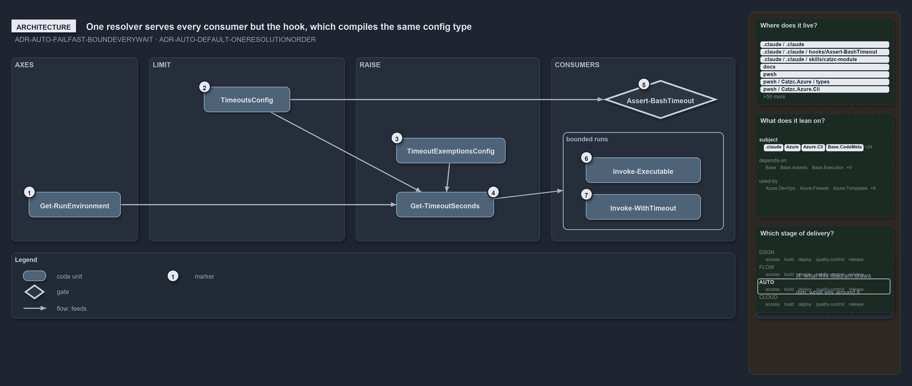

---
catzc:
  warning: "Header is generated by Format-FileMeta via Format-Code; do not change it"
  edges:
    cites:
      - ADR-AUTO-DEFAULT-ONERESOLUTIONORDER
      - ADR-AUTO-FAILFAST-BOUNDEVERYWAIT
    drs_total: 2
---

# One resolver serves every consumer but the hook, which compiles the same config type

```text
One resolver, Get-TimeoutSeconds, serves every consumer of the time safeguard but the hook, which compiles the same config type.

1  Get-RunEnvironment       the environment axis: Devbox or Pipeline, read from the session
2  TimeoutsConfig           the type that maps timeouts.yml and declares every default
3  TimeoutExemptionsConfig  the type that maps timeout-exemptions.yml and declares the ceilings
4  Get-TimeoutSeconds       the resolver: environment, config, then exemption, one answer
5  Assert-BashTimeout       the hook that bounds an agent's Bash calls; it compiles TimeoutsConfig itself
6  Invoke-Executable        a native tool's run, bounded by its executable's limit
7  Invoke-WithTimeout       a script block's run, bounded by the pwsh limit or a budget's ceiling

Supports ADR-AUTO-FAILFAST-BOUNDEVERYWAIT and ADR-AUTO-DEFAULT-ONERESOLUTIONORDER (architecture lens).
```

The time safeguard of cats has one resolver. `Get-TimeoutSeconds` reads the run environment, the limits config and the exemptions, and hands
every consumer in pwsh its limit, so tuning a limit is one edit to one file. The one consumer that does not call it is the Bash hook, a
compiled program that runs before every shell call a coding agent makes; it compiles the resolver's own config type into itself, so the hook
and the pwsh side share one parser and one set of defaults without sharing a process.

```yml drawio
description:
  One resolver combines the run environment, the typed timeouts config and the exemptions config into one limit for every consumer except
  the hook, which compiles the same config type itself.
about:
  adrs: [ADR-AUTO-FAILFAST-BOUNDEVERYWAIT, ADR-AUTO-DEFAULT-ONERESOLUTIONORDER]
  lens: architecture
content:
  title: One resolver serves every consumer but the hook, which compiles the same config type
  kind: explanation
  flow: left-to-right
  relation: feeds
  theme: dark
  bands:
    - { id: band-axes, label: AXES }
    - { id: band-limit, label: LIMIT }
    - { id: band-raise, label: RAISE }
    - { id: band-consumers, label: CONSUMERS }
  groups:
    - { id: grp-consumers, label: bounded runs, in: band-consumers }
  glyphs:
    - { id: g-environment, kind: code, label: Get-RunEnvironment, in: band-axes }
    - { id: g-config, kind: code, label: TimeoutsConfig, in: band-limit }
    - { id: g-exemptions, kind: code, label: TimeoutExemptionsConfig, in: band-raise }
    - { id: g-seconds, kind: code, label: Get-TimeoutSeconds, in: band-raise }
    - { id: g-hook, kind: gate, label: Assert-BashTimeout, in: band-consumers }
    - { id: g-executable, kind: code, label: Invoke-Executable, in: grp-consumers }
    - { id: g-with-timeout, kind: code, label: Invoke-WithTimeout, in: grp-consumers }
  edges:
    - { from: g-environment, to: g-seconds, kind: flow, label: "" }
    - { from: g-config, to: g-seconds, kind: flow, label: "" }
    - { from: g-config, to: g-hook, kind: flow, label: "" }
    - { from: g-exemptions, to: g-seconds, kind: flow, label: "" }
    - { from: g-seconds, to: grp-consumers, kind: flow, label: "" }
  markers:
    - { at: g-environment, number: 1 }
    - { at: g-config, number: 2 }
    - { at: g-exemptions, number: 3 }
    - { at: g-seconds, number: 4 }
    - { at: g-hook, number: 5 }
    - { at: g-executable, number: 6 }
    - { at: g-with-timeout, number: 7 }
  legend: auto
  minimaps:
    code-locations:
      - cell: .claude/.claude/.
        by: [.claude/CLAUDE.md, ADR-AUTO-DEFAULT-ONERESOLUTIONORDER, ADR-AUTO-FAILFAST-BOUNDEVERYWAIT]
      - cell: .claude/.claude/hooks/Assert-BashTimeout
        by: [.claude/hooks/Assert-BashTimeout/Program.cs, ADR-AUTO-DEFAULT-ONERESOLUTIONORDER, ADR-AUTO-FAILFAST-BOUNDEVERYWAIT]
      - cell: .claude/.claude/skills/catzc-module
        by: [.claude/skills/catzc-module/SKILL.md, ADR-AUTO-DEFAULT-ONERESOLUTIONORDER]
      - cell: docs/-/.
        by:
          - docs/drs/automation/dora-explains.md
          - docs/drs/automation/fail-fast-with-asserts.md
          - docs/drs/automation/sensible-defaults.md
          - docs/drs/glossary.md
          - docs/drs/index.md
          - docs/how-to/pwsh/manual-test-plan/configs.md
          - docs/how-to/pwsh/manual-test-plan/repository-conventions.md
          - docs/references/pwsh/catzc-azure-cli/Assert-AzCliSubscriptionAccessible.ps1.md
          - docs/references/pwsh/catzc-azure/types/AzureConfig.cs.md
          - docs/references/pwsh/catzc-base-contracts/configs/contracts.yml.md
          - docs/references/pwsh/catzc-base-contracts/tests/types/ContractsConfig.Tests.ps1.md
          - docs/references/pwsh/catzc-base-contracts/types/ContractsConfig.cs.md
          - docs/references/pwsh/catzc-base-docs/Test-Glossary.ps1.md
          - docs/references/pwsh/catzc-base-docs/tests/Test-Glossary.Tests.ps1.md
          - docs/references/pwsh/catzc-base-drs/configs/drs-checks.yml.md
          - docs/references/pwsh/catzc-base-drs/private/Import-DrsCitationMapFile.ps1.md
          - docs/references/pwsh/catzc-base-drs/types/DrsChecksConfig.cs.md
          - docs/references/pwsh/catzc-base-drs/types/DrsConfig.cs.md
          - docs/references/pwsh/catzc-base-engines/types/ExecutionEngine.cs.md
          - docs/references/pwsh/catzc-base-folders/tests/types/FolderWalkConfig.Tests.ps1.md
          - docs/references/pwsh/catzc-base-git/Import-RepositoryWithHistory.ps1.md
          - docs/references/pwsh/catzc-base-globs/Test-GlobSetAffected.ps1.md
          - docs/references/pwsh/catzc-base-languages.md
          - docs/references/pwsh/catzc-base-languages/configs/file-carriers.yml.md
          - docs/references/pwsh/catzc-base-languages/configs/go.yml.md
          - docs/references/pwsh/catzc-base-languages/configs/languages.yml.md
          - docs/references/pwsh/catzc-base-languages/configs/python.yml.md
          - docs/references/pwsh/catzc-base-languages/types/FileCarrier.cs.md
          - docs/references/pwsh/catzc-base-languages/types/FileCarriersConfig.cs.md
          - docs/references/pwsh/catzc-base-languages/types/GoConfig.cs.md
          - docs/references/pwsh/catzc-base-languages/types/LanguagesConfig.cs.md
          - docs/references/pwsh/catzc-base-maps/configs/maps.yml.md
          - docs/references/pwsh/catzc-base-maps/types/MapsConfig.cs.md
          - docs/references/pwsh/catzc-base-maps/types/MapsHighlight.cs.md
          - docs/references/pwsh/catzc-base-maps/types/MapsLabels.cs.md
          - docs/references/pwsh/catzc-base-maps/types/MapsLimits.cs.md
          - docs/references/pwsh/catzc-base-maps/types/MapsPalette.cs.md
          - docs/references/pwsh/catzc-base-quality-gates/Test-ShippedConfigs.ps1.md
          - docs/references/pwsh/catzc-base-quality-gates/configs/comments.yml.md
          - docs/references/pwsh/catzc-base-quality-gates/configs/file-meta.yml.md
          - docs/references/pwsh/catzc-base-quality-gates/configs/links.yml.md
          - docs/references/pwsh/catzc-base-quality-gates/configs/parameter-consistency.yml.md
          - docs/references/pwsh/catzc-base-quality-gates/configs/source-conventions.yml.md
          - docs/references/pwsh/catzc-base-quality-gates/configs/test-policy.yml.md
          - docs/references/pwsh/catzc-base-quality-gates/private/Get-LinkLineLimit.ps1.md
          - docs/references/pwsh/catzc-base-quality-gates/private/Test-TestRunOverBudget.ps1.md
          - docs/references/pwsh/catzc-base-quality-gates/private/Write-TestAutomationVerdict.ps1.md
          - docs/references/pwsh/catzc-base-quality-gates/tests/types/CommentsConfig.Tests.ps1.md
          - docs/references/pwsh/catzc-base-quality-gates/tests/types/FileMetaConfig.Tests.ps1.md
          - docs/references/pwsh/catzc-base-quality-gates/tests/types/LinksConfig.Tests.ps1.md
          - docs/references/pwsh/catzc-base-quality-gates/tests/types/SourceCheck.Tests.ps1.md
          - docs/references/pwsh/catzc-base-quality-gates/tests/types/SourceConventionsConfig.Tests.ps1.md
          - docs/references/pwsh/catzc-base-quality-gates/types/CommentsConfig.cs.md
          - docs/references/pwsh/catzc-base-quality-gates/types/EngineSetCheck.cs.md
          - docs/references/pwsh/catzc-base-quality-gates/types/FileMetaKind.cs.md
          - docs/references/pwsh/catzc-base-quality-gates/types/GeneratedWriter.cs.md
          - docs/references/pwsh/catzc-base-quality-gates/types/LinksConfig.cs.md
          - docs/references/pwsh/catzc-base-quality-gates/types/ParameterConsistencyConfig.cs.md
          - docs/references/pwsh/catzc-base-quality-gates/types/SourceCheck.cs.md
          - docs/references/pwsh/catzc-base-quality-gates/types/SourceConventionsConfig.cs.md
          - docs/references/pwsh/catzc-base-quality-gates/types/TestPolicyConfig.cs.md
          - docs/references/pwsh/catzc-base-reports/types/CheckMode.cs.md
          - docs/references/pwsh/catzc-base-reports/types/CheckModes.cs.md
          - docs/references/pwsh/catzc-base-timeouts/Get-TestTimeLimits.ps1.md
          - docs/references/pwsh/catzc-base-timeouts/Watch-Blocking.ps1.md
          - docs/references/pwsh/catzc-base-timeouts/types/BashSafeguard.cs.md
          - docs/references/pwsh/catzc-base-timeouts/types/TimeoutExemptionsConfig.cs.md
          - docs/references/pwsh/catzc-base-timeouts/types/TimeoutsConfig.cs.md
          - docs/references/pwsh/catzc-base-types-system.md
          - docs/references/pwsh/catzc-base-types-system/Build-AgentHook.ps1.md
          - docs/references/pwsh/catzc-base-variants/private/Get-Variant.ps1.md
          - docs/references/pwsh/catzc-base-variants/types/VariantsConfig.cs.md
          - docs/references/pwsh/catzc-tooling-inspiration/Get-Inspiration.ps1.md
          - docs/references/pwsh/catzc-tooling-inspiration/configs/inspiration.yml.md
          - docs/references/pwsh/catzc-tooling-inspiration/tests/types/InspirationConfig.Tests.ps1.md
          - docs/references/pwsh/catzc-tooling-inspiration/types/InspirationConfig.cs.md
          - docs/references/pwsh/catzc-tooling-listen/Wait-DocChange.ps1.md
          - docs/references/pwsh/catzc-tooling-listen/Wait-DocNote.ps1.md
          - docs/references/pwsh/claude-hooks/Assert-BashTimeout/Program.cs.md
          - ADR-AUTO-DEFAULT-ONERESOLUTIONORDER
          - ADR-AUTO-FAILFAST-BOUNDEVERYWAIT
      - cell: pwsh/-/.
        by: [pwsh/.scriptanalyzer/tests/NoLiteralDefault.Tests.ps1, ADR-AUTO-DEFAULT-ONERESOLUTIONORDER]
      - cell: pwsh/Catzc.Azure/types
        by: [pwsh/Catzc.Azure/types/AzureConfig.cs, ADR-AUTO-DEFAULT-ONERESOLUTIONORDER]
      - cell: pwsh/Catzc.Azure.Cli/.
        by: [pwsh/Catzc.Azure.Cli/Assert-AzCliSubscriptionAccessible.ps1, ADR-AUTO-FAILFAST-BOUNDEVERYWAIT]
      - cell: pwsh/Catzc.Base.CodeMeta/tests/types
        by: [pwsh/Catzc.Base.CodeMeta/tests/types/CommentPagesConfig.Tests.ps1, ADR-AUTO-DEFAULT-ONERESOLUTIONORDER]
      - cell: pwsh/Catzc.Base.Config/configs
        by: [pwsh/Catzc.Base.Config/configs/glossary.yml, ADR-AUTO-DEFAULT-ONERESOLUTIONORDER]
      - cell: pwsh/Catzc.Base.Config/tests
        by: [pwsh/Catzc.Base.Config/tests/Get-Config.Tests.ps1, ADR-AUTO-DEFAULT-ONERESOLUTIONORDER]
      - cell: pwsh/Catzc.Base.Config/types
        by: [pwsh/Catzc.Base.Config/types/ConfigDefaultDifference.cs, ADR-AUTO-DEFAULT-ONERESOLUTIONORDER]
      - cell: pwsh/Catzc.Base.Contracts/configs
        by: [pwsh/Catzc.Base.Contracts/configs/contracts.yml, ADR-AUTO-DEFAULT-ONERESOLUTIONORDER]
      - cell: pwsh/Catzc.Base.Contracts/tests
        by: [pwsh/Catzc.Base.Contracts/tests/Get-Contract.Tests.ps1, ADR-AUTO-DEFAULT-ONERESOLUTIONORDER]
      - cell: pwsh/Catzc.Base.Contracts/tests/types
        by:
          - pwsh/Catzc.Base.Contracts/tests/types/AccostedConfig.Tests.ps1
          - pwsh/Catzc.Base.Contracts/tests/types/ContractCommand.Tests.ps1
          - pwsh/Catzc.Base.Contracts/tests/types/ContractsConfig.Tests.ps1
          - ADR-AUTO-DEFAULT-ONERESOLUTIONORDER
      - cell: pwsh/Catzc.Base.Contracts/types
        by:
          - pwsh/Catzc.Base.Contracts/types/ContractCommand.cs
          - pwsh/Catzc.Base.Contracts/types/ContractParameter.cs
          - pwsh/Catzc.Base.Contracts/types/ContractsConfig.cs
          - ADR-AUTO-DEFAULT-ONERESOLUTIONORDER
      - cell: pwsh/Catzc.Base.Docs/.
        by: [pwsh/Catzc.Base.Docs/Test-Glossary.ps1, ADR-AUTO-FAILFAST-BOUNDEVERYWAIT]
      - cell: pwsh/Catzc.Base.Docs/configs
        by:
          - pwsh/Catzc.Base.Docs/configs/agents.yml
          - pwsh/Catzc.Base.Docs/configs/capabilities.yml
          - ADR-AUTO-DEFAULT-ONERESOLUTIONORDER
          - ADR-AUTO-FAILFAST-BOUNDEVERYWAIT
      - cell: pwsh/Catzc.Base.Docs/tests
        by: [pwsh/Catzc.Base.Docs/tests/Test-Glossary.Tests.ps1, ADR-AUTO-FAILFAST-BOUNDEVERYWAIT]
      - cell: pwsh/Catzc.Base.Docs/tests/types
        by: [pwsh/Catzc.Base.Docs/tests/types/LearningsConfig.Tests.ps1, ADR-AUTO-DEFAULT-ONERESOLUTIONORDER]
      - cell: pwsh/Catzc.Base.Drs/configs
        by:
          - pwsh/Catzc.Base.Drs/configs/drs-checks.yml
          - pwsh/Catzc.Base.Drs/configs/drs.yml
          - ADR-AUTO-DEFAULT-ONERESOLUTIONORDER
          - ADR-AUTO-FAILFAST-BOUNDEVERYWAIT
      - cell: pwsh/Catzc.Base.Drs/private
        by: [pwsh/Catzc.Base.Drs/private/Import-DrsCitationMapFile.ps1, ADR-AUTO-FAILFAST-BOUNDEVERYWAIT]
      - cell: pwsh/Catzc.Base.Drs/tests/types
        by: [pwsh/Catzc.Base.Drs/tests/types/DrsChecksConfig.Tests.ps1, ADR-AUTO-DEFAULT-ONERESOLUTIONORDER]
      - cell: pwsh/Catzc.Base.Drs/types
        by: [pwsh/Catzc.Base.Drs/types/DrsChecksConfig.cs, pwsh/Catzc.Base.Drs/types/DrsConfig.cs, ADR-AUTO-DEFAULT-ONERESOLUTIONORDER]
      - cell: pwsh/Catzc.Base.Engines/types
        by: [pwsh/Catzc.Base.Engines/types/ExecutionEngine.cs, ADR-AUTO-FAILFAST-BOUNDEVERYWAIT]
      - cell: pwsh/Catzc.Base.Flow/tests/types
        by: [pwsh/Catzc.Base.Flow/tests/types/RungsConfig.Tests.ps1, ADR-AUTO-DEFAULT-ONERESOLUTIONORDER]
      - cell: pwsh/Catzc.Base.Folders/tests
        by: [pwsh/Catzc.Base.Folders/tests/Get-ChildPath.Tests.ps1, ADR-AUTO-DEFAULT-ONERESOLUTIONORDER]
      - cell: pwsh/Catzc.Base.Folders/tests/types
        by:
          - pwsh/Catzc.Base.Folders/tests/types/FolderWalkConfig.Tests.ps1
          - pwsh/Catzc.Base.Folders/tests/types/FolderWalker.Tests.ps1
          - ADR-AUTO-DEFAULT-ONERESOLUTIONORDER
      - cell: pwsh/Catzc.Base.Git/.
        by: [pwsh/Catzc.Base.Git/Import-RepositoryWithHistory.ps1, ADR-AUTO-DEFAULT-ONERESOLUTIONORDER]
      - cell: pwsh/Catzc.Base.Globs/.
        by: [pwsh/Catzc.Base.Globs/Test-GlobSetAffected.ps1, ADR-AUTO-FAILFAST-BOUNDEVERYWAIT]
      - cell: pwsh/Catzc.Base.Languages/configs
        by:
          - pwsh/Catzc.Base.Languages/configs/file-carriers.yml
          - pwsh/Catzc.Base.Languages/configs/go.yml
          - pwsh/Catzc.Base.Languages/configs/languages.yml
          - pwsh/Catzc.Base.Languages/configs/python.yml
          - ADR-AUTO-DEFAULT-ONERESOLUTIONORDER
      - cell: pwsh/Catzc.Base.Languages/tests
        by: [pwsh/Catzc.Base.Languages/tests/Get-EngineContract.Tests.ps1, ADR-AUTO-FAILFAST-BOUNDEVERYWAIT]
      - cell: pwsh/Catzc.Base.Languages/tests/types
        by:
          - pwsh/Catzc.Base.Languages/tests/types/FileCarriersConfig.Tests.ps1
          - pwsh/Catzc.Base.Languages/tests/types/LanguagesConfig.Tests.ps1
          - ADR-AUTO-DEFAULT-ONERESOLUTIONORDER
      - cell: pwsh/Catzc.Base.Languages/types
        by:
          - pwsh/Catzc.Base.Languages/types/FileCarrier.cs
          - pwsh/Catzc.Base.Languages/types/FileCarriersConfig.cs
          - pwsh/Catzc.Base.Languages/types/GoConfig.cs
          - pwsh/Catzc.Base.Languages/types/LanguagesConfig.cs
          - pwsh/Catzc.Base.Languages/types/LayoutRow.cs
          - ADR-AUTO-DEFAULT-ONERESOLUTIONORDER
      - cell: pwsh/Catzc.Base.Maps/configs
        by: [pwsh/Catzc.Base.Maps/configs/maps.yml, ADR-AUTO-DEFAULT-ONERESOLUTIONORDER]
      - cell: pwsh/Catzc.Base.Maps/tests/types
        by: [pwsh/Catzc.Base.Maps/tests/types/MapsConfig.Tests.ps1, ADR-AUTO-DEFAULT-ONERESOLUTIONORDER]
      - cell: pwsh/Catzc.Base.Maps/types
        by:
          - pwsh/Catzc.Base.Maps/types/MapsConfig.cs
          - pwsh/Catzc.Base.Maps/types/MapsHighlight.cs
          - pwsh/Catzc.Base.Maps/types/MapsLabels.cs
          - pwsh/Catzc.Base.Maps/types/MapsLimits.cs
          - pwsh/Catzc.Base.Maps/types/MapsPalette.cs
          - ADR-AUTO-DEFAULT-ONERESOLUTIONORDER
      - cell: pwsh/Catzc.Base.ModuleSystem/tests
        by:
          - pwsh/Catzc.Base.ModuleSystem/tests/Resolve-ImportMix.Tests.ps1
          - pwsh/Catzc.Base.ModuleSystem/tests/Set-ImportMix.Tests.ps1
          - ADR-AUTO-DEFAULT-ONERESOLUTIONORDER
      - cell: pwsh/Catzc.Base.ModuleSystem/tests/types
        by:
          - pwsh/Catzc.Base.ModuleSystem/tests/types/ImportMix.Tests.ps1
          - pwsh/Catzc.Base.ModuleSystem/tests/types/ImporterConfig.Tests.ps1
          - ADR-AUTO-DEFAULT-ONERESOLUTIONORDER
      - cell: pwsh/Catzc.Base.QualityGates/.
        by: [pwsh/Catzc.Base.QualityGates/Test-ShippedConfigs.ps1, ADR-AUTO-DEFAULT-ONERESOLUTIONORDER]
      - cell: pwsh/Catzc.Base.QualityGates/configs
        by:
          - pwsh/Catzc.Base.QualityGates/configs/analyzer-drs-map.yml
          - pwsh/Catzc.Base.QualityGates/configs/comments.yml
          - pwsh/Catzc.Base.QualityGates/configs/file-meta.yml
          - pwsh/Catzc.Base.QualityGates/configs/links.yml
          - pwsh/Catzc.Base.QualityGates/configs/parameter-consistency.yml
          - pwsh/Catzc.Base.QualityGates/configs/source-conventions.yml
          - pwsh/Catzc.Base.QualityGates/configs/test-policy.yml
          - ADR-AUTO-DEFAULT-ONERESOLUTIONORDER
      - cell: pwsh/Catzc.Base.QualityGates/private
        by:
          - pwsh/Catzc.Base.QualityGates/private/Get-LinkLineLimit.ps1
          - pwsh/Catzc.Base.QualityGates/private/Test-TestRunOverBudget.ps1
          - pwsh/Catzc.Base.QualityGates/private/Write-TestAutomationVerdict.ps1
          - ADR-AUTO-DEFAULT-ONERESOLUTIONORDER
          - ADR-AUTO-FAILFAST-BOUNDEVERYWAIT
      - cell: pwsh/Catzc.Base.QualityGates/tests
        by:
          - pwsh/Catzc.Base.QualityGates/tests/Get-DrsCodesFileMetaFact.Tests.ps1
          - pwsh/Catzc.Base.QualityGates/tests/Test-ShippedConfigs.Tests.ps1
          - ADR-AUTO-DEFAULT-ONERESOLUTIONORDER
      - cell: pwsh/Catzc.Base.QualityGates/tests/types
        by:
          - pwsh/Catzc.Base.QualityGates/tests/types/CommentsConfig.Tests.ps1
          - pwsh/Catzc.Base.QualityGates/tests/types/EngineSetCheck.Tests.ps1
          - pwsh/Catzc.Base.QualityGates/tests/types/FileHeadPolicy.Tests.ps1
          - pwsh/Catzc.Base.QualityGates/tests/types/FileMetaConfig.Tests.ps1
          - pwsh/Catzc.Base.QualityGates/tests/types/LinksConfig.Tests.ps1
          - pwsh/Catzc.Base.QualityGates/tests/types/PlansConfig.Tests.ps1
          - pwsh/Catzc.Base.QualityGates/tests/types/SourceCheck.Tests.ps1
          - pwsh/Catzc.Base.QualityGates/tests/types/SourceConventionsConfig.Tests.ps1
          - ADR-AUTO-DEFAULT-ONERESOLUTIONORDER
      - cell: pwsh/Catzc.Base.QualityGates/types
        by:
          - pwsh/Catzc.Base.QualityGates/types/CommentsConfig.cs
          - pwsh/Catzc.Base.QualityGates/types/EngineSetCheck.cs
          - pwsh/Catzc.Base.QualityGates/types/FileMetaKind.cs
          - pwsh/Catzc.Base.QualityGates/types/GeneratedWriter.cs
          - pwsh/Catzc.Base.QualityGates/types/LinksConfig.cs
          - pwsh/Catzc.Base.QualityGates/types/ParameterConsistencyConfig.cs
          - pwsh/Catzc.Base.QualityGates/types/PlansConfig.cs
          - pwsh/Catzc.Base.QualityGates/types/SourceCheck.cs
          - pwsh/Catzc.Base.QualityGates/types/SourceConventionsConfig.cs
          - pwsh/Catzc.Base.QualityGates/types/TestPolicyConfig.cs
          - ADR-AUTO-DEFAULT-ONERESOLUTIONORDER
      - cell: pwsh/Catzc.Base.Reports/tests/types
        by:
          - pwsh/Catzc.Base.Reports/tests/types/CheckModes.Tests.ps1
          - pwsh/Catzc.Base.Reports/tests/types/IsolationRunResult.Tests.ps1
          - pwsh/Catzc.Base.Reports/tests/types/OutputFormatsConfig.Tests.ps1
          - pwsh/Catzc.Base.Reports/tests/types/QualityGateResult.Tests.ps1
          - pwsh/Catzc.Base.Reports/tests/types/TestRunResult.Tests.ps1
          - ADR-AUTO-DEFAULT-ONERESOLUTIONORDER
      - cell: pwsh/Catzc.Base.Reports/types
        by:
          - pwsh/Catzc.Base.Reports/types/CheckMode.cs
          - pwsh/Catzc.Base.Reports/types/CheckModes.cs
          - pwsh/Catzc.Base.Reports/types/IsolationRunResult.cs
          - pwsh/Catzc.Base.Reports/types/QualityGateResult.cs
          - pwsh/Catzc.Base.Reports/types/TestRunResult.cs
          - ADR-AUTO-DEFAULT-ONERESOLUTIONORDER
      - cell: pwsh/Catzc.Base.Slides/tests/types
        by:
          - pwsh/Catzc.Base.Slides/tests/types/SlidesConfig.Tests.ps1
          - pwsh/Catzc.Base.Slides/tests/types/SlidesKit.Tests.ps1
          - ADR-AUTO-DEFAULT-ONERESOLUTIONORDER
      - cell: pwsh/Catzc.Base.Timeouts/.
        by: [pwsh/Catzc.Base.Timeouts/Get-TestTimeLimits.ps1, pwsh/Catzc.Base.Timeouts/Watch-Blocking.ps1, ADR-AUTO-FAILFAST-BOUNDEVERYWAIT]
      - cell: pwsh/Catzc.Base.Timeouts/tests/types
        by:
          - pwsh/Catzc.Base.Timeouts/tests/types/TimeoutsConfig.Tests.ps1
          - ADR-AUTO-DEFAULT-ONERESOLUTIONORDER
          - ADR-AUTO-FAILFAST-BOUNDEVERYWAIT
      - cell: pwsh/Catzc.Base.Timeouts/types
        by:
          - pwsh/Catzc.Base.Timeouts/types/BashSafeguard.cs
          - pwsh/Catzc.Base.Timeouts/types/TimeoutExemptionsConfig.cs
          - pwsh/Catzc.Base.Timeouts/types/TimeoutsConfig.cs
          - ADR-AUTO-DEFAULT-ONERESOLUTIONORDER
          - ADR-AUTO-FAILFAST-BOUNDEVERYWAIT
      - cell: pwsh/Catzc.Base.TypesSystem/.
        by: [pwsh/Catzc.Base.TypesSystem/Build-AgentHook.ps1, ADR-AUTO-FAILFAST-BOUNDEVERYWAIT]
      - cell: pwsh/Catzc.Base.Variants/private
        by: [pwsh/Catzc.Base.Variants/private/Get-Variant.ps1, ADR-AUTO-DEFAULT-ONERESOLUTIONORDER]
      - cell: pwsh/Catzc.Base.Variants/tests
        by: [pwsh/Catzc.Base.Variants/tests/Get-Track.Tests.ps1, ADR-AUTO-DEFAULT-ONERESOLUTIONORDER]
      - cell: pwsh/Catzc.Base.Variants/tests/types
        by: [pwsh/Catzc.Base.Variants/tests/types/VariantsConfig.Tests.ps1, ADR-AUTO-DEFAULT-ONERESOLUTIONORDER]
      - cell: pwsh/Catzc.Base.Variants/types
        by: [pwsh/Catzc.Base.Variants/types/VariantsConfig.cs, ADR-AUTO-DEFAULT-ONERESOLUTIONORDER]
      - cell: pwsh/Catzc.Base.VSCode/types
        by: [pwsh/Catzc.Base.VSCode/types/VscodeOwnExtension.cs, ADR-AUTO-DEFAULT-ONERESOLUTIONORDER]
      - cell: pwsh/Catzc.Internal.Assets/.
        by: [pwsh/.internal/assets/Enter-CatzcBurst.ps1, pwsh/.internal/assets/Invoke-CatzcCommand.ps1, ADR-AUTO-FAILFAST-BOUNDEVERYWAIT]
      - cell: pwsh/Catzc.Internal.Tests/.
        by:
          - pwsh/.internal/tests/Enter-CatzcBurst.Tests.ps1
          - pwsh/.internal/tests/Invoke-CatzcCommand.Tests.ps1
          - pwsh/.internal/tests/Wait-CatzcRunLock.Tests.ps1
          - ADR-AUTO-FAILFAST-BOUNDEVERYWAIT
      - cell: pwsh/Catzc.Tooling.Claude/tests/types
        by: [pwsh/Catzc.Tooling.Claude/tests/types/ClaudeDroneConfig.Tests.ps1, ADR-AUTO-DEFAULT-ONERESOLUTIONORDER]
      - cell: pwsh/Catzc.Tooling.Inspiration/.
        by: [pwsh/Catzc.Tooling.Inspiration/Get-Inspiration.ps1, ADR-AUTO-DEFAULT-ONERESOLUTIONORDER]
      - cell: pwsh/Catzc.Tooling.Inspiration/configs
        by: [pwsh/Catzc.Tooling.Inspiration/configs/inspiration.yml, ADR-AUTO-DEFAULT-ONERESOLUTIONORDER]
      - cell: pwsh/Catzc.Tooling.Inspiration/tests/types
        by: [pwsh/Catzc.Tooling.Inspiration/tests/types/InspirationConfig.Tests.ps1, ADR-AUTO-DEFAULT-ONERESOLUTIONORDER]
      - cell: pwsh/Catzc.Tooling.Inspiration/types
        by: [pwsh/Catzc.Tooling.Inspiration/types/InspirationConfig.cs, ADR-AUTO-DEFAULT-ONERESOLUTIONORDER]
      - cell: pwsh/Catzc.Tooling.Listen/.
        by: [pwsh/Catzc.Tooling.Listen/Wait-DocChange.ps1, pwsh/Catzc.Tooling.Listen/Wait-DocNote.ps1, ADR-AUTO-FAILFAST-BOUNDEVERYWAIT]
      - cell: pwsh/Catzc.Tooling.Listen/tests
        by:
          - pwsh/Catzc.Tooling.Listen/tests/Wait-DocChange.Tests.ps1
          - pwsh/Catzc.Tooling.Listen/tests/Wait-DocNote.Tests.ps1
          - ADR-AUTO-FAILFAST-BOUNDEVERYWAIT
      - cell: pwsh/Catzc.Tooling.Listen/tests/types
        by: [pwsh/Catzc.Tooling.Listen/tests/types/ListenConfig.Tests.ps1, ADR-AUTO-DEFAULT-ONERESOLUTIONORDER]
    module-neighbourhood:
      - cell: subject/.claude
        by:
          - .claude/CLAUDE.md
          - .claude/hooks/Assert-BashTimeout/Program.cs
          - .claude/skills/catzc-module/SKILL.md
          - ADR-AUTO-DEFAULT-ONERESOLUTIONORDER
          - ADR-AUTO-FAILFAST-BOUNDEVERYWAIT
      - cell: subject/Catzc.Azure
        by: [pwsh/Catzc.Azure/types/AzureConfig.cs, ADR-AUTO-DEFAULT-ONERESOLUTIONORDER]
      - cell: subject/Catzc.Azure.Cli
        by: [pwsh/Catzc.Azure.Cli/Assert-AzCliSubscriptionAccessible.ps1, ADR-AUTO-FAILFAST-BOUNDEVERYWAIT]
      - cell: subject/Catzc.Base.CodeMeta
        by: [pwsh/Catzc.Base.CodeMeta/tests/types/CommentPagesConfig.Tests.ps1, ADR-AUTO-DEFAULT-ONERESOLUTIONORDER]
      - cell: subject/Catzc.Base.Config
        by:
          - pwsh/Catzc.Base.Config/configs/glossary.yml
          - pwsh/Catzc.Base.Config/tests/Get-Config.Tests.ps1
          - pwsh/Catzc.Base.Config/types/ConfigDefaultDifference.cs
          - ADR-AUTO-DEFAULT-ONERESOLUTIONORDER
      - cell: subject/Catzc.Base.Contracts
        by:
          - pwsh/Catzc.Base.Contracts/configs/contracts.yml
          - pwsh/Catzc.Base.Contracts/tests/Get-Contract.Tests.ps1
          - pwsh/Catzc.Base.Contracts/tests/types/AccostedConfig.Tests.ps1
          - pwsh/Catzc.Base.Contracts/tests/types/ContractCommand.Tests.ps1
          - pwsh/Catzc.Base.Contracts/tests/types/ContractsConfig.Tests.ps1
          - pwsh/Catzc.Base.Contracts/types/ContractCommand.cs
          - pwsh/Catzc.Base.Contracts/types/ContractParameter.cs
          - pwsh/Catzc.Base.Contracts/types/ContractsConfig.cs
          - ADR-AUTO-DEFAULT-ONERESOLUTIONORDER
      - cell: subject/Catzc.Base.Docs
        by:
          - pwsh/Catzc.Base.Docs/Test-Glossary.ps1
          - pwsh/Catzc.Base.Docs/configs/agents.yml
          - pwsh/Catzc.Base.Docs/configs/capabilities.yml
          - pwsh/Catzc.Base.Docs/tests/Test-Glossary.Tests.ps1
          - pwsh/Catzc.Base.Docs/tests/types/LearningsConfig.Tests.ps1
          - ADR-AUTO-DEFAULT-ONERESOLUTIONORDER
          - ADR-AUTO-FAILFAST-BOUNDEVERYWAIT
      - cell: subject/Catzc.Base.Drs
        by:
          - pwsh/Catzc.Base.Drs/configs/drs-checks.yml
          - pwsh/Catzc.Base.Drs/configs/drs.yml
          - pwsh/Catzc.Base.Drs/private/Import-DrsCitationMapFile.ps1
          - pwsh/Catzc.Base.Drs/tests/types/DrsChecksConfig.Tests.ps1
          - pwsh/Catzc.Base.Drs/types/DrsChecksConfig.cs
          - pwsh/Catzc.Base.Drs/types/DrsConfig.cs
          - ADR-AUTO-DEFAULT-ONERESOLUTIONORDER
          - ADR-AUTO-FAILFAST-BOUNDEVERYWAIT
      - cell: subject/Catzc.Base.Engines
        by: [pwsh/Catzc.Base.Engines/types/ExecutionEngine.cs, ADR-AUTO-FAILFAST-BOUNDEVERYWAIT]
      - cell: subject/Catzc.Base.Flow
        by: [pwsh/Catzc.Base.Flow/tests/types/RungsConfig.Tests.ps1, ADR-AUTO-DEFAULT-ONERESOLUTIONORDER]
      - cell: subject/Catzc.Base.Folders
        by:
          - pwsh/Catzc.Base.Folders/tests/Get-ChildPath.Tests.ps1
          - pwsh/Catzc.Base.Folders/tests/types/FolderWalkConfig.Tests.ps1
          - pwsh/Catzc.Base.Folders/tests/types/FolderWalker.Tests.ps1
          - ADR-AUTO-DEFAULT-ONERESOLUTIONORDER
      - cell: subject/Catzc.Base.Git
        by: [pwsh/Catzc.Base.Git/Import-RepositoryWithHistory.ps1, ADR-AUTO-DEFAULT-ONERESOLUTIONORDER]
      - cell: subject/Catzc.Base.Globs
        by: [pwsh/Catzc.Base.Globs/Test-GlobSetAffected.ps1, ADR-AUTO-FAILFAST-BOUNDEVERYWAIT]
      - cell: subject/Catzc.Base.Languages
        by:
          - pwsh/Catzc.Base.Languages/configs/file-carriers.yml
          - pwsh/Catzc.Base.Languages/configs/go.yml
          - pwsh/Catzc.Base.Languages/configs/languages.yml
          - pwsh/Catzc.Base.Languages/configs/python.yml
          - pwsh/Catzc.Base.Languages/tests/Get-EngineContract.Tests.ps1
          - pwsh/Catzc.Base.Languages/tests/types/FileCarriersConfig.Tests.ps1
          - pwsh/Catzc.Base.Languages/tests/types/LanguagesConfig.Tests.ps1
          - pwsh/Catzc.Base.Languages/types/FileCarrier.cs
          - pwsh/Catzc.Base.Languages/types/FileCarriersConfig.cs
          - pwsh/Catzc.Base.Languages/types/GoConfig.cs
          - pwsh/Catzc.Base.Languages/types/LanguagesConfig.cs
          - pwsh/Catzc.Base.Languages/types/LayoutRow.cs
          - ADR-AUTO-DEFAULT-ONERESOLUTIONORDER
          - ADR-AUTO-FAILFAST-BOUNDEVERYWAIT
      - cell: subject/Catzc.Base.Maps
        by:
          - pwsh/Catzc.Base.Maps/configs/maps.yml
          - pwsh/Catzc.Base.Maps/tests/types/MapsConfig.Tests.ps1
          - pwsh/Catzc.Base.Maps/types/MapsConfig.cs
          - pwsh/Catzc.Base.Maps/types/MapsHighlight.cs
          - pwsh/Catzc.Base.Maps/types/MapsLabels.cs
          - pwsh/Catzc.Base.Maps/types/MapsLimits.cs
          - pwsh/Catzc.Base.Maps/types/MapsPalette.cs
          - ADR-AUTO-DEFAULT-ONERESOLUTIONORDER
      - cell: subject/Catzc.Base.ModuleSystem
        by:
          - pwsh/Catzc.Base.ModuleSystem/tests/Resolve-ImportMix.Tests.ps1
          - pwsh/Catzc.Base.ModuleSystem/tests/Set-ImportMix.Tests.ps1
          - pwsh/Catzc.Base.ModuleSystem/tests/types/ImportMix.Tests.ps1
          - pwsh/Catzc.Base.ModuleSystem/tests/types/ImporterConfig.Tests.ps1
          - ADR-AUTO-DEFAULT-ONERESOLUTIONORDER
      - cell: subject/Catzc.Base.QualityGates
        by:
          - pwsh/Catzc.Base.QualityGates/Test-ShippedConfigs.ps1
          - pwsh/Catzc.Base.QualityGates/configs/analyzer-drs-map.yml
          - pwsh/Catzc.Base.QualityGates/configs/comments.yml
          - pwsh/Catzc.Base.QualityGates/configs/file-meta.yml
          - pwsh/Catzc.Base.QualityGates/configs/links.yml
          - pwsh/Catzc.Base.QualityGates/configs/parameter-consistency.yml
          - pwsh/Catzc.Base.QualityGates/configs/source-conventions.yml
          - pwsh/Catzc.Base.QualityGates/configs/test-policy.yml
          - pwsh/Catzc.Base.QualityGates/private/Get-LinkLineLimit.ps1
          - pwsh/Catzc.Base.QualityGates/private/Test-TestRunOverBudget.ps1
          - pwsh/Catzc.Base.QualityGates/private/Write-TestAutomationVerdict.ps1
          - pwsh/Catzc.Base.QualityGates/tests/Get-DrsCodesFileMetaFact.Tests.ps1
          - pwsh/Catzc.Base.QualityGates/tests/Test-ShippedConfigs.Tests.ps1
          - pwsh/Catzc.Base.QualityGates/tests/types/CommentsConfig.Tests.ps1
          - pwsh/Catzc.Base.QualityGates/tests/types/EngineSetCheck.Tests.ps1
          - pwsh/Catzc.Base.QualityGates/tests/types/FileHeadPolicy.Tests.ps1
          - pwsh/Catzc.Base.QualityGates/tests/types/FileMetaConfig.Tests.ps1
          - pwsh/Catzc.Base.QualityGates/tests/types/LinksConfig.Tests.ps1
          - pwsh/Catzc.Base.QualityGates/tests/types/PlansConfig.Tests.ps1
          - pwsh/Catzc.Base.QualityGates/tests/types/SourceCheck.Tests.ps1
          - pwsh/Catzc.Base.QualityGates/tests/types/SourceConventionsConfig.Tests.ps1
          - pwsh/Catzc.Base.QualityGates/types/CommentsConfig.cs
          - pwsh/Catzc.Base.QualityGates/types/EngineSetCheck.cs
          - pwsh/Catzc.Base.QualityGates/types/FileMetaKind.cs
          - pwsh/Catzc.Base.QualityGates/types/GeneratedWriter.cs
          - pwsh/Catzc.Base.QualityGates/types/LinksConfig.cs
          - pwsh/Catzc.Base.QualityGates/types/ParameterConsistencyConfig.cs
          - pwsh/Catzc.Base.QualityGates/types/PlansConfig.cs
          - pwsh/Catzc.Base.QualityGates/types/SourceCheck.cs
          - pwsh/Catzc.Base.QualityGates/types/SourceConventionsConfig.cs
          - pwsh/Catzc.Base.QualityGates/types/TestPolicyConfig.cs
          - ADR-AUTO-DEFAULT-ONERESOLUTIONORDER
          - ADR-AUTO-FAILFAST-BOUNDEVERYWAIT
      - cell: subject/Catzc.Base.Reports
        by:
          - pwsh/Catzc.Base.Reports/tests/types/CheckModes.Tests.ps1
          - pwsh/Catzc.Base.Reports/tests/types/IsolationRunResult.Tests.ps1
          - pwsh/Catzc.Base.Reports/tests/types/OutputFormatsConfig.Tests.ps1
          - pwsh/Catzc.Base.Reports/tests/types/QualityGateResult.Tests.ps1
          - pwsh/Catzc.Base.Reports/tests/types/TestRunResult.Tests.ps1
          - pwsh/Catzc.Base.Reports/types/CheckMode.cs
          - pwsh/Catzc.Base.Reports/types/CheckModes.cs
          - pwsh/Catzc.Base.Reports/types/IsolationRunResult.cs
          - pwsh/Catzc.Base.Reports/types/QualityGateResult.cs
          - pwsh/Catzc.Base.Reports/types/TestRunResult.cs
          - ADR-AUTO-DEFAULT-ONERESOLUTIONORDER
      - cell: subject/Catzc.Base.Slides
        by:
          - pwsh/Catzc.Base.Slides/tests/types/SlidesConfig.Tests.ps1
          - pwsh/Catzc.Base.Slides/tests/types/SlidesKit.Tests.ps1
          - ADR-AUTO-DEFAULT-ONERESOLUTIONORDER
      - cell: subject/Catzc.Base.Timeouts
        by:
          - pwsh/Catzc.Base.Timeouts/Get-TestTimeLimits.ps1
          - pwsh/Catzc.Base.Timeouts/Watch-Blocking.ps1
          - pwsh/Catzc.Base.Timeouts/tests/types/TimeoutsConfig.Tests.ps1
          - pwsh/Catzc.Base.Timeouts/types/BashSafeguard.cs
          - pwsh/Catzc.Base.Timeouts/types/TimeoutExemptionsConfig.cs
          - pwsh/Catzc.Base.Timeouts/types/TimeoutsConfig.cs
          - ADR-AUTO-DEFAULT-ONERESOLUTIONORDER
          - ADR-AUTO-FAILFAST-BOUNDEVERYWAIT
      - cell: subject/Catzc.Base.TypesSystem
        by: [pwsh/Catzc.Base.TypesSystem/Build-AgentHook.ps1, ADR-AUTO-FAILFAST-BOUNDEVERYWAIT]
      - cell: subject/Catzc.Base.VSCode
        by: [pwsh/Catzc.Base.VSCode/types/VscodeOwnExtension.cs, ADR-AUTO-DEFAULT-ONERESOLUTIONORDER]
      - cell: subject/Catzc.Base.Variants
        by:
          - pwsh/Catzc.Base.Variants/private/Get-Variant.ps1
          - pwsh/Catzc.Base.Variants/tests/Get-Track.Tests.ps1
          - pwsh/Catzc.Base.Variants/tests/types/VariantsConfig.Tests.ps1
          - pwsh/Catzc.Base.Variants/types/VariantsConfig.cs
          - ADR-AUTO-DEFAULT-ONERESOLUTIONORDER
      - cell: subject/Catzc.Internal.Assets
        by: [pwsh/.internal/assets/Enter-CatzcBurst.ps1, pwsh/.internal/assets/Invoke-CatzcCommand.ps1, ADR-AUTO-FAILFAST-BOUNDEVERYWAIT]
      - cell: subject/Catzc.Internal.Tests
        by:
          - pwsh/.internal/tests/Enter-CatzcBurst.Tests.ps1
          - pwsh/.internal/tests/Invoke-CatzcCommand.Tests.ps1
          - pwsh/.internal/tests/Wait-CatzcRunLock.Tests.ps1
          - ADR-AUTO-FAILFAST-BOUNDEVERYWAIT
      - cell: subject/Catzc.Tooling.Claude
        by: [pwsh/Catzc.Tooling.Claude/tests/types/ClaudeDroneConfig.Tests.ps1, ADR-AUTO-DEFAULT-ONERESOLUTIONORDER]
      - cell: subject/Catzc.Tooling.Inspiration
        by:
          - pwsh/Catzc.Tooling.Inspiration/Get-Inspiration.ps1
          - pwsh/Catzc.Tooling.Inspiration/configs/inspiration.yml
          - pwsh/Catzc.Tooling.Inspiration/tests/types/InspirationConfig.Tests.ps1
          - pwsh/Catzc.Tooling.Inspiration/types/InspirationConfig.cs
          - ADR-AUTO-DEFAULT-ONERESOLUTIONORDER
      - cell: subject/Catzc.Tooling.Listen
        by:
          - pwsh/Catzc.Tooling.Listen/Wait-DocChange.ps1
          - pwsh/Catzc.Tooling.Listen/Wait-DocNote.ps1
          - pwsh/Catzc.Tooling.Listen/tests/Wait-DocChange.Tests.ps1
          - pwsh/Catzc.Tooling.Listen/tests/Wait-DocNote.Tests.ps1
          - pwsh/Catzc.Tooling.Listen/tests/types/ListenConfig.Tests.ps1
          - ADR-AUTO-DEFAULT-ONERESOLUTIONORDER
          - ADR-AUTO-FAILFAST-BOUNDEVERYWAIT
    axis:
      - cell: AUTO/*
        by: [ADR-AUTO-DEFAULT-ONERESOLUTIONORDER, ADR-AUTO-FAILFAST-BOUNDEVERYWAIT]
layout:
  band-axes: { x: 20, y: 84, w: 220, h: 320 }
  band-limit: { x: 260, y: 84, w: 340, h: 320 }
  band-raise: { x: 620, y: 84, w: 320, h: 320 }
  band-consumers: { x: 960, y: 84, w: 320, h: 320 }
  g-environment: { x: 50, y: 318, w: 160, h: 44 }
  g-config: { x: 355, y: 135, w: 150, h: 44 }
  g-exemptions: { x: 690, y: 224, w: 190, h: 44 }
  g-seconds: { x: 690, y: 318, w: 170, h: 44 }
  g-hook: { x: 1050, y: 123, w: 200, h: 68 }
  grp-consumers: { x: 980, y: 214, w: 280, h: 170 }
  g-executable: { x: 1020, y: 258, w: 200, h: 44 }
  g-with-timeout: { x: 1020, y: 322, w: 200, h: 44 }
```



## Walkthrough

1. **Get-RunEnvironment.** The environment axis of the limits. It answers `Devbox` or `Pipeline` from the one pipeline-detection function,
   `Test-IsRunningInPipeline` in the internal loader, which reads the variables an Azure DevOps or GitHub Actions agent sets. A caller may
   pin the expected environment with `-EnvironmentAssertIs`; the guard verifies and never selects.
2. **TimeoutsConfig.** The typed record that `Get-Config -Config timeouts` returns. It validates `timeouts.yml` when it loads, keeps the
   per-executable entries, and declares the sensible defaults once, for both environments and for every execution engine, with a foreground
   and a background limit for bash.
3. **TimeoutExemptionsConfig.** The typed record behind `timeout-exemptions.yml`. It validates each exemption, a single budget GUID or an
   inclusive range, with a reason and, optionally, a scope, and declares the default ceilings: 600 seconds on a devbox, 3600 in a pipeline.
4. **Get-TimeoutSeconds.** The resolver. With `-Executable` it returns the executable's own entry or the environment's pwsh limit; with
   `-Shell` it returns that engine's limit, and with `-Budget` it raises an exempt budget to the ceiling through `Get-TimeoutExemption`,
   never lowering it. A third form, `-Command`, resolves a function's own `[TimeLimit]` declaration the same way.
5. **Assert-BashTimeout.** The PreToolUse hook in `.claude/hooks/`. It does not call the resolver; its project compiles `TimeoutsConfig.cs`
   and `BashSafeguard.cs` from the module's own sources, loads `timeouts.yml`, detects the environment by the same test, and denies a call
   outside the bash limits. It never reads the exemptions.
6. **Invoke-Executable.** The wrapper for every native tool. In its default mode it asks `Get-TimeoutSeconds -Executable` for the bare
   executable's limit and kills the whole process tree past it.
7. **Invoke-WithTimeout.** The wrapper for in-process work. It asks `Get-TimeoutSeconds -Budget` for the pwsh limit or the budget's ceiling,
   and stops the script block past it. `Assert-CompletesWithin` and `Test-CompletesWithin` are its assertion and boolean forms.

## Why it holds

- The limits live in one config owned by `Catzc.Base.Timeouts`, keyed by run environment and execution engine, with sensible defaults
  declared on its config type; `Invoke-Executable`, `Invoke-WithTimeout` and the hook are the consumers the decision names, and the hook
  compiles the module's own config and verdict types so its limits are the ones `Get-TimeoutSeconds` resolves
  (ADR-AUTO-FAILFAST-BOUNDEVERYWAIT).
- The sensible default is declared exactly once, on the config type, so no function and no second file restates it
  (ADR-AUTO-DEFAULT-ONERESOLUTIONORDER).

## See also

- [Fail fast with inline assertions](../../drs/automation/fail-fast-with-asserts.md) and
  [Sensible defaults for all parameters](../../drs/automation/sensible-defaults.md) — the decisions this article explains.
- The other lenses on the same resolution: [meta](callers-value-else-config-else-default.md),
  [implementation](resolve-one-limit-in-code-order.md), [operations](a-stopped-run-names-its-limit.md) and
  [governance](one-rule-per-stage-and-two-gaps.md).
- [The automation explanations](index.md) · [How to read the diagrams](../index.md#how-to-read-the-diagrams)
