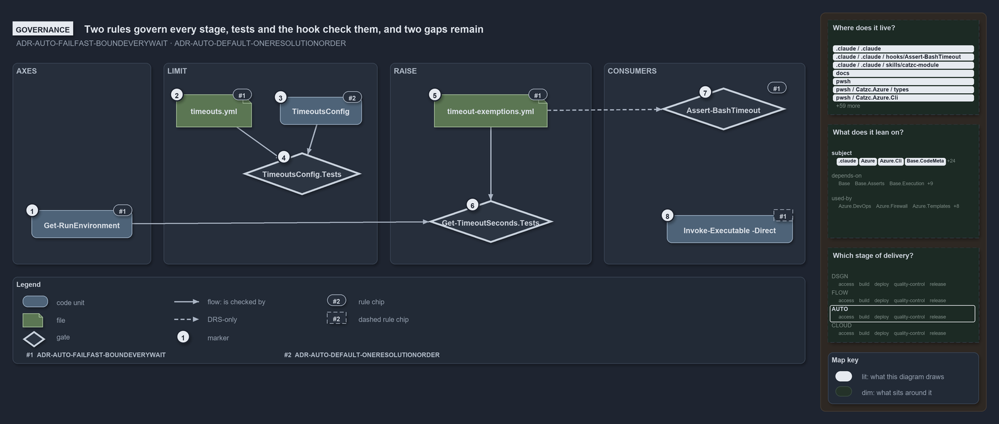

# What guards the limit's resolution

```text
What guards the limit's resolution.

1  Get-RunEnvironment        F7: limits are keyed by run environment and execution engine
2  timeouts.yml              F7: one config, every value a positive whole number
3  TimeoutsConfig            D6: the sensible default is declared once, on the config type
4  TimeoutsConfig.Tests      the gate on 2 and 3: defaults, no "no limit", background >= foreground
5  timeout-exemptions.yml    F7: an exemption raises to a ceiling, never lifts; a bash ceiling nothing reads
6  Get-TimeoutSeconds.Tests  the gate on 1 and 5: the environment keying, the entry, the raise, never a lowering
7  Assert-BashTimeout        F7: the hook denies an agent's call outside the bash limits
8  Invoke-Executable -Direct no gate: the interactive mode runs unbounded against F7

Supports ADR-AUTO-FAILFAST-BOUNDEVERYWAIT and ADR-AUTO-DEFAULT-ONERESOLUTIONORDER (governance lens).
```

Two rules decide how a time limit is found in cats. ADR-AUTO-FAILFAST-BOUNDEVERYWAIT says what is bounded, where the limits live and how an
exemption may raise one; ADR-AUTO-DEFAULT-ONERESOLUTIONORDER says in which order a configurable setting resolves and where its default is
declared. Two L0 test files and the Bash hook check them, and the checks leave two gaps: an exemption the hook never reads, and one mode
that no gate bounds.

```yml drawio
description:
  Two rules govern each stage of a limit's resolution; tests gate the config and the resolver, the hook gates an agent's shell calls, and
  the interactive executable mode has no gate, so two gaps remain.
about:
  rules: [ADR-AUTO-FAILFAST-BOUNDEVERYWAIT, ADR-AUTO-DEFAULT-ONERESOLUTIONORDER]
  lens: governance
content:
  title: What guards the limit's resolution
  kind: explanation
  flow: left-to-right
  theme: dark
  bands:
    - { id: band-axes, label: AXES }
    - { id: band-limit, label: LIMIT }
    - { id: band-raise, label: RAISE }
    - { id: band-consumers, label: CONSUMERS }
  glyphs:
    - { id: g-environment, kind: code, label: Get-RunEnvironment, in: band-axes }
    - { id: g-timeouts, kind: file, label: timeouts.yml, in: band-limit }
    - { id: g-config, kind: code, label: TimeoutsConfig, in: band-limit }
    - { id: g-config-tests, kind: gate, label: TimeoutsConfig.Tests, in: band-limit }
    - { id: g-exemptions, kind: file, label: timeout-exemptions.yml, in: band-raise }
    - { id: g-seconds-tests, kind: gate, label: Get-TimeoutSeconds.Tests, in: band-raise }
    - { id: g-hook, kind: gate, label: Assert-BashTimeout, in: band-consumers }
    - { id: g-direct, kind: code, label: Invoke-Executable -Direct, in: band-consumers }
  edges:
    - { from: g-config, to: g-config-tests, kind: flow, label: "" }
    - { from: g-timeouts, to: g-config-tests, kind: flow, label: "" }
    - { from: g-exemptions, to: g-seconds-tests, kind: flow, label: "" }
    - { from: g-environment, to: g-seconds-tests, kind: flow, label: "" }
    - { from: g-exemptions, to: g-hook, kind: record, label: "" }
  markers:
    - { at: g-environment, number: 1 }
    - { at: g-timeouts, number: 2 }
    - { at: g-config, number: 3 }
    - { at: g-config-tests, number: 4 }
    - { at: g-exemptions, number: 5 }
    - { at: g-seconds-tests, number: 6 }
    - { at: g-hook, number: 7 }
    - { at: g-direct, number: 8 }
  chips:
    - { at: g-environment, kind: rule, rule: ADR-AUTO-FAILFAST-BOUNDEVERYWAIT }
    - { at: g-timeouts, kind: rule, rule: ADR-AUTO-FAILFAST-BOUNDEVERYWAIT }
    - { at: g-config, kind: rule, rule: ADR-AUTO-DEFAULT-ONERESOLUTIONORDER }
    - { at: g-exemptions, kind: rule, rule: ADR-AUTO-FAILFAST-BOUNDEVERYWAIT }
    - { at: g-hook, kind: rule, rule: ADR-AUTO-FAILFAST-BOUNDEVERYWAIT }
    - { at: g-direct, kind: rule, rule: ADR-AUTO-FAILFAST-BOUNDEVERYWAIT, gated: false }
  legend: auto
  minimaps: [code-locations, module-neighbourhood, axis]
layout:
  band-axes: { x: 20, y: 84, w: 220, h: 320 }
  band-limit: { x: 260, y: 84, w: 340, h: 320 }
  band-raise: { x: 620, y: 84, w: 320, h: 320 }
  band-consumers: { x: 960, y: 84, w: 320, h: 320 }
  g-environment: { x: 50, y: 318, w: 160, h: 44 }
  g-timeouts: { x: 280, y: 134, w: 120, h: 52 }
  g-config: { x: 445, y: 138, w: 130, h: 44 }
  g-config-tests: { x: 385, y: 226, w: 190, h: 68 }
  g-exemptions: { x: 690, y: 134, w: 180, h: 52 }
  g-seconds-tests: { x: 665, y: 302, w: 230, h: 68 }
  g-hook: { x: 1050, y: 123, w: 200, h: 68 }
  g-direct: { x: 1060, y: 326, w: 200, h: 44 }
```



## Walkthrough

1. **Get-RunEnvironment.** The rule keys every limit by run environment, devbox or pipeline, and by execution engine, and both are read from
   the session rather than passed in. `Get-TimeoutSeconds.Tests` checks the devbox and the pipeline answers for pwsh, for bash in the
   foreground and the background, and for zsh.
2. **timeouts.yml.** The rule puts the limits in one config owned by `Catzc.Base.Timeouts`, with per-executable entries and no "no limit"
   value. The integrity test in `TimeoutsConfig.Tests` loads the shipped file as its typed record.
3. **TimeoutsConfig.** The rule declares the sensible default exactly once, on the config type, so an omitted key and a fresh checkout
   behave the same.
4. **TimeoutsConfig.Tests.** The gate on the type: an empty and a null config resolve the declared defaults; a zero, negative, fractional or
   quoted limit is rejected, so no file can state "no limit"; a background bash limit below its foreground limit is rejected.
   `TimeoutExemptionsConfig.Tests` does the same for the exemptions and checks that every exempt GUID is a registered budget.
5. **timeout-exemptions.yml.** The rule lets work that is slow while it is tuned carry a budget GUID and be exempted, which raises its limit
   to a ceiling and never lifts it. The file also accepts a bash ceiling and a `shell: bash` scope that no code reads, drawn as the one
   thing here the record states and no code does.
6. **Get-TimeoutSeconds.Tests.** The gate on the resolution: an executable's own entry, the pwsh limit for an unlisted executable, the raise
   of an exempt budget to the ceiling, the unchanged limit for a budget that is not exempt, and a limit above the ceiling that is never
   lowered. `Build-AgentHook.Tests` adds parity: the published hook allows exactly the limit the resolver gives and denies one unit more.
7. **Assert-BashTimeout.** The rule says the bash limits bound every shell call an agent makes and a hook denies a call outside them. The
   hook is that gate, compiled from the module's own types so it cannot drift from the resolver.
8. **Invoke-Executable -Direct.** The rule bounds every external call. The interactive mode has no limit, and no test or gate catches it;
   its rule chip is dashed because nothing checks it.

## Why it holds

- Every external call and every unbounded piece of work runs inside a time safeguard, the limits live in one config keyed by run environment
  and execution engine with sensible defaults on the type and no "no limit" value, a hook denies an agent's call outside the bash limits,
  and an exemption raises a limit to a ceiling but never lifts it (ADR-AUTO-FAILFAST-BOUNDEVERYWAIT).
- A configurable setting resolves in one order, the explicit value, else the configuration, else the sensible default, and the default is
  declared exactly once, on the config type (ADR-AUTO-DEFAULT-ONERESOLUTIONORDER).

## See also

- [Fail fast with inline assertions](../../drs/automation/fail-fast-with-asserts.md) and
  [Sensible defaults for all parameters](../../drs/automation/sensible-defaults.md) — the decisions this article explains.
- The other lenses on the same resolution: [meta](callers-value-else-config-else-default.md),
  [architecture](one-resolver-every-consumer-but-the-hook.md), [implementation](resolve-one-limit-in-code-order.md) and
  [operations](a-stopped-run-names-its-limit.md).
- [The automation explanations](index.md) · [How to read the diagrams](../index.md#how-to-read-the-diagrams)
