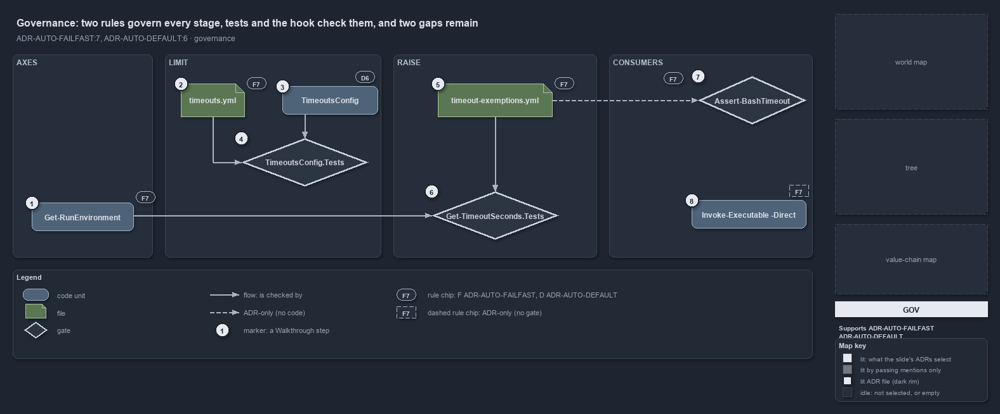

---
catzc:
  immutable:
    with_body_sha: d24069d9bd3b
    repo_status: clean
    path: docs/explanation/automation/one-rule-per-stage-and-two-gaps.md
    folder: docs/explanation/automation
    name: one-rule-per-stage-and-two-gaps
    filetype: md
    kind: explanation
    language: markdown
    track: docs
    tracktype: documentation
  edges:
    cites:
      - ADR-AUTO-DEFAULT#6
      - ADR-AUTO-FAILFAST#7
    links:
      - docs/.assets/explanation/adr-auto-failfast--one-rule-per-stage-and-two-gaps--governance.drawio.md
      - docs/.assets/explanation/adr-auto-failfast--one-rule-per-stage-and-two-gaps--governance.drawio.png
      - docs/adr/automation/fail-fast-with-asserts.md
      - docs/adr/automation/sensible-defaults.md
      - docs/explanation/automation/a-stopped-run-names-its-limit.md
      - docs/explanation/automation/callers-value-else-config-else-default.md
      - docs/explanation/automation/index.md
      - docs/explanation/automation/one-resolver-every-consumer-but-the-hook.md
      - docs/explanation/automation/resolve-one-limit-in-code-order.md
      - docs/explanation/index.md#how-to-read-the-diagrams
---

# Two rules govern every stage, tests and the hook check them, and two gaps remain

```text
Two rules govern every stage of the limit's resolution, tests and the hook check them, and two gaps remain.

1  Get-RunEnvironment        F7: limits are keyed by run environment and execution engine
2  timeouts.yml              F7: one config, every value a positive whole number
3  TimeoutsConfig            D6: the sensible default is declared once, on the config type
4  TimeoutsConfig.Tests      the gate on 2 and 3: defaults, no "no limit", background >= foreground
5  timeout-exemptions.yml    F7: an exemption raises to a ceiling, never lifts; a bash ceiling nothing reads
6  Get-TimeoutSeconds.Tests  the gate on 1 and 5: the environment keying, the entry, the raise, never a lowering
7  Assert-BashTimeout        F7: the hook denies an agent's call outside the bash limits
8  Invoke-Executable -Direct no gate: the interactive mode runs unbounded against F7

Supports ADR-AUTO-FAILFAST#7 and ADR-AUTO-DEFAULT#6 (governance lens).
```

Two rules decide how a time limit is found in cats. ADR-AUTO-FAILFAST#7 says what is bounded, where the limits live and how an exemption may
raise one; ADR-AUTO-DEFAULT#6 says in which order a configurable setting resolves and where its default is declared. Two L0 test files and
the Bash hook check them, and the checks leave two gaps: an exemption the hook never reads, and one mode that no gate bounds.



The diagram is described element by element in
[its asset description](../../.assets/explanation/adr-auto-failfast--one-rule-per-stage-and-two-gaps--governance.drawio.md).

## Walkthrough

1. **Get-RunEnvironment.** The rule keys every limit by run environment, devbox or pipeline, and by execution engine, and both are read from
   the session rather than passed in. `Get-TimeoutSeconds.Tests` checks the devbox and the pipeline answers for pwsh, for bash in the
   foreground and the background, and for zsh.
2. **timeouts.yml.** The rule puts the limits in one config owned by `Catzc.Base.Timeouts`, with per-executable entries and no "no limit"
   value. The integrity test in `TimeoutsConfig.Tests` loads the shipped file as its typed record.
3. **TimeoutsConfig.** The rule declares the sensible default exactly once, on the config type, so an omitted key and a fresh checkout
   behave the same.
4. **TimeoutsConfig.Tests.** The gate on the type: an empty and a null config resolve the declared defaults; a zero, negative, fractional or
   quoted limit is rejected, so no file can state "no limit"; a background bash limit below its foreground limit is rejected.
   `TimeoutExemptionsConfig.Tests` does the same for the exemptions and checks that every exempt GUID is a registered budget.
5. **timeout-exemptions.yml.** The rule lets work that is slow while it is tuned carry a budget GUID and be exempted, which raises its limit
   to a ceiling and never lifts it. The file also accepts a bash ceiling and a `shell: bash` scope that no code reads, drawn as the one
   thing here the ADR states and no code does.
6. **Get-TimeoutSeconds.Tests.** The gate on the resolution: an executable's own entry, the pwsh limit for an unlisted executable, the raise
   of an exempt budget to the ceiling, the unchanged limit for a budget that is not exempt, and a limit above the ceiling that is never
   lowered. `Build-BashTimeoutHook.Tests` adds parity: the published hook allows exactly the limit the resolver gives and denies one unit
   more.
7. **Assert-BashTimeout.** The rule says the bash limits bound every shell call an agent makes and a hook denies a call outside them. The
   hook is that gate, compiled from the module's own types so it cannot drift from the resolver.
8. **Invoke-Executable -Direct.** The rule bounds every external call. The interactive mode has no limit, and no test or gate catches it;
   its rule chip is dashed because nothing checks it.

## Why it holds

- Every external call and every unbounded piece of work runs inside a time safeguard, the limits live in one config keyed by run environment
  and execution engine with sensible defaults on the type and no "no limit" value, a hook denies an agent's call outside the bash limits,
  and an exemption raises a limit to a ceiling but never lifts it (ADR-AUTO-FAILFAST#7).
- A configurable setting resolves in one order, the explicit value, else the configuration, else the sensible default, and the default is
  declared exactly once, on the config type (ADR-AUTO-DEFAULT#6).

## Where the code and the ADR differ

The ADR lets an exemption raise an agent's bash limit, and the exemptions file accepts a bash ceiling and a `shell: bash` scope, but the
hook reads `TimeoutsConfig` only. The ADR bounds every external call, yet `Invoke-Executable -Direct` runs with no limit, and no gate checks
it.

## See also

- [Fail fast with inline assertions](../../adr/automation/fail-fast-with-asserts.md) and
  [Sensible defaults for all parameters](../../adr/automation/sensible-defaults.md) — the decisions this article explains.
- The other lenses on the same resolution: [meta](callers-value-else-config-else-default.md),
  [architecture](one-resolver-every-consumer-but-the-hook.md), [implementation](resolve-one-limit-in-code-order.md) and
  [operations](a-stopped-run-names-its-limit.md).
- [The automation explanations](index.md) · [How to read the diagrams](../index.md#how-to-read-the-diagrams)
