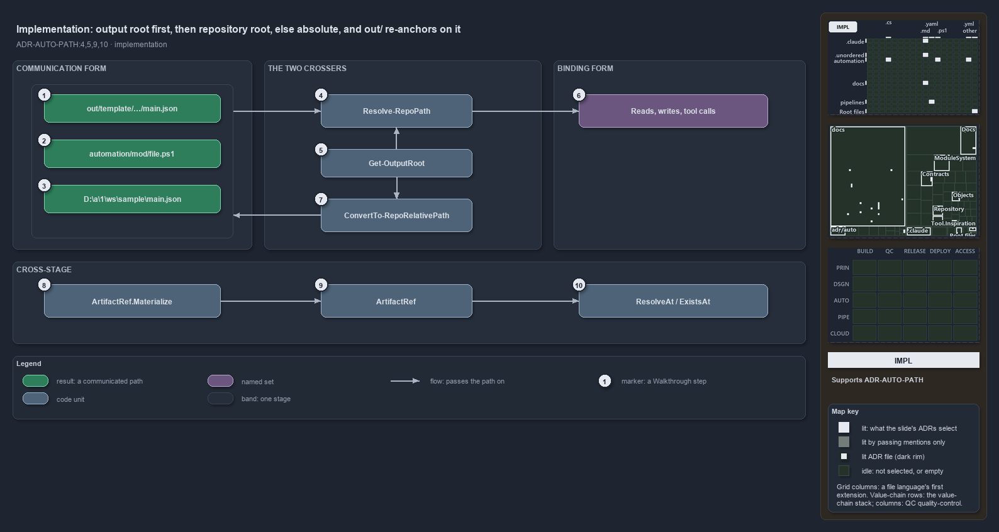

---
catzc:
  immutable:
    repo_status: clean
    path: docs/explanation/automation/output-root-first-then-repo-root.md
    folder: docs/explanation/automation
    name: output-root-first-then-repo-root
    filetype: md
    kind: explanation
    language: markdown
    track: docs
    tracktype: documentation
  edges:
    cites:
      - ADR-AUTO-PATH#{4,5,9,10}
    links:
      - docs/adr/automation/path-representation.md
      - docs/explanation/.assets/adr-auto-path--output-root-first-then-repo-root--implementation.drawio.png
      - docs/explanation/automation/index.md
      - docs/explanation/automation/one-out-string-two-places.md
      - docs/explanation/automation/output-root-first-then-repo-root.drawio.md
      - docs/explanation/automation/two-crossers-and-three-anchors.md
      - docs/explanation/automation/two-forms-never-a-third.md
      - docs/explanation/automation/types-check-forms-review-checks-crossers.md
      - docs/explanation/index.md#how-to-read-the-diagrams
---

# The output root is tried first, then the repository root, else the path stays absolute, and out/ re-anchors on the output root

```text
ConvertTo-RepoRelativePath tries the output root, then the repository root, else keeps the absolute; Resolve-RepoPath re-anchors out/.

 1  out/template/sample/main.json  a path under the output root: out/ plus the remainder
 2  automation/mod/file.ps1        a path under the repository root: repo-relative
 3  D:\a\1\ws\sample\main.json     a path under neither root: the normalized absolute, unchanged
 4  Resolve-RepoPath               out/ onto Get-OutputRoot, a rooted path unchanged, else onto Get-RepositoryRoot
 5  Get-OutputRoot                 the staging directory in a pipeline, else {root}/out
 6  Reads, writes, tool calls      the side-effect lines that take the absolute result
 7  ConvertTo-RepoRelativePath     GetFullPath, then the output root, then the repository root, else absolute
 8  ArtifactRef.Materialize        the factory: a raw path plus the artifact root; throws outside the root
 9  ArtifactRef                    relative and absolute, immutable
10  ResolveAt / ExistsAt           the consumer's re-resolve and existence check

Supports ADR-AUTO-PATH#4, #5, #9 and #10 (implementation lens).
```

`ConvertTo-RepoRelativePath` and `Resolve-RepoPath`, both in `Catzc.Base.Repository`, are the two boundary crossers of cats, and the order
of their tests is the whole contract. Converting a path tries the output root before the repository root and keeps a normalized absolute
path when neither applies; resolving a path re-anchors `out/` on `Get-OutputRoot`, passes a rooted path through and joins everything else
onto the repository root. Across a stage boundary `ArtifactRef` does the same job against the artifact root.



The diagram is described element by element in [its asset description](output-root-first-then-repo-root.drawio.md).

## Walkthrough

1. **out/template/sample/main.json.** The first test in `ConvertTo-RepoRelativePath`: after `[IO.Path]::GetFullPath`, a path under
   `Get-OutputRoot` comes back as `out/` plus the remainder with forward slashes, and the output root itself comes back as `out`. The input
   need not exist.
2. **automation/mod/file.ps1.** The second test: a path under `Get-RepositoryRoot` comes back repo-relative with forward slashes.
3. **D:\a\1\ws\sample\main.json.** A path under neither root comes back as the normalized absolute path, the honest answer when no relative
   form exists.
4. **Resolve-RepoPath.** Backslashes become forward slashes; `out` and `out/...` are joined onto `Get-OutputRoot` and passed through
   `GetFullPath`; a rooted path is returned as given; any other relative path is joined onto `Get-RepositoryRoot` and passed through
   `GetFullPath`. `Get-RepositoryFile` and `Get-RepositoryFolder` are one call to this function each.
5. **Get-OutputRoot.** When `Test-IsRunningInPipeline` is true and `BUILD_ARTIFACTSTAGINGDIRECTORY` is set, the staging directory, asserted
   to exist; otherwise `{root}/out`. Both crossers ask it, so the `out/` sentinel means the same place on both ways across the boundary.
6. **Reads, writes, tool calls.** The absolute result goes straight into `Get-Content`, `Import-Module`, `Test-Path` or the tool call, and
   is never stored, returned or logged.
7. **ConvertTo-RepoRelativePath.** The path in hand on the binding side, absolute, `.\` or `..`, goes through the three tests above and
   lands in communication form.
8. **ArtifactRef.Materialize.** The controlled factory takes the raw path and the artifact root, resolves the raw path against the root when
   it is relative, relativizes it, and throws when the file does not live under the root.
9. **ArtifactRef.** The immutable result: `relative`, artifact-internal with forward slashes, and `absolute`, resolved in the producing
   context for audit. The constructor rejects a rooted or escaping relative, so a deserialized manifest cannot smuggle one in.
10. **ResolveAt / ExistsAt.** The consumer combines its own artifact root with `relative` and asks whether a file or folder exists there
    before binding.

## Why it holds

- Normalization lives in the two crossers, so a `.\` or a backslash cannot leak downstream (ADR-AUTO-PATH#4).
- A path under neither root degrades to a normalized absolute path, never to a hybrid (ADR-AUTO-PATH#5).
- `out/` is a reserved anchor, re-anchored on `Get-OutputRoot` rather than the repository root, so one stored string resolves right on a
  devbox and in a pipeline (ADR-AUTO-PATH#9).
- A published artifact is created by `ArtifactRef.Materialize`, carries both forms, and is re-resolved and checked at the consumer with
  `ResolveAt` and `ExistsAt` (ADR-AUTO-PATH#10).

## Where the code and the ADR differ

- The ADR defines binding form as a normalized absolute path, and `Resolve-RepoPath` promises a full path for every result; a rooted input
  is returned exactly as given, so `C:\x\.\y` passes through un-normalized.
- The ADR says `ExistsAt` asserts that the file exists; the method returns a Boolean.
- The ADR says a path-bearing type converts once in its constructor and exposes both forms; `RepoRelativePath` stores only the relative form
  and derives the absolute on demand. `ArtifactRef` holds both.
- The ADR names `ArtifactRef` the primary enforcement; today only its tests call it.

## See also

- [Path representation](../../adr/automation/path-representation.md) — the decision this article explains.
- The other views of the same boundary: [meta](two-forms-never-a-third.md), [architecture](two-crossers-and-three-anchors.md),
  [operations](one-out-string-two-places.md) and [governance](types-check-forms-review-checks-crossers.md).
- [The automation explanations](index.md) · [How to read the diagrams](../index.md#how-to-read-the-diagrams)
