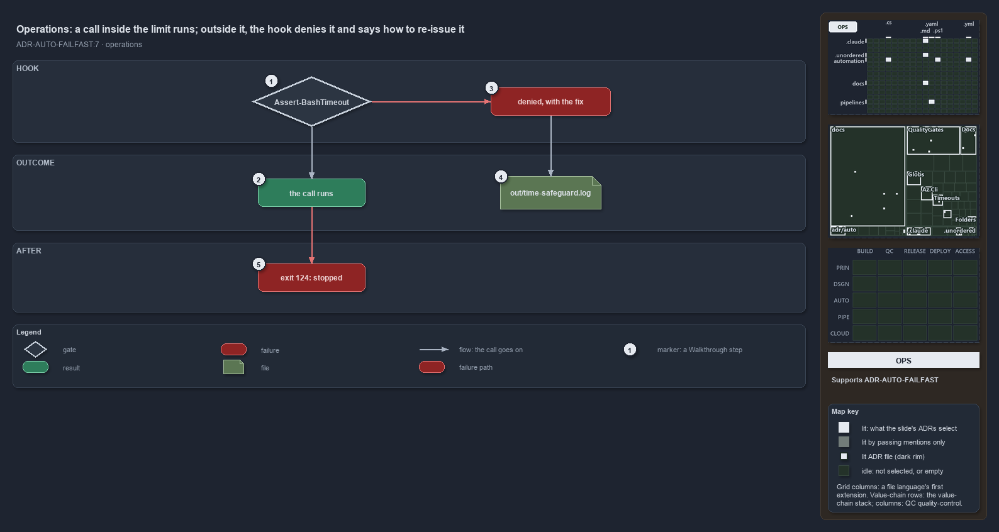

---
catzc:
  derived:
    path: docs/explanation/automation/pass-the-limit-or-the-call-is-denied.md
    kind: explanation
    language: markdown
    filekind: md
    track: docs
    body_sha: "951dcc6dc22d"
    adrs:
      - ADR-AUTO-FAILFAST#7
    links:
      - docs/.assets/explanation/adr-auto-failfast--pass-the-limit-or-the-call-is-denied--operations.drawio.md
      - docs/.assets/explanation/adr-auto-failfast--pass-the-limit-or-the-call-is-denied--operations.drawio.png
      - docs/adr/automation/fail-fast-with-asserts.md
      - docs/explanation/automation/a-shell-call-carries-its-limit-or-is-denied.md
      - docs/explanation/automation/decide-returns-null-or-a-reason.md
      - docs/explanation/automation/hook-compiles-module-verdict-and-limits.md
      - docs/explanation/automation/index.md
      - docs/explanation/automation/three-tests-prove-the-hook.md
      - docs/explanation/index.md#how-to-read-the-diagrams
---

# A call inside the limit runs; outside it, the hook denies it and says how to re-issue it

```text
A call inside the limit runs; outside it, the hook denies it and says how to re-issue it.

1  Assert-BashTimeout      runs before every Bash call: timeout: 3000 in the foreground, timeout 360 <one command> in the background
2  the call runs           the hook is silent and the call meets the normal permission flow
3  denied, with the fix    the message names the problem, the limits file, the fix and who acts on it
4  out/time-safeguard.log  every denial, one line, to tune the limits from
5  exit 124: stopped       a background call that outlives its prefix is killed by timeout

Supports ADR-AUTO-FAILFAST#7 (operations lens).
```

An agent working at a devbox in cats passes `timeout: 3000` on every foreground Bash call, and runs anything longer in the background behind
`timeout 360 <one command>`. That is the whole contract. A call in that shape runs as if the safeguard were not there. A call in any other
shape is denied before it starts, with a message that says what was wrong and the exact form to re-issue it in, and the denial is written to
a log so the limits can be tuned together instead of worked around.



The diagram is described element by element in
[its asset description](../../.assets/explanation/adr-auto-failfast--pass-the-limit-or-the-call-is-denied--operations.drawio.md).

## Walkthrough

1. **Assert-BashTimeout.** The hook runs before every Bash call, published by the importer at a devbox. A foreground call passes a `timeout`
   of at most the foreground limit, `limits.devbox.bash.foreground` in `timeouts.yml`, 3 s today, so `timeout: 3000`. A background call must
   start with a GNU `timeout <seconds>` of at most the background limit, 360 s today, around one command, because the Bash tool ignores its
   own `timeout` parameter in the background; `cd … &&`, a pipe or a `;` after the prefix is a compound command, so multi-step work goes in
   a script under `out/`. In a pipeline the limits are 600 s and 3600 s.
2. **The call runs.** When the call carries its limit, the hook prints nothing and exits 0. The call then goes through the ordinary
   permission flow; the safeguard never approves anything on its own.
3. **Denied, with the fix.** Otherwise the agent sees `Bash time safeguard (Devbox, foreground): this foreground call has no timeout;`
   `every foreground Bash call must pass timeout <= 3000 ms`, the file the limits live in, `timeouts.yml`, and the fix:
   `Re-issue it with timeout: 3000, or run longer work with run_in_background: true behind timeout 360 <one command>`
   `and wait for its completion notification.` A background denial says that the prefix is missing, that the duration is over the limit, or
   that the command is compound, and its fix is
   `Re-issue it as timeout 360 <one command> (exit 124 means it was stopped), and put multi-step work in a script under out/.` The last
   sentence depends on who asked: the main session is told to raise the blocker with the user and never work around the safeguard; a
   subagent is told to report the blocker to its coordinator rather than retry with a larger limit; a pipeline is told to fix the call or
   its limit, because nobody tunes it live. When the hook is not built yet, the wrapper in `.claude/settings.json` says so,
   `import the repository (Build-BashTimeoutHook publishes it)`, and lets the call go.
4. **out/time-safeguard.log.** Each denial appends one tab-separated line: the UTC time, `Devbox` or `Pipeline`, the actor (`main`,
   `subagent:<type>` or `pipeline`), `foreground` or `background`, what was requested (`timeout 3001 ms`, `no timeout prefix`,
   `timeout 361 s`, `compound command`), the limit, and the command. The file is the list of blockers to tune: a call that legitimately
   needs longer gets a `timeouts.yml` entry or moves to the background, never a bigger number in the call.
5. **Exit 124: stopped.** An allowed background call is still bounded by its prefix. When the command outlives it, GNU `timeout` kills it
   and the call ends with exit code 124, which means the safeguard stopped it.

## Why it holds

- Every external call runs inside a time safeguard, so a hang fails fast with a message naming the limit instead of waiting forever; the
  bash limits bound every shell call an agent makes, foreground and background, and a hook denies a call outside them (ADR-AUTO-FAILFAST#7).
- The limits are deliberately tight at a devbox and live in one config, so a call that needs longer surfaces as a blocker to tune rather
  than a limit raised quietly (ADR-AUTO-FAILFAST#7).

## Where the code and the ADR differ

- The ADR states that an agent cannot start a shell call that has no limit. An unbuilt hook and a hook error each report a non-blocking
  error and let the call go.
- The denial has a pipeline wording, but the importer never publishes the hook in a pipeline, so no pipeline call ever sees it.

## See also

- [Fail fast with inline assertions](../../adr/automation/fail-fast-with-asserts.md) — the decision this article explains.
- The other lenses on the same verdict: [meta](a-shell-call-carries-its-limit-or-is-denied.md),
  [architecture](hook-compiles-module-verdict-and-limits.md), [implementation](decide-returns-null-or-a-reason.md) and
  [governance](three-tests-prove-the-hook.md).
- [The automation explanations](index.md) · [How to read the diagrams](../index.md#how-to-read-the-diagrams)
