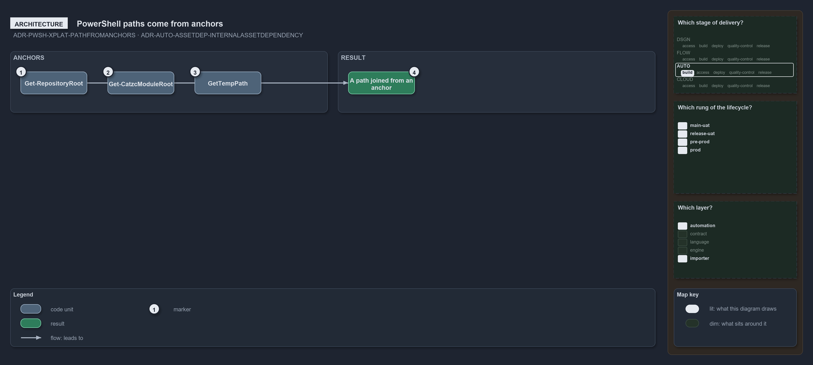

---
catzc:
  warning: "Experimental: this article merges two rules into one and holds nothing beyond what they say"
  edges:
    cites:
      - ADR-PWSH-XPLAT-PATHFROMANCHORS
      - ADR-AUTO-ASSETDEP-INTERNALASSETDEPENDENCY
---

# Powershell paths are resolved from anchors and internal assets have one locator

This article is one rule:
[ADR-PWSH-XPLAT-PATHFROMANCHORS](../../drs/automation/pwsh/cross-platform-powershell.md#rule-adr-pwsh-xplat-pathfromanchors) and
[ADR-AUTO-ASSETDEP-INTERNALASSETDEPENDENCY](../../drs/automation/internal-asset-dependencies.md#rule-adr-auto-assetdep-internalassetdependency)
merged into one. It holds nothing beyond what those two rules say.

PowerShell code resolves a path from the anchors: the working root through `Get-RepositoryRoot`, the code root through
`Get-CatzcModuleRoot`, or the temp directory through `[IO.Path]::GetTempPath()`, then joined. An internal asset dependency is any read, by a
module's own code, of content that ships inside the code tree: the module's `configs/` and `assets/`, another module's, `.internal/assets/`,
`.vendor/` and `.compiled/`, located only through the code-root helper.

