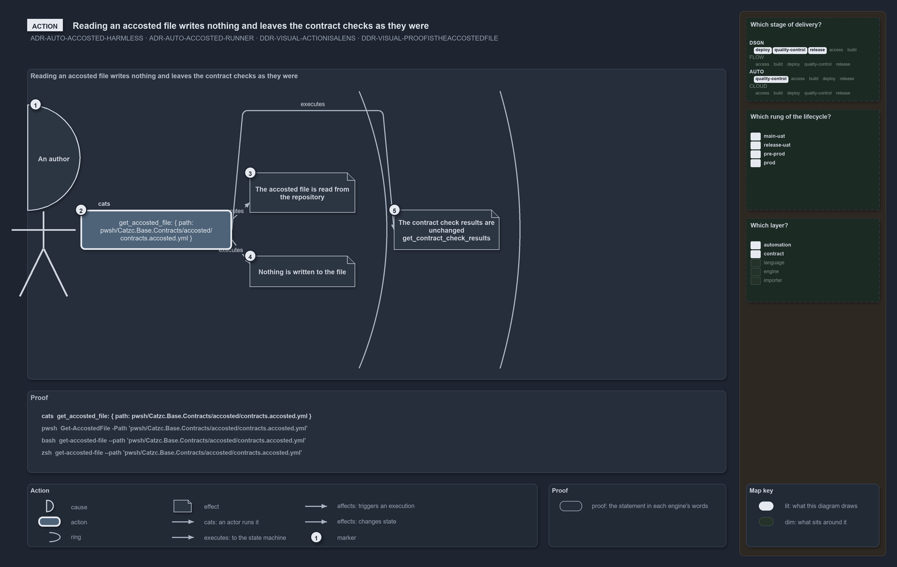

# Reading an accosted file writes nothing and leaves the contract checks as they were

```text
An author runs cats, and one harmless call reads an accosted file.

1  An author runs cats                 the cause: someone asks cats for the file
2  get_accosted_file                   the action: one harmless call, in the contract form
3  The accosted file is read           ring 1, local: get_repository_file shows the file
4  Nothing is written to the file      ring 1, local: the same observation after the call shows the same file
5  The contract check results          ring 2, local: get_contract_check_results gives the same results after the call

Supports ADR-AUTO-ACCOSTED-HARMLESS, ADR-AUTO-ACCOSTED-RUNNER, DDR-VISUAL-ACTIONISALENS and DDR-VISUAL-PROOFISTHEACCOSTEDFILE (action lens).
```

An author asks cats for the accosted file of the contracts module. The call is one command, and it only reads. Two observations, taken
before and after it, show that the file is the same, and a third shows that the contract check results are the same. The drawing is the
action and its effects; the runs under it prove each effect.



## Walkthrough

1. **An author runs cats.** The cause sits on the left rim: a person asks cats for the file, with no other trigger and no state beyond the
   repository.
2. **get_accosted_file.** The action is one command in the contract form, written with its normal-form name and its one argument. It is
   harmless because a command contract names it and its verb is on the harmless list
   ([ADR-AUTO-ACCOSTED-HARMLESS](../../drs/automation/accosted-language.md#rule-adr-auto-accosted-harmless)).
3. **The accosted file is read.** The first ring holds what the call changes directly. Here it reads the file, and the observation that
   shows it is `get_repository_file` on the same path.
4. **Nothing is written to the file.** The same observation taken again after the call returns the same file. Nothing the call did changed
   it, which is what a harmless read promises.
5. **The contract check results.** The second ring holds what the call could cause further out. `get_contract_check_results` gives the same
   results after the call as before it, so the read left the contract checks as they were.

## The proof

The drawing never says what the proof does not run. The two runs below are copied from the accosted file the diagram names, and each
observation on the drawing occurs in them verbatim
([DDR-VISUAL-PROOFISTHEACCOSTEDFILE](../../drs/design/visual-design.md#rule-ddr-visual-proofistheaccostedfile)).

```yml accosted
runs:
  - - get_repository_file: { path: pwsh/Catzc.Base.Contracts/accosted/contracts.accosted.yml }
    - get_accosted_file: { path: pwsh/Catzc.Base.Contracts/accosted/contracts.accosted.yml }
    - get_repository_file: { path: pwsh/Catzc.Base.Contracts/accosted/contracts.accosted.yml }
  - - get_contract_check_results:
    - get_accosted_file: { path: pwsh/Catzc.Base.Contracts/accosted/contracts.accosted.yml }
    - get_contract_check_results:
```

The same runs in PowerShell, rendered from that file by `Get-AccostedFragment` (runs 5 and 6), never written by hand
([ADR-AUTO-ACCOSTED-ARTICLERENDERING](../../drs/automation/accosted-language.md#rule-adr-auto-accosted-articlerendering)):

```powershell
Get-RepositoryFile -Path 'pwsh/Catzc.Base.Contracts/accosted/contracts.accosted.yml'
Get-AccostedFile -Path 'pwsh/Catzc.Base.Contracts/accosted/contracts.accosted.yml'
Get-RepositoryFile -Path 'pwsh/Catzc.Base.Contracts/accosted/contracts.accosted.yml'

Get-ContractCheckResults
Get-AccostedFile -Path 'pwsh/Catzc.Base.Contracts/accosted/contracts.accosted.yml'
Get-ContractCheckResults
```

The runner runs every run through cats under each engine, so each observation is proven from every engine
([ADR-AUTO-ACCOSTED-RUNNER](../../drs/automation/accosted-language.md#rule-adr-auto-accosted-runner)).

## Why it holds

- A harmless command is one a contract names whose verb is on the configured list, so the call cannot write outside `out/`
  (ADR-AUTO-ACCOSTED-HARMLESS).
- Every run is proven from every engine, bounded by its time limit (ADR-AUTO-ACCOSTED-RUNNER).
- The action diagram is the drawing of a cause and its effects, and its proof is the accosted file, not a second statement of it
  (DDR-VISUAL-ACTIONISALENS, DDR-VISUAL-PROOFISTHEACCOSTEDFILE).

"Nothing is written" rests on the call being harmless and on two identical reads; it is an observation, not a proof of absence.

## See also

- [The accosted language](../../drs/automation/accosted-language.md) — the decision this article explains.
- [Visual design](../../drs/design/visual-design.md) — how an action diagram is drawn.
- [The automation explanations](index.md) · [How to read the diagrams](../index.md#how-to-read-the-diagrams)
