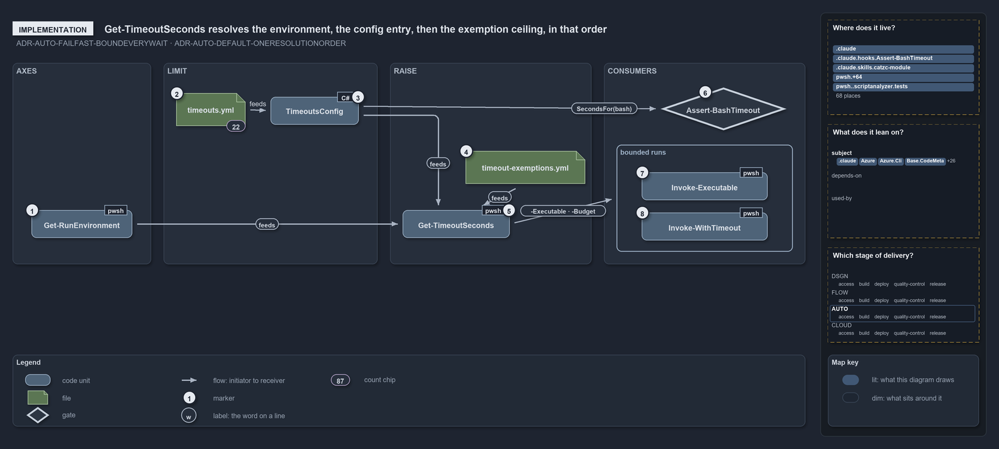

# Get-TimeoutSeconds resolves the environment, the config entry, then the exemption ceiling, in that order

```text
Get-TimeoutSeconds resolves the run environment, then the config entry or default, then the exemption ceiling, in that code order.

1  Get-RunEnvironment      Devbox or Pipeline, the first thing the resolver reads
2  timeouts.yml            the limits config: 22 executable entries today, no limits block
3  TimeoutsConfig          the typed record with the defaults; SecondsFor and SecondsForExecutable
4  timeout-exemptions.yml  the exemptions and ceilings; exempt: [] today
5  Get-TimeoutSeconds      -Executable, -Shell -Background, -Budget: one answer in seconds
6  Assert-BashTimeout      the hook asks TimeoutsConfig.SecondsFor for bash directly
7  Invoke-Executable       defaults -TimeoutSeconds to Get-TimeoutSeconds -Executable
8  Invoke-WithTimeout      defaults -Seconds to Get-TimeoutSeconds -Budget

Supports ADR-AUTO-FAILFAST-BOUNDEVERYWAIT and ADR-AUTO-DEFAULT-ONERESOLUTIONORDER (implementation lens).
```

`Get-TimeoutSeconds` is a short function, and its code order is the resolution order of the time safeguard. It reads the run environment,
loads the limits config as its typed record, asks that record for the limit of an executable or a shell, and only then, for a budget that is
exempt, raises the answer to the exemption ceiling. Each consumer in cats asks it from a parameter default, so the caller's explicit value,
the config, and the default on the type are tried in exactly that order.

```yml drawio
description:
  The resolver reads the run environment, then the config entry or its declared default, then the exemption ceiling, and hands one answer in
  seconds to the two bounded runners; the hook asks the same config type for bash directly.
about:
  adrs: [ADR-AUTO-FAILFAST-BOUNDEVERYWAIT, ADR-AUTO-DEFAULT-ONERESOLUTIONORDER]
  lens: implementation
content:
  title: Get-TimeoutSeconds resolves the environment, the config entry, then the exemption ceiling, in that order
  kind: explanation
  flow: left-to-right
  relation: feeds
  theme: dark
  bands:
    - { id: band-axes, label: AXES }
    - { id: band-limit, label: LIMIT }
    - { id: band-raise, label: RAISE }
    - { id: band-consumers, label: CONSUMERS }
  groups:
    - { id: grp-consumers, label: bounded runs, in: band-consumers }
  glyphs:
    - { id: g-environment, kind: code, label: Get-RunEnvironment, in: band-axes }
    - { id: g-timeouts, kind: file, label: timeouts.yml, in: band-limit }
    - { id: g-config, kind: code, label: TimeoutsConfig, in: band-limit }
    - { id: g-exemptions, kind: file, label: timeout-exemptions.yml, in: band-raise }
    - { id: g-seconds, kind: code, label: Get-TimeoutSeconds, in: band-raise }
    - { id: g-hook, kind: gate, label: Assert-BashTimeout, in: band-consumers }
    - { id: g-executable, kind: code, label: Invoke-Executable, in: grp-consumers }
    - { id: g-with-timeout, kind: code, label: Invoke-WithTimeout, in: grp-consumers }
  edges:
    - { from: g-timeouts, to: g-config, kind: flow, label: "" }
    - { from: g-environment, to: g-seconds, kind: flow, label: Devbox | Pipeline }
    - { from: g-config, to: g-seconds, kind: flow, label: SecondsFor }
    - { from: g-config, to: g-hook, kind: flow, label: SecondsFor(bash) }
    - { from: g-exemptions, to: g-seconds, kind: flow, label: "" }
    - { from: g-seconds, to: grp-consumers, kind: flow, label: -Executable · -Budget }
  markers:
    - { at: g-environment, number: 1 }
    - { at: g-timeouts, number: 2 }
    - { at: g-config, number: 3 }
    - { at: g-exemptions, number: 4 }
    - { at: g-seconds, number: 5 }
    - { at: g-hook, number: 6 }
    - { at: g-executable, number: 7 }
    - { at: g-with-timeout, number: 8 }
  chips:
    - { at: g-timeouts, kind: count, text: "22" }
  legend: auto
  minimaps: [code-locations, module-neighbourhood, axis]
layout:
  band-axes: { x: 20, y: 84, w: 220, h: 320 }
  band-limit: { x: 260, y: 84, w: 340, h: 320 }
  band-raise: { x: 620, y: 84, w: 320, h: 320 }
  band-consumers: { x: 960, y: 84, w: 320, h: 320 }
  g-environment: { x: 50, y: 318, w: 160, h: 44 }
  g-timeouts: { x: 280, y: 132, w: 110, h: 52 }
  g-config: { x: 430, y: 138, w: 140, h: 44 }
  g-exemptions: { x: 740, y: 224, w: 190, h: 52 }
  g-seconds: { x: 640, y: 318, w: 170, h: 44 }
  g-hook: { x: 1050, y: 123, w: 200, h: 68 }
  grp-consumers: { x: 980, y: 214, w: 280, h: 170 }
  g-executable: { x: 1020, y: 258, w: 200, h: 44 }
  g-with-timeout: { x: 1020, y: 322, w: 200, h: 44 }
```



## Walkthrough

1. **Get-RunEnvironment.** The first call. It returns `Devbox` or `Pipeline`, and `-EnvironmentAssertIs` is passed through only when the
   caller gave it, to verify the environment rather than select it.
2. **timeouts.yml.** The limits config of `Catzc.Base.Timeouts`, loaded next through `Get-Config -Config timeouts`. Today it holds 22
   entries under `executables`, among them `pwsh` 360, `dotnet` 600, `az` 1800, `gh` 120 and `go` 900, and no `limits` block: every
   environment and shell limit is the declared default.
3. **TimeoutsConfig.** The record the file becomes. `SecondsFor(environment, shell, background)` answers a shell's limit, and
   `SecondsForExecutable(environment, name)` answers an executable's own entry, looked up by the bare name with directory and extension
   dropped, or else the environment's pwsh limit. An entry is not keyed by environment and replaces the limit: `gh`, `cspell`, `prettier`
   and `markdownlint-cli2` at 120 seconds and `tar` at 300 sit below the pipeline's pwsh default of 600.
4. **timeout-exemptions.yml.** The exemptions config, loaded only when a budget is given. Its record validates each entry and declares the
   ceilings, 600 seconds on a devbox and 3600 in a pipeline for every shell. The list is empty today.
5. **Get-TimeoutSeconds.** Three parameter sets. `-Executable` returns `SecondsForExecutable` and stops there. The default set takes
   `-Shell`, `-Background` for bash, and `-Budget`: it takes `SecondsFor`, and when `Get-TimeoutExemption` finds the budget for this
   environment and shell, returns the larger of that limit and `CeilingFor`. Because `-Budget` belongs to the shell set only, an
   executable's limit cannot be exempted. The third set, `-Command`, resolves a function's `[TimeLimit]` declaration: an exemption for its
   budget, then a `commands` entry, then the declaration, then the pwsh limit.
6. **Assert-BashTimeout.** The hook does not call the function. It constructs `TimeoutsConfig` from `timeouts.yml` itself and asks
   `SecondsFor(environment, "bash", background)` for the foreground or background limit of the call it is judging.
7. **Invoke-Executable.** Its `-TimeoutSeconds` is bound to at least one second, and when the caller omits it the default mode asks
   `Get-TimeoutSeconds -Executable` with the executable name `CliRunner` parses from the command. The function has no `-Budget`.
8. **Invoke-WithTimeout.** Its `-Seconds` defaults to `Get-TimeoutSeconds -Budget $Budget`, as do `Assert-CompletesWithin` and
   `Test-CompletesWithin`, which call it. A value the caller passes is bounded the same way and overrides everything.

## Why it holds

- The limits live in one config keyed by run environment and execution engine, with sensible defaults on the config type and per-executable
  entries, and no "no limit" value; `Invoke-Executable` kills a process tree at its executable's limit, the in-process wrappers stop a
  script block at theirs, and an exemption raises a budget's limit to a ceiling but never lifts it (ADR-AUTO-FAILFAST-BOUNDEVERYWAIT).
- The explicit value, else the module's configuration read through `Get-Config`, else the default declared once on the config type, is the
  one resolution order of every configurable setting (ADR-AUTO-DEFAULT-ONERESOLUTIONORDER).

## Where the code and the decision record differ

The ADR presents a per-executable entry as the remedy for a call that needs longer, but an entry replaces the limit in every environment and
may lower it.

## See also

- [Fail fast with inline assertions](../../drs/automation/fail-fast-with-asserts.md) and
  [Sensible defaults for all parameters](../../drs/automation/sensible-defaults.md) — the decisions this article explains.
- The other lenses on the same resolution: [meta](callers-value-else-config-else-default.md),
  [architecture](one-resolver-every-consumer-but-the-hook.md), [operations](a-stopped-run-names-its-limit.md) and
  [governance](one-rule-per-stage-and-two-gaps.md).
- [The automation explanations](index.md) · [How to read the diagrams](../index.md#how-to-read-the-diagrams)
