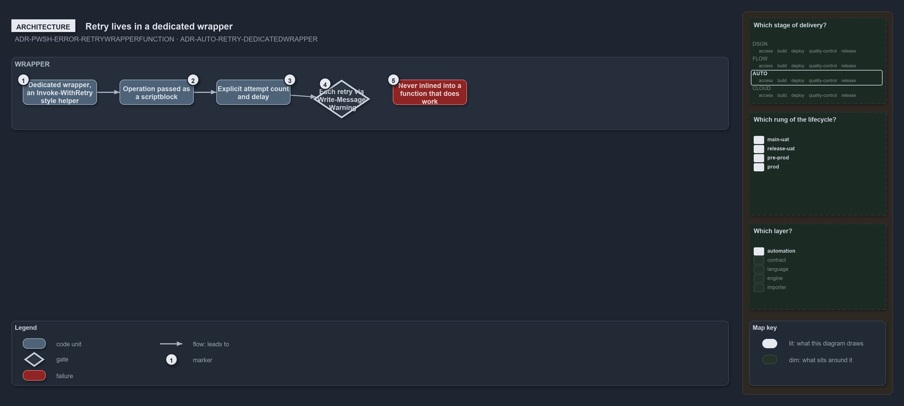

---
catzc:
  warning: "Experimental: this article merges two rules into one and holds nothing beyond what they say"
  edges:
    cites:
      - ADR-PWSH-ERROR-RETRYWRAPPERFUNCTION
      - ADR-AUTO-RETRY-DEDICATEDWRAPPER
---

# Retry lives in a dedicated wrapper that takes the operation as a scriptblock

This article is one rule:
[ADR-PWSH-ERROR-RETRYWRAPPERFUNCTION](../../drs/automation/pwsh/error-handling.md#rule-adr-pwsh-error-retrywrapperfunction) and
[ADR-AUTO-RETRY-DEDICATEDWRAPPER](../../drs/automation/retry-as-last-resort.md#rule-adr-auto-retry-dedicatedwrapper) merged into one. It
holds nothing beyond what those two rules say.

Isolate retry in a dedicated wrapper that takes the operation to repeat as its argument, an `Invoke-WithRetry`-style helper, never inlined
into a function that also does work. In pwsh the wrapper is its own function that takes the one operation to repeat as a `[scriptblock]`
parameter, with an explicit attempt count and delay, and writes each retry with `Write-Message -Warning`, never `Write-Warning`.

