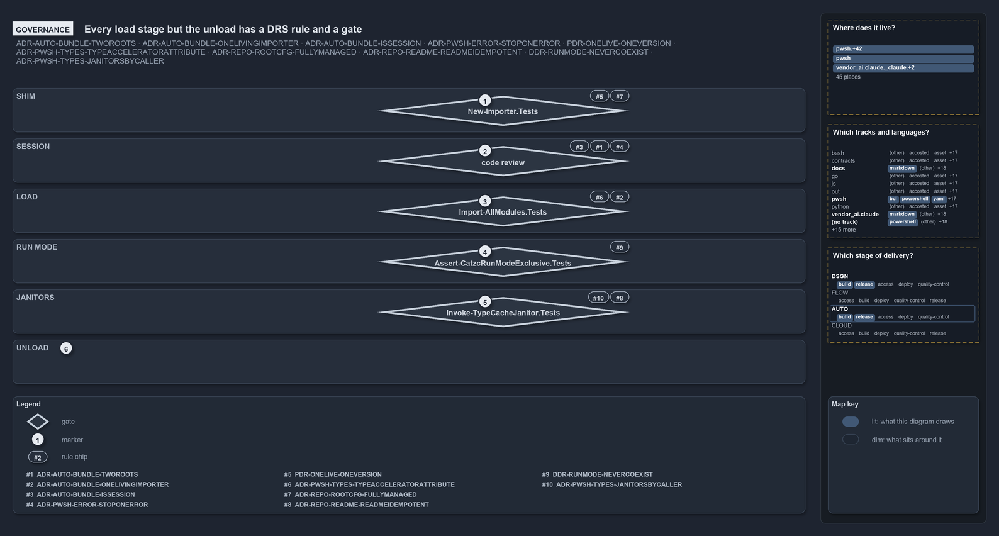

# Every load stage but the unload has a DRS rule and a gate

```text
Every load stage but the unload has a DRS rule and a gate.

1  Shim                    generated importer.ps1; gate New-Importer.Tests
2  Session                 preferences and two roots; gate code review
3  Load                    types before modules; gate Import-AllModules.Tests
4  Run mode                run modes never coexist; gate Assert-CatzcRunModeExclusive.Tests
5  Janitors                idempotent, actor-aware; gate Invoke-TypeCacheJanitor.Tests
6  Unload                  the import-time helpers removed; no rule and no gate

Supports ADR-AUTO-BUNDLE-TWOROOTS, ADR-AUTO-BUNDLE-ONELIVINGIMPORTER, ADR-AUTO-BUNDLE-ISSESSION, ADR-PWSH-ERROR-STOPONERROR,
PDR-ONELIVE-ONEVERSION, ADR-PWSH-TYPES-TYPEACCELERATORATTRIBUTE, ADR-REPO-ROOTCFG-FULLYMANAGED, ADR-REPO-README-READMEIDEMPOTENT,
DDR-RUNMODE-NEVERCOEXIST and ADR-PWSH-TYPES-JANITORSBYCALLER (governance lens).
```

The cats load sequence runs in six stages, from the generated shim to the final unload of the import-time helpers. Each stage but the last
is constrained by at least one DRS rule, and each of those stages is checked by a gate: a test for four of them, and code review for the
session set-up. The unload has neither a rule nor a gate.

```yml drawio
description:
  The load runs in six stages; each stage but the last carries the DRS rules it follows and the test or review that gates them, and the
  unload carries neither.
about:
  rules:
    - ADR-AUTO-BUNDLE-TWOROOTS
    - ADR-AUTO-BUNDLE-ONELIVINGIMPORTER
    - ADR-AUTO-BUNDLE-ISSESSION
    - ADR-PWSH-ERROR-STOPONERROR
    - PDR-ONELIVE-ONEVERSION
    - ADR-PWSH-TYPES-TYPEACCELERATORATTRIBUTE
    - ADR-REPO-ROOTCFG-FULLYMANAGED
    - ADR-REPO-README-READMEIDEMPOTENT
    - DDR-RUNMODE-NEVERCOEXIST
    - ADR-PWSH-TYPES-JANITORSBYCALLER
  lens: governance
content:
  title: Every load stage but the unload has a DRS rule and a gate
  kind: explanation
  flow: top-to-bottom
  theme: dark
  bands:
    - { id: band-shim, label: SHIM }
    - { id: band-session, label: SESSION }
    - { id: band-load, label: LOAD }
    - { id: band-mode, label: RUN MODE }
    - { id: band-janitors, label: JANITORS }
    - { id: band-unload, label: UNLOAD }
  glyphs:
    - { id: g-shim, kind: gate, label: New-Importer.Tests, in: band-shim }
    - { id: g-session, kind: gate, label: code review, in: band-session }
    - { id: g-load, kind: gate, label: Import-AllModules.Tests, in: band-load }
    - { id: g-mode, kind: gate, label: Assert-CatzcRunModeExclusive.Tests, in: band-mode }
    - { id: g-janitors, kind: gate, label: Invoke-TypeCacheJanitor.Tests, in: band-janitors }
  markers:
    - { at: g-shim, number: 1 }
    - { at: g-session, number: 2 }
    - { at: g-load, number: 3 }
    - { at: g-mode, number: 4 }
    - { at: g-janitors, number: 5 }
    - { at: band-unload, number: 6 }
  chips:
    - { at: g-shim, kind: rule, rule: ADR-REPO-ROOTCFG-FULLYMANAGED }
    - { at: g-shim, kind: rule, rule: PDR-ONELIVE-ONEVERSION }
    - { at: g-session, kind: rule, rule: ADR-PWSH-ERROR-STOPONERROR }
    - { at: g-session, kind: rule, rule: ADR-AUTO-BUNDLE-TWOROOTS }
    - { at: g-session, kind: rule, rule: ADR-AUTO-BUNDLE-ISSESSION }
    - { at: g-load, kind: rule, rule: ADR-AUTO-BUNDLE-ONELIVINGIMPORTER }
    - { at: g-load, kind: rule, rule: ADR-PWSH-TYPES-TYPEACCELERATORATTRIBUTE }
    - { at: g-mode, kind: rule, rule: DDR-RUNMODE-NEVERCOEXIST }
    - { at: g-janitors, kind: rule, rule: ADR-REPO-README-READMEIDEMPOTENT }
    - { at: g-janitors, kind: rule, rule: ADR-PWSH-TYPES-JANITORSBYCALLER }
  legend: auto
  minimaps: [code-locations, grid, axis]
layout:
  band-shim: { x: 20, y: 124, w: 1260, h: 70 }
  band-session: { x: 20, y: 204, w: 1260, h: 70 }
  band-load: { x: 20, y: 284, w: 1260, h: 70 }
  band-mode: { x: 20, y: 364, w: 1260, h: 70 }
  band-janitors: { x: 20, y: 444, w: 1260, h: 70 }
  band-unload: { x: 20, y: 524, w: 1260, h: 70 }
  g-shim: { x: 600, y: 136, w: 400, h: 48 }
  g-session: { x: 600, y: 216, w: 400, h: 48 }
  g-load: { x: 600, y: 296, w: 400, h: 48 }
  g-mode: { x: 600, y: 376, w: 400, h: 48 }
  g-janitors: { x: 600, y: 456, w: 400, h: 48 }
```



Each stage has its own band, and a stage's gate sits in its band beside the rules it checks.

## Walkthrough

1. **Shim.** `importer.ps1` is fully managed: `New-Importer` renders it from one source of truth, and it carries no load logic of its own
   (ADR-REPO-ROOTCFG-FULLYMANAGED, PDR-ONELIVE-ONEVERSION). `New-Importer.Tests` checks that the shim's parameter set equals
   `Invoke-Importer`'s and that the committed file equals the generated one.
2. **Session.** The importer sets `$ErrorActionPreference = 'Stop'` globally (ADR-PWSH-ERROR-STOPONERROR), anchors on the working root and
   the code root (ADR-AUTO-BUNDLE-TWOROOTS), and a bundle sets up the same session as source mode does (ADR-AUTO-BUNDLE-ISSESSION). The gate
   is code review, the gate the platform-bundle record names: it rejects a scan of catzc's own code anchored on `RepositoryRoot`. No test
   checks the preferences.
3. **Load.** The bundle reuses the one importer so that the C# types and their accelerators register before any module loads
   (ADR-AUTO-BUNDLE-ONELIVINGIMPORTER, ADR-PWSH-TYPES-TYPEACCELERATORATTRIBUTE). `Import-AllModules.Tests` checks that a duplicated or
   shadowing function name fails the import, and `Import-CSharpTypes.Tests` and the walking-skeleton `Import-Catzc.Tests` also cover this
   stage.
4. **Run mode.** The two run modes never coexist (DDR-RUNMODE-NEVERCOEXIST). The stage is itself a check: `Assert-CatzcRunModeExclusive`
   runs on every load and throws when a module from the other run mode's root is still loaded. `Assert-CatzcRunModeExclusive.Tests` checks
   it, and the eviction block of `Import-AllModules.Tests` checks the removal that comes before it.
5. **Janitors.** Generation is idempotent and runs on every import (ADR-REPO-README-READMEIDEMPOTENT), and who runs the importer decides
   what the janitors may change, read from `Get-SessionActor` (ADR-PWSH-TYPES-JANITORSBYCALLER). `Invoke-TypeCacheJanitor.Tests` checks that
   holders are never stopped in a `Pipeline` or `Agent` session.
6. **Unload.** `Invoke-Importer` removes `Catzc.Internal.Bootstrap`, and the entry script's `finally` removes `Catzc.Internal.Importer`. No
   DRS rule states this, and no test checks it; only the code comments and the project instructions describe it. That is why its band holds
   no rule and no gate.

Beyond the gate at each stage, `Test-Automation` and `Test-CatzcBuild` run the same tests in both modes, `Assert-CatzcBundle` checks every
build, and code review rejects a bundle loader that forks the importer.

## Why it holds

- An opted-in root file is materialised from exactly one source of truth (ADR-REPO-ROOTCFG-FULLYMANAGED), and the code holds one living
  version of every behaviour (PDR-ONELIVE-ONEVERSION).
- The error preference is `Stop`, set globally by the importer (ADR-PWSH-ERROR-STOPONERROR). Cats anchors on two roots
  (ADR-AUTO-BUNDLE-TWOROOTS), and a bundle is a session, not a passive library (ADR-AUTO-BUNDLE-ISSESSION).
- A bundle loads through the one living importer, so types and accelerators register before any module (ADR-AUTO-BUNDLE-ONELIVINGIMPORTER,
  ADR-PWSH-TYPES-TYPEACCELERATORATTRIBUTE).
- The two run modes never coexist in one session (DDR-RUNMODE-NEVERCOEXIST).
- Root-config generation is idempotent and runs on every import (ADR-REPO-README-READMEIDEMPOTENT), and the session actor decides what the
  janitors may change (ADR-PWSH-TYPES-JANITORSBYCALLER).
- The run modes have two entry points (DDR-RUNMODE-TWORUNMODES).

## Where the code and the decision record differ

- No DRS rule covers removing the Bootstrap and the importer after the load, although the code does it on every load.

## See also

- [Platform bundle](../../drs/automation/platform-bundle.md) — the decision this article explains. The stages also rest on
  [error-handling](../../drs/automation/pwsh/error-handling.md), [native-csharp-types](../../drs/automation/BCL/native-csharp-types.md),
  [hosting-csharp-types](../../drs/automation/pwsh/hosting-csharp-types.md), [run-modes](../../drs/design/run-modes.md),
  [one-living-version](../../drs/principles/one-living-version.md) and
  [generated-root-configs](../../drs/repository/generated-root-configs.md).
- The other lenses on the same load sequence: [meta](every-entry-runs-one-load-sequence.md),
  [architecture](two-entries-feed-one-importer.md), [implementation](invoke-importer-in-code-order.md) and
  [operations](dot-source-one-entry-script.md).
- [The automation explanations](index.md) · [How to read the diagrams](../index.md#how-to-read-the-diagrams)
