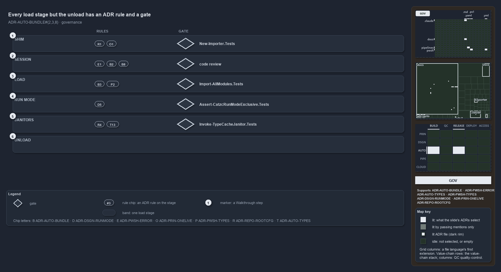

# Every load stage but the unload has an ADR rule and a gate

```text
Every load stage but the unload has an ADR rule and a gate.

1  Shim                    generated importer.ps1; gate New-Importer.Tests
2  Session                 preferences and two roots; gate code review
3  Load                    types before modules; gate Import-AllModules.Tests
4  Run mode                run modes never coexist; gate Assert-CatzcRunModeExclusive.Tests
5  Janitors                idempotent, actor-aware; gate Invoke-TypeCacheJanitor.Tests
6  Unload                  the import-time helpers removed; no rule and no gate

Supports ADR-AUTO-BUNDLE-TWOROOTS, ADR-AUTO-BUNDLE-ONELIVINGIMPORTER and ADR-AUTO-BUNDLE-BUNDLEISSESSION (governance lens).
```

The cats load sequence runs in six stages, from the generated shim to the final unload of the import-time helpers. Each stage but the last
is constrained by at least one ADR rule, and each of those stages is checked by a gate: a test for four of them, and code review for the
session set-up. The unload has neither a rule nor a gate.



The diagram is described element by element in [its asset description](.assets/rule-and-gate-per-load-stage/diagram.drawio.md). Each stage
has its own band, and a stage's gate sits in its band beside the rules it checks.

## Walkthrough

1. **Shim.** `importer.ps1` is fully managed: `New-Importer` renders it from one source of truth, and it carries no load logic of its own
   (ADR-REPO-ROOTCFG-FULLYMANAGED, ADR-PRIN-ONELIVE-ONEVERSION). `New-Importer.Tests` checks that the shim's parameter set equals
   `Invoke-Importer`'s and that the committed file equals the generated one.
2. **Session.** The importer sets `$ErrorActionPreference = 'Stop'` globally (ADR-PWSH-ERROR-STOPONERROR), anchors on the working root and
   the code root (ADR-AUTO-BUNDLE-TWOROOTS), and a bundle sets up the same session as source mode does (ADR-AUTO-BUNDLE-BUNDLEISSESSION).
   The gate is code review, the gate the platform-bundle ADR names: it rejects a scan of catzc's own code anchored on `RepositoryRoot`. No
   test checks the preferences.
3. **Load.** The bundle reuses the one importer so that the C# types and their accelerators register before any module loads
   (ADR-AUTO-BUNDLE-ONELIVINGIMPORTER, ADR-PWSH-TYPES-TYPEACCELERATORATTRIBUTE). `Import-AllModules.Tests` checks that a duplicated or
   shadowing function name fails the import, and `Import-CSharpTypes.Tests` and the walking-skeleton `Import-Catzc.Tests` also cover this
   stage.
4. **Run mode.** The two run modes never coexist (ADR-DSGN-RUNMODE-NEVERCOEXIST). The stage is itself a check:
   `Assert-CatzcRunModeExclusive` runs on every load and throws when a module from the other run mode's root is still loaded.
   `Assert-CatzcRunModeExclusive.Tests` checks it, and the eviction block of `Import-AllModules.Tests` checks the removal that comes before
   it.
5. **Janitors.** Generation is idempotent and runs on every import (ADR-REPO-ROOTCFG-IDEMPOTENTGENERATION), and who runs the importer
   decides what the janitors may change, read from `Get-SessionActor` (ADR-AUTO-TYPES-JANITORSBYCALLER). `Invoke-TypeCacheJanitor.Tests`
   checks that holders are never stopped in a `Pipeline` or `Agent` session.
6. **Unload.** `Invoke-Importer` removes `Catzc.Internal.Bootstrap`, and the entry script's `finally` removes `Catzc.Internal.Importer`. No
   ADR rule states this, and no test checks it; only the code comments and the project instructions describe it. That is why its band holds
   no rule and no gate.

Beyond the gate at each stage, `Test-Automation` and `Test-CatzcBuild` run the same tests in both modes, `Assert-CatzcBundle` checks every
build, and code review rejects a bundle loader that forks the importer.

## Why it holds

- An opted-in root file is materialised from exactly one source of truth (ADR-REPO-ROOTCFG-FULLYMANAGED), and the code holds one living
  version of every behaviour (ADR-PRIN-ONELIVE-ONEVERSION).
- The error preference is `Stop`, set globally by the importer (ADR-PWSH-ERROR-STOPONERROR). Cats anchors on two roots
  (ADR-AUTO-BUNDLE-TWOROOTS), and a bundle is a session, not a passive library (ADR-AUTO-BUNDLE-BUNDLEISSESSION).
- A bundle loads through the one living importer, so types and accelerators register before any module (ADR-AUTO-BUNDLE-ONELIVINGIMPORTER,
  ADR-PWSH-TYPES-TYPEACCELERATORATTRIBUTE).
- The two run modes never coexist in one session (ADR-DSGN-RUNMODE-NEVERCOEXIST).
- Root-config generation is idempotent and runs on every import (ADR-REPO-ROOTCFG-IDEMPOTENTGENERATION), and the session actor decides what
  the janitors may change (ADR-AUTO-TYPES-JANITORSBYCALLER).
- The run modes have two entry points (ADR-DSGN-RUNMODE-TWORUNMODES).

## Where the code and the ADR differ

- No ADR rule covers removing the Bootstrap and the importer after the load, although the code does it on every load.

## See also

- [Platform bundle](../../adr/automation/platform-bundle.md) — the decision this article explains. The stages also rest on
  [error-handling](../../adr/automation/pwsh/error-handling.md), [native-csharp-types](../../adr/automation/BCL/native-csharp-types.md),
  [hosting-csharp-types](../../adr/automation/pwsh/hosting-csharp-types.md), [run-modes](../../adr/design/run-modes.md),
  [one-living-version](../../adr/principles/one-living-version.md) and
  [generated-root-configs](../../adr/repository/generated-root-configs.md).
- The other lenses on the same load sequence: [meta](every-entry-runs-one-load-sequence.md),
  [architecture](two-entries-feed-one-importer.md), [implementation](invoke-importer-in-code-order.md) and
  [operations](dot-source-one-entry-script.md).
- [The automation explanations](index.md) · [How to read the diagrams](../index.md#how-to-read-the-diagrams)
