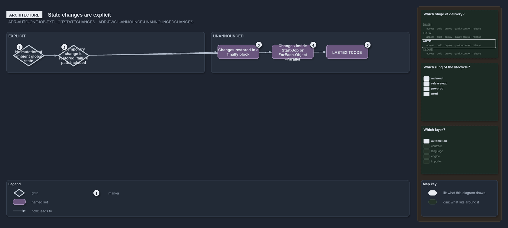

---
catzc:
  warning: "Experimental: this article merges two rules into one and holds nothing beyond what they say"
  edges:
    cites:
      - ADR-AUTO-ONEJOB-EXPLICITSTATECHANGES
      - ADR-PWSH-ANNOUNCE-UNANNOUNCEDCHANGES
---

# State changes are explicit and restored and some restored changes go unannounced

This article is one rule:
[ADR-AUTO-ONEJOB-EXPLICITSTATECHANGES](../../drs/automation/single-responsibility-functions.md#rule-adr-auto-onejob-explicitstatechanges)
and [ADR-PWSH-ANNOUNCE-UNANNOUNCEDCHANGES](../../drs/automation/pwsh/announce-state-changes.md#rule-adr-pwsh-announce-unannouncedchanges)
merged into one. It holds nothing beyond what those two rules say.

State changes are explicit: functions do not mutate ambient global state, error preferences, the working directory or environment variables,
as a side effect, and a temporary change is restored before the function returns, on the failure path as well as the success path. In pwsh
the changes left unannounced include a change restored in a `finally` block before the function returns, a change inside `Start-Job`,
`Start-ThreadJob` or `ForEach-Object -Parallel`, and PowerShell's own `$LASTEXITCODE`.

