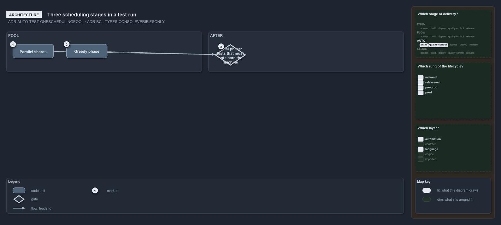

---
catzc:
  warning: "Experimental: this article merges two rules into one and holds nothing beyond what they say"
  edges:
    cites:
      - ADR-AUTO-TEST-ONESCHEDULINGPOOL
      - ADR-BCL-TYPES-CONSOLEVERIFIESONLY
---

# Tests that must not share the machine run serially and a console import loads nothing

This article is one rule: [ADR-AUTO-TEST-ONESCHEDULINGPOOL](../../drs/automation/test-automation.md#rule-adr-auto-test-oneschedulingpool)
and [ADR-BCL-TYPES-CONSOLEVERIFIESONLY](../../drs/automation/BCL/native-csharp-types.md#rule-adr-bcl-types-consoleverifiesonly) merged into
one. It holds nothing beyond what those two rules say.

A test run has three scheduling stages: the parallel shards and the greedy phase share one worker pool, and the serial phase runs after
both, with two optional phase tags naming tests that must not share the machine with the parallel pool. In a console session the importer
verifies the types assembly and loads nothing, so an import that runs no command pays no load.

