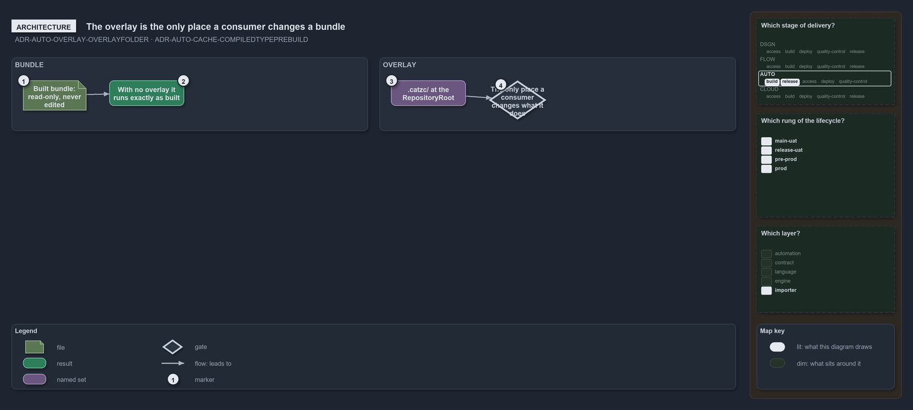

---
catzc:
  warning: "Experimental: this article merges two rules into one and holds nothing beyond what they say"
  edges:
    cites:
      - ADR-AUTO-OVERLAY-OVERLAYFOLDER
      - ADR-AUTO-CACHE-COMPILEDTYPEPREBUILD
---

# The consumers overlay is the only place to change a built bundle

This article is one rule: [ADR-AUTO-OVERLAY-OVERLAYFOLDER](../../drs/automation/consumer-overlay.md#rule-adr-auto-overlay-overlayfolder) and
[ADR-AUTO-CACHE-COMPILEDTYPEPREBUILD](../../drs/automation/caching.md#rule-adr-auto-cache-compiledtypeprebuild) merged into one. It holds
nothing beyond what those two rules say.

A consumer's overlay is the `.catzc/` folder at its `RepositoryRoot`: the only place a consumer changes what a built bundle does. The bundle
it runs is read-only and never edited, and the overlay is optional, as is every file in it; with none, the bundle runs exactly as built. The
compiled-type prebuild is the one committed, cross-session cache: one assembly for the whole repository, named for the combined hash of
every module's type sources.

