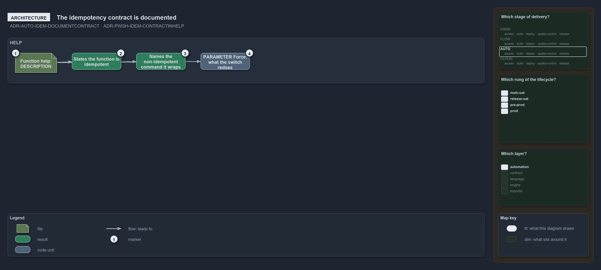

---
catzc:
  warning: "Experimental: this article merges two rules into one and holds nothing beyond what they say"
  edges:
    cites:
      - ADR-AUTO-IDEM-DOCUMENTCONTRACT
      - ADR-PWSH-IDEM-CONTRACTINHELP
---

# The idempotency contract is documented and written in the comment based help

This article is one rule:
[ADR-AUTO-IDEM-DOCUMENTCONTRACT](../../drs/automation/idempotent-state-functions.md#rule-adr-auto-idem-documentcontract) and
[ADR-PWSH-IDEM-CONTRACTINHELP](../../drs/automation/pwsh/idempotent-state-mechanics.md#rule-adr-pwsh-idem-contractinhelp) merged into one.
It holds nothing beyond what those two rules say.

Document the idempotency contract: a function's help states that it is idempotent, and notes when it wraps a non-idempotent external
command. In PowerShell the contract is written in the comment-based help: `.DESCRIPTION` states that the function is idempotent and names a
non-idempotent command it wraps, and a `.PARAMETER Force` says what the switch redoes.

