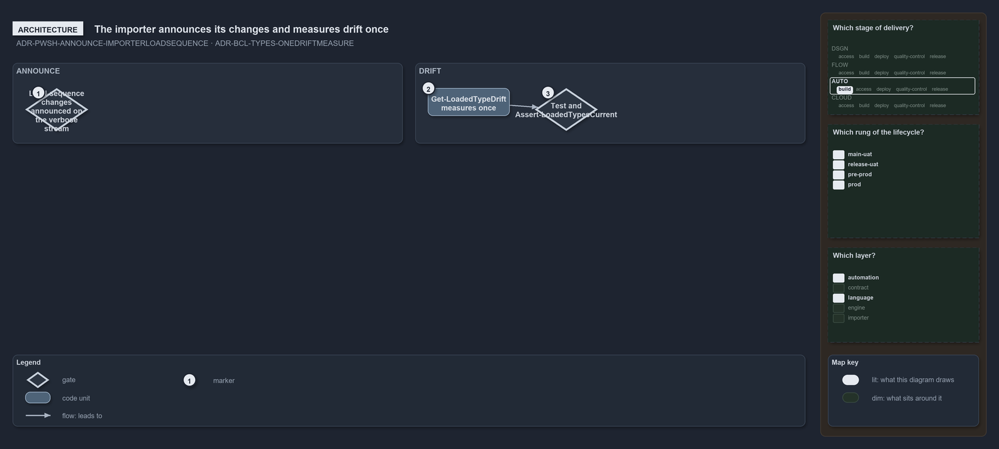

---
catzc:
  warning: "Experimental: this article merges two rules into one and holds nothing beyond what they say"
  edges:
    cites:
      - ADR-PWSH-ANNOUNCE-IMPORTERLOADSEQUENCE
      - ADR-BCL-TYPES-ONEDRIFTMEASURE
---

# The importer announces its own changes on the verbose stream and measures type drift once

This article is one rule:
[ADR-PWSH-ANNOUNCE-IMPORTERLOADSEQUENCE](../../drs/automation/pwsh/announce-state-changes.md#rule-adr-pwsh-announce-importerloadsequence)
and [ADR-BCL-TYPES-ONEDRIFTMEASURE](../../drs/automation/BCL/native-csharp-types.md#rule-adr-bcl-types-onedriftmeasure) merged into one. It
holds nothing beyond what those two rules say.

The importer's own load sequence is the load-sequence exception: the state changes it makes itself, session preferences, roots, vendor
modules, `PSModulePath`, the types assembly and the catzc modules, are announced on the verbose stream. Whether the loaded C# types are
current is measured in one place, `Get-LoadedTypeDrift`, and asked through one test and assert pair, `Test-LoadedTypesCurrent` and
`Assert-LoadedTypesCurrent`.

