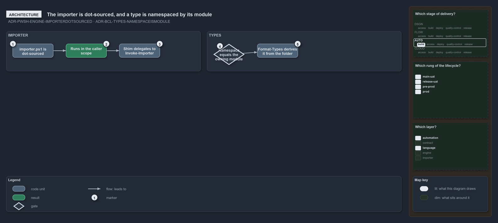

---
catzc:
  warning: "Experimental: this article merges two rules into one and holds nothing beyond what they say"
  edges:
    cites:
      - ADR-PWSH-ENGINE-IMPORTERDOTSOURCED
      - ADR-BCL-TYPES-NAMESPACEISMODULE
---

# The importer is always dot sourced and a types namespace is its module

This article is one rule:
[ADR-PWSH-ENGINE-IMPORTERDOTSOURCED](../../drs/automation/pwsh/pwsh-engine.md#rule-adr-pwsh-engine-importerdotsourced) and
[ADR-BCL-TYPES-NAMESPACEISMODULE](../../drs/automation/BCL/native-csharp-types.md#rule-adr-bcl-types-namespaceismodule) merged into one. It
holds nothing beyond what those two rules say.

`importer.ps1` is always dot-sourced, so it runs in the caller's scope and its session state lands in the caller's session; it is a
generated shim that carries only the importer's parameter block and delegates the whole load sequence to `Invoke-Importer`. Every type's
namespace equals its owning module and is declared in the source as a file-scoped `namespace <module>;`, derived from the folder, not
hand-authored.

