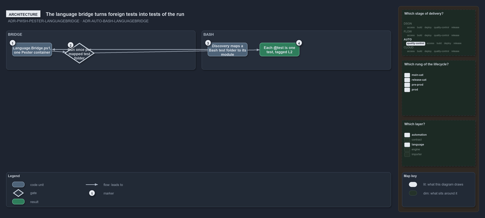

---
catzc:
  warning: "Experimental: this article merges two rules into one and holds nothing beyond what they say"
  edges:
    cites:
      - ADR-PWSH-PESTER-LANGUAGEBRIDGE
      - ADR-AUTO-BASH-LANGUAGEBRIDGE
---

# The language bridge is one pester container and bash tests run through it

This article is one rule: [ADR-PWSH-PESTER-LANGUAGEBRIDGE](../../drs/automation/pwsh/pester-testing.md#rule-adr-pwsh-pester-languagebridge)
and [ADR-AUTO-BASH-LANGUAGEBRIDGE](../../drs/automation/bash/bash-test-artifacts.md#rule-adr-auto-bash-languagebridge) merged into one. It
holds nothing beyond what those two rules say.

The language bridge is one Pester container, `Language.Bridge.ps1` in `Catzc.Base.QualityGates/tests/`, run once per mapped test folder with
the folder, its language and the engine entry. `Test-Automation` runs the Bash tests through the same bridge the Go and Python tests use:
discovery maps each Bash test folder to its catzc module, and the bridge turns every `@test` into one test of the run, tagged `L2`.

