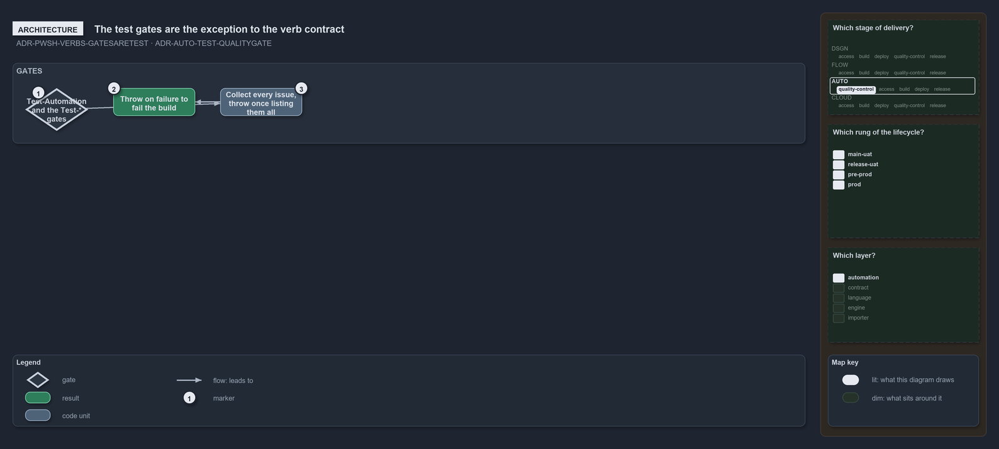

---
catzc:
  warning: "Experimental: this article merges two rules into one and holds nothing beyond what they say"
  edges:
    cites:
      - ADR-PWSH-VERBS-GATESARETEST
      - ADR-AUTO-TEST-QUALITYGATE
---

# The test gates are the sanctioned exception to the verb contract

This article is one rule:
[ADR-PWSH-VERBS-GATESARETEST](../../drs/automation/pwsh/respect-pwsh-verb-rules.md#rule-adr-pwsh-verbs-gatesaretest) and
[ADR-AUTO-TEST-QUALITYGATE](../../drs/automation/test-automation.md#rule-adr-auto-test-qualitygate) merged into one. It holds nothing beyond
what those two rules say.

The repository quality gates, `Test-Automation` and the `Test-*` gates it aggregates, are the sanctioned exception to the verb contract:
each throws on failure so it can fail the build. A quality gate is a gate, decided automatically, that checks one property of the whole
repository: one public `Test-<subject>` function that collects every issue and throws once listing them all.

