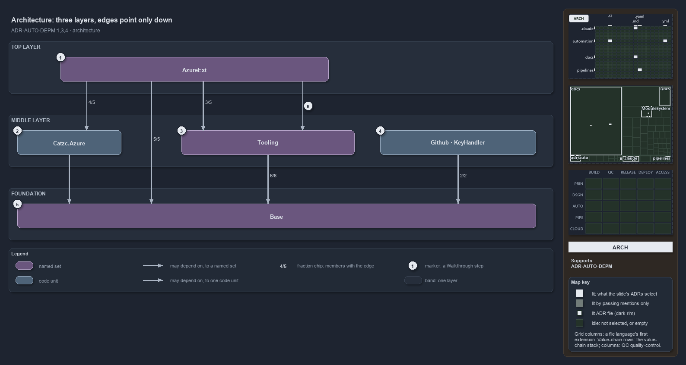

---
catzc:
  immutable:
    with_body_sha: a9f5e8f8eb54
    path: docs/explanation/automation/three-layers-edges-point-down.md
    folder: docs/explanation/automation
    name: three-layers-edges-point-down
    filetype: md
    kind: explanation
    language: markdown
    track: docs
    tracktype: documentation
  edges:
    cites:
      - ADR-AUTO-DEPM#{1,3,4}
    links:
      - docs/.assets/explanation/adr-auto-depm--three-layers-edges-point-down--architecture.drawio.md
      - docs/.assets/explanation/adr-auto-depm--three-layers-edges-point-down--architecture.drawio.png
      - docs/adr/automation/controlling-module-dependencies.md
      - docs/explanation/automation/a-declared-allow-list-of-layers.md
      - docs/explanation/automation/index.md
      - docs/explanation/automation/two-gates-check-the-layer-pins.md
      - docs/explanation/automation/two-sections-unioned-into-one-allow-set.md
      - docs/explanation/automation/undeclared-edge-fails-with-one-line.md
      - docs/explanation/index.md#how-to-read-the-diagrams
---

# Module dependencies form three layers, and every edge points down

```text
Module dependencies form three layers, and every allowed edge points down.

1  AzureExt             top layer: the five Azure extension modules, one group
2  Catzc.Azure          middle layer: the Azure root, one module
3  Tooling              middle layer: the six external-tool modules, one group
4  Github, KeyHandler   middle layer: two Tooling modules that belong to no group
5  Base                 foundation: 26 libraries that everything rests on
6  Cli -> Tooling.Core  the one edge from the top layer to a single Tooling module

Supports ADR-AUTO-DEPM#1, #3 and #4 (architecture lens).
```

Cats is built from about forty PowerShell modules that call one another. To keep that web from tangling, every dependency between modules is
declared up front in one file, `dependencies.yml`, and the declaration is the allow-list: an edge the file does not permit fails the build.
Seen from far enough away, the declared graph has a simple shape. The modules sit in three layers, and every allowed dependency points down
to a lower one.



The diagram is described element by element in
[its asset description](../../.assets/explanation/adr-auto-depm--three-layers-edges-point-down--architecture.drawio.md).

## Walkthrough

1. **AzureExt.** The top of the graph is one group: the five Azure extension modules that sit below the `Catzc.Azure` root. Inside the
   group, Cli is the root that the others build on. Four of the five may use `Catzc.Azure`, three may use the Tooling group, and all five
   may use Base.
2. **Catzc.Azure.** The Azure root is a single module in the middle of the graph. It depends on Base alone.
3. **Tooling.** The six modules that install and manage external tools form the group in the middle of the graph. Core is their foundation,
   Provisioning orchestrates the whole devbox on top of the others, and every member may use Base.
4. **Github and KeyHandler.** Two Tooling modules belong to no group. Each is declared on its own, and both may use Base.
5. **Base.** The foundation is a group of 26 small libraries. Two of them, Asserts and Engines, depend on nothing at all, and every declared
   module in cats ultimately rests on this layer.
6. **Cli to Tooling.Core.** One edge from the top of the graph names a single module instead of a whole group: Cli may use Tooling's Core,
   but no other Tooling member. The edge from AzureExt to `Catzc.Azure` is the other single-module edge in the diagram.

## Why it holds

- The declaration is the only place a module dependency can exist, and an undeclared edge fails the build (ADR-AUTO-DEPM#1).
- A group is a concept, not a folder on disk. Depending on a group permits an edge to any of its members, while naming a module permits
  exactly that one edge (ADR-AUTO-DEPM#3).
- The declaration is checked when it loads, so every target must exist and no cycle may form, and the quality gate then checks every real
  edge in the code against it (ADR-AUTO-DEPM#4).

## Where the code and the ADR differ

The ADR says a module missing from the `modules:` section is unconstrained. The code also constrains every member of a group, so a Base
library that appears only in `groups:` is still held to the Base group's internal order.

## See also

- [Controlling module dependencies](../../adr/automation/controlling-module-dependencies.md) — the decision this article explains.
- The other lenses on the same graph: [meta](a-declared-allow-list-of-layers.md),
  [implementation](two-sections-unioned-into-one-allow-set.md), [operations](undeclared-edge-fails-with-one-line.md) and
  [governance](two-gates-check-the-layer-pins.md).
- [The automation explanations](index.md) · [How to read the diagrams](../index.md#how-to-read-the-diagrams)
