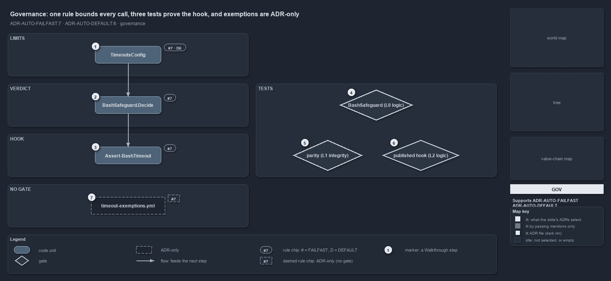

# docs/explanation/automation/three-tests-prove-the-hook.md

`One rule bounds every call, three tests prove the hook, and the exemption route is ADR-only`

```text
One rule bounds every agent call, three tests prove the hook at three tiers, and the exemption route is ADR-only.

1  TimeoutsConfig             the limits, validated at load, defaults declared once (ADR-AUTO-FAILFAST#7, ADR-AUTO-DEFAULT#6)
2  BashSafeguard.Decide       the verdict that applies the bash limits to a call (ADR-AUTO-FAILFAST#7)
3  Assert-BashTimeout         the hook that denies a call outside them (ADR-AUTO-FAILFAST#7)
4  BashSafeguard (L0 logic)   the verdict against fixture limits: every rule, actor and wording
5  parity (L1 integrity)      the published hook against the shipped config, against Get-TimeoutSeconds
6  published hook (L2 logic)  the published program end to end: allow, deny, log, and the error exit
7  timeout-exemptions.yml     a budget exemption raises a limit, but no code applies it to a Bash call

Supports ADR-AUTO-FAILFAST#7 and ADR-AUTO-DEFAULT#6 (governance lens).
```

One rule governs the whole path of an agent's shell call through cats: every wait is bounded, the limits live in one config, and a hook
denies a call outside them. A second rule fixes where the defaults live. Three tests, one per tier, prove that the hook keeps to the rule as
published, not just as written. One route the rule offers, exempting slow work by its budget GUID, has no code behind it for a Bash call.



The diagram is described element by element in
[its asset description](../../.assets/explanation/adr-auto-failfast--three-tests-prove-the-hook--governance.drawio.md).

## Walkthrough

1. **TimeoutsConfig.** The limits are keyed by run environment and shell, every value is a positive whole number of seconds, and there is no
   "no limit" value; constructing the type validates all of that and throws once with every violation. The sensible defaults are declared on
   the type, once, so the file states only what has been tuned.
2. **BashSafeguard.Decide.** The verdict applies the bash limits to one call: a foreground timeout within the foreground limit, or a
   `timeout` prefix within the background limit around one command. It is the module's own type, so it is governed and tested where the
   limits are.
3. **Assert-BashTimeout.** The hook compiles that verdict and those limits in, and denies a call outside them with a reason. It never
   rewrites a call.
4. **BashSafeguard (L0 logic).** The verdict's own tests run `Decide` against fixture limits, 7 s and 70 s at a devbox, 60 s and 600 s in a
   pipeline, and cover the run environment, every foreground and background case, who is asked to act on a denial, the denial output and the
   log line.
5. **Parity (L1 integrity).** An integrity test publishes the hook and runs it against the shipped `timeouts.yml`: it must allow exactly the
   foreground limit `Get-TimeoutSeconds -Shell Bash` resolves and deny one millisecond more, and allow exactly the background limit and deny
   one second more.
6. **Published hook (L2 logic).** A test publishes the program against a fixture repository and drives it end to end: an allowed foreground
   and background call, a denied background call that is also logged, a denied foreground call naming the limit, and a payload the hook
   cannot read, which exits 1 as a non-blocking error.
7. **timeout-exemptions.yml.** The rule offers one route for work that must run longer while it is tuned: an immutable budget GUID, exempted
   in `timeout-exemptions.yml`, raises its limit to a ceiling. The pwsh side applies that in `Get-TimeoutSeconds`. The hook reads no
   exemption and a Bash call carries no budget, so for an agent's shell call this route stands in the rule alone.

## Why it holds

- Every wait runs inside a time safeguard; the limits live in one config, `timeouts.yml`, keyed by run environment and execution engine,
  with no "no limit" value; the bash limits bound every shell call an agent makes and a hook denies a call outside them; and the hook
  compiles the module's own config and verdict types, proven by an integrity test against the shipped config (ADR-AUTO-FAILFAST#7).
- A setting resolves in one fixed order, and its sensible default is declared once on the config type (ADR-AUTO-DEFAULT#6).

## Where the code and the ADR differ

- The ADR offers an exemption in `timeout-exemptions.yml` as the way to run longer while a limit is tuned. The hook never reads that file,
  so an exemption, even one scoped to the bash shell, changes no verdict on an agent's Bash call.
- The ADR says the run environment comes from `Get-RunEnvironment`. The hook decides it with `BashSafeguard.EnvironmentOf`; an L0 test keeps
  the two in agreement.
- The ADR states that an agent cannot start a shell call that has no limit. A hook error exits 1 as a non-blocking error and the call goes
  ahead, and the L2 test asserts exactly that exit.

## See also

- [Fail fast with inline assertions](../../adr/automation/fail-fast-with-asserts.md) — the decision this article explains.
- [Sensible defaults](../../adr/automation/sensible-defaults.md) — the resolution order of a setting, ADR-AUTO-DEFAULT#6.
- The other lenses on the same verdict: [meta](a-shell-call-carries-its-limit-or-is-denied.md),
  [architecture](hook-compiles-module-verdict-and-limits.md), [implementation](decide-returns-null-or-a-reason.md) and
  [operations](pass-the-limit-or-the-call-is-denied.md).
- [The automation explanations](index.md) · [How to read the diagrams](../index.md#how-to-read-the-diagrams)
