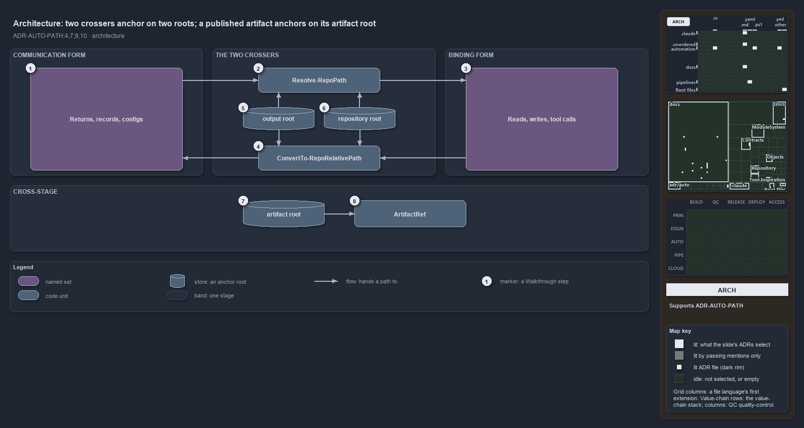

---
catzc:
  derived:
    path: docs/explanation/automation/two-crossers-and-three-anchors.md
    kind: explanation
    language: markdown
    track: docs
    body_sha: a93d455cb4f2
    adrs:
      - ADR-AUTO-PATH#{4,7,9,10}
    links:
      - docs/.assets/explanation/adr-auto-path--two-crossers-and-three-anchors--architecture.drawio.md
      - docs/.assets/explanation/adr-auto-path--two-crossers-and-three-anchors--architecture.drawio.png
      - docs/adr/automation/path-representation.md
      - docs/explanation/automation/index.md
      - docs/explanation/automation/one-out-string-two-places.md
      - docs/explanation/automation/output-root-first-then-repo-root.md
      - docs/explanation/automation/two-forms-never-a-third.md
      - docs/explanation/automation/types-check-forms-review-checks-crossers.md
      - docs/explanation/index.md#how-to-read-the-diagrams
---

# Two crossers anchor on two roots, and a published artifact anchors on its artifact root

```text
Two crossers anchor on the repository root and the output root; a published artifact anchors on its own artifact root.

1  Returns, records, configs   where a communication-form path lives: a return value, a record field, a checked-in config
2  Resolve-RepoPath            the crosser into binding form, anchored on one of the two roots
3  Reads, writes, tool calls   the side-effect lines that consume binding form
4  ConvertTo-RepoRelativePath  the crosser into communication form, relativized against one of the two roots
5  output root                 Get-OutputRoot: {root}/out on a devbox, the staging directory in a pipeline
6  repository root             Get-RepositoryRoot: the working root the importer sets, never $PWD
7  artifact root               the only anchor that survives a stage boundary
8  ArtifactRef                 the cross-stage type: both forms, anchored on the artifact root

Supports ADR-AUTO-PATH#4, #7, #9 and #10 (architecture lens).
```

The path contract of cats is built from two functions in `Catzc.Base.Repository` and three anchors. `ConvertTo-RepoRelativePath` and
`Resolve-RepoPath` are the only boundary crossers, and each decides between the output root and the repository root. A published artifact
crosses a stage boundary, where neither root survives, so its type `ArtifactRef` in `Catzc.Base.Objects` anchors on the artifact root
instead.



The diagram is described element by element in
[its asset description](../../.assets/explanation/adr-auto-path--two-crossers-and-three-anchors--architecture.drawio.md).

## Walkthrough

1. **Returns, records, configs.** A return value, a `DictionaryRecord` field, a deployment-context artifact or a source-controlled config
   holds a communication-form path: relative, slash-separated, normalized. `ContractAsset` and `rootconfig.yml` are two of the records that
   hold this form. A caller that needs to bind such a path hands it to `Resolve-RepoPath`.
2. **Resolve-RepoPath.** The crosser into binding form. An `out/` path is joined onto the output root, any other relative path onto the
   repository root, and a rooted path passes through. The absolute result goes to the line that uses it.
3. **Reads, writes, tool calls.** `Get-Content`, `Import-Module`, `Test-Path` and the external tools consume binding form, and only there is
   an absolute path correct. A tool run through `Invoke-Executable` starts in the repository root, so a repo-relative path binds there on
   its own; an `out/` path still needs the resolve. A path in hand on this side, absolute, `.\` or `..`, goes to
   `ConvertTo-RepoRelativePath` before it is stored.
4. **ConvertTo-RepoRelativePath.** The crosser into communication form. It relativizes against the output root first, then the repository
   root, and returns a normalized absolute path when the input lies under neither. The binding helpers `Get-RepositoryFile` and
   `Get-RepositoryFolder` are one call to `Resolve-RepoPath` each, so the normalization lives in one place.
5. **output root.** `Get-OutputRoot` is `{root}/out` on a devbox and `BUILD_ARTIFACTSTAGINGDIRECTORY` in a pipeline, which is why `out/` is
   a reserved anchor: both crossers treat it as the output root, never as a folder under the repository root.
6. **repository root.** `Get-RepositoryRoot` returns `$env:RepositoryRoot`, the working root the importer sets. Both crossers resolve
   against it, never against the current directory.
7. **artifact root.** When a build stage publishes a file and a deploy stage downloads it, the publish step strips the `out/template/`
   prefix, so the output root does not survive. The artifact root, the producer's `output_folder` or the consumer's downloaded folder, is
   the one anchor both sides share.
8. **ArtifactRef.** The cross-stage type holds an artifact-relative path and the producing context's absolute path. Its factory takes the
   raw path and the artifact root, and the consumer re-resolves against its own artifact root with `ResolveAt` and checks with `ExistsAt`.
   It uses neither crosser and never the `out/` anchor. A fourth anchor, `{workspace}` for a sibling checkout, is resolved by
   `InspirationRoot` in `Catzc.Tooling.Inspiration`.

## Why it holds

- Normalization is centralized: the two crossers are the only sanctioned way across the boundary (ADR-AUTO-PATH#4).
- A path is named by its form: the two crossers cross, and `Get-RepositoryFile` and `Get-RepositoryFolder` are binding helpers
  (ADR-AUTO-PATH#7).
- `out/` is a reserved anchor that `Resolve-RepoPath` re-anchors against `Get-OutputRoot`, not the repository root (ADR-AUTO-PATH#9).
- A published artifact is created by `ArtifactRef`, holds both forms and anchors on the artifact root (ADR-AUTO-PATH#10).

## Where the code and the ADR differ

- The ADR keeps `RepoRelativePath` repo-root-pure, yet its `ToAbsolute` joins every relative value onto the repository root and knows no
  `out/` anchor, a third resolver beside the two crossers.
- The ADR's prose says `ConvertTo-RepoRelativePath` relativizes against the repository root; the function tries the output root first.

## See also

- [Path representation](../../adr/automation/path-representation.md) — the decision this article explains.
- The other views of the same boundary: [meta](two-forms-never-a-third.md), [implementation](output-root-first-then-repo-root.md),
  [operations](one-out-string-two-places.md) and [governance](types-check-forms-review-checks-crossers.md).
- [The automation explanations](index.md) · [How to read the diagrams](../index.md#how-to-read-the-diagrams)
