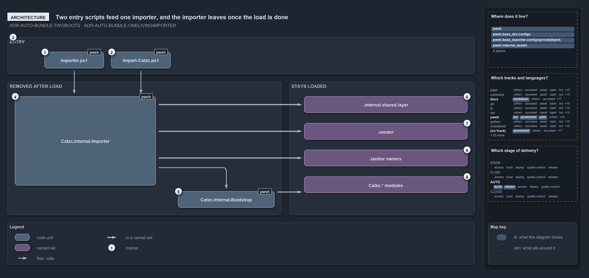

# Two entry scripts feed one importer, and the importer leaves once the load is done

```text
Two entry scripts feed one importer, and the importer leaves once the load is done.

1  importer.ps1               the source-mode entry, a generated shim
2  Import-Catzc.ps1           the build-mode entry, copied into every build
3  Two roots                  the working root and the code root
4  Catzc.Internal.Importer    runs every load stage; removed by the entry script
5  Catzc.Internal.Bootstrap   discovery, eviction, manifests, C# types; removed by the importer
6  .internal shared layer     Loader, Types and Vendor, which stay loaded
7  .vendor                    the vendored third-party modules
8  Catzc.* modules            every module folder, on top of one combined types DLL
9  Janitor owners             the seven modules whose functions the janitors call

Supports ADR-AUTO-BUNDLE-TWOROOTS and ADR-AUTO-BUNDLE-ONELIVINGIMPORTER (architecture lens).
```

Cats has two run modes, and each has its own entry script: `importer.ps1` for source mode and `Import-Catzc.ps1` for build mode. Both hand
the whole load to the same `Catzc.Internal.Importer`, so there is one living load sequence instead of two. The importer and its Bootstrap
only orchestrate the import. They remove themselves when it is done, and what stays in the session is the `.internal` layer that every
module shares, the vendored modules and the catzc modules.

```yml drawio
description:
  Two entry scripts, one per run mode, feed one importer; the importer and its bootstrap are removed once the load is done, and the shared
  internal layer, the vendored modules, the modules and the janitor owners stay loaded.
about:
  rules: [ADR-AUTO-BUNDLE-TWOROOTS, ADR-AUTO-BUNDLE-ONELIVINGIMPORTER]
  lens: architecture
content:
  title: Two entry scripts feed one importer, and the importer leaves once the load is done
  kind: explanation
  flow: top-to-bottom
  theme: dark
  bands:
    - { id: band-entry, label: ENTRY }
    - { id: band-removed, label: REMOVED AFTER LOAD }
    - { id: band-stays, label: STAYS LOADED }
  glyphs:
    - { id: g-importer-ps1, kind: code, label: importer.ps1, in: band-entry }
    - { id: g-import-catzc, kind: code, label: Import-Catzc.ps1, in: band-entry }
    - { id: g-importer, kind: code, label: Catzc.Internal.Importer, in: band-removed }
    - { id: g-bootstrap, kind: code, label: Catzc.Internal.Bootstrap, in: band-removed }
    - { id: s-internal, kind: set, label: .internal shared layer, in: band-stays }
    - { id: s-vendor, kind: set, label: .vendor, in: band-stays }
    - { id: s-janitors, kind: set, label: Janitor owners, in: band-stays }
    - { id: s-modules, kind: set, label: Catzc.* modules, in: band-stays }
  edges:
    - { from: g-importer-ps1, to: g-importer, kind: flow, label: calls }
    - { from: g-import-catzc, to: g-importer, kind: flow, label: calls }
    - { from: g-importer, to: s-internal, kind: thick, label: "" }
    - { from: g-importer, to: s-vendor, kind: thick, label: "" }
    - { from: g-importer, to: s-janitors, kind: thick, label: "" }
    - { from: g-importer, to: g-bootstrap, kind: flow, label: calls }
    - { from: g-bootstrap, to: s-modules, kind: thick, label: "" }
  markers:
    - { at: g-importer-ps1, number: 1 }
    - { at: g-import-catzc, number: 2 }
    - { at: band-entry, number: 3 }
    - { at: g-importer, number: 4 }
    - { at: g-bootstrap, number: 5 }
    - { at: s-internal, number: 6 }
    - { at: s-vendor, number: 7 }
    - { at: s-modules, number: 8 }
    - { at: s-janitors, number: 9 }
  legend: auto
  minimaps: [code-locations, grid, axis]
layout:
  band-entry: { x: 20, y: 84, w: 1260, h: 100 }
  band-removed: { x: 20, y: 204, w: 740, h: 360 }
  band-stays: { x: 780, y: 204, w: 500, h: 360 }
  g-importer-ps1: { x: 120, y: 124, w: 160, h: 44 }
  g-import-catzc: { x: 300, y: 124, w: 160, h: 44 }
  g-importer: { x: 40, y: 244, w: 380, h: 240 }
  g-bootstrap: { x: 480, y: 500, w: 260, h: 44 }
  s-internal: { x: 820, y: 244, w: 440, h: 44 }
  s-vendor: { x: 820, y: 316, w: 440, h: 44 }
  s-janitors: { x: 820, y: 388, w: 440, h: 44 }
  s-modules: { x: 820, y: 460, w: 440, h: 44 }
```



## Walkthrough

1. **importer.ps1.** The source-mode entry is a generated shim that `New-Importer` renders, as `rootconfig.yml` declares. It sets
   `$env:RepositoryRoot`, loads `Catzc.Internal.Loader` by path, imports the importer, calls `Invoke-Importer`, and removes the importer
   again in its `finally` block.
2. **Import-Catzc.ps1.** The build-mode entry is authored once under `pwsh/.internal/assets/` and copied into every build. It calls
   `Invoke-Importer -Bundle`. A build's `Catzc.psm1` dot-sources the same file, so `Import-Module Catzc` sets up the same session.
3. **Two roots.** The working root, `$env:RepositoryRoot`, is where `out/` and repo-relative paths resolve. The code root,
   `$env:CatzcModulesRoot`, is where the loaded code lives, and config, type and vendor discovery follow it. Source mode derives the code
   root as `<RepositoryRoot>/pwsh`. `Import-Catzc.ps1` sets it to the build's own folder, and `-Bundle` honours that value.
4. **Catzc.Internal.Importer.** This module holds `Invoke-Importer`, which runs every load stage in order and proves that only one run mode
   is loaded. The entry script removes it once the load returns.
5. **Catzc.Internal.Bootstrap.** The Bootstrap does the discovery, the eviction of stale and foreign modules, the manifests and the C# types
   through its `Import-AllModules`. `Invoke-Importer` removes it at the end of the load.
6. **`.internal shared layer`.** `Catzc.Internal.Loader`, `Catzc.Internal.Types` and `Catzc.Internal.Vendor` stay loaded, so cover functions
   can reuse the same shared code after the import.
7. **.vendor.** The vendored third-party modules are powershell-yaml, Pester and PSScriptAnalyzer. Pester and PSScriptAnalyzer load lazily.
8. **Catzc.\* modules.** Each module folder is imported as its own module, on top of the one combined `Catzc.Types.<hash>.dll`, which loads
   before any module.
9. **Janitor owners.** Seven modules own the functions the janitors call: Docs, QualityGates, RootConfig, TypesSystem, Git, ModuleSystem and
   Tooling.Core. They stay loaded like every other module; only the janitor calls can be skipped. A build and `-SkipJanitors` never make
   them.

The bash entry, `importer.sh`, is not a third load path: its `cats` dispatcher starts `pwsh` and dot-sources `importer.ps1`.

## Why it holds

- Cats anchors on two roots, not one. The working root and the code root coincide in the repository and differ in an install, and every
  config, type and vendor scan follows the code root (ADR-AUTO-BUNDLE-TWOROOTS).
- A bundle loads by running the one living importer in its `-Bundle` mode, never a forked bootstrap, so the types and their accelerators
  register before any module loads in both modes (ADR-AUTO-BUNDLE-ONELIVINGIMPORTER).

## See also

- [Platform bundle](../../drs/automation/platform-bundle.md) — the decision this article explains.
- The other lenses on the same load sequence: [meta](every-entry-runs-one-load-sequence.md),
  [implementation](invoke-importer-in-code-order.md), [operations](dot-source-one-entry-script.md) and
  [governance](rule-and-gate-per-load-stage.md).
- [The automation explanations](index.md) · [How to read the diagrams](../index.md#how-to-read-the-diagrams)
