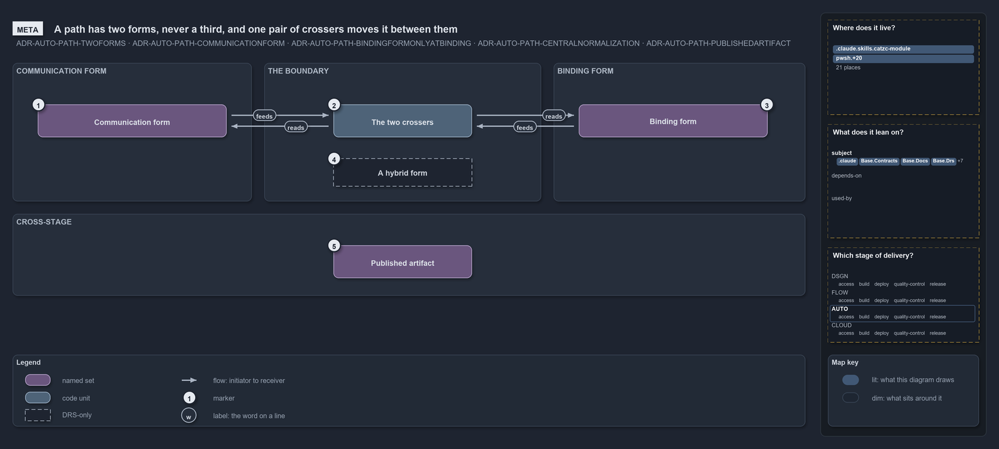

---
catzc:
  warning: "Header is generated by Format-FileMeta via Format-Code; do not change it"
  edges:
    cites:
      - ADR-AUTO-PATH-TWOFORMS
      - ADR-AUTO-PATH-COMMUNICATIONFORM
      - ADR-AUTO-PATH-BINDINGFORMONLYATBINDING
      - ADR-AUTO-PATH-CENTRALNORMALIZATION
      - ADR-AUTO-PATH-PUBLISHEDARTIFACT
    drs_total: 5
---

# A path has two forms, never a third, and one pair of crossers moves it between them

```text
A path has two forms, never a third, and one pair of crossers moves it between them.

1  Communication form  relative, slash-separated and normalized: what is stored, returned or logged
2  The two crossers    the only two functions that move a path across the boundary
3  Binding form        the normalized absolute path, alive only on the line that uses it
4  A hybrid form       {root}/./sub: neither form, always a bug, produced by nothing
5  Published artifact  a file that crosses a stage boundary, anchored on its own artifact root

Supports ADR-AUTO-PATH-TWOFORMS, ADR-AUTO-PATH-COMMUNICATIONFORM, ADR-AUTO-PATH-BINDINGFORMONLYATBINDING, ADR-AUTO-PATH-CENTRALNORMALIZATION and ADR-AUTO-PATH-PUBLISHEDARTIFACT (meta lens).
```

Every path that moves through cats is either data or an address. As data it is in communication form: relative to the repository root or the
output root, slash-separated, with no `.` or `..` segments, so it reads the same on a workstation and on a build agent. As an address it is
in binding form: a normalized absolute path that exists only on the line that reads, writes, or hands the path to a tool. Two functions, and
only two, move a path from one form to the other, so normalization is a guarantee rather than a hope.

```yml drawio
description:
  A path has a communication form and a binding form, never a third; one pair of crossers moves it between them, a hybrid form is always a
  bug, and a published artifact anchors on its own root across a stage boundary.
about:
  adrs:
    - ADR-AUTO-PATH-TWOFORMS
    - ADR-AUTO-PATH-COMMUNICATIONFORM
    - ADR-AUTO-PATH-BINDINGFORMONLYATBINDING
    - ADR-AUTO-PATH-CENTRALNORMALIZATION
    - ADR-AUTO-PATH-PUBLISHEDARTIFACT
  lens: meta
content:
  title: A path has two forms, never a third, and one pair of crossers moves it between them
  kind: explanation
  flow: left-to-right
  relation: crosses the boundary
  theme: dark
  bands:
    - { id: band-communication, label: COMMUNICATION FORM }
    - { id: band-boundary, label: THE BOUNDARY }
    - { id: band-binding, label: BINDING FORM }
    - { id: band-stage, label: CROSS-STAGE }
  glyphs:
    - { id: s-communication, kind: set, label: Communication form, in: band-communication }
    - { id: g-crossers, kind: code, label: The two crossers, in: band-boundary }
    - { id: a-hybrid, kind: drsonly, label: A hybrid form, in: band-boundary }
    - { id: s-binding, kind: set, label: Binding form, in: band-binding }
    - { id: s-artifact, kind: set, label: Published artifact, in: band-stage }
  edges:
    - { from: s-communication, to: g-crossers, kind: flow, label: "" }
    - { from: g-crossers, to: s-binding, kind: flow, label: "" }
    - { from: s-binding, to: g-crossers, kind: flow, label: "" }
    - { from: g-crossers, to: s-communication, kind: flow, label: "" }
  markers:
    - { at: s-communication, number: 1 }
    - { at: g-crossers, number: 2 }
    - { at: s-binding, number: 3 }
    - { at: a-hybrid, number: 4 }
    - { at: s-artifact, number: 5 }
  legend: auto
  minimaps:
    code-locations:
      - cell: .claude/.claude/skills/catzc-module
        by: [.claude/skills/catzc-module/SKILL.md, ADR-AUTO-PATH-BINDINGFORMONLYATBINDING, ADR-AUTO-PATH-TWOFORMS]
      - cell: docs/-/.
        by:
          - docs/drs/automation/dora-explains.md
          - docs/drs/automation/path-representation.md
          - docs/drs/glossary.md
          - docs/drs/index.md
          - docs/references/pwsh/catzc-base-contracts/Get-Contract.ps1.md
          - docs/references/pwsh/catzc-base-contracts/Publish-ContractRelease.ps1.md
          - docs/references/pwsh/catzc-base-contracts/private/Get-ContractFileHashes.ps1.md
          - docs/references/pwsh/catzc-base-contracts/tests/types/ContractAsset.Tests.ps1.md
          - docs/references/pwsh/catzc-base-contracts/types/ContractAsset.cs.md
          - docs/references/pwsh/catzc-base-docs/configs/readme.yml.md
          - docs/references/pwsh/catzc-base-docs/types/DocMapping.cs.md
          - docs/references/pwsh/catzc-base-docs/types/DocPattern.cs.md
          - docs/references/pwsh/catzc-base-module-system/Copy-CatzcModule.ps1.md
          - docs/references/pwsh/catzc-base-objects/types/ArtifactRef.cs.md
          - docs/references/pwsh/catzc-base-objects/types/RepoRelativePath.cs.md
          - docs/references/pwsh/catzc-base-repository/ConvertTo-RepoRelativePath.ps1.md
          - docs/references/pwsh/catzc-base-repository/Resolve-RepoPath.ps1.md
          - docs/references/pwsh/catzc-base-root-config/configs/rootconfig.yml.md
          - docs/references/pwsh/catzc-base-root-config/types/RootConfigFile.cs.md
          - docs/references/pwsh/catzc-tooling-inspiration/private/Resolve-InspirationRoot.ps1.md
          - docs/references/pwsh/catzc-tooling-inspiration/types/InspirationRoot.cs.md
          - ADR-AUTO-PATH-BINDINGFORMONLYATBINDING
          - ADR-AUTO-PATH-CENTRALNORMALIZATION
          - ADR-AUTO-PATH-COMMUNICATIONFORM
          - ADR-AUTO-PATH-PUBLISHEDARTIFACT
          - ADR-AUTO-PATH-TWOFORMS
      - cell: pwsh/Catzc.Base.Contracts/.
        by:
          - pwsh/Catzc.Base.Contracts/Get-Contract.ps1
          - pwsh/Catzc.Base.Contracts/Publish-ContractRelease.ps1
          - ADR-AUTO-PATH-COMMUNICATIONFORM
      - cell: pwsh/Catzc.Base.Contracts/private
        by: [pwsh/Catzc.Base.Contracts/private/Get-ContractFileHashes.ps1, ADR-AUTO-PATH-COMMUNICATIONFORM]
      - cell: pwsh/Catzc.Base.Contracts/tests
        by: [pwsh/Catzc.Base.Contracts/tests/Get-Contract.Tests.ps1, ADR-AUTO-PATH-COMMUNICATIONFORM]
      - cell: pwsh/Catzc.Base.Contracts/tests/types
        by: [pwsh/Catzc.Base.Contracts/tests/types/ContractAsset.Tests.ps1, ADR-AUTO-PATH-COMMUNICATIONFORM, ADR-AUTO-PATH-TWOFORMS]
      - cell: pwsh/Catzc.Base.Contracts/types
        by: [pwsh/Catzc.Base.Contracts/types/ContractAsset.cs, ADR-AUTO-PATH-COMMUNICATIONFORM, ADR-AUTO-PATH-TWOFORMS]
      - cell: pwsh/Catzc.Base.Docs/configs
        by:
          - pwsh/Catzc.Base.Docs/configs/readme.yml
          - ADR-AUTO-PATH-BINDINGFORMONLYATBINDING
          - ADR-AUTO-PATH-CENTRALNORMALIZATION
          - ADR-AUTO-PATH-COMMUNICATIONFORM
          - ADR-AUTO-PATH-PUBLISHEDARTIFACT
          - ADR-AUTO-PATH-TWOFORMS
      - cell: pwsh/Catzc.Base.Docs/types
        by:
          - pwsh/Catzc.Base.Docs/types/DocMapping.cs
          - pwsh/Catzc.Base.Docs/types/DocPattern.cs
          - ADR-AUTO-PATH-BINDINGFORMONLYATBINDING
          - ADR-AUTO-PATH-CENTRALNORMALIZATION
          - ADR-AUTO-PATH-COMMUNICATIONFORM
          - ADR-AUTO-PATH-PUBLISHEDARTIFACT
          - ADR-AUTO-PATH-TWOFORMS
      - cell: pwsh/Catzc.Base.Drs/configs
        by:
          - pwsh/Catzc.Base.Drs/configs/drs.yml
          - ADR-AUTO-PATH-BINDINGFORMONLYATBINDING
          - ADR-AUTO-PATH-CENTRALNORMALIZATION
          - ADR-AUTO-PATH-COMMUNICATIONFORM
          - ADR-AUTO-PATH-PUBLISHEDARTIFACT
          - ADR-AUTO-PATH-TWOFORMS
      - cell: pwsh/Catzc.Base.ModuleSystem/.
        by:
          - pwsh/Catzc.Base.ModuleSystem/Copy-CatzcModule.ps1
          - ADR-AUTO-PATH-BINDINGFORMONLYATBINDING
          - ADR-AUTO-PATH-CENTRALNORMALIZATION
          - ADR-AUTO-PATH-COMMUNICATIONFORM
          - ADR-AUTO-PATH-PUBLISHEDARTIFACT
          - ADR-AUTO-PATH-TWOFORMS
      - cell: pwsh/Catzc.Base.ModuleSystem/configs
        by: [pwsh/Catzc.Base.ModuleSystem/configs/glossary.yml, ADR-AUTO-PATH-PUBLISHEDARTIFACT]
      - cell: pwsh/Catzc.Base.Objects/tests/types
        by: [pwsh/Catzc.Base.Objects/tests/types/ArtifactRef.Tests.ps1, ADR-AUTO-PATH-PUBLISHEDARTIFACT]
      - cell: pwsh/Catzc.Base.Objects/types
        by:
          - pwsh/Catzc.Base.Objects/types/ArtifactRef.cs
          - pwsh/Catzc.Base.Objects/types/RepoRelativePath.cs
          - ADR-AUTO-PATH-BINDINGFORMONLYATBINDING
          - ADR-AUTO-PATH-CENTRALNORMALIZATION
          - ADR-AUTO-PATH-COMMUNICATIONFORM
          - ADR-AUTO-PATH-PUBLISHEDARTIFACT
          - ADR-AUTO-PATH-TWOFORMS
      - cell: pwsh/Catzc.Base.Repository/.
        by:
          - pwsh/Catzc.Base.Repository/ConvertTo-RepoRelativePath.ps1
          - pwsh/Catzc.Base.Repository/Resolve-RepoPath.ps1
          - ADR-AUTO-PATH-BINDINGFORMONLYATBINDING
          - ADR-AUTO-PATH-CENTRALNORMALIZATION
          - ADR-AUTO-PATH-COMMUNICATIONFORM
          - ADR-AUTO-PATH-PUBLISHEDARTIFACT
          - ADR-AUTO-PATH-TWOFORMS
      - cell: pwsh/Catzc.Base.RootConfig/configs
        by:
          - pwsh/Catzc.Base.RootConfig/configs/rootconfig.yml
          - ADR-AUTO-PATH-BINDINGFORMONLYATBINDING
          - ADR-AUTO-PATH-CENTRALNORMALIZATION
          - ADR-AUTO-PATH-COMMUNICATIONFORM
          - ADR-AUTO-PATH-PUBLISHEDARTIFACT
          - ADR-AUTO-PATH-TWOFORMS
      - cell: pwsh/Catzc.Base.RootConfig/types
        by:
          - pwsh/Catzc.Base.RootConfig/types/RootConfigFile.cs
          - ADR-AUTO-PATH-BINDINGFORMONLYATBINDING
          - ADR-AUTO-PATH-CENTRALNORMALIZATION
          - ADR-AUTO-PATH-COMMUNICATIONFORM
          - ADR-AUTO-PATH-PUBLISHEDARTIFACT
          - ADR-AUTO-PATH-TWOFORMS
      - cell: pwsh/Catzc.Base.Slides/tests/types
        by: [pwsh/Catzc.Base.Slides/tests/types/SlidesConfig.Tests.ps1, ADR-AUTO-PATH-TWOFORMS]
      - cell: pwsh/Catzc.Tooling.Inspiration/private
        by: [pwsh/Catzc.Tooling.Inspiration/private/Resolve-InspirationRoot.ps1, ADR-AUTO-PATH-BINDINGFORMONLYATBINDING]
      - cell: pwsh/Catzc.Tooling.Inspiration/types
        by: [pwsh/Catzc.Tooling.Inspiration/types/InspirationRoot.cs, ADR-AUTO-PATH-BINDINGFORMONLYATBINDING]
    module-neighbourhood:
      - cell: subject/.claude
        by: [.claude/skills/catzc-module/SKILL.md, ADR-AUTO-PATH-BINDINGFORMONLYATBINDING, ADR-AUTO-PATH-TWOFORMS]
      - cell: subject/Catzc.Base.Contracts
        by:
          - pwsh/Catzc.Base.Contracts/Get-Contract.ps1
          - pwsh/Catzc.Base.Contracts/Publish-ContractRelease.ps1
          - pwsh/Catzc.Base.Contracts/private/Get-ContractFileHashes.ps1
          - pwsh/Catzc.Base.Contracts/tests/Get-Contract.Tests.ps1
          - pwsh/Catzc.Base.Contracts/tests/types/ContractAsset.Tests.ps1
          - pwsh/Catzc.Base.Contracts/types/ContractAsset.cs
          - ADR-AUTO-PATH-COMMUNICATIONFORM
          - ADR-AUTO-PATH-TWOFORMS
      - cell: subject/Catzc.Base.Docs
        by:
          - pwsh/Catzc.Base.Docs/configs/readme.yml
          - pwsh/Catzc.Base.Docs/types/DocMapping.cs
          - pwsh/Catzc.Base.Docs/types/DocPattern.cs
          - ADR-AUTO-PATH-BINDINGFORMONLYATBINDING
          - ADR-AUTO-PATH-CENTRALNORMALIZATION
          - ADR-AUTO-PATH-COMMUNICATIONFORM
          - ADR-AUTO-PATH-PUBLISHEDARTIFACT
          - ADR-AUTO-PATH-TWOFORMS
      - cell: subject/Catzc.Base.Drs
        by:
          - pwsh/Catzc.Base.Drs/configs/drs.yml
          - ADR-AUTO-PATH-BINDINGFORMONLYATBINDING
          - ADR-AUTO-PATH-CENTRALNORMALIZATION
          - ADR-AUTO-PATH-COMMUNICATIONFORM
          - ADR-AUTO-PATH-PUBLISHEDARTIFACT
          - ADR-AUTO-PATH-TWOFORMS
      - cell: subject/Catzc.Base.ModuleSystem
        by:
          - pwsh/Catzc.Base.ModuleSystem/Copy-CatzcModule.ps1
          - pwsh/Catzc.Base.ModuleSystem/configs/glossary.yml
          - ADR-AUTO-PATH-BINDINGFORMONLYATBINDING
          - ADR-AUTO-PATH-CENTRALNORMALIZATION
          - ADR-AUTO-PATH-COMMUNICATIONFORM
          - ADR-AUTO-PATH-PUBLISHEDARTIFACT
          - ADR-AUTO-PATH-TWOFORMS
      - cell: subject/Catzc.Base.Objects
        by:
          - pwsh/Catzc.Base.Objects/tests/types/ArtifactRef.Tests.ps1
          - pwsh/Catzc.Base.Objects/types/ArtifactRef.cs
          - pwsh/Catzc.Base.Objects/types/RepoRelativePath.cs
          - ADR-AUTO-PATH-BINDINGFORMONLYATBINDING
          - ADR-AUTO-PATH-CENTRALNORMALIZATION
          - ADR-AUTO-PATH-COMMUNICATIONFORM
          - ADR-AUTO-PATH-PUBLISHEDARTIFACT
          - ADR-AUTO-PATH-TWOFORMS
      - cell: subject/Catzc.Base.Repository
        by:
          - pwsh/Catzc.Base.Repository/ConvertTo-RepoRelativePath.ps1
          - pwsh/Catzc.Base.Repository/Resolve-RepoPath.ps1
          - ADR-AUTO-PATH-BINDINGFORMONLYATBINDING
          - ADR-AUTO-PATH-CENTRALNORMALIZATION
          - ADR-AUTO-PATH-COMMUNICATIONFORM
          - ADR-AUTO-PATH-PUBLISHEDARTIFACT
          - ADR-AUTO-PATH-TWOFORMS
      - cell: subject/Catzc.Base.RootConfig
        by:
          - pwsh/Catzc.Base.RootConfig/configs/rootconfig.yml
          - pwsh/Catzc.Base.RootConfig/types/RootConfigFile.cs
          - ADR-AUTO-PATH-BINDINGFORMONLYATBINDING
          - ADR-AUTO-PATH-CENTRALNORMALIZATION
          - ADR-AUTO-PATH-COMMUNICATIONFORM
          - ADR-AUTO-PATH-PUBLISHEDARTIFACT
          - ADR-AUTO-PATH-TWOFORMS
      - cell: subject/Catzc.Base.Slides
        by: [pwsh/Catzc.Base.Slides/tests/types/SlidesConfig.Tests.ps1, ADR-AUTO-PATH-TWOFORMS]
      - cell: subject/Catzc.Tooling.Inspiration
        by:
          - pwsh/Catzc.Tooling.Inspiration/private/Resolve-InspirationRoot.ps1
          - pwsh/Catzc.Tooling.Inspiration/types/InspirationRoot.cs
          - ADR-AUTO-PATH-BINDINGFORMONLYATBINDING
    axis:
      - cell: AUTO/*
        by:
          - ADR-AUTO-PATH-BINDINGFORMONLYATBINDING
          - ADR-AUTO-PATH-CENTRALNORMALIZATION
          - ADR-AUTO-PATH-COMMUNICATIONFORM
          - ADR-AUTO-PATH-PUBLISHEDARTIFACT
          - ADR-AUTO-PATH-TWOFORMS
layout:
  band-communication: { x: 20, y: 84, w: 380, h: 220 }
  band-boundary: { x: 420, y: 84, w: 440, h: 220 }
  band-binding: { x: 880, y: 84, w: 400, h: 220 }
  band-stage: { x: 20, y: 324, w: 1260, h: 130 }
  s-communication: { x: 60, y: 150, w: 300, h: 52 }
  g-crossers: { x: 530, y: 150, w: 220, h: 52 }
  a-hybrid: { x: 530, y: 236, w: 220, h: 44 }
  s-binding: { x: 920, y: 150, w: 300, h: 52 }
  s-artifact: { x: 530, y: 374, w: 220, h: 52 }
```



## Walkthrough

1. **Communication form.** A path that is returned to a caller, held on a record, written into a config or printed in a log is relative and
   normalized. It is portable, comparable with `-eq`, and committable. `ConvertTo-RepoRelativePath` produces it from any path in hand.
2. **The two crossers.** `ConvertTo-RepoRelativePath` takes a path out of binding form, and `Resolve-RepoPath` takes it back in. Both
   collapse `.` and `..`, fix separators and anchor on a known root, never on the current directory, and the pair round-trips. No other
   function hand-builds a communicated path by joining a root onto a raw argument.
3. **Binding form.** Immediately before `Get-Content`, `Import-Module`, `Test-Path` or an external tool needs the path, `Resolve-RepoPath`
   resolves it to a normalized absolute path. The result is used on that line and never stored, returned or logged.
4. **A hybrid form.** A value such as `{root}/./sub`, absolute but not normalized, is neither form and always a bug. Nothing in cats
   produces it, which is why it is joined to nothing: the crossers normalize on both ways across the boundary, and code review holds the
   rule that nothing goes around them.
5. **Published artifact.** A file that a build stage produces and a later deploy stage downloads crosses a different boundary, and it stands
   apart from the two crossers. `ArtifactRef` carries both of its forms and anchors the relative one on the artifact root, not on `out/`,
   because the publish step strips the output-root prefix.

## Why it holds

- A path value is in communication form or binding form, never a third; a hybrid is always a bug (ADR-AUTO-PATH-TWOFORMS).
- A stored or transported path is in communication form, and `ConvertTo-RepoRelativePath` produces it (ADR-AUTO-PATH-COMMUNICATIONFORM).
- A path is in binding form only at the point of binding, resolved with `Resolve-RepoPath` immediately before the side effect
  (ADR-AUTO-PATH-BINDINGFORMONLYATBINDING).
- Normalization is centralized in the two sanctioned crossers; nothing joins a root onto a raw argument or fixes separators by hand
  (ADR-AUTO-PATH-CENTRALNORMALIZATION).
- A published artifact is an immutable object with both forms, created by `ArtifactRef` and anchored on the artifact root
  (ADR-AUTO-PATH-PUBLISHEDARTIFACT).

## See also

- [Path representation](../../drs/automation/path-representation.md) — the decision this article explains.
- The other views of the same boundary: [architecture](two-crossers-and-three-anchors.md),
  [implementation](output-root-first-then-repo-root.md), [operations](one-out-string-two-places.md) and
  [governance](types-check-forms-review-checks-crossers.md).
- [The automation explanations](index.md) · [How to read the diagrams](../index.md#how-to-read-the-diagrams)
