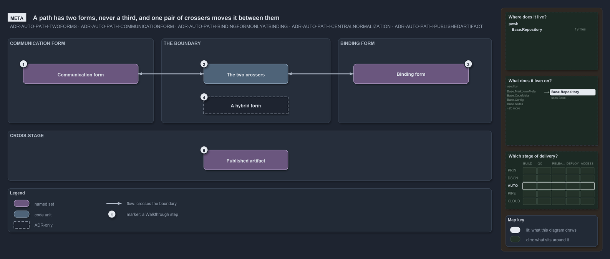

# A path has two forms, never a third, and one pair of crossers moves it between them

```text
A path has two forms, never a third, and one pair of crossers moves it between them.

1  Communication form  relative, slash-separated and normalized: what is stored, returned or logged
2  The two crossers    the only two functions that move a path across the boundary
3  Binding form        the normalized absolute path, alive only on the line that uses it
4  A hybrid form       {root}/./sub: neither form, always a bug, produced by nothing
5  Published artifact  a file that crosses a stage boundary, anchored on its own artifact root

Supports ADR-AUTO-PATH-TWOFORMS, ADR-AUTO-PATH-COMMUNICATIONFORM, ADR-AUTO-PATH-BINDINGFORMONLYATBINDING, ADR-AUTO-PATH-CENTRALNORMALIZATION and ADR-AUTO-PATH-PUBLISHEDARTIFACT (meta lens).
```

Every path that moves through cats is either data or an address. As data it is in communication form: relative to the repository root or the
output root, slash-separated, with no `.` or `..` segments, so it reads the same on a workstation and on a build agent. As an address it is
in binding form: a normalized absolute path that exists only on the line that reads, writes, or hands the path to a tool. Two functions, and
only two, move a path from one form to the other, so normalization is a guarantee rather than a hope.



## Walkthrough

1. **Communication form.** A path that is returned to a caller, held on a record, written into a config or printed in a log is relative and
   normalized. It is portable, comparable with `-eq`, and committable. `ConvertTo-RepoRelativePath` produces it from any path in hand.
2. **The two crossers.** `ConvertTo-RepoRelativePath` takes a path out of binding form, and `Resolve-RepoPath` takes it back in. Both
   collapse `.` and `..`, fix separators and anchor on a known root, never on the current directory, and the pair round-trips. No other
   function hand-builds a communicated path by joining a root onto a raw argument.
3. **Binding form.** Immediately before `Get-Content`, `Import-Module`, `Test-Path` or an external tool needs the path, `Resolve-RepoPath`
   resolves it to a normalized absolute path. The result is used on that line and never stored, returned or logged.
4. **A hybrid form.** A value such as `{root}/./sub`, absolute but not normalized, is neither form and always a bug. Nothing in cats
   produces it, which is why it is joined to nothing: the crossers normalize on both ways across the boundary, and code review holds the
   rule that nothing goes around them.
5. **Published artifact.** A file that a build stage produces and a later deploy stage downloads crosses a different boundary, and it stands
   apart from the two crossers. `ArtifactRef` carries both of its forms and anchors the relative one on the artifact root, not on `out/`,
   because the publish step strips the output-root prefix.

## Why it holds

- A path value is in communication form or binding form, never a third; a hybrid is always a bug (ADR-AUTO-PATH-TWOFORMS).
- A stored or transported path is in communication form, and `ConvertTo-RepoRelativePath` produces it (ADR-AUTO-PATH-COMMUNICATIONFORM).
- A path is in binding form only at the point of binding, resolved with `Resolve-RepoPath` immediately before the side effect
  (ADR-AUTO-PATH-BINDINGFORMONLYATBINDING).
- Normalization is centralized in the two sanctioned crossers; nothing joins a root onto a raw argument or fixes separators by hand
  (ADR-AUTO-PATH-CENTRALNORMALIZATION).
- A published artifact is an immutable object with both forms, created by `ArtifactRef` and anchored on the artifact root
  (ADR-AUTO-PATH-PUBLISHEDARTIFACT).

## See also

- [Path representation](../../adr/automation/path-representation.md) — the decision this article explains.
- The other views of the same boundary: [architecture](two-crossers-and-three-anchors.md),
  [implementation](output-root-first-then-repo-root.md), [operations](one-out-string-two-places.md) and
  [governance](types-check-forms-review-checks-crossers.md).
- [The automation explanations](index.md) · [How to read the diagrams](../index.md#how-to-read-the-diagrams)
