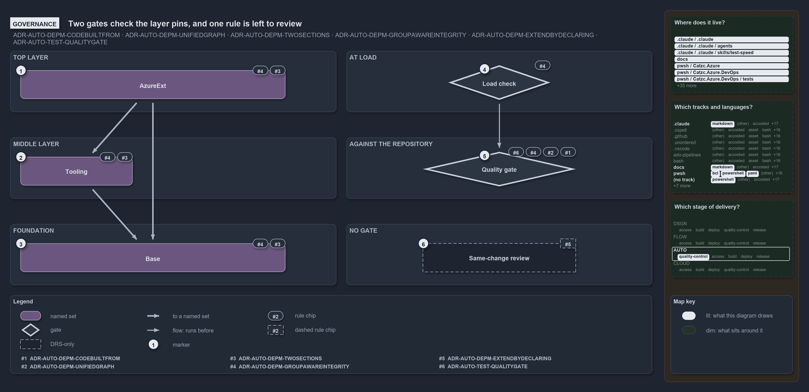

---
catzc:
  warning: "Header is generated by Format-FileMeta via Format-Code; do not change it"
  edges:
    cites:
      - ADR-AUTO-DEPM
      - ADR-AUTO-TEST-QUALITYGATE
    drs_total: 11
---

# Two gates check the layer pins, and one rule is left to review

```text
Two gates check the layer pins, and one rule is left to review.

1  AzureExt            top layer: every member pins groups or single modules, never its own group
2  Tooling             middle layer: four members also pin their own group
3  Base                foundation: no member has its own pin list
4  Load check          the declaration's shape, checked when it loads
5  Quality gate        the real code and the on-disk modules, checked against the declaration
6  Same-change review  a new edge lands with its code; no gate checks it

Supports ADR-AUTO-DEPM-CODEBUILTFROM, ADR-AUTO-DEPM-UNIFIEDGRAPH, ADR-AUTO-DEPM-TWOSECTIONS, ADR-AUTO-DEPM-GROUPAWAREINTEGRITY and ADR-AUTO-DEPM-EXTENDBYDECLARING, and ADR-AUTO-TEST-QUALITYGATE (governance lens).
```

The layer pins of cats' module graph, the groups and modules each consumer may use, are held by the same ADR rules on every layer, and they
are checked twice. The load check validates the declaration itself, and the `Test-ModuleDependency` quality gate checks the real code
against it. One rule, declaring a new edge in the same change as the code, has no gate at all.

```yml drawio
description:
  Two gates check the layer pins, one against the declaration's own shape at load and one against the real code and the on-disk modules; a
  new edge landing with its code is left to review, because no gate checks it.
about:
  adrs:
    - ADR-AUTO-DEPM-CODEBUILTFROM
    - ADR-AUTO-DEPM-UNIFIEDGRAPH
    - ADR-AUTO-DEPM-TWOSECTIONS
    - ADR-AUTO-DEPM-GROUPAWAREINTEGRITY
    - ADR-AUTO-DEPM-EXTENDBYDECLARING
    - ADR-AUTO-TEST-QUALITYGATE
  lens: governance
content:
  title: Two gates check the layer pins, and one rule is left to review
  kind: explanation
  flow: left-to-right
  relation: runs before
  theme: dark
  bands:
    - { id: band-top, label: TOP LAYER }
    - { id: band-middle, label: MIDDLE LAYER }
    - { id: band-foundation, label: FOUNDATION }
    - { id: band-load, label: AT LOAD }
    - { id: band-repository, label: AGAINST THE REPOSITORY }
    - { id: band-no-gate, label: NO GATE }
  glyphs:
    - { id: s-azure-ext, kind: set, label: AzureExt, in: band-top }
    - { id: s-tooling, kind: set, label: Tooling, in: band-middle }
    - { id: s-base, kind: set, label: Base, in: band-foundation }
    - { id: g-load, kind: gate, label: Load check, in: band-load }
    - { id: g-quality, kind: gate, label: Quality gate, in: band-repository }
    - { id: a-review, kind: drsonly, label: Same-change review, in: band-no-gate }
  edges:
    - { from: s-azure-ext, to: s-tooling, kind: thick, label: "" }
    - { from: s-azure-ext, to: s-base, kind: thick, label: "" }
    - { from: s-tooling, to: s-base, kind: thick, label: "" }
    - { from: g-load, to: g-quality, kind: flow, label: "" }
  markers:
    - { at: s-azure-ext, number: 1 }
    - { at: s-tooling, number: 2 }
    - { at: s-base, number: 3 }
    - { at: g-load, number: 4 }
    - { at: g-quality, number: 5 }
    - { at: a-review, number: 6 }
  chips:
    - { at: s-azure-ext, kind: rule, rule: ADR-AUTO-DEPM-TWOSECTIONS }
    - { at: s-azure-ext, kind: rule, rule: ADR-AUTO-DEPM-GROUPAWAREINTEGRITY }
    - { at: s-tooling, kind: rule, rule: ADR-AUTO-DEPM-TWOSECTIONS }
    - { at: s-tooling, kind: rule, rule: ADR-AUTO-DEPM-GROUPAWAREINTEGRITY }
    - { at: s-base, kind: rule, rule: ADR-AUTO-DEPM-TWOSECTIONS }
    - { at: s-base, kind: rule, rule: ADR-AUTO-DEPM-GROUPAWAREINTEGRITY }
    - { at: g-load, kind: rule, rule: ADR-AUTO-DEPM-GROUPAWAREINTEGRITY }
    - { at: g-quality, kind: rule, rule: ADR-AUTO-DEPM-CODEBUILTFROM }
    - { at: g-quality, kind: rule, rule: ADR-AUTO-DEPM-UNIFIEDGRAPH }
    - { at: g-quality, kind: rule, rule: ADR-AUTO-DEPM-GROUPAWAREINTEGRITY }
    - { at: g-quality, kind: rule, rule: ADR-AUTO-TEST-QUALITYGATE }
    - { at: a-review, kind: rule, rule: ADR-AUTO-DEPM-EXTENDBYDECLARING, gated: false }
  legend: auto
  minimaps:
    code-locations:
      - cell: .claude/.claude/.
        by: [.claude/CLAUDE.md, ADR-AUTO-TEST-QUALITYGATE]
      - cell: .claude/.claude/agents
        by: [.claude/agents/test-optimization.md, ADR-AUTO-TEST-QUALITYGATE]
      - cell: .claude/.claude/skills/test-speed
        by: [.claude/skills/test-speed/SKILL.md, ADR-AUTO-TEST-QUALITYGATE]
      - cell: docs/-/.
        by:
          - docs/drs/automation/controlling-module-dependencies.md
          - docs/drs/automation/dora-explains.md
          - docs/drs/automation/test-automation.md
          - docs/drs/glossary.md
          - docs/drs/index.md
          - docs/references/pwsh/catzc-azure-dev-ops/Test-Pipelines.ps1.md
          - docs/references/pwsh/catzc-azure/Test-AzureNetworkPlan.ps1.md
          - docs/references/pwsh/catzc-base-config-extensions/Test-ConfigValidators.ps1.md
          - docs/references/pwsh/catzc-base-config/tests/Config-Conventions.Tests.ps1.md
          - docs/references/pwsh/catzc-base-contracts/Test-Contracts.ps1.md
          - docs/references/pwsh/catzc-base-contracts/tests/Test-Contracts.Tests.ps1.md
          - docs/references/pwsh/catzc-base-docs.md
          - docs/references/pwsh/catzc-base-docs/Test-AgentDefinitions.ps1.md
          - docs/references/pwsh/catzc-base-docs/Test-GeneratedReadmes.ps1.md
          - docs/references/pwsh/catzc-base-docs/Test-Glossary.ps1.md
          - docs/references/pwsh/catzc-base-drs/Test-DrsEngineNeutrality.ps1.md
          - docs/references/pwsh/catzc-base-drs/Test-DrsRegistry.ps1.md
          - docs/references/pwsh/catzc-base-drs/configs/drs-checks.yml.md
          - docs/references/pwsh/catzc-base-drs/tests/Get-DrsRuleSet.Tests.ps1.md
          - docs/references/pwsh/catzc-base-drs/tests/Test-DrsRegistry.Tests.ps1.md
          - docs/references/pwsh/catzc-base-drs/types/DrsChecksConfig.cs.md
          - docs/references/pwsh/catzc-base-execution/Invoke-Executable.ps1.md
          - docs/references/pwsh/catzc-base-globs.md
          - docs/references/pwsh/catzc-base-globs/Test-AdoPipelineTriggerGlob.ps1.md
          - docs/references/pwsh/catzc-base-globs/Test-GitHubWorkflowTriggerGlob.ps1.md
          - docs/references/pwsh/catzc-base-globs/Test-GlobSetIndependence.ps1.md
          - docs/references/pwsh/catzc-base-globs/Test-GlobSetTriggerCoverage.ps1.md
          - docs/references/pwsh/catzc-base-globs/tests/GlobSetTrigger-Coverage.Tests.ps1.md
          - docs/references/pwsh/catzc-base-globs/tests/Test-AdoPipelineTriggerGlob.Tests.ps1.md
          - docs/references/pwsh/catzc-base-globs/tests/Test-GitHubWorkflowTriggerGlob.Tests.ps1.md
          - docs/references/pwsh/catzc-base-globs/tests/Test-GlobSetIndependence.Tests.ps1.md
          - docs/references/pwsh/catzc-base-maps/Get-ModuleNeighbourhoodMinimapData.ps1.md
          - docs/references/pwsh/catzc-base-maps/Get-ValueChainHighlight.ps1.md
          - docs/references/pwsh/catzc-base-maps/Test-ValueChainMap.ps1.md
          - docs/references/pwsh/catzc-base-maps/Test-WorldMap.ps1.md
          - docs/references/pwsh/catzc-base-maps/tests/Test-ValueChainMap.Tests.ps1.md
          - docs/references/pwsh/catzc-base-maps/tests/Test-WorldMap.Tests.ps1.md
          - docs/references/pwsh/catzc-base-module-system.md
          - docs/references/pwsh/catzc-base-module-system/Test-CheckedInBinaries.ps1.md
          - docs/references/pwsh/catzc-base-module-system/Test-FolderConventions.ps1.md
          - docs/references/pwsh/catzc-base-module-system/Test-FunctionDependency.ps1.md
          - docs/references/pwsh/catzc-base-module-system/Test-InternalAssetDependency.ps1.md
          - docs/references/pwsh/catzc-base-module-system/Test-ModuleCycles.ps1.md
          - docs/references/pwsh/catzc-base-module-system/Test-ModuleDependency.ps1.md
          - docs/references/pwsh/catzc-base-module-system/configs/artifacts.yml.md
          - docs/references/pwsh/catzc-base-module-system/tests/Get-InternalAssetDependency.Integrity.Tests.ps1.md
          - docs/references/pwsh/catzc-base-module-system/tests/Test-CheckedInBinaries.Tests.ps1.md
          - docs/references/pwsh/catzc-base-module-system/tests/Test-FunctionDependency.Tests.ps1.md
          - docs/references/pwsh/catzc-base-module-system/tests/Test-ModuleDependency.Tests.ps1.md
          - docs/references/pwsh/catzc-base-module-system/types/DependenciesConfig.cs.md
          - docs/references/pwsh/catzc-base-module-system/types/DependencyGraph.cs.md
          - docs/references/pwsh/catzc-base-module-system/types/ModuleGroup.cs.md
          - docs/references/pwsh/catzc-base-quality-gates/Test-AnalyzerDrsMap.ps1.md
          - docs/references/pwsh/catzc-base-quality-gates/Test-BuildArtifact.ps1.md
          - docs/references/pwsh/catzc-base-quality-gates/Test-Change.ps1.md
          - docs/references/pwsh/catzc-base-quality-gates/Test-Comments.ps1.md
          - docs/references/pwsh/catzc-base-quality-gates/Test-ConfigIdentityHygiene.ps1.md
          - docs/references/pwsh/catzc-base-quality-gates/Test-FileMeta.ps1.md
          - docs/references/pwsh/catzc-base-quality-gates/Test-FileMetaProcessors.ps1.md
          - docs/references/pwsh/catzc-base-quality-gates/Test-Formatting.ps1.md
          - docs/references/pwsh/catzc-base-quality-gates/Test-GeneratedFiles.ps1.md
          - docs/references/pwsh/catzc-base-quality-gates/Test-Links.ps1.md
          - docs/references/pwsh/catzc-base-quality-gates/Test-LogicTestIdentity.ps1.md
          - docs/references/pwsh/catzc-base-quality-gates/Test-ManagedGuids.ps1.md
          - docs/references/pwsh/catzc-base-quality-gates/Test-ManualTestPlan.ps1.md
          - docs/references/pwsh/catzc-base-quality-gates/Test-MarkdownTitle.ps1.md
          - docs/references/pwsh/catzc-base-quality-gates/Test-Markdownlint.ps1.md
          - docs/references/pwsh/catzc-base-quality-gates/Test-ParameterConsistency.ps1.md
          - docs/references/pwsh/catzc-base-quality-gates/Test-Plans.ps1.md
          - docs/references/pwsh/catzc-base-quality-gates/Test-ScriptAnalyzer.ps1.md
          - docs/references/pwsh/catzc-base-quality-gates/Test-ShippedConfigs.ps1.md
          - docs/references/pwsh/catzc-base-quality-gates/Test-SourceConventions.ps1.md
          - docs/references/pwsh/catzc-base-quality-gates/Test-Spelling.ps1.md
          - docs/references/pwsh/catzc-base-quality-gates/Test-Terminology.ps1.md
          - docs/references/pwsh/catzc-base-quality-gates/Test-TestTitles.ps1.md
          - docs/references/pwsh/catzc-base-quality-gates/configs/generated-files.yml.md
          - docs/references/pwsh/catzc-base-quality-gates/configs/terminology.yml.md
          - docs/references/pwsh/catzc-base-quality-gates/private/Get-GeneratedFileGenerator.ps1.md
          - docs/references/pwsh/catzc-base-quality-gates/tests/Format-Types.Tests.ps1.md
          - docs/references/pwsh/catzc-base-quality-gates/tests/Get-AnalyzerDrsCoverage.Tests.ps1.md
          - docs/references/pwsh/catzc-base-quality-gates/tests/Get-RepositoryGuids.Tests.ps1.md
          - docs/references/pwsh/catzc-base-quality-gates/tests/Get-TestTagViolations.Tests.ps1.md
          - docs/references/pwsh/catzc-base-quality-gates/tests/ManualTestPlan-Coverage.Tests.ps1.md
          - docs/references/pwsh/catzc-base-quality-gates/tests/Test-Automation.Tests.ps1.md
          - docs/references/pwsh/catzc-base-quality-gates/tests/Test-BuildArtifact.Tests.ps1.md
          - docs/references/pwsh/catzc-base-quality-gates/tests/Test-ConfigIdentityHygiene.Tests.ps1.md
          - docs/references/pwsh/catzc-base-quality-gates/tests/Test-Formatting.Tests.ps1.md
          - docs/references/pwsh/catzc-base-quality-gates/tests/Test-GeneratedFiles.Tests.ps1.md
          - docs/references/pwsh/catzc-base-quality-gates/tests/Test-Links.Tests.ps1.md
          - docs/references/pwsh/catzc-base-quality-gates/tests/Test-LogicTestIdentity.Tests.ps1.md
          - docs/references/pwsh/catzc-base-quality-gates/tests/Test-ParameterConsistency.Tests.ps1.md
          - docs/references/pwsh/catzc-base-quality-gates/tests/Test-PythonLint.Tests.ps1.md
          - docs/references/pwsh/catzc-base-quality-gates/tests/Test-ShellScripts.Tests.ps1.md
          - docs/references/pwsh/catzc-base-quality-gates/tests/TestTitle-TemplateTokens.Tests.ps1.md
          - docs/references/pwsh/catzc-base-reports/Write-QualityGateReport.ps1.md
          - docs/references/pwsh/catzc-base-reports/configs/reports.yml.md
          - docs/references/pwsh/catzc-base-reports/tests/Write-QualityGateReport.Tests.ps1.md
          - docs/references/pwsh/catzc-base-reports/types/CheckMode.cs.md
          - docs/references/pwsh/catzc-base-reports/types/ReportsConfig.cs.md
          - docs/references/pwsh/catzc-base-root-config.md
          - docs/references/pwsh/catzc-base-root-config/Test-RootAnalyzerSettings.ps1.md
          - docs/references/pwsh/catzc-base-root-config/Test-RootConfigFiles.ps1.md
          - docs/references/pwsh/catzc-base-root-config/tests/Test-RootConfigIntegrity.Tests.ps1.md
          - docs/references/pwsh/catzc-base-types-system/Test-ShippedTypes.ps1.md
          - docs/references/pwsh/catzc-tooling-key-handler/private/Select-SupportedKeyHandler.ps1.md
          - docs/references/pwsh/internal/tests/Test-FolderConventions.Tests.ps1.md
          - ADR-AUTO-DEPM-CODEBUILTFROM
          - ADR-AUTO-DEPM-EXTENDBYDECLARING
          - ADR-AUTO-DEPM-GROUPAWAREINTEGRITY
          - ADR-AUTO-DEPM-TWOSECTIONS
          - ADR-AUTO-DEPM-UNIFIEDGRAPH
          - ADR-AUTO-TEST-QUALITYGATE
      - cell: pwsh/Catzc.Azure/.
        by: [pwsh/Catzc.Azure/Test-AzureNetworkPlan.ps1, ADR-AUTO-TEST-QUALITYGATE]
      - cell: pwsh/Catzc.Azure.DevOps/.
        by: [pwsh/Catzc.Azure.DevOps/Test-Pipelines.ps1, ADR-AUTO-TEST-QUALITYGATE]
      - cell: pwsh/Catzc.Azure.DevOps/tests
        by: [pwsh/Catzc.Azure.DevOps/tests/Test-Pipelines.Tests.ps1, ADR-AUTO-TEST-QUALITYGATE]
      - cell: pwsh/Catzc.Base.Config/tests
        by: [pwsh/Catzc.Base.Config/tests/Config-Conventions.Tests.ps1, ADR-AUTO-TEST-QUALITYGATE]
      - cell: pwsh/Catzc.Base.ConfigExtensions/.
        by: [pwsh/Catzc.Base.ConfigExtensions/Test-ConfigValidators.ps1, ADR-AUTO-TEST-QUALITYGATE]
      - cell: pwsh/Catzc.Base.Contracts/.
        by: [pwsh/Catzc.Base.Contracts/Test-Contracts.ps1, ADR-AUTO-TEST-QUALITYGATE]
      - cell: pwsh/Catzc.Base.Contracts/tests
        by: [pwsh/Catzc.Base.Contracts/tests/Test-Contracts.Tests.ps1, ADR-AUTO-TEST-QUALITYGATE]
      - cell: pwsh/Catzc.Base.Docs/.
        by:
          - pwsh/Catzc.Base.Docs/Test-AgentDefinitions.ps1
          - pwsh/Catzc.Base.Docs/Test-GeneratedReadmes.ps1
          - pwsh/Catzc.Base.Docs/Test-Glossary.ps1
          - ADR-AUTO-TEST-QUALITYGATE
      - cell: pwsh/Catzc.Base.Docs/configs
        by: [pwsh/Catzc.Base.Docs/configs/agents.yml, pwsh/Catzc.Base.Docs/configs/capabilities.yml, ADR-AUTO-TEST-QUALITYGATE]
      - cell: pwsh/Catzc.Base.Docs/tests
        by:
          - pwsh/Catzc.Base.Docs/tests/Test-AgentDefinitions.Tests.ps1
          - pwsh/Catzc.Base.Docs/tests/Test-Glossary.Tests.ps1
          - ADR-AUTO-TEST-QUALITYGATE
      - cell: pwsh/Catzc.Base.Drs/.
        by: [pwsh/Catzc.Base.Drs/Test-DrsEngineNeutrality.ps1, pwsh/Catzc.Base.Drs/Test-DrsRegistry.ps1, ADR-AUTO-TEST-QUALITYGATE]
      - cell: pwsh/Catzc.Base.Drs/configs
        by:
          - pwsh/Catzc.Base.Drs/configs/drs-checks.yml
          - pwsh/Catzc.Base.Drs/configs/drs.yml
          - ADR-AUTO-DEPM-CODEBUILTFROM
          - ADR-AUTO-DEPM-EXTENDBYDECLARING
          - ADR-AUTO-DEPM-GROUPAWAREINTEGRITY
          - ADR-AUTO-DEPM-TWOSECTIONS
          - ADR-AUTO-DEPM-UNIFIEDGRAPH
          - ADR-AUTO-TEST-QUALITYGATE
      - cell: pwsh/Catzc.Base.Drs/tests
        by:
          - pwsh/Catzc.Base.Drs/tests/Get-DrsCitationGraphViolations.Tests.ps1
          - pwsh/Catzc.Base.Drs/tests/Get-DrsDoraCoverageViolations.Tests.ps1
          - pwsh/Catzc.Base.Drs/tests/Get-DrsRuleSet.Tests.ps1
          - pwsh/Catzc.Base.Drs/tests/Test-DrsEngineNeutrality.Tests.ps1
          - pwsh/Catzc.Base.Drs/tests/Test-DrsRegistry.Tests.ps1
          - ADR-AUTO-TEST-QUALITYGATE
      - cell: pwsh/Catzc.Base.Drs/types
        by: [pwsh/Catzc.Base.Drs/types/DrsChecksConfig.cs, ADR-AUTO-TEST-QUALITYGATE]
      - cell: pwsh/Catzc.Base.Execution/.
        by: [pwsh/Catzc.Base.Execution/Invoke-Executable.ps1, ADR-AUTO-TEST-QUALITYGATE]
      - cell: pwsh/Catzc.Base.Globs/.
        by:
          - pwsh/Catzc.Base.Globs/Test-AdoPipelineTriggerGlob.ps1
          - pwsh/Catzc.Base.Globs/Test-GitHubWorkflowTriggerGlob.ps1
          - pwsh/Catzc.Base.Globs/Test-GlobSetIndependence.ps1
          - pwsh/Catzc.Base.Globs/Test-GlobSetTriggerCoverage.ps1
          - ADR-AUTO-TEST-QUALITYGATE
      - cell: pwsh/Catzc.Base.Globs/tests
        by:
          - pwsh/Catzc.Base.Globs/tests/GlobSetTrigger-Coverage.Tests.ps1
          - pwsh/Catzc.Base.Globs/tests/Test-AdoPipelineTriggerGlob.Tests.ps1
          - pwsh/Catzc.Base.Globs/tests/Test-GitHubWorkflowTriggerGlob.Tests.ps1
          - pwsh/Catzc.Base.Globs/tests/Test-GlobSetIndependence.Tests.ps1
          - ADR-AUTO-TEST-QUALITYGATE
      - cell: pwsh/Catzc.Base.Maps/.
        by:
          - pwsh/Catzc.Base.Maps/Get-ModuleNeighbourhoodMinimapData.ps1
          - pwsh/Catzc.Base.Maps/Get-ValueChainHighlight.ps1
          - pwsh/Catzc.Base.Maps/Test-ValueChainMap.ps1
          - pwsh/Catzc.Base.Maps/Test-WorldMap.ps1
          - ADR-AUTO-DEPM-CODEBUILTFROM
          - ADR-AUTO-DEPM-EXTENDBYDECLARING
          - ADR-AUTO-DEPM-GROUPAWAREINTEGRITY
          - ADR-AUTO-DEPM-TWOSECTIONS
          - ADR-AUTO-DEPM-UNIFIEDGRAPH
          - ADR-AUTO-TEST-QUALITYGATE
      - cell: pwsh/Catzc.Base.Maps/tests
        by:
          - pwsh/Catzc.Base.Maps/tests/Test-ValueChainMap.Tests.ps1
          - pwsh/Catzc.Base.Maps/tests/Test-WorldMap.Tests.ps1
          - ADR-AUTO-TEST-QUALITYGATE
      - cell: pwsh/Catzc.Base.Modules/tests
        by: [pwsh/Catzc.Base.Modules/tests/Get-CatzcModule.Tests.ps1, ADR-AUTO-TEST-QUALITYGATE]
      - cell: pwsh/Catzc.Base.ModuleSystem/.
        by:
          - pwsh/Catzc.Base.ModuleSystem/Test-CheckedInBinaries.ps1
          - pwsh/Catzc.Base.ModuleSystem/Test-FolderConventions.ps1
          - pwsh/Catzc.Base.ModuleSystem/Test-FunctionDependency.ps1
          - pwsh/Catzc.Base.ModuleSystem/Test-InternalAssetDependency.ps1
          - pwsh/Catzc.Base.ModuleSystem/Test-ModuleCycles.ps1
          - pwsh/Catzc.Base.ModuleSystem/Test-ModuleDependency.ps1
          - ADR-AUTO-TEST-QUALITYGATE
      - cell: pwsh/Catzc.Base.ModuleSystem/configs
        by: [pwsh/Catzc.Base.ModuleSystem/configs/artifacts.yml, ADR-AUTO-TEST-QUALITYGATE]
      - cell: pwsh/Catzc.Base.ModuleSystem/tests
        by:
          - pwsh/Catzc.Base.ModuleSystem/tests/Get-InternalAssetDependency.Integrity.Tests.ps1
          - pwsh/Catzc.Base.ModuleSystem/tests/Test-CheckedInBinaries.Tests.ps1
          - pwsh/Catzc.Base.ModuleSystem/tests/Test-FunctionDependency.Tests.ps1
          - pwsh/Catzc.Base.ModuleSystem/tests/Test-ModuleDependency.Tests.ps1
          - ADR-AUTO-TEST-QUALITYGATE
      - cell: pwsh/Catzc.Base.ModuleSystem/types
        by:
          - pwsh/Catzc.Base.ModuleSystem/types/DependenciesConfig.cs
          - pwsh/Catzc.Base.ModuleSystem/types/DependencyGraph.cs
          - pwsh/Catzc.Base.ModuleSystem/types/ModuleGroup.cs
          - ADR-AUTO-DEPM-CODEBUILTFROM
          - ADR-AUTO-DEPM-EXTENDBYDECLARING
          - ADR-AUTO-DEPM-GROUPAWAREINTEGRITY
          - ADR-AUTO-DEPM-TWOSECTIONS
          - ADR-AUTO-DEPM-UNIFIEDGRAPH
      - cell: pwsh/Catzc.Base.QualityGates/.
        by:
          - pwsh/Catzc.Base.QualityGates/Test-AnalyzerDrsMap.ps1
          - pwsh/Catzc.Base.QualityGates/Test-BuildArtifact.ps1
          - pwsh/Catzc.Base.QualityGates/Test-Change.ps1
          - pwsh/Catzc.Base.QualityGates/Test-Comments.ps1
          - pwsh/Catzc.Base.QualityGates/Test-ConfigIdentityHygiene.ps1
          - pwsh/Catzc.Base.QualityGates/Test-FileMeta.ps1
          - pwsh/Catzc.Base.QualityGates/Test-FileMetaProcessors.ps1
          - pwsh/Catzc.Base.QualityGates/Test-Formatting.ps1
          - pwsh/Catzc.Base.QualityGates/Test-GeneratedFiles.ps1
          - pwsh/Catzc.Base.QualityGates/Test-Links.ps1
          - pwsh/Catzc.Base.QualityGates/Test-LogicTestIdentity.ps1
          - pwsh/Catzc.Base.QualityGates/Test-ManagedGuids.ps1
          - pwsh/Catzc.Base.QualityGates/Test-ManualTestPlan.ps1
          - pwsh/Catzc.Base.QualityGates/Test-MarkdownTitle.ps1
          - pwsh/Catzc.Base.QualityGates/Test-Markdownlint.ps1
          - pwsh/Catzc.Base.QualityGates/Test-ParameterConsistency.ps1
          - pwsh/Catzc.Base.QualityGates/Test-Plans.ps1
          - pwsh/Catzc.Base.QualityGates/Test-ScriptAnalyzer.ps1
          - pwsh/Catzc.Base.QualityGates/Test-ShippedConfigs.ps1
          - pwsh/Catzc.Base.QualityGates/Test-SourceConventions.ps1
          - pwsh/Catzc.Base.QualityGates/Test-Spelling.ps1
          - pwsh/Catzc.Base.QualityGates/Test-Terminology.ps1
          - pwsh/Catzc.Base.QualityGates/Test-TestTitles.ps1
          - ADR-AUTO-TEST-QUALITYGATE
      - cell: pwsh/Catzc.Base.QualityGates/configs
        by:
          - pwsh/Catzc.Base.QualityGates/configs/generated-files.yml
          - pwsh/Catzc.Base.QualityGates/configs/glossary.yml
          - pwsh/Catzc.Base.QualityGates/configs/terminology.yml
          - ADR-AUTO-TEST-QUALITYGATE
      - cell: pwsh/Catzc.Base.QualityGates/private
        by: [pwsh/Catzc.Base.QualityGates/private/Get-GeneratedFileGenerator.ps1, ADR-AUTO-TEST-QUALITYGATE]
      - cell: pwsh/Catzc.Base.QualityGates/tests
        by:
          - pwsh/Catzc.Base.QualityGates/tests/Format-FileMeta.Tests.ps1
          - pwsh/Catzc.Base.QualityGates/tests/Format-MarkdownTitle.Tests.ps1
          - pwsh/Catzc.Base.QualityGates/tests/Format-Types.Tests.ps1
          - pwsh/Catzc.Base.QualityGates/tests/Get-AnalyzerDrsCoverage.Tests.ps1
          - pwsh/Catzc.Base.QualityGates/tests/Get-RepositoryGuids.Tests.ps1
          - pwsh/Catzc.Base.QualityGates/tests/Get-TestTagViolations.Tests.ps1
          - pwsh/Catzc.Base.QualityGates/tests/ManualTestPlan-Coverage.Tests.ps1
          - pwsh/Catzc.Base.QualityGates/tests/Test-Automation.Tests.ps1
          - pwsh/Catzc.Base.QualityGates/tests/Test-BuildArtifact.Tests.ps1
          - pwsh/Catzc.Base.QualityGates/tests/Test-ConfigIdentityHygiene.Tests.ps1
          - pwsh/Catzc.Base.QualityGates/tests/Test-Formatting.Tests.ps1
          - pwsh/Catzc.Base.QualityGates/tests/Test-GeneratedFiles.Tests.ps1
          - pwsh/Catzc.Base.QualityGates/tests/Test-Links.Tests.ps1
          - pwsh/Catzc.Base.QualityGates/tests/Test-LogicTestIdentity.Tests.ps1
          - pwsh/Catzc.Base.QualityGates/tests/Test-Markdownlint.Tests.ps1
          - pwsh/Catzc.Base.QualityGates/tests/Test-ParameterConsistency.Tests.ps1
          - pwsh/Catzc.Base.QualityGates/tests/Test-Plans.Tests.ps1
          - pwsh/Catzc.Base.QualityGates/tests/Test-PythonLint.Tests.ps1
          - pwsh/Catzc.Base.QualityGates/tests/Test-PythonTypes.Tests.ps1
          - pwsh/Catzc.Base.QualityGates/tests/Test-ScriptAnalyzer.Tests.ps1
          - pwsh/Catzc.Base.QualityGates/tests/Test-ShellScripts.Tests.ps1
          - pwsh/Catzc.Base.QualityGates/tests/Test-Spelling.Tests.ps1
          - pwsh/Catzc.Base.QualityGates/tests/TestTitle-TemplateTokens.Tests.ps1
          - ADR-AUTO-TEST-QUALITYGATE
      - cell: pwsh/Catzc.Base.Reports/.
        by: [pwsh/Catzc.Base.Reports/Write-QualityGateReport.ps1, ADR-AUTO-TEST-QUALITYGATE]
      - cell: pwsh/Catzc.Base.Reports/configs
        by: [pwsh/Catzc.Base.Reports/configs/reports.yml, ADR-AUTO-TEST-QUALITYGATE]
      - cell: pwsh/Catzc.Base.Reports/tests
        by: [pwsh/Catzc.Base.Reports/tests/Write-QualityGateReport.Tests.ps1, ADR-AUTO-TEST-QUALITYGATE]
      - cell: pwsh/Catzc.Base.Reports/tests/types
        by: [pwsh/Catzc.Base.Reports/tests/types/ReportsConfig.Tests.ps1, ADR-AUTO-TEST-QUALITYGATE]
      - cell: pwsh/Catzc.Base.Reports/types
        by: [pwsh/Catzc.Base.Reports/types/CheckMode.cs, pwsh/Catzc.Base.Reports/types/ReportsConfig.cs, ADR-AUTO-TEST-QUALITYGATE]
      - cell: pwsh/Catzc.Base.RootConfig/.
        by:
          - pwsh/Catzc.Base.RootConfig/Test-RootAnalyzerSettings.ps1
          - pwsh/Catzc.Base.RootConfig/Test-RootConfigFiles.ps1
          - ADR-AUTO-TEST-QUALITYGATE
      - cell: pwsh/Catzc.Base.RootConfig/tests
        by: [pwsh/Catzc.Base.RootConfig/tests/Test-RootConfigIntegrity.Tests.ps1, ADR-AUTO-TEST-QUALITYGATE]
      - cell: pwsh/Catzc.Base.TypesSystem/.
        by: [pwsh/Catzc.Base.TypesSystem/Test-ShippedTypes.ps1, ADR-AUTO-TEST-QUALITYGATE]
      - cell: pwsh/Catzc.Internal.Tests/.
        by: [pwsh/.internal/tests/Test-FolderConventions.Tests.ps1, ADR-AUTO-TEST-QUALITYGATE]
      - cell: pwsh/Catzc.Tooling.KeyHandler/private
        by: [pwsh/Catzc.Tooling.KeyHandler/private/Select-SupportedKeyHandler.ps1, ADR-AUTO-TEST-QUALITYGATE]
    grid:
      - cell: .claude/markdown
        by: [.claude/CLAUDE.md, .claude/agents/test-optimization.md, .claude/skills/test-speed/SKILL.md, ADR-AUTO-TEST-QUALITYGATE]
      - cell: docs/markdown
        by:
          - docs/drs/automation/controlling-module-dependencies.md
          - docs/drs/automation/dora-explains.md
          - docs/drs/automation/test-automation.md
          - docs/drs/glossary.md
          - docs/drs/index.md
          - docs/references/pwsh/catzc-azure-dev-ops/Test-Pipelines.ps1.md
          - docs/references/pwsh/catzc-azure/Test-AzureNetworkPlan.ps1.md
          - docs/references/pwsh/catzc-base-config-extensions/Test-ConfigValidators.ps1.md
          - docs/references/pwsh/catzc-base-config/tests/Config-Conventions.Tests.ps1.md
          - docs/references/pwsh/catzc-base-contracts/Test-Contracts.ps1.md
          - docs/references/pwsh/catzc-base-contracts/tests/Test-Contracts.Tests.ps1.md
          - docs/references/pwsh/catzc-base-docs.md
          - docs/references/pwsh/catzc-base-docs/Test-AgentDefinitions.ps1.md
          - docs/references/pwsh/catzc-base-docs/Test-GeneratedReadmes.ps1.md
          - docs/references/pwsh/catzc-base-docs/Test-Glossary.ps1.md
          - docs/references/pwsh/catzc-base-drs/Test-DrsEngineNeutrality.ps1.md
          - docs/references/pwsh/catzc-base-drs/Test-DrsRegistry.ps1.md
          - docs/references/pwsh/catzc-base-drs/configs/drs-checks.yml.md
          - docs/references/pwsh/catzc-base-drs/tests/Get-DrsRuleSet.Tests.ps1.md
          - docs/references/pwsh/catzc-base-drs/tests/Test-DrsRegistry.Tests.ps1.md
          - docs/references/pwsh/catzc-base-drs/types/DrsChecksConfig.cs.md
          - docs/references/pwsh/catzc-base-execution/Invoke-Executable.ps1.md
          - docs/references/pwsh/catzc-base-globs.md
          - docs/references/pwsh/catzc-base-globs/Test-AdoPipelineTriggerGlob.ps1.md
          - docs/references/pwsh/catzc-base-globs/Test-GitHubWorkflowTriggerGlob.ps1.md
          - docs/references/pwsh/catzc-base-globs/Test-GlobSetIndependence.ps1.md
          - docs/references/pwsh/catzc-base-globs/Test-GlobSetTriggerCoverage.ps1.md
          - docs/references/pwsh/catzc-base-globs/tests/GlobSetTrigger-Coverage.Tests.ps1.md
          - docs/references/pwsh/catzc-base-globs/tests/Test-AdoPipelineTriggerGlob.Tests.ps1.md
          - docs/references/pwsh/catzc-base-globs/tests/Test-GitHubWorkflowTriggerGlob.Tests.ps1.md
          - docs/references/pwsh/catzc-base-globs/tests/Test-GlobSetIndependence.Tests.ps1.md
          - docs/references/pwsh/catzc-base-maps/Get-ModuleNeighbourhoodMinimapData.ps1.md
          - docs/references/pwsh/catzc-base-maps/Get-ValueChainHighlight.ps1.md
          - docs/references/pwsh/catzc-base-maps/Test-ValueChainMap.ps1.md
          - docs/references/pwsh/catzc-base-maps/Test-WorldMap.ps1.md
          - docs/references/pwsh/catzc-base-maps/tests/Test-ValueChainMap.Tests.ps1.md
          - docs/references/pwsh/catzc-base-maps/tests/Test-WorldMap.Tests.ps1.md
          - docs/references/pwsh/catzc-base-module-system.md
          - docs/references/pwsh/catzc-base-module-system/Test-CheckedInBinaries.ps1.md
          - docs/references/pwsh/catzc-base-module-system/Test-FolderConventions.ps1.md
          - docs/references/pwsh/catzc-base-module-system/Test-FunctionDependency.ps1.md
          - docs/references/pwsh/catzc-base-module-system/Test-InternalAssetDependency.ps1.md
          - docs/references/pwsh/catzc-base-module-system/Test-ModuleCycles.ps1.md
          - docs/references/pwsh/catzc-base-module-system/Test-ModuleDependency.ps1.md
          - docs/references/pwsh/catzc-base-module-system/configs/artifacts.yml.md
          - docs/references/pwsh/catzc-base-module-system/tests/Get-InternalAssetDependency.Integrity.Tests.ps1.md
          - docs/references/pwsh/catzc-base-module-system/tests/Test-CheckedInBinaries.Tests.ps1.md
          - docs/references/pwsh/catzc-base-module-system/tests/Test-FunctionDependency.Tests.ps1.md
          - docs/references/pwsh/catzc-base-module-system/tests/Test-ModuleDependency.Tests.ps1.md
          - docs/references/pwsh/catzc-base-module-system/types/DependenciesConfig.cs.md
          - docs/references/pwsh/catzc-base-module-system/types/DependencyGraph.cs.md
          - docs/references/pwsh/catzc-base-module-system/types/ModuleGroup.cs.md
          - docs/references/pwsh/catzc-base-quality-gates/Test-AnalyzerDrsMap.ps1.md
          - docs/references/pwsh/catzc-base-quality-gates/Test-BuildArtifact.ps1.md
          - docs/references/pwsh/catzc-base-quality-gates/Test-Change.ps1.md
          - docs/references/pwsh/catzc-base-quality-gates/Test-Comments.ps1.md
          - docs/references/pwsh/catzc-base-quality-gates/Test-ConfigIdentityHygiene.ps1.md
          - docs/references/pwsh/catzc-base-quality-gates/Test-FileMeta.ps1.md
          - docs/references/pwsh/catzc-base-quality-gates/Test-FileMetaProcessors.ps1.md
          - docs/references/pwsh/catzc-base-quality-gates/Test-Formatting.ps1.md
          - docs/references/pwsh/catzc-base-quality-gates/Test-GeneratedFiles.ps1.md
          - docs/references/pwsh/catzc-base-quality-gates/Test-Links.ps1.md
          - docs/references/pwsh/catzc-base-quality-gates/Test-LogicTestIdentity.ps1.md
          - docs/references/pwsh/catzc-base-quality-gates/Test-ManagedGuids.ps1.md
          - docs/references/pwsh/catzc-base-quality-gates/Test-ManualTestPlan.ps1.md
          - docs/references/pwsh/catzc-base-quality-gates/Test-MarkdownTitle.ps1.md
          - docs/references/pwsh/catzc-base-quality-gates/Test-Markdownlint.ps1.md
          - docs/references/pwsh/catzc-base-quality-gates/Test-ParameterConsistency.ps1.md
          - docs/references/pwsh/catzc-base-quality-gates/Test-Plans.ps1.md
          - docs/references/pwsh/catzc-base-quality-gates/Test-ScriptAnalyzer.ps1.md
          - docs/references/pwsh/catzc-base-quality-gates/Test-ShippedConfigs.ps1.md
          - docs/references/pwsh/catzc-base-quality-gates/Test-SourceConventions.ps1.md
          - docs/references/pwsh/catzc-base-quality-gates/Test-Spelling.ps1.md
          - docs/references/pwsh/catzc-base-quality-gates/Test-Terminology.ps1.md
          - docs/references/pwsh/catzc-base-quality-gates/Test-TestTitles.ps1.md
          - docs/references/pwsh/catzc-base-quality-gates/configs/generated-files.yml.md
          - docs/references/pwsh/catzc-base-quality-gates/configs/terminology.yml.md
          - docs/references/pwsh/catzc-base-quality-gates/private/Get-GeneratedFileGenerator.ps1.md
          - docs/references/pwsh/catzc-base-quality-gates/tests/Format-Types.Tests.ps1.md
          - docs/references/pwsh/catzc-base-quality-gates/tests/Get-AnalyzerDrsCoverage.Tests.ps1.md
          - docs/references/pwsh/catzc-base-quality-gates/tests/Get-RepositoryGuids.Tests.ps1.md
          - docs/references/pwsh/catzc-base-quality-gates/tests/Get-TestTagViolations.Tests.ps1.md
          - docs/references/pwsh/catzc-base-quality-gates/tests/ManualTestPlan-Coverage.Tests.ps1.md
          - docs/references/pwsh/catzc-base-quality-gates/tests/Test-Automation.Tests.ps1.md
          - docs/references/pwsh/catzc-base-quality-gates/tests/Test-BuildArtifact.Tests.ps1.md
          - docs/references/pwsh/catzc-base-quality-gates/tests/Test-ConfigIdentityHygiene.Tests.ps1.md
          - docs/references/pwsh/catzc-base-quality-gates/tests/Test-Formatting.Tests.ps1.md
          - docs/references/pwsh/catzc-base-quality-gates/tests/Test-GeneratedFiles.Tests.ps1.md
          - docs/references/pwsh/catzc-base-quality-gates/tests/Test-Links.Tests.ps1.md
          - docs/references/pwsh/catzc-base-quality-gates/tests/Test-LogicTestIdentity.Tests.ps1.md
          - docs/references/pwsh/catzc-base-quality-gates/tests/Test-ParameterConsistency.Tests.ps1.md
          - docs/references/pwsh/catzc-base-quality-gates/tests/Test-PythonLint.Tests.ps1.md
          - docs/references/pwsh/catzc-base-quality-gates/tests/Test-ShellScripts.Tests.ps1.md
          - docs/references/pwsh/catzc-base-quality-gates/tests/TestTitle-TemplateTokens.Tests.ps1.md
          - docs/references/pwsh/catzc-base-reports/Write-QualityGateReport.ps1.md
          - docs/references/pwsh/catzc-base-reports/configs/reports.yml.md
          - docs/references/pwsh/catzc-base-reports/tests/Write-QualityGateReport.Tests.ps1.md
          - docs/references/pwsh/catzc-base-reports/types/CheckMode.cs.md
          - docs/references/pwsh/catzc-base-reports/types/ReportsConfig.cs.md
          - docs/references/pwsh/catzc-base-root-config.md
          - docs/references/pwsh/catzc-base-root-config/Test-RootAnalyzerSettings.ps1.md
          - docs/references/pwsh/catzc-base-root-config/Test-RootConfigFiles.ps1.md
          - docs/references/pwsh/catzc-base-root-config/tests/Test-RootConfigIntegrity.Tests.ps1.md
          - docs/references/pwsh/catzc-base-types-system/Test-ShippedTypes.ps1.md
          - docs/references/pwsh/catzc-tooling-key-handler/private/Select-SupportedKeyHandler.ps1.md
          - docs/references/pwsh/internal/tests/Test-FolderConventions.Tests.ps1.md
          - ADR-AUTO-DEPM-CODEBUILTFROM
          - ADR-AUTO-DEPM-EXTENDBYDECLARING
          - ADR-AUTO-DEPM-GROUPAWAREINTEGRITY
          - ADR-AUTO-DEPM-TWOSECTIONS
          - ADR-AUTO-DEPM-UNIFIEDGRAPH
          - ADR-AUTO-TEST-QUALITYGATE
      - cell: pwsh/bcl
        by:
          - pwsh/Catzc.Base.Drs/types/DrsChecksConfig.cs
          - pwsh/Catzc.Base.ModuleSystem/types/DependenciesConfig.cs
          - pwsh/Catzc.Base.ModuleSystem/types/DependencyGraph.cs
          - pwsh/Catzc.Base.ModuleSystem/types/ModuleGroup.cs
          - pwsh/Catzc.Base.Reports/types/CheckMode.cs
          - pwsh/Catzc.Base.Reports/types/ReportsConfig.cs
          - ADR-AUTO-DEPM-CODEBUILTFROM
          - ADR-AUTO-DEPM-EXTENDBYDECLARING
          - ADR-AUTO-DEPM-GROUPAWAREINTEGRITY
          - ADR-AUTO-DEPM-TWOSECTIONS
          - ADR-AUTO-DEPM-UNIFIEDGRAPH
          - ADR-AUTO-TEST-QUALITYGATE
      - cell: pwsh/powershell
        by:
          - pwsh/.internal/tests/Test-FolderConventions.Tests.ps1
          - pwsh/Catzc.Azure.DevOps/Test-Pipelines.ps1
          - pwsh/Catzc.Azure.DevOps/tests/Test-Pipelines.Tests.ps1
          - pwsh/Catzc.Azure/Test-AzureNetworkPlan.ps1
          - pwsh/Catzc.Base.Config/tests/Config-Conventions.Tests.ps1
          - pwsh/Catzc.Base.ConfigExtensions/Test-ConfigValidators.ps1
          - pwsh/Catzc.Base.Contracts/Test-Contracts.ps1
          - pwsh/Catzc.Base.Contracts/tests/Test-Contracts.Tests.ps1
          - pwsh/Catzc.Base.Docs/Test-AgentDefinitions.ps1
          - pwsh/Catzc.Base.Docs/Test-GeneratedReadmes.ps1
          - pwsh/Catzc.Base.Docs/Test-Glossary.ps1
          - pwsh/Catzc.Base.Docs/tests/Test-AgentDefinitions.Tests.ps1
          - pwsh/Catzc.Base.Docs/tests/Test-Glossary.Tests.ps1
          - pwsh/Catzc.Base.Drs/Test-DrsEngineNeutrality.ps1
          - pwsh/Catzc.Base.Drs/Test-DrsRegistry.ps1
          - pwsh/Catzc.Base.Drs/tests/Get-DrsCitationGraphViolations.Tests.ps1
          - pwsh/Catzc.Base.Drs/tests/Get-DrsDoraCoverageViolations.Tests.ps1
          - pwsh/Catzc.Base.Drs/tests/Get-DrsRuleSet.Tests.ps1
          - pwsh/Catzc.Base.Drs/tests/Test-DrsEngineNeutrality.Tests.ps1
          - pwsh/Catzc.Base.Drs/tests/Test-DrsRegistry.Tests.ps1
          - pwsh/Catzc.Base.Execution/Invoke-Executable.ps1
          - pwsh/Catzc.Base.Globs/Test-AdoPipelineTriggerGlob.ps1
          - pwsh/Catzc.Base.Globs/Test-GitHubWorkflowTriggerGlob.ps1
          - pwsh/Catzc.Base.Globs/Test-GlobSetIndependence.ps1
          - pwsh/Catzc.Base.Globs/Test-GlobSetTriggerCoverage.ps1
          - pwsh/Catzc.Base.Globs/tests/GlobSetTrigger-Coverage.Tests.ps1
          - pwsh/Catzc.Base.Globs/tests/Test-AdoPipelineTriggerGlob.Tests.ps1
          - pwsh/Catzc.Base.Globs/tests/Test-GitHubWorkflowTriggerGlob.Tests.ps1
          - pwsh/Catzc.Base.Globs/tests/Test-GlobSetIndependence.Tests.ps1
          - pwsh/Catzc.Base.Maps/Get-ModuleNeighbourhoodMinimapData.ps1
          - pwsh/Catzc.Base.Maps/Get-ValueChainHighlight.ps1
          - pwsh/Catzc.Base.Maps/Test-ValueChainMap.ps1
          - pwsh/Catzc.Base.Maps/Test-WorldMap.ps1
          - pwsh/Catzc.Base.Maps/tests/Test-ValueChainMap.Tests.ps1
          - pwsh/Catzc.Base.Maps/tests/Test-WorldMap.Tests.ps1
          - pwsh/Catzc.Base.ModuleSystem/Test-CheckedInBinaries.ps1
          - pwsh/Catzc.Base.ModuleSystem/Test-FolderConventions.ps1
          - pwsh/Catzc.Base.ModuleSystem/Test-FunctionDependency.ps1
          - pwsh/Catzc.Base.ModuleSystem/Test-InternalAssetDependency.ps1
          - pwsh/Catzc.Base.ModuleSystem/Test-ModuleCycles.ps1
          - pwsh/Catzc.Base.ModuleSystem/Test-ModuleDependency.ps1
          - pwsh/Catzc.Base.ModuleSystem/tests/Get-InternalAssetDependency.Integrity.Tests.ps1
          - pwsh/Catzc.Base.ModuleSystem/tests/Test-CheckedInBinaries.Tests.ps1
          - pwsh/Catzc.Base.ModuleSystem/tests/Test-FunctionDependency.Tests.ps1
          - pwsh/Catzc.Base.ModuleSystem/tests/Test-ModuleDependency.Tests.ps1
          - pwsh/Catzc.Base.Modules/tests/Get-CatzcModule.Tests.ps1
          - pwsh/Catzc.Base.QualityGates/Test-AnalyzerDrsMap.ps1
          - pwsh/Catzc.Base.QualityGates/Test-BuildArtifact.ps1
          - pwsh/Catzc.Base.QualityGates/Test-Change.ps1
          - pwsh/Catzc.Base.QualityGates/Test-Comments.ps1
          - pwsh/Catzc.Base.QualityGates/Test-ConfigIdentityHygiene.ps1
          - pwsh/Catzc.Base.QualityGates/Test-FileMeta.ps1
          - pwsh/Catzc.Base.QualityGates/Test-FileMetaProcessors.ps1
          - pwsh/Catzc.Base.QualityGates/Test-Formatting.ps1
          - pwsh/Catzc.Base.QualityGates/Test-GeneratedFiles.ps1
          - pwsh/Catzc.Base.QualityGates/Test-Links.ps1
          - pwsh/Catzc.Base.QualityGates/Test-LogicTestIdentity.ps1
          - pwsh/Catzc.Base.QualityGates/Test-ManagedGuids.ps1
          - pwsh/Catzc.Base.QualityGates/Test-ManualTestPlan.ps1
          - pwsh/Catzc.Base.QualityGates/Test-MarkdownTitle.ps1
          - pwsh/Catzc.Base.QualityGates/Test-Markdownlint.ps1
          - pwsh/Catzc.Base.QualityGates/Test-ParameterConsistency.ps1
          - pwsh/Catzc.Base.QualityGates/Test-Plans.ps1
          - pwsh/Catzc.Base.QualityGates/Test-ScriptAnalyzer.ps1
          - pwsh/Catzc.Base.QualityGates/Test-ShippedConfigs.ps1
          - pwsh/Catzc.Base.QualityGates/Test-SourceConventions.ps1
          - pwsh/Catzc.Base.QualityGates/Test-Spelling.ps1
          - pwsh/Catzc.Base.QualityGates/Test-Terminology.ps1
          - pwsh/Catzc.Base.QualityGates/Test-TestTitles.ps1
          - pwsh/Catzc.Base.QualityGates/private/Get-GeneratedFileGenerator.ps1
          - pwsh/Catzc.Base.QualityGates/tests/Format-FileMeta.Tests.ps1
          - pwsh/Catzc.Base.QualityGates/tests/Format-MarkdownTitle.Tests.ps1
          - pwsh/Catzc.Base.QualityGates/tests/Format-Types.Tests.ps1
          - pwsh/Catzc.Base.QualityGates/tests/Get-AnalyzerDrsCoverage.Tests.ps1
          - pwsh/Catzc.Base.QualityGates/tests/Get-RepositoryGuids.Tests.ps1
          - pwsh/Catzc.Base.QualityGates/tests/Get-TestTagViolations.Tests.ps1
          - pwsh/Catzc.Base.QualityGates/tests/ManualTestPlan-Coverage.Tests.ps1
          - pwsh/Catzc.Base.QualityGates/tests/Test-Automation.Tests.ps1
          - pwsh/Catzc.Base.QualityGates/tests/Test-BuildArtifact.Tests.ps1
          - pwsh/Catzc.Base.QualityGates/tests/Test-ConfigIdentityHygiene.Tests.ps1
          - pwsh/Catzc.Base.QualityGates/tests/Test-Formatting.Tests.ps1
          - pwsh/Catzc.Base.QualityGates/tests/Test-GeneratedFiles.Tests.ps1
          - pwsh/Catzc.Base.QualityGates/tests/Test-Links.Tests.ps1
          - pwsh/Catzc.Base.QualityGates/tests/Test-LogicTestIdentity.Tests.ps1
          - pwsh/Catzc.Base.QualityGates/tests/Test-Markdownlint.Tests.ps1
          - pwsh/Catzc.Base.QualityGates/tests/Test-ParameterConsistency.Tests.ps1
          - pwsh/Catzc.Base.QualityGates/tests/Test-Plans.Tests.ps1
          - pwsh/Catzc.Base.QualityGates/tests/Test-PythonLint.Tests.ps1
          - pwsh/Catzc.Base.QualityGates/tests/Test-PythonTypes.Tests.ps1
          - pwsh/Catzc.Base.QualityGates/tests/Test-ScriptAnalyzer.Tests.ps1
          - pwsh/Catzc.Base.QualityGates/tests/Test-ShellScripts.Tests.ps1
          - pwsh/Catzc.Base.QualityGates/tests/Test-Spelling.Tests.ps1
          - pwsh/Catzc.Base.QualityGates/tests/TestTitle-TemplateTokens.Tests.ps1
          - pwsh/Catzc.Base.Reports/Write-QualityGateReport.ps1
          - pwsh/Catzc.Base.Reports/tests/Write-QualityGateReport.Tests.ps1
          - pwsh/Catzc.Base.Reports/tests/types/ReportsConfig.Tests.ps1
          - pwsh/Catzc.Base.RootConfig/Test-RootAnalyzerSettings.ps1
          - pwsh/Catzc.Base.RootConfig/Test-RootConfigFiles.ps1
          - pwsh/Catzc.Base.RootConfig/tests/Test-RootConfigIntegrity.Tests.ps1
          - pwsh/Catzc.Base.TypesSystem/Test-ShippedTypes.ps1
          - pwsh/Catzc.Tooling.KeyHandler/private/Select-SupportedKeyHandler.ps1
          - ADR-AUTO-DEPM-CODEBUILTFROM
          - ADR-AUTO-DEPM-EXTENDBYDECLARING
          - ADR-AUTO-DEPM-GROUPAWAREINTEGRITY
          - ADR-AUTO-DEPM-TWOSECTIONS
          - ADR-AUTO-DEPM-UNIFIEDGRAPH
          - ADR-AUTO-TEST-QUALITYGATE
      - cell: pwsh/yaml
        by:
          - pwsh/Catzc.Base.Docs/configs/agents.yml
          - pwsh/Catzc.Base.Docs/configs/capabilities.yml
          - pwsh/Catzc.Base.Drs/configs/drs-checks.yml
          - pwsh/Catzc.Base.Drs/configs/drs.yml
          - pwsh/Catzc.Base.ModuleSystem/configs/artifacts.yml
          - pwsh/Catzc.Base.QualityGates/configs/generated-files.yml
          - pwsh/Catzc.Base.QualityGates/configs/glossary.yml
          - pwsh/Catzc.Base.QualityGates/configs/terminology.yml
          - pwsh/Catzc.Base.Reports/configs/reports.yml
          - ADR-AUTO-DEPM-CODEBUILTFROM
          - ADR-AUTO-DEPM-EXTENDBYDECLARING
          - ADR-AUTO-DEPM-GROUPAWAREINTEGRITY
          - ADR-AUTO-DEPM-TWOSECTIONS
          - ADR-AUTO-DEPM-UNIFIEDGRAPH
          - ADR-AUTO-TEST-QUALITYGATE
      - cell: (no track)/powershell
        by: [importer.ps1, ADR-AUTO-TEST-QUALITYGATE]
    axis:
      - cell: AUTO/quality-control
        by: [ADR-AUTO-TEST-QUALITYGATE]
      - cell: AUTO/*
        by:
          - ADR-AUTO-DEPM-CODEBUILTFROM
          - ADR-AUTO-DEPM-EXTENDBYDECLARING
          - ADR-AUTO-DEPM-GROUPAWAREINTEGRITY
          - ADR-AUTO-DEPM-TWOSECTIONS
          - ADR-AUTO-DEPM-UNIFIEDGRAPH
layout:
  band-top: { x: 20, y: 84, w: 640, h: 120 }
  band-middle: { x: 20, y: 254, w: 640, h: 120 }
  band-foundation: { x: 20, y: 424, w: 640, h: 120 }
  band-load: { x: 680, y: 84, w: 600, h: 120 }
  band-repository: { x: 680, y: 254, w: 600, h: 120 }
  band-no-gate: { x: 680, y: 424, w: 600, h: 120 }
  s-azure-ext: { x: 40, y: 122, w: 520, h: 56 }
  s-tooling: { x: 40, y: 292, w: 220, h: 56 }
  s-base: { x: 40, y: 462, w: 520, h: 56 }
  g-load: { x: 880, y: 112, w: 200, h: 68 }
  g-quality: { x: 830, y: 282, w: 300, h: 68 }
  a-review: { x: 830, y: 462, w: 300, h: 56 }
```



## Walkthrough

1. **AzureExt.** Each member of the top group pins a group (Tooling, Base) or a single module (`Catzc.Azure`, `Catzc.Tooling.Core`). Its
   internal map is acyclic, and no member pins its own group, so every in-group edge stays within the internal map.
2. **Tooling.** Four members, Python, Node, Toolchain and Provisioning, also pin their own group. The code unions that pin with their
   in-group list, so they may reach any Tooling member, and the in-group rule holds for only two of the six members, Core and Environment.
   The internal map is still acyclic.
3. **Base.** No Base member has its own pin list, so each library's in-group list is its whole allow-set. The in-group rule holds, and the
   map is acyclic. `Catzc.Azure`, Github and KeyHandler, the single modules in the middle of the graph, pin Base alone.
4. **Load check.** The `DependenciesConfig` type checks the declaration when it loads, without reading the disk: every target resolves,
   every group is closed over its members, and the module graph and each group's map are acyclic. One throw lists every problem, and it runs
   before the quality gate checks anything.
5. **Quality gate.** `Test-ModuleDependency` checks that every function call and C# type reference stays within the allow-set, and that
   every declared module and group member exists on disk. It collects every issue, reports through `Write-QualityGateReport` and throws
   once. Its L1 integrity test, tagged `source-only`, runs it, so every default test run includes it; no gate runs at import.
6. **Same-change review.** Landing a new edge in the same change as the code is left to code review, because the integrity test sees only
   the end state. It stands alone: no code runs or checks it.

## Why it holds

- The declaration is the allow-list, and an undeclared edge fails the build (ADR-AUTO-DEPM-CODEBUILTFROM).
- Function calls and C# type references are one graph, checked by one gate (ADR-AUTO-DEPM-UNIFIEDGRAPH).
- Each consumer pins a group (loose) or a module (tight) (ADR-AUTO-DEPM-TWOSECTIONS).
- The declaration's shape is checked at load, and the real edges, on-disk modules and in-group edges by the gate
  (ADR-AUTO-DEPM-GROUPAWAREINTEGRITY).
- A new edge is declared in the same change as the code that introduces it (ADR-AUTO-DEPM-EXTENDBYDECLARING).
- A quality gate is one `Test-<subject>` that collects every issue, writes its report and throws once, run by an integrity test at its tier
  (ADR-AUTO-TEST-QUALITYGATE).

The remaining rules, which keep module and system dependencies apart and pin, vendor and stitch external code
(ADR-AUTO-DEPM-NOTSYSTEMDEPENDENCY, ADR-AUTO-DEPM-EXACTVERSIONPINS, ADR-AUTO-DEPM-INTERNALVENDORED, ADR-AUTO-DEPM-EXTERNALSTITCHEDATBUILD
and ADR-AUTO-DEPM-STITCHISCONFIG), lie outside these two gates.

## Where the code and the decision record differ

- The ADR says actual in-group edges must stay within the group's declared internal map. The code unions a member's pins with its in-group
  list, so the four Tooling members that pin `Tooling` may reach any Tooling member.
- The ADR says a module absent from the pin lists is unconstrained. The code also constrains every group member.

## See also

- [Controlling module dependencies](../../drs/automation/controlling-module-dependencies.md) — the decision this article explains.
- [Test automation](../../drs/automation/test-automation.md) — the quality-gate rule, ADR-AUTO-TEST-QUALITYGATE.
- The other lenses on the same graph: [meta](a-declared-allow-list-of-layers.md), [architecture](three-layers-edges-point-down.md),
  [implementation](two-sections-unioned-into-one-allow-set.md) and [operations](undeclared-edge-fails-with-one-line.md).
- [The automation explanations](index.md) · [How to read the diagrams](../index.md#how-to-read-the-diagrams)
