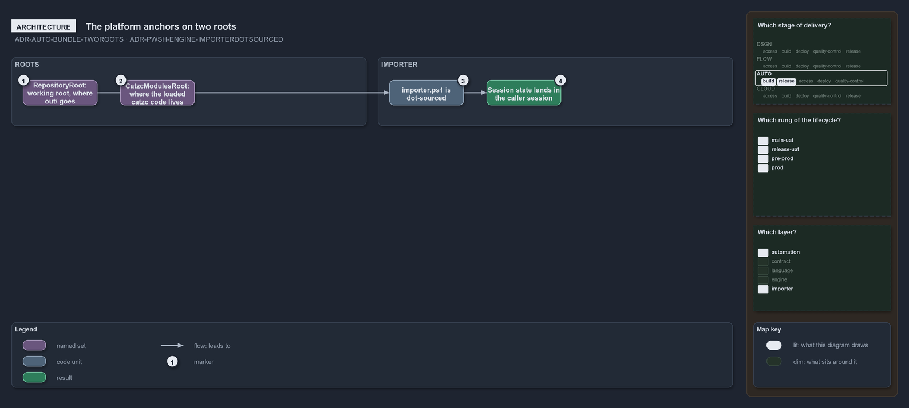

---
catzc:
  warning: "Experimental: this article merges two rules into one and holds nothing beyond what they say"
  edges:
    cites:
      - ADR-AUTO-BUNDLE-TWOROOTS
      - ADR-PWSH-ENGINE-IMPORTERDOTSOURCED
---

# Two roots anchor the platform and the importer is always dot sourced

This article is one rule: [ADR-AUTO-BUNDLE-TWOROOTS](../../drs/automation/platform-bundle.md#rule-adr-auto-bundle-tworoots) and
[ADR-PWSH-ENGINE-IMPORTERDOTSOURCED](../../drs/automation/pwsh/pwsh-engine.md#rule-adr-pwsh-engine-importerdotsourced) merged into one. It
holds nothing beyond what those two rules say.

The platform anchors on two roots, not one: `RepositoryRoot`, the working root where `out/` goes and what repo-relative paths and git
resolve against, and `CatzcModulesRoot`, where the loaded catzc code lives, both environment variables. `importer.ps1` is always
dot-sourced, so it runs in the caller's scope and its session state lands in the caller's session.

