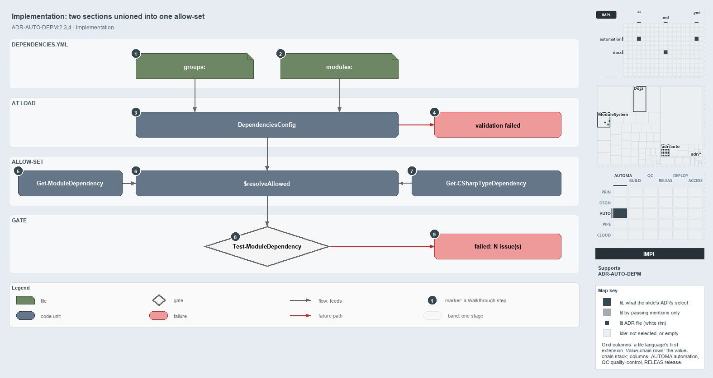

---
catzc:
  derived:
    path: docs/explanation/automation/two-sections-unioned-into-one-allow-set.md
    kind: explanation
    body_sha: be83854e0e86
    adrs:
      - ADR-AUTO-DEPM#2
      - ADR-AUTO-DEPM#3
      - ADR-AUTO-DEPM#4
    links:
      - docs/.assets/explanation/adr-auto-depm--two-sections-unioned-into-one-allow-set--implementation.drawio.md
      - docs/.assets/explanation/adr-auto-depm--two-sections-unioned-into-one-allow-set--implementation.drawio.png
      - docs/adr/automation/controlling-module-dependencies.md
      - docs/explanation/automation/a-declared-allow-list-of-layers.md
      - docs/explanation/automation/index.md
      - docs/explanation/automation/three-layers-edges-point-down.md
      - docs/explanation/automation/two-gates-check-the-layer-pins.md
      - docs/explanation/automation/undeclared-edge-fails-with-one-line.md
      - docs/explanation/index.md#how-to-read-the-diagrams
---

# Two sections of dependencies.yml are unioned into one allow-set per source module

```text
Two sections of dependencies.yml are unioned into one allow-set per source module.

1  groups:                   three groups, each with its own internal member-to-member map
2  modules:                  fourteen consumer entries, each listing the groups or modules it may use
3  DependenciesConfig        the typed config that validates both sections at load
4  validation failed         the one throw for a malformed declaration
5  Get-ModuleDependency      extracts the cross-module function-call edges
6  $resolveAllowed           builds each source module's allow-set and checks every edge against it
7  Get-CSharpTypeDependency  extracts the cross-module C# type references
8  Test-ModuleDependency     the quality gate that reports every issue
9  failed: N issue(s)        the gate's one throw, listing every issue

Supports ADR-AUTO-DEPM#2, #3 and #4 (implementation lens).
```

`dependencies.yml` declares module dependencies in two sections, `groups:` and `modules:`. The `DependenciesConfig` type validates both when
the file loads, and `Get-ModuleDependencyViolations` merges them into one allow-set for each source module. Every function-call edge and
every C# type edge from that module is then checked against the set, and the `Test-ModuleDependency` quality gate fails on any miss. Reading
the code in this order shows exactly where an undeclared edge is caught.



The diagram is described element by element in
[its asset description](../../.assets/explanation/adr-auto-depm--two-sections-unioned-into-one-allow-set--implementation.drawio.md).

## Walkthrough

1. **`groups:`.** Three groups, each with its own internal member-to-member map: `Base` with 26 members, `AzureExt` with 5 rooted at
   `Catzc.Azure.Cli`, and `Tooling` with 6, where Core and Environment depend on nothing in the group.
2. **`modules:`.** Fourteen consumer entries, each listing the groups or single modules that consumer may use. For example,
   `Catzc.Azure.Cli: [Base, Catzc.Azure, Catzc.Tooling.Core]`. No `Base` member has an entry, so a Base library's in-group list is its whole
   allow-set.
3. **`DependenciesConfig`.** The type that `Get-Config -Config dependencies` returns. The private accessors `Get-ModuleDependencyConfig` and
   `Get-ModuleGroupConfig` read its `modules` and `groups` sections, and each group is validated by `ModuleGroup`.
4. **validation failed.** Constructing the type collects every shape problem into one throw: a target that is neither a declared module nor
   a group, a group member that depends outside its own group, or a cycle. The throw starts with
   `module dependency configuration validation failed:`, before any edge is checked.
5. **`Get-ModuleDependency`.** It extracts the cross-module function-call edges, and it runs first.
6. **`$resolveAllowed`.** For each edge's source module it builds the allow-set: the module's `modules:` list with group names expanded to
   their members, unioned with the module's in-group list. A module in neither section is skipped. A declared module or group member missing
   on disk becomes an `[UnknownModule]` issue, and an edge outside the set becomes an `[UndeclaredDependency]` issue.
7. **`Get-CSharpTypeDependency`.** From `Catzc.Base.TypesSystem`, it extracts the cross-module C# type references. They are checked against
   the same allow-set and become `[UndeclaredTypeDependency]` issues, so one graph covers both kinds of edge.
8. **`Test-ModuleDependency`.** The quality gate passes every issue to `Write-QualityGateReport -Subject module-dependency`, which writes
   the report and either throws or, with `-PassThru`, returns the result. The L1 integrity test runs it and expects zero issues.
9. **failed: N issue(s).** With any issue, the gate throws once: `Test-ModuleDependency failed: N issue(s)`, followed by every issue line.

## Why it holds

- A cross-module function call and a cross-module C# type reference are one relationship, extracted by two functions and checked against one
  file (ADR-AUTO-DEPM#2).
- The file has two sections. Naming a group allows an edge to any member, while naming a module allows exactly that edge (ADR-AUTO-DEPM#3).
- The declaration's shape is checked when it loads, and the gate checks the real edges and the on-disk modules against it (ADR-AUTO-DEPM#4).

## Where the code and the ADR differ

- The ADR says actual in-group edges must stay within the group's declared internal map. The allow-set is a union, so the four Tooling
  members that also pin `Tooling` in `modules:` (Python, Node, Toolchain and Provisioning) may reach any Tooling member.
- The ADR says a module absent from `modules:` is unconstrained. The code also constrains every group member, which is what keeps Base
  libraries inside their internal map.

## See also

- [Controlling module dependencies](../../adr/automation/controlling-module-dependencies.md) — the decision this article explains.
- The other lenses on the same graph: [meta](a-declared-allow-list-of-layers.md), [architecture](three-layers-edges-point-down.md),
  [operations](undeclared-edge-fails-with-one-line.md) and [governance](two-gates-check-the-layer-pins.md).
- [The automation explanations](index.md) · [How to read the diagrams](../index.md#how-to-read-the-diagrams)
