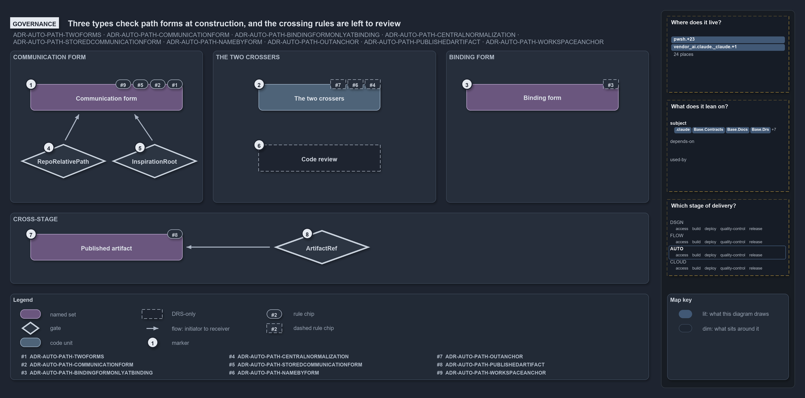

---
catzc:
  warning: "Header is generated by Format-FileMeta via Format-Code; do not change it"
  edges:
    cites:
      - ADR-AUTO-PATH-TWOFORMS
      - ADR-AUTO-PATH-COMMUNICATIONFORM
      - ADR-AUTO-PATH-BINDINGFORMONLYATBINDING
      - ADR-AUTO-PATH-CENTRALNORMALIZATION
      - ADR-AUTO-PATH-STOREDCOMMUNICATIONFORM
      - ADR-AUTO-PATH-NAMEBYFORM
      - ADR-AUTO-PATH-OUTANCHOR
      - ADR-AUTO-PATH-PUBLISHEDARTIFACT
      - ADR-AUTO-PATH-WORKSPACEANCHOR
    drs_total: 9
---

# Three types check path forms at construction, and the crossing rules are left to review

```text
Three types check path forms at construction; the rules about crossing the boundary have no gate and are left to review.

1  Communication form  rules #1, #2, #6 and #11: relative, normalized, stored, {workspace}-anchored
2  The two crossers    rules #4, #7 and #9: the only crossers, named by form, the out/ anchor; no gate
3  Binding form        rule #3: absolute only at the point of use; no gate
4  RepoRelativePath    throws on an escaping relative; a rooted value degrades
5  InspirationRoot     rejects a backslash, a drive letter, an absolute path, a misplaced anchor, . or ..
6  Code review         the only check on the crossing rules; no code runs it
7  Published artifact  rule #10: both forms, anchored on the artifact root
8  ArtifactRef         throws when the file is outside the artifact root

Supports ADR-AUTO-PATH-TWOFORMS, ADR-AUTO-PATH-COMMUNICATIONFORM, ADR-AUTO-PATH-BINDINGFORMONLYATBINDING, ADR-AUTO-PATH-CENTRALNORMALIZATION, ADR-AUTO-PATH-STOREDCOMMUNICATIONFORM, ADR-AUTO-PATH-NAMEBYFORM, ADR-AUTO-PATH-OUTANCHOR, ADR-AUTO-PATH-PUBLISHEDARTIFACT and ADR-AUTO-PATH-WORKSPACEANCHOR (governance lens).
```

The path rules of cats are enforced by construction, not by a linter. A record that holds a `RepoRelativePath`, an inspiration root checked
by `InspirationRoot`, or a published artifact created by `ArtifactRef` cannot carry a mis-formed or wrong-anchor path, because the type
throws when it is built. The rules about how a path crosses the boundary, through the two crossers and only at the point of use, have no
gate at all: code review holds them, and the ADR says why a static rule would be noise.

```yml drawio
description:
  Three types check path forms at construction and throw on a mis-formed or wrong-anchor path; the rules about crossing the boundary,
  through the two crossers and only at the point of use, have no gate and are left to code review.
about:
  adrs:
    - ADR-AUTO-PATH-TWOFORMS
    - ADR-AUTO-PATH-COMMUNICATIONFORM
    - ADR-AUTO-PATH-BINDINGFORMONLYATBINDING
    - ADR-AUTO-PATH-CENTRALNORMALIZATION
    - ADR-AUTO-PATH-STOREDCOMMUNICATIONFORM
    - ADR-AUTO-PATH-NAMEBYFORM
    - ADR-AUTO-PATH-OUTANCHOR
    - ADR-AUTO-PATH-PUBLISHEDARTIFACT
    - ADR-AUTO-PATH-WORKSPACEANCHOR
  lens: governance
content:
  title: Three types check path forms at construction, and the crossing rules are left to review
  kind: explanation
  flow: left-to-right
  relation: checks
  theme: dark
  bands:
    - { id: band-communication, label: COMMUNICATION FORM }
    - { id: band-crossers, label: THE TWO CROSSERS }
    - { id: band-binding, label: BINDING FORM }
    - { id: band-stage, label: CROSS-STAGE }
  glyphs:
    - { id: s-communication, kind: set, label: Communication form, in: band-communication }
    - { id: g-repo-relative, kind: gate, label: RepoRelativePath, in: band-communication }
    - { id: g-inspiration, kind: gate, label: InspirationRoot, in: band-communication }
    - { id: g-crossers, kind: code, label: The two crossers, in: band-crossers }
    - { id: a-review, kind: drsonly, label: Code review, in: band-crossers }
    - { id: s-binding, kind: set, label: Binding form, in: band-binding }
    - { id: s-artifact, kind: set, label: Published artifact, in: band-stage }
    - { id: g-reference, kind: gate, label: ArtifactRef, in: band-stage }
  edges:
    - { from: g-repo-relative, to: s-communication, kind: flow, label: "" }
    - { from: g-inspiration, to: s-communication, kind: flow, label: "" }
    - { from: g-reference, to: s-artifact, kind: flow, label: "" }
  markers:
    - { at: s-communication, number: 1 }
    - { at: g-crossers, number: 2 }
    - { at: s-binding, number: 3 }
    - { at: g-repo-relative, number: 4 }
    - { at: g-inspiration, number: 5 }
    - { at: a-review, number: 6 }
    - { at: s-artifact, number: 7 }
    - { at: g-reference, number: 8 }
  chips:
    - { at: s-communication, kind: rule, rule: ADR-AUTO-PATH-TWOFORMS }
    - { at: s-communication, kind: rule, rule: ADR-AUTO-PATH-COMMUNICATIONFORM }
    - { at: s-communication, kind: rule, rule: ADR-AUTO-PATH-STOREDCOMMUNICATIONFORM }
    - { at: s-communication, kind: rule, rule: ADR-AUTO-PATH-WORKSPACEANCHOR }
    - { at: g-crossers, kind: rule, rule: ADR-AUTO-PATH-CENTRALNORMALIZATION, gated: false }
    - { at: g-crossers, kind: rule, rule: ADR-AUTO-PATH-NAMEBYFORM, gated: false }
    - { at: g-crossers, kind: rule, rule: ADR-AUTO-PATH-OUTANCHOR, gated: false }
    - { at: s-binding, kind: rule, rule: ADR-AUTO-PATH-BINDINGFORMONLYATBINDING, gated: false }
    - { at: s-artifact, kind: rule, rule: ADR-AUTO-PATH-PUBLISHEDARTIFACT }
  legend: auto
  minimaps:
    code-locations:
      - cell: .claude/.claude/skills/catzc-module
        by: [.claude/skills/catzc-module/SKILL.md, ADR-AUTO-PATH-BINDINGFORMONLYATBINDING, ADR-AUTO-PATH-TWOFORMS]
      - cell: docs/-/.
        by:
          - docs/drs/automation/dora-explains.md
          - docs/drs/automation/path-representation.md
          - docs/drs/glossary.md
          - docs/drs/index.md
          - docs/references/pwsh/catzc-base-contracts/Get-Contract.ps1.md
          - docs/references/pwsh/catzc-base-contracts/Publish-ContractRelease.ps1.md
          - docs/references/pwsh/catzc-base-contracts/private/Get-ContractFileHashes.ps1.md
          - docs/references/pwsh/catzc-base-contracts/tests/types/ContractAsset.Tests.ps1.md
          - docs/references/pwsh/catzc-base-contracts/types/ContractAsset.cs.md
          - docs/references/pwsh/catzc-base-docs/configs/readme.yml.md
          - docs/references/pwsh/catzc-base-docs/types/DocMapping.cs.md
          - docs/references/pwsh/catzc-base-docs/types/DocPattern.cs.md
          - docs/references/pwsh/catzc-base-module-system/Copy-CatzcModule.ps1.md
          - docs/references/pwsh/catzc-base-objects/types/ArtifactRef.cs.md
          - docs/references/pwsh/catzc-base-objects/types/RepoRelativePath.cs.md
          - docs/references/pwsh/catzc-base-repository/ConvertTo-RepoRelativePath.ps1.md
          - docs/references/pwsh/catzc-base-repository/Get-RepositoryFile.ps1.md
          - docs/references/pwsh/catzc-base-repository/Get-RepositoryFolder.ps1.md
          - docs/references/pwsh/catzc-base-repository/Resolve-RepoPath.ps1.md
          - docs/references/pwsh/catzc-base-root-config/configs/rootconfig.yml.md
          - docs/references/pwsh/catzc-base-root-config/types/RootConfigFile.cs.md
          - docs/references/pwsh/catzc-tooling-inspiration/configs/inspiration.yml.md
          - docs/references/pwsh/catzc-tooling-inspiration/private/Resolve-InspirationRoot.ps1.md
          - docs/references/pwsh/catzc-tooling-inspiration/tests/Resolve-InspirationRoot.Tests.ps1.md
          - docs/references/pwsh/catzc-tooling-inspiration/tests/types/InspirationConfig.Tests.ps1.md
          - docs/references/pwsh/catzc-tooling-inspiration/tests/types/InspirationRoot.Tests.ps1.md
          - docs/references/pwsh/catzc-tooling-inspiration/types/InspirationRoot.cs.md
          - ADR-AUTO-PATH-BINDINGFORMONLYATBINDING
          - ADR-AUTO-PATH-CENTRALNORMALIZATION
          - ADR-AUTO-PATH-COMMUNICATIONFORM
          - ADR-AUTO-PATH-NAMEBYFORM
          - ADR-AUTO-PATH-OUTANCHOR
          - ADR-AUTO-PATH-PUBLISHEDARTIFACT
          - ADR-AUTO-PATH-STOREDCOMMUNICATIONFORM
          - ADR-AUTO-PATH-TWOFORMS
          - ADR-AUTO-PATH-WORKSPACEANCHOR
      - cell: pwsh/Catzc.Base.Contracts/.
        by:
          - pwsh/Catzc.Base.Contracts/Get-Contract.ps1
          - pwsh/Catzc.Base.Contracts/Publish-ContractRelease.ps1
          - ADR-AUTO-PATH-COMMUNICATIONFORM
      - cell: pwsh/Catzc.Base.Contracts/private
        by: [pwsh/Catzc.Base.Contracts/private/Get-ContractFileHashes.ps1, ADR-AUTO-PATH-COMMUNICATIONFORM]
      - cell: pwsh/Catzc.Base.Contracts/tests
        by: [pwsh/Catzc.Base.Contracts/tests/Get-Contract.Tests.ps1, ADR-AUTO-PATH-COMMUNICATIONFORM]
      - cell: pwsh/Catzc.Base.Contracts/tests/types
        by: [pwsh/Catzc.Base.Contracts/tests/types/ContractAsset.Tests.ps1, ADR-AUTO-PATH-COMMUNICATIONFORM, ADR-AUTO-PATH-TWOFORMS]
      - cell: pwsh/Catzc.Base.Contracts/types
        by: [pwsh/Catzc.Base.Contracts/types/ContractAsset.cs, ADR-AUTO-PATH-COMMUNICATIONFORM, ADR-AUTO-PATH-TWOFORMS]
      - cell: pwsh/Catzc.Base.Docs/configs
        by:
          - pwsh/Catzc.Base.Docs/configs/readme.yml
          - ADR-AUTO-PATH-BINDINGFORMONLYATBINDING
          - ADR-AUTO-PATH-CENTRALNORMALIZATION
          - ADR-AUTO-PATH-COMMUNICATIONFORM
          - ADR-AUTO-PATH-NAMEBYFORM
          - ADR-AUTO-PATH-OUTANCHOR
          - ADR-AUTO-PATH-PUBLISHEDARTIFACT
          - ADR-AUTO-PATH-STOREDCOMMUNICATIONFORM
          - ADR-AUTO-PATH-TWOFORMS
          - ADR-AUTO-PATH-WORKSPACEANCHOR
      - cell: pwsh/Catzc.Base.Docs/types
        by:
          - pwsh/Catzc.Base.Docs/types/DocMapping.cs
          - pwsh/Catzc.Base.Docs/types/DocPattern.cs
          - ADR-AUTO-PATH-BINDINGFORMONLYATBINDING
          - ADR-AUTO-PATH-CENTRALNORMALIZATION
          - ADR-AUTO-PATH-COMMUNICATIONFORM
          - ADR-AUTO-PATH-NAMEBYFORM
          - ADR-AUTO-PATH-OUTANCHOR
          - ADR-AUTO-PATH-PUBLISHEDARTIFACT
          - ADR-AUTO-PATH-STOREDCOMMUNICATIONFORM
          - ADR-AUTO-PATH-TWOFORMS
          - ADR-AUTO-PATH-WORKSPACEANCHOR
      - cell: pwsh/Catzc.Base.Drs/configs
        by:
          - pwsh/Catzc.Base.Drs/configs/drs.yml
          - ADR-AUTO-PATH-BINDINGFORMONLYATBINDING
          - ADR-AUTO-PATH-CENTRALNORMALIZATION
          - ADR-AUTO-PATH-COMMUNICATIONFORM
          - ADR-AUTO-PATH-NAMEBYFORM
          - ADR-AUTO-PATH-OUTANCHOR
          - ADR-AUTO-PATH-PUBLISHEDARTIFACT
          - ADR-AUTO-PATH-STOREDCOMMUNICATIONFORM
          - ADR-AUTO-PATH-TWOFORMS
          - ADR-AUTO-PATH-WORKSPACEANCHOR
      - cell: pwsh/Catzc.Base.ModuleSystem/.
        by:
          - pwsh/Catzc.Base.ModuleSystem/Copy-CatzcModule.ps1
          - ADR-AUTO-PATH-BINDINGFORMONLYATBINDING
          - ADR-AUTO-PATH-CENTRALNORMALIZATION
          - ADR-AUTO-PATH-COMMUNICATIONFORM
          - ADR-AUTO-PATH-NAMEBYFORM
          - ADR-AUTO-PATH-OUTANCHOR
          - ADR-AUTO-PATH-PUBLISHEDARTIFACT
          - ADR-AUTO-PATH-STOREDCOMMUNICATIONFORM
          - ADR-AUTO-PATH-TWOFORMS
          - ADR-AUTO-PATH-WORKSPACEANCHOR
      - cell: pwsh/Catzc.Base.ModuleSystem/configs
        by: [pwsh/Catzc.Base.ModuleSystem/configs/glossary.yml, ADR-AUTO-PATH-PUBLISHEDARTIFACT]
      - cell: pwsh/Catzc.Base.Objects/tests/types
        by: [pwsh/Catzc.Base.Objects/tests/types/ArtifactRef.Tests.ps1, ADR-AUTO-PATH-PUBLISHEDARTIFACT]
      - cell: pwsh/Catzc.Base.Objects/types
        by:
          - pwsh/Catzc.Base.Objects/types/ArtifactRef.cs
          - pwsh/Catzc.Base.Objects/types/RepoRelativePath.cs
          - ADR-AUTO-PATH-BINDINGFORMONLYATBINDING
          - ADR-AUTO-PATH-CENTRALNORMALIZATION
          - ADR-AUTO-PATH-COMMUNICATIONFORM
          - ADR-AUTO-PATH-NAMEBYFORM
          - ADR-AUTO-PATH-OUTANCHOR
          - ADR-AUTO-PATH-PUBLISHEDARTIFACT
          - ADR-AUTO-PATH-STOREDCOMMUNICATIONFORM
          - ADR-AUTO-PATH-TWOFORMS
          - ADR-AUTO-PATH-WORKSPACEANCHOR
      - cell: pwsh/Catzc.Base.Repository/.
        by:
          - pwsh/Catzc.Base.Repository/ConvertTo-RepoRelativePath.ps1
          - pwsh/Catzc.Base.Repository/Get-RepositoryFile.ps1
          - pwsh/Catzc.Base.Repository/Get-RepositoryFolder.ps1
          - pwsh/Catzc.Base.Repository/Resolve-RepoPath.ps1
          - ADR-AUTO-PATH-BINDINGFORMONLYATBINDING
          - ADR-AUTO-PATH-CENTRALNORMALIZATION
          - ADR-AUTO-PATH-COMMUNICATIONFORM
          - ADR-AUTO-PATH-NAMEBYFORM
          - ADR-AUTO-PATH-OUTANCHOR
          - ADR-AUTO-PATH-PUBLISHEDARTIFACT
          - ADR-AUTO-PATH-STOREDCOMMUNICATIONFORM
          - ADR-AUTO-PATH-TWOFORMS
          - ADR-AUTO-PATH-WORKSPACEANCHOR
      - cell: pwsh/Catzc.Base.RootConfig/configs
        by:
          - pwsh/Catzc.Base.RootConfig/configs/rootconfig.yml
          - ADR-AUTO-PATH-BINDINGFORMONLYATBINDING
          - ADR-AUTO-PATH-CENTRALNORMALIZATION
          - ADR-AUTO-PATH-COMMUNICATIONFORM
          - ADR-AUTO-PATH-NAMEBYFORM
          - ADR-AUTO-PATH-OUTANCHOR
          - ADR-AUTO-PATH-PUBLISHEDARTIFACT
          - ADR-AUTO-PATH-STOREDCOMMUNICATIONFORM
          - ADR-AUTO-PATH-TWOFORMS
          - ADR-AUTO-PATH-WORKSPACEANCHOR
      - cell: pwsh/Catzc.Base.RootConfig/types
        by:
          - pwsh/Catzc.Base.RootConfig/types/RootConfigFile.cs
          - ADR-AUTO-PATH-BINDINGFORMONLYATBINDING
          - ADR-AUTO-PATH-CENTRALNORMALIZATION
          - ADR-AUTO-PATH-COMMUNICATIONFORM
          - ADR-AUTO-PATH-NAMEBYFORM
          - ADR-AUTO-PATH-OUTANCHOR
          - ADR-AUTO-PATH-PUBLISHEDARTIFACT
          - ADR-AUTO-PATH-STOREDCOMMUNICATIONFORM
          - ADR-AUTO-PATH-TWOFORMS
          - ADR-AUTO-PATH-WORKSPACEANCHOR
      - cell: pwsh/Catzc.Base.Slides/tests/types
        by: [pwsh/Catzc.Base.Slides/tests/types/SlidesConfig.Tests.ps1, ADR-AUTO-PATH-TWOFORMS]
      - cell: pwsh/Catzc.Tooling.Inspiration/configs
        by: [pwsh/Catzc.Tooling.Inspiration/configs/inspiration.yml, ADR-AUTO-PATH-WORKSPACEANCHOR]
      - cell: pwsh/Catzc.Tooling.Inspiration/private
        by:
          - pwsh/Catzc.Tooling.Inspiration/private/Resolve-InspirationRoot.ps1
          - ADR-AUTO-PATH-BINDINGFORMONLYATBINDING
          - ADR-AUTO-PATH-STOREDCOMMUNICATIONFORM
          - ADR-AUTO-PATH-WORKSPACEANCHOR
      - cell: pwsh/Catzc.Tooling.Inspiration/tests
        by: [pwsh/Catzc.Tooling.Inspiration/tests/Resolve-InspirationRoot.Tests.ps1, ADR-AUTO-PATH-WORKSPACEANCHOR]
      - cell: pwsh/Catzc.Tooling.Inspiration/tests/types
        by:
          - pwsh/Catzc.Tooling.Inspiration/tests/types/InspirationConfig.Tests.ps1
          - pwsh/Catzc.Tooling.Inspiration/tests/types/InspirationRoot.Tests.ps1
          - ADR-AUTO-PATH-STOREDCOMMUNICATIONFORM
          - ADR-AUTO-PATH-WORKSPACEANCHOR
      - cell: pwsh/Catzc.Tooling.Inspiration/types
        by:
          - pwsh/Catzc.Tooling.Inspiration/types/InspirationRoot.cs
          - ADR-AUTO-PATH-BINDINGFORMONLYATBINDING
          - ADR-AUTO-PATH-STOREDCOMMUNICATIONFORM
          - ADR-AUTO-PATH-WORKSPACEANCHOR
    module-neighbourhood:
      - cell: subject/.claude
        by: [.claude/skills/catzc-module/SKILL.md, ADR-AUTO-PATH-BINDINGFORMONLYATBINDING, ADR-AUTO-PATH-TWOFORMS]
      - cell: subject/Catzc.Base.Contracts
        by:
          - pwsh/Catzc.Base.Contracts/Get-Contract.ps1
          - pwsh/Catzc.Base.Contracts/Publish-ContractRelease.ps1
          - pwsh/Catzc.Base.Contracts/private/Get-ContractFileHashes.ps1
          - pwsh/Catzc.Base.Contracts/tests/Get-Contract.Tests.ps1
          - pwsh/Catzc.Base.Contracts/tests/types/ContractAsset.Tests.ps1
          - pwsh/Catzc.Base.Contracts/types/ContractAsset.cs
          - ADR-AUTO-PATH-COMMUNICATIONFORM
          - ADR-AUTO-PATH-TWOFORMS
      - cell: subject/Catzc.Base.Docs
        by:
          - pwsh/Catzc.Base.Docs/configs/readme.yml
          - pwsh/Catzc.Base.Docs/types/DocMapping.cs
          - pwsh/Catzc.Base.Docs/types/DocPattern.cs
          - ADR-AUTO-PATH-BINDINGFORMONLYATBINDING
          - ADR-AUTO-PATH-CENTRALNORMALIZATION
          - ADR-AUTO-PATH-COMMUNICATIONFORM
          - ADR-AUTO-PATH-NAMEBYFORM
          - ADR-AUTO-PATH-OUTANCHOR
          - ADR-AUTO-PATH-PUBLISHEDARTIFACT
          - ADR-AUTO-PATH-STOREDCOMMUNICATIONFORM
          - ADR-AUTO-PATH-TWOFORMS
          - ADR-AUTO-PATH-WORKSPACEANCHOR
      - cell: subject/Catzc.Base.Drs
        by:
          - pwsh/Catzc.Base.Drs/configs/drs.yml
          - ADR-AUTO-PATH-BINDINGFORMONLYATBINDING
          - ADR-AUTO-PATH-CENTRALNORMALIZATION
          - ADR-AUTO-PATH-COMMUNICATIONFORM
          - ADR-AUTO-PATH-NAMEBYFORM
          - ADR-AUTO-PATH-OUTANCHOR
          - ADR-AUTO-PATH-PUBLISHEDARTIFACT
          - ADR-AUTO-PATH-STOREDCOMMUNICATIONFORM
          - ADR-AUTO-PATH-TWOFORMS
          - ADR-AUTO-PATH-WORKSPACEANCHOR
      - cell: subject/Catzc.Base.ModuleSystem
        by:
          - pwsh/Catzc.Base.ModuleSystem/Copy-CatzcModule.ps1
          - pwsh/Catzc.Base.ModuleSystem/configs/glossary.yml
          - ADR-AUTO-PATH-BINDINGFORMONLYATBINDING
          - ADR-AUTO-PATH-CENTRALNORMALIZATION
          - ADR-AUTO-PATH-COMMUNICATIONFORM
          - ADR-AUTO-PATH-NAMEBYFORM
          - ADR-AUTO-PATH-OUTANCHOR
          - ADR-AUTO-PATH-PUBLISHEDARTIFACT
          - ADR-AUTO-PATH-STOREDCOMMUNICATIONFORM
          - ADR-AUTO-PATH-TWOFORMS
          - ADR-AUTO-PATH-WORKSPACEANCHOR
      - cell: subject/Catzc.Base.Objects
        by:
          - pwsh/Catzc.Base.Objects/tests/types/ArtifactRef.Tests.ps1
          - pwsh/Catzc.Base.Objects/types/ArtifactRef.cs
          - pwsh/Catzc.Base.Objects/types/RepoRelativePath.cs
          - ADR-AUTO-PATH-BINDINGFORMONLYATBINDING
          - ADR-AUTO-PATH-CENTRALNORMALIZATION
          - ADR-AUTO-PATH-COMMUNICATIONFORM
          - ADR-AUTO-PATH-NAMEBYFORM
          - ADR-AUTO-PATH-OUTANCHOR
          - ADR-AUTO-PATH-PUBLISHEDARTIFACT
          - ADR-AUTO-PATH-STOREDCOMMUNICATIONFORM
          - ADR-AUTO-PATH-TWOFORMS
          - ADR-AUTO-PATH-WORKSPACEANCHOR
      - cell: subject/Catzc.Base.Repository
        by:
          - pwsh/Catzc.Base.Repository/ConvertTo-RepoRelativePath.ps1
          - pwsh/Catzc.Base.Repository/Get-RepositoryFile.ps1
          - pwsh/Catzc.Base.Repository/Get-RepositoryFolder.ps1
          - pwsh/Catzc.Base.Repository/Resolve-RepoPath.ps1
          - ADR-AUTO-PATH-BINDINGFORMONLYATBINDING
          - ADR-AUTO-PATH-CENTRALNORMALIZATION
          - ADR-AUTO-PATH-COMMUNICATIONFORM
          - ADR-AUTO-PATH-NAMEBYFORM
          - ADR-AUTO-PATH-OUTANCHOR
          - ADR-AUTO-PATH-PUBLISHEDARTIFACT
          - ADR-AUTO-PATH-STOREDCOMMUNICATIONFORM
          - ADR-AUTO-PATH-TWOFORMS
          - ADR-AUTO-PATH-WORKSPACEANCHOR
      - cell: subject/Catzc.Base.RootConfig
        by:
          - pwsh/Catzc.Base.RootConfig/configs/rootconfig.yml
          - pwsh/Catzc.Base.RootConfig/types/RootConfigFile.cs
          - ADR-AUTO-PATH-BINDINGFORMONLYATBINDING
          - ADR-AUTO-PATH-CENTRALNORMALIZATION
          - ADR-AUTO-PATH-COMMUNICATIONFORM
          - ADR-AUTO-PATH-NAMEBYFORM
          - ADR-AUTO-PATH-OUTANCHOR
          - ADR-AUTO-PATH-PUBLISHEDARTIFACT
          - ADR-AUTO-PATH-STOREDCOMMUNICATIONFORM
          - ADR-AUTO-PATH-TWOFORMS
          - ADR-AUTO-PATH-WORKSPACEANCHOR
      - cell: subject/Catzc.Base.Slides
        by: [pwsh/Catzc.Base.Slides/tests/types/SlidesConfig.Tests.ps1, ADR-AUTO-PATH-TWOFORMS]
      - cell: subject/Catzc.Tooling.Inspiration
        by:
          - pwsh/Catzc.Tooling.Inspiration/configs/inspiration.yml
          - pwsh/Catzc.Tooling.Inspiration/private/Resolve-InspirationRoot.ps1
          - pwsh/Catzc.Tooling.Inspiration/tests/Resolve-InspirationRoot.Tests.ps1
          - pwsh/Catzc.Tooling.Inspiration/tests/types/InspirationConfig.Tests.ps1
          - pwsh/Catzc.Tooling.Inspiration/tests/types/InspirationRoot.Tests.ps1
          - pwsh/Catzc.Tooling.Inspiration/types/InspirationRoot.cs
          - ADR-AUTO-PATH-BINDINGFORMONLYATBINDING
          - ADR-AUTO-PATH-STOREDCOMMUNICATIONFORM
          - ADR-AUTO-PATH-WORKSPACEANCHOR
    axis:
      - cell: AUTO/*
        by:
          - ADR-AUTO-PATH-BINDINGFORMONLYATBINDING
          - ADR-AUTO-PATH-CENTRALNORMALIZATION
          - ADR-AUTO-PATH-COMMUNICATIONFORM
          - ADR-AUTO-PATH-NAMEBYFORM
          - ADR-AUTO-PATH-OUTANCHOR
          - ADR-AUTO-PATH-PUBLISHEDARTIFACT
          - ADR-AUTO-PATH-STOREDCOMMUNICATIONFORM
          - ADR-AUTO-PATH-TWOFORMS
          - ADR-AUTO-PATH-WORKSPACEANCHOR
layout:
  band-communication: { x: 20, y: 84, w: 380, h: 300 }
  band-crossers: { x: 420, y: 84, w: 440, h: 300 }
  band-binding: { x: 880, y: 84, w: 400, h: 300 }
  band-stage: { x: 20, y: 404, w: 1260, h: 140 }
  s-communication: { x: 60, y: 150, w: 300, h: 52 }
  g-repo-relative: { x: 40, y: 268, w: 170, h: 68 }
  g-inspiration: { x: 220, y: 268, w: 170, h: 68 }
  g-crossers: { x: 510, y: 150, w: 240, h: 52 }
  a-review: { x: 510, y: 270, w: 240, h: 52 }
  s-binding: { x: 920, y: 150, w: 300, h: 52 }
  s-artifact: { x: 60, y: 446, w: 300, h: 52 }
  g-reference: { x: 540, y: 438, w: 190, h: 68 }
```



## Walkthrough

1. **Communication form.** Four rules govern it: a path is in one of two forms (#1), a stored or transported path is relative (#2),
   source-controlled config and long-lived records hold relative paths only (#6), and a folder beside the repository is written
   `{workspace}/<name>` (#11). Two types check them when a value is constructed.
2. **The two crossers.** `ConvertTo-RepoRelativePath` and `Resolve-RepoPath` are the only sanctioned crossers (#4), a function is named by
   the form it produces (#7), and `out/` re-anchors on the output root (#9). No gate checks that code goes through them; the chip is dashed.
3. **Binding form.** A path is absolute only on the line that uses it (#3). Nothing can tell a stored absolute path from a bound one by its
   shape, so this rule too is review-only.
4. **RepoRelativePath.** The type in `Catzc.Base.Objects` that holds a repository-relative path. Its constructor collapses `.`, `..`, a
   leading `./` and duplicate separators without touching the current directory, throws when a relative path escapes the root or names the
   root itself, and keeps a rooted input as a normalized absolute path, the degrade case.
5. **InspirationRoot.** The checker in `Catzc.Tooling.Inspiration` for a stored inspiration root. `Violations` names every way a value
   breaks communication form: a backslash, a drive letter, an absolute path, a `{workspace}` anchor anywhere but first, a `..` or `.`
   segment, an empty segment. `Resolve-InspirationRoot` binds a valid root only at the point of use.
6. **Code review.** The ADR rejects a custom PSScriptAnalyzer rule: a raw `$env:RepositoryRoot` read, a `Join-Path` onto it and an ad hoc
   separator replace are each legitimate in scores of binding sites, and whether a path is communicated or bound is not an AST pattern. So
   the crossing rules are reviewed against the ADR, and no code checks them.
7. **Published artifact.** A file that crosses a stage boundary is an immutable object with both forms, created by the controlled type and
   anchored on the artifact root (#10). The glossary realizes the term by `Catzc.Base.Objects.ArtifactRef`.
8. **ArtifactRef.** `Materialize` throws when the raw path does not live under the artifact root, and the constructor rejects a rooted or
   escaping relative, so a manifest cannot rehydrate a wrong-anchor path. `ResolveAt` and `ExistsAt` give the consumer its check.

## Why it holds

- A path value is in one of two forms, never a third (ADR-AUTO-PATH-TWOFORMS).
- A stored or transported path is in communication form (ADR-AUTO-PATH-COMMUNICATIONFORM).
- A path is in binding form only at the point of binding (ADR-AUTO-PATH-BINDINGFORMONLYATBINDING).
- Normalization is mandatory and centralized in the two sanctioned crossers (ADR-AUTO-PATH-CENTRALNORMALIZATION).
- Source-controlled config and long-lived records store communication-form paths only (ADR-AUTO-PATH-STOREDCOMMUNICATIONFORM).
- A path is named by its form: crossers cross, binding helpers bind (ADR-AUTO-PATH-NAMEBYFORM).
- `out/` is a reserved anchor re-anchored on `Get-OutputRoot` (ADR-AUTO-PATH-OUTANCHOR).
- A published artifact is created by `ArtifactRef` and anchored on the artifact root (ADR-AUTO-PATH-PUBLISHEDARTIFACT).
- `{workspace}` is a reserved anchor for a folder beside the repository, resolved only at the point of use (ADR-AUTO-PATH-WORKSPACEANCHOR).

Rule #5, degradation, is held by `RepoRelativePath.IsRooted` and the third test in `ConvertTo-RepoRelativePath`; rule #8, rendering per
channel, is a per-channel choice with no gate. Neither carries a chip.

## See also

- [Path representation](../../drs/automation/path-representation.md) — the decision this article explains.
- The other views of the same boundary: [meta](two-forms-never-a-third.md), [architecture](two-crossers-and-three-anchors.md),
  [implementation](output-root-first-then-repo-root.md) and [operations](one-out-string-two-places.md).
- [The automation explanations](index.md) · [How to read the diagrams](../index.md#how-to-read-the-diagrams)
