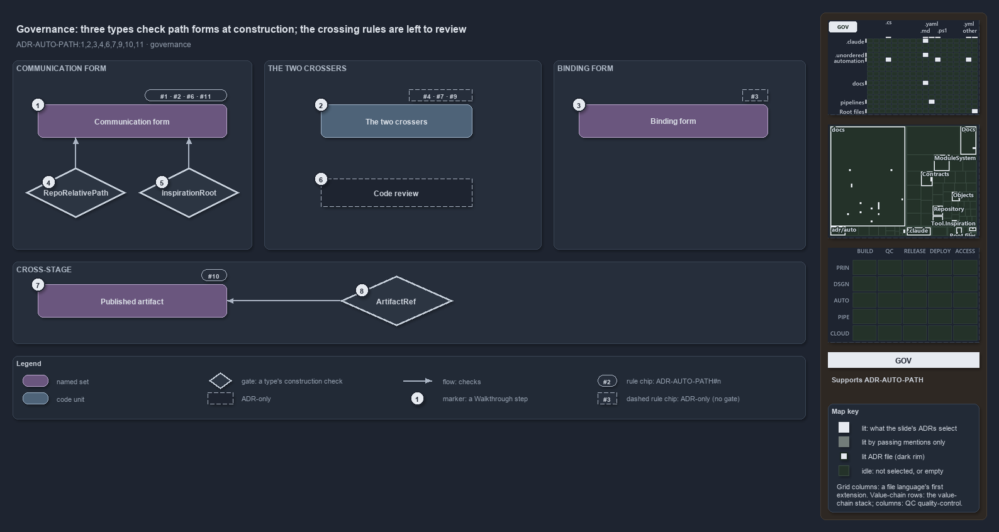

---
catzc:
  derived:
    path: docs/explanation/automation/types-check-forms-review-checks-crossers.md
    kind: explanation
    language: markdown
    track: docs
    body_sha: b0cbf15d555a
    adrs:
      - ADR-AUTO-PATH#{1-4,6,7,9-11}
    links:
      - docs/.assets/explanation/adr-auto-path--types-check-forms-review-checks-crossers--governance.drawio.md
      - docs/.assets/explanation/adr-auto-path--types-check-forms-review-checks-crossers--governance.drawio.png
      - docs/adr/automation/path-representation.md
      - docs/explanation/automation/index.md
      - docs/explanation/automation/one-out-string-two-places.md
      - docs/explanation/automation/output-root-first-then-repo-root.md
      - docs/explanation/automation/two-crossers-and-three-anchors.md
      - docs/explanation/automation/two-forms-never-a-third.md
      - docs/explanation/index.md#how-to-read-the-diagrams
---

# Three types check path forms at construction, and the crossing rules are left to review

```text
Three types check path forms at construction; the rules about crossing the boundary have no gate and are left to review.

1  Communication form  rules #1, #2, #6 and #11: relative, normalized, stored, {workspace}-anchored
2  The two crossers    rules #4, #7 and #9: the only crossers, named by form, the out/ anchor; no gate
3  Binding form        rule #3: absolute only at the point of use; no gate
4  RepoRelativePath    throws on an escaping relative; a rooted value degrades
5  InspirationRoot     rejects a backslash, a drive letter, an absolute path, a misplaced anchor, . or ..
6  Code review         the only check on the crossing rules; no code runs it
7  Published artifact  rule #10: both forms, anchored on the artifact root
8  ArtifactRef         throws when the file is outside the artifact root

Supports ADR-AUTO-PATH#1, #2, #3, #4, #6, #7, #9, #10 and #11 (governance lens).
```

The path rules of cats are enforced by construction, not by a linter. A record that holds a `RepoRelativePath`, an inspiration root checked
by `InspirationRoot`, or a published artifact created by `ArtifactRef` cannot carry a mis-formed or wrong-anchor path, because the type
throws when it is built. The rules about how a path crosses the boundary, through the two crossers and only at the point of use, have no
gate at all: code review holds them, and the ADR says why a static rule would be noise.



The diagram is described element by element in
[its asset description](../../.assets/explanation/adr-auto-path--types-check-forms-review-checks-crossers--governance.drawio.md).

## Walkthrough

1. **Communication form.** Four rules govern it: a path is in one of two forms (#1), a stored or transported path is relative (#2),
   source-controlled config and long-lived records hold relative paths only (#6), and a folder beside the repository is written
   `{workspace}/<name>` (#11). Two types check them when a value is constructed.
2. **The two crossers.** `ConvertTo-RepoRelativePath` and `Resolve-RepoPath` are the only sanctioned crossers (#4), a function is named by
   the form it produces (#7), and `out/` re-anchors on the output root (#9). No gate checks that code goes through them; the chip is dashed.
3. **Binding form.** A path is absolute only on the line that uses it (#3). Nothing can tell a stored absolute path from a bound one by its
   shape, so this rule too is review-only.
4. **RepoRelativePath.** The type in `Catzc.Base.Objects` that holds a repository-relative path. Its constructor collapses `.`, `..`, a
   leading `./` and duplicate separators without touching the current directory, throws when a relative path escapes the root or names the
   root itself, and keeps a rooted input as a normalized absolute path, the degrade case.
5. **InspirationRoot.** The checker in `Catzc.Tooling.Inspiration` for a stored inspiration root. `Violations` names every way a value
   breaks communication form: a backslash, a drive letter, an absolute path, a `{workspace}` anchor anywhere but first, a `..` or `.`
   segment, an empty segment. `Resolve-InspirationRoot` binds a valid root only at the point of use.
6. **Code review.** The ADR rejects a custom PSScriptAnalyzer rule: a raw `$env:RepositoryRoot` read, a `Join-Path` onto it and an ad hoc
   separator replace are each legitimate in scores of binding sites, and whether a path is communicated or bound is not an AST pattern. So
   the crossing rules are reviewed against the ADR, and no code checks them.
7. **Published artifact.** A file that crosses a stage boundary is an immutable object with both forms, created by the controlled type and
   anchored on the artifact root (#10). The glossary realizes the term by `Catzc.Base.Objects.ArtifactRef`.
8. **ArtifactRef.** `Materialize` throws when the raw path does not live under the artifact root, and the constructor rejects a rooted or
   escaping relative, so a manifest cannot rehydrate a wrong-anchor path. `ResolveAt` and `ExistsAt` give the consumer its check.

## Why it holds

- A path value is in one of two forms, never a third (ADR-AUTO-PATH#1).
- A stored or transported path is in communication form (ADR-AUTO-PATH#2).
- A path is in binding form only at the point of binding (ADR-AUTO-PATH#3).
- Normalization is mandatory and centralized in the two sanctioned crossers (ADR-AUTO-PATH#4).
- Source-controlled config and long-lived records store communication-form paths only (ADR-AUTO-PATH#6).
- A path is named by its form: crossers cross, binding helpers bind (ADR-AUTO-PATH#7).
- `out/` is a reserved anchor re-anchored on `Get-OutputRoot` (ADR-AUTO-PATH#9).
- A published artifact is created by `ArtifactRef` and anchored on the artifact root (ADR-AUTO-PATH#10).
- `{workspace}` is a reserved anchor for a folder beside the repository, resolved only at the point of use (ADR-AUTO-PATH#11).

Rule #5, degradation, is held by `RepoRelativePath.IsRooted` and the third test in `ConvertTo-RepoRelativePath`; rule #8, rendering per
channel, is a per-channel choice with no gate. Neither carries a chip.

## Where the code and the ADR differ

- The ADR names the types the primary enforcement; `ArtifactRef` has no production caller today, only its tests.
- The ADR says a path-bearing type converts once and exposes both forms; `RepoRelativePath` stores the relative form only and derives the
  absolute on demand.
- The ADR says `ExistsAt` asserts that the file exists; the method returns a Boolean.

## See also

- [Path representation](../../adr/automation/path-representation.md) — the decision this article explains.
- The other views of the same boundary: [meta](two-forms-never-a-third.md), [architecture](two-crossers-and-three-anchors.md),
  [implementation](output-root-first-then-repo-root.md) and [operations](one-out-string-two-places.md).
- [The automation explanations](index.md) · [How to read the diagrams](../index.md#how-to-read-the-diagrams)
