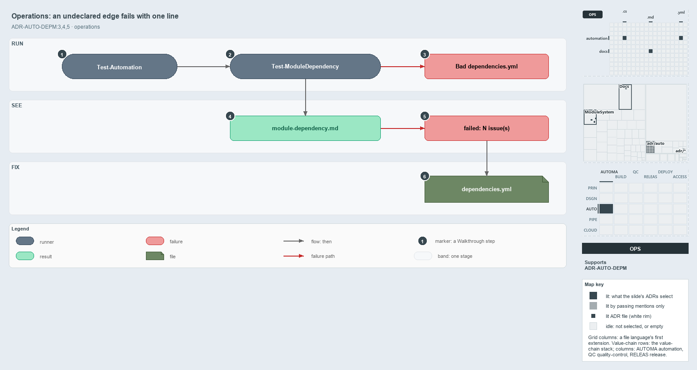

---
catzc:
  immutable:
    with_body_sha: de8d7a0b63f5
    path: docs/explanation/automation/undeclared-edge-fails-with-one-line.md
    folder: docs/explanation/automation
    name: undeclared-edge-fails-with-one-line
    filetype: md
    kind: explanation
    language: markdown
    track: docs
    tracktype: documentation
  edges:
    cites:
      - ADR-AUTO-DEPM#{3-5}
    links:
      - docs/.assets/explanation/adr-auto-depm--undeclared-edge-fails-with-one-line--operations.drawio.md
      - docs/.assets/explanation/adr-auto-depm--undeclared-edge-fails-with-one-line--operations.drawio.png
      - docs/adr/automation/controlling-module-dependencies.md
      - docs/explanation/automation/a-declared-allow-list-of-layers.md
      - docs/explanation/automation/index.md
      - docs/explanation/automation/three-layers-edges-point-down.md
      - docs/explanation/automation/two-gates-check-the-layer-pins.md
      - docs/explanation/automation/two-sections-unioned-into-one-allow-set.md
      - docs/explanation/index.md#how-to-read-the-diagrams
---

# An undeclared module edge fails the gate with one line per issue

```text
An undeclared module edge fails the gate with one line per issue.

1  Test-Automation        the usual entry point; its L1 integrity test runs the gate
2  Test-ModuleDependency  the gate itself, run directly or by the test
3  Bad dependencies.yml   a malformed declaration throws before any edge is checked
4  module-dependency.md   the report, written before the gate decides
5  failed: N issue(s)     the one throw, one line per undeclared edge or unknown module
6  dependencies.yml       the fix: declare the edge, or remove the call

Supports ADR-AUTO-DEPM#3, #4 and #5 (operations lens).
```

`Test-ModuleDependency` gives everyone who runs it, directly or through `Test-Automation` at level 1 or higher, the same verdict on the
module graph. A broken declaration stops the run before any edge is checked. Otherwise a report lands in `out/`, and every undeclared edge
or unknown module becomes one listed line in a single failure. The fix is always the same: declare the edge, or remove the call.



The diagram is described element by element in
[its asset description](../../.assets/explanation/adr-auto-depm--undeclared-edge-fails-with-one-line--operations.drawio.md).

## Walkthrough

1. **Test-Automation.** The usual entry point. Its L1 integrity test (tagged `L1`, `integrity` and `source-only`) runs the gate, so every
   run at level 1 or above includes it, and the default run does too.
2. **Test-ModuleDependency.** The gate itself, run directly as `Test-ModuleDependency [-OutputFolder] [-PassThru]`. It runs after the
   importer, so the calls of every loaded module are seen.
3. **Bad dependencies.yml.** A malformed declaration throws first, before any conformance check, with
   `module dependency configuration validation failed:` and one line per problem.
4. **module-dependency.md.** The report lands in `out/test-module-dependency/<yyyyMMdd-HHmmss>/module-dependency.md`, with `latest.txt`
   beside the stamped folders naming the latest run. It is written before the gate decides, and the console prints every issue, the count
   and the report folder. A clean run prints `No module-dependency issues found.` and stops here.
5. **failed: N issue(s).** With any issue, the gate throws once: `Test-ModuleDependency failed: N issue(s) — see <runDir>`, then one line
   per issue. A line reads `[UndeclaredDependency] A -> B  (<functions>)  -- not allowed for A`; a C# type edge reads the same with
   `[UndeclaredTypeDependency]`; and a misspelt declared name reads
   `[UnknownModule] <name>  -- declared in configuration but no such module on disk`. With `-PassThru` the gate returns
   `{ Subject; IssueCount; Issues; ReportPath }` instead of throwing.
6. **dependencies.yml.** The fix: declare the edge in `dependencies.yml` in the same change as the code that needs it, or drop the call or
   type reference.

## Why it holds

- `dependencies.yml` has two sections, and each consumer's allowed names come from them: a group allows any member, a module allows exactly
  that one (ADR-AUTO-DEPM#3).
- Integrity fails fast: the declaration's shape at load, then the real edges and the on-disk modules in the gate (ADR-AUTO-DEPM#4).
- A new dependency is a new declared edge, landed in the same change as the code that introduces it (ADR-AUTO-DEPM#5).

A module in neither section is never flagged. Today all 40 modules under `automation/` are declared (26 Base, 6 Azure, 8 Tooling), so none
is unconstrained.

## See also

- [Controlling module dependencies](../../adr/automation/controlling-module-dependencies.md) — the decision this article explains.
- The other lenses on the same graph: [meta](a-declared-allow-list-of-layers.md), [architecture](three-layers-edges-point-down.md),
  [implementation](two-sections-unioned-into-one-allow-set.md) and [governance](two-gates-check-the-layer-pins.md).
- [The automation explanations](index.md) · [How to read the diagrams](../index.md#how-to-read-the-diagrams)
