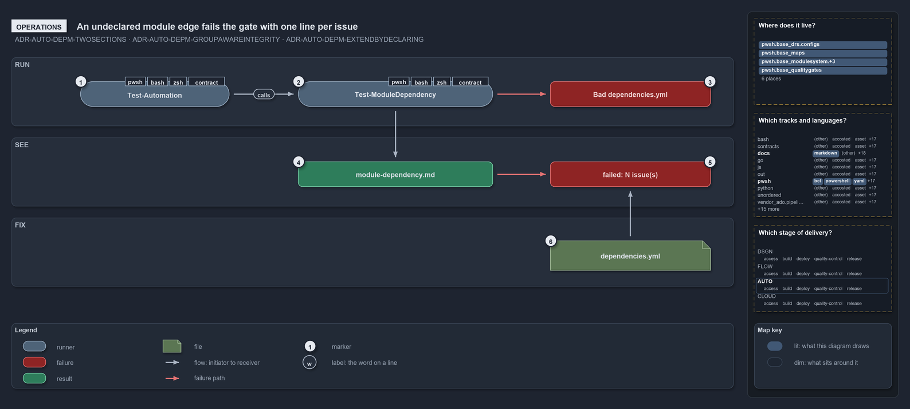

---
catzc:
  warning: "Header is generated by Format-FileMeta via Format-Code; do not change it"
  edges:
    cites:
      - ADR-AUTO-DEPM-TWOSECTIONS
      - ADR-AUTO-DEPM-GROUPAWAREINTEGRITY
      - ADR-AUTO-DEPM-EXTENDBYDECLARING
    drs_total: 3
---

# An undeclared module edge fails the gate with one line per issue

```text
An undeclared module edge fails the gate with one line per issue.

1  Test-Automation        the usual entry point; its L1 integrity test runs the gate
2  Test-ModuleDependency  the gate itself, run directly or by the test
3  Bad dependencies.yml   a malformed declaration throws before any edge is checked
4  module-dependency.md   the report, written before the gate decides
5  failed: N issue(s)     the one throw, one line per undeclared edge or unknown module
6  dependencies.yml       the fix: declare the edge, or remove the call

Supports ADR-AUTO-DEPM-TWOSECTIONS, ADR-AUTO-DEPM-GROUPAWAREINTEGRITY and ADR-AUTO-DEPM-EXTENDBYDECLARING (operations lens).
```

`Test-ModuleDependency` gives everyone who runs it, directly or through `Test-Automation` at level 1 or higher, the same verdict on the
module graph. A broken declaration stops the run before any edge is checked. Otherwise a report lands in `out/`, and every undeclared edge
or unknown module becomes one listed line in a single failure. The fix is always the same: declare the edge, or remove the call.

```yml drawio
description:
  Running Test-Automation or Test-ModuleDependency checks every module edge against the declaration; a malformed declaration throws first,
  an undeclared edge fails with one line per issue after the report is written, and the fix goes in dependencies.yml.
about:
  adrs: [ADR-AUTO-DEPM-TWOSECTIONS, ADR-AUTO-DEPM-GROUPAWAREINTEGRITY, ADR-AUTO-DEPM-EXTENDBYDECLARING]
  lens: operations
content:
  title: An undeclared module edge fails the gate with one line per issue
  kind: explanation
  flow: top-to-bottom
  relation: then
  theme: dark
  bands:
    - { id: band-run, label: RUN }
    - { id: band-see, label: SEE }
    - { id: band-fix, label: FIX }
  glyphs:
    - { id: n-automation, kind: runner, label: Test-Automation, in: band-run }
    - { id: n-gate, kind: runner, label: Test-ModuleDependency, in: band-run }
    - { id: f-bad, kind: failure, label: Bad dependencies.yml, in: band-run }
    - { id: r-report, kind: result, label: module-dependency.md, in: band-see }
    - { id: f-issues, kind: failure, label: "failed: N issue(s)", in: band-see }
    - { id: g-dependencies, kind: file, label: dependencies.yml, in: band-fix }
  edges:
    - { from: n-automation, to: n-gate, kind: flow, label: "" }
    - { from: n-gate, to: r-report, kind: flow, label: "" }
    - { from: f-issues, to: g-dependencies, kind: flow, label: "" }
    - { from: n-gate, to: f-bad, kind: fail, label: "" }
    - { from: r-report, to: f-issues, kind: fail, label: "" }
  markers:
    - { at: n-automation, number: 1 }
    - { at: n-gate, number: 2 }
    - { at: f-bad, number: 3 }
    - { at: r-report, number: 4 }
    - { at: f-issues, number: 5 }
    - { at: g-dependencies, number: 6 }
  legend: auto
  minimaps:
    code-locations:
      - cell: docs/-/.
        by:
          - docs/drs/automation/controlling-module-dependencies.md
          - docs/drs/automation/dora-explains.md
          - docs/drs/index.md
          - docs/references/pwsh/catzc-base-maps/Get-ModuleNeighbourhoodMinimapData.ps1.md
          - docs/references/pwsh/catzc-base-module-system/types/DependenciesConfig.cs.md
          - docs/references/pwsh/catzc-base-module-system/types/DependencyGraph.cs.md
          - docs/references/pwsh/catzc-base-module-system/types/ModuleGroup.cs.md
          - ADR-AUTO-DEPM-EXTENDBYDECLARING
          - ADR-AUTO-DEPM-GROUPAWAREINTEGRITY
          - ADR-AUTO-DEPM-TWOSECTIONS
      - cell: pwsh/Catzc.Base.Drs/configs
        by:
          - pwsh/Catzc.Base.Drs/configs/drs.yml
          - ADR-AUTO-DEPM-EXTENDBYDECLARING
          - ADR-AUTO-DEPM-GROUPAWAREINTEGRITY
          - ADR-AUTO-DEPM-TWOSECTIONS
      - cell: pwsh/Catzc.Base.Maps/.
        by:
          - pwsh/Catzc.Base.Maps/Get-ModuleNeighbourhoodMinimapData.ps1
          - ADR-AUTO-DEPM-EXTENDBYDECLARING
          - ADR-AUTO-DEPM-GROUPAWAREINTEGRITY
          - ADR-AUTO-DEPM-TWOSECTIONS
      - cell: pwsh/Catzc.Base.ModuleSystem/types
        by:
          - pwsh/Catzc.Base.ModuleSystem/types/DependenciesConfig.cs
          - pwsh/Catzc.Base.ModuleSystem/types/DependencyGraph.cs
          - pwsh/Catzc.Base.ModuleSystem/types/ModuleGroup.cs
          - ADR-AUTO-DEPM-EXTENDBYDECLARING
          - ADR-AUTO-DEPM-GROUPAWAREINTEGRITY
          - ADR-AUTO-DEPM-TWOSECTIONS
    grid:
      - cell: docs/markdown
        by:
          - docs/drs/automation/controlling-module-dependencies.md
          - docs/drs/automation/dora-explains.md
          - docs/drs/index.md
          - docs/references/pwsh/catzc-base-maps/Get-ModuleNeighbourhoodMinimapData.ps1.md
          - docs/references/pwsh/catzc-base-module-system/types/DependenciesConfig.cs.md
          - docs/references/pwsh/catzc-base-module-system/types/DependencyGraph.cs.md
          - docs/references/pwsh/catzc-base-module-system/types/ModuleGroup.cs.md
          - ADR-AUTO-DEPM-EXTENDBYDECLARING
          - ADR-AUTO-DEPM-GROUPAWAREINTEGRITY
          - ADR-AUTO-DEPM-TWOSECTIONS
      - cell: pwsh/bcl
        by:
          - pwsh/Catzc.Base.ModuleSystem/types/DependenciesConfig.cs
          - pwsh/Catzc.Base.ModuleSystem/types/DependencyGraph.cs
          - pwsh/Catzc.Base.ModuleSystem/types/ModuleGroup.cs
          - ADR-AUTO-DEPM-EXTENDBYDECLARING
          - ADR-AUTO-DEPM-GROUPAWAREINTEGRITY
          - ADR-AUTO-DEPM-TWOSECTIONS
      - cell: pwsh/powershell
        by:
          - pwsh/Catzc.Base.Maps/Get-ModuleNeighbourhoodMinimapData.ps1
          - ADR-AUTO-DEPM-EXTENDBYDECLARING
          - ADR-AUTO-DEPM-GROUPAWAREINTEGRITY
          - ADR-AUTO-DEPM-TWOSECTIONS
      - cell: pwsh/yaml
        by:
          - pwsh/Catzc.Base.Drs/configs/drs.yml
          - ADR-AUTO-DEPM-EXTENDBYDECLARING
          - ADR-AUTO-DEPM-GROUPAWAREINTEGRITY
          - ADR-AUTO-DEPM-TWOSECTIONS
    axis:
      - cell: AUTO/*
        by: [ADR-AUTO-DEPM-EXTENDBYDECLARING, ADR-AUTO-DEPM-GROUPAWAREINTEGRITY, ADR-AUTO-DEPM-TWOSECTIONS]
layout:
  band-run: { x: 20, y: 84, w: 1260, h: 120 }
  band-see: { x: 20, y: 224, w: 1260, h: 120 }
  band-fix: { x: 20, y: 364, w: 1260, h: 120 }
  n-automation: { x: 140, y: 126, w: 260, h: 44 }
  n-gate: { x: 520, y: 126, w: 340, h: 44 }
  f-bad: { x: 960, y: 126, w: 280, h: 44 }
  r-report: { x: 520, y: 266, w: 340, h: 44 }
  f-issues: { x: 960, y: 266, w: 280, h: 44 }
  g-dependencies: { x: 960, y: 404, w: 280, h: 52 }
```



## Walkthrough

1. **Test-Automation.** The usual entry point. Its L1 integrity test (tagged `L1`, `integrity` and `source-only`) runs the gate, so every
   run at level 1 or above includes it, and the default run does too.
2. **Test-ModuleDependency.** The gate itself, run directly as `Test-ModuleDependency [-OutputFolder] [-PassThru]`. It runs after the
   importer, so the calls of every loaded module are seen.
3. **Bad dependencies.yml.** A malformed declaration throws first, before any conformance check, with
   `module dependency configuration validation failed:` and one line per problem.
4. **module-dependency.md.** The report lands in `out/test-module-dependency/<yyyyMMdd-HHmmss>/module-dependency.md`, with `latest.txt`
   beside the stamped folders naming the latest run. It is written before the gate decides, and the console prints every issue, the count
   and the report folder. A clean run prints `No module-dependency issues found.` and stops here.
5. **failed: N issue(s).** With any issue, the gate throws once: `Test-ModuleDependency failed: N issue(s) — see <runDir>`, then one line
   per issue. A line reads `[UndeclaredDependency] A -> B  (<functions>)  -- not allowed for A`; a C# type edge reads the same with
   `[UndeclaredTypeDependency]`; and a misspelt declared name reads
   `[UnknownModule] <name>  -- declared in configuration but no such module on disk`. With `-PassThru` the gate returns
   `{ Subject; IssueCount; Issues; ReportPath }` instead of throwing.
6. **dependencies.yml.** The fix: declare the edge in `dependencies.yml` in the same change as the code that needs it, or drop the call or
   type reference.

## Why it holds

- `dependencies.yml` has two sections, and each consumer's allowed names come from them: a group allows any member, a module allows exactly
  that one (ADR-AUTO-DEPM-TWOSECTIONS).
- Integrity fails fast: the declaration's shape at load, then the real edges and the on-disk modules in the gate
  (ADR-AUTO-DEPM-GROUPAWAREINTEGRITY).
- A new dependency is a new declared edge, landed in the same change as the code that introduces it (ADR-AUTO-DEPM-EXTENDBYDECLARING).

A module in neither section is never flagged. Today all 40 modules under `automation/` are declared (26 Base, 6 Azure, 8 Tooling), so none
is unconstrained.

## See also

- [Controlling module dependencies](../../drs/automation/controlling-module-dependencies.md) — the decision this article explains.
- The other lenses on the same graph: [meta](a-declared-allow-list-of-layers.md), [architecture](three-layers-edges-point-down.md),
  [implementation](two-sections-unioned-into-one-allow-set.md) and [governance](two-gates-check-the-layer-pins.md).
- [The automation explanations](index.md) · [How to read the diagrams](../index.md#how-to-read-the-diagrams)
