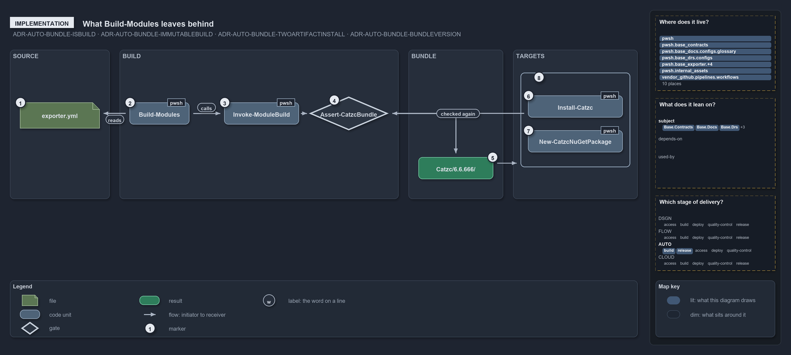

# What Build-Modules leaves behind

```text
What Build-Modules leaves behind.

1  exporter.yml             the exporter's one config: versions, default profile, vendor policy
2  Build-Modules            settles the selection and version, loads the engine, calls it
3  Invoke-ModuleBuild       asserts, closure-expands, plans, checks assets, then writes
4  Assert-CatzcBundle       the integrity guard on the engine's output
5  Catzc/6.6.666/           the build folder with its build.json
6  Install-Catzc            asserts its source, then copies the folder to a module path or root
7  New-CatzcNuGetPackage    packs the folder into out/automation/packages/
8  Checked again            Install-Catzc's first call is the guard

Supports ADR-AUTO-BUNDLE-ISBUILD, ADR-AUTO-BUNDLE-IMMUTABLEBUILD, ADR-AUTO-BUNDLE-TWOARTIFACTINSTALL
and ADR-AUTO-BUNDLE-BUNDLEVERSION (implementation lens).
```

A bundle, in code, is a short chain of functions in `Catzc.Base.Exporter` and one `.internal` engine. `Build-Modules` reads its options,
resolves the version, calls `Invoke-ModuleBuild`, and runs `Assert-CatzcBundle` on what the engine wrote. What is left is one folder,
`out/automation/build/Catzc/6.6.666/` on a devbox, and each target verifies that folder again and then copies or packs it whole.

```yml drawio
description:
  "The bundle in code: Build-Modules reads exporter.yml and calls the build engine, Assert-CatzcBundle checks what the engine wrote, and
  each target verifies the build folder again before it copies or packs it whole."
about:
  rules: [ADR-AUTO-BUNDLE-ISBUILD, ADR-AUTO-BUNDLE-IMMUTABLEBUILD, ADR-AUTO-BUNDLE-TWOARTIFACTINSTALL, ADR-AUTO-BUNDLE-BUNDLEVERSION]
  lens: implementation
content:
  title: What Build-Modules leaves behind
  kind: explanation
  flow: left-to-right
  theme: dark
  bands:
    - { id: band-source, label: SOURCE }
    - { id: band-build, label: BUILD }
    - { id: band-bundle, label: BUNDLE }
    - { id: band-targets, label: TARGETS }
  groups:
    - { id: grp-targets, label: " ", in: band-targets }
  glyphs:
    - { id: g-config, kind: file, label: exporter.yml, in: band-source }
    - { id: g-build, kind: code, label: Build-Modules, in: band-build }
    - { id: g-engine, kind: code, label: Invoke-ModuleBuild, in: band-build }
    - { id: g-assert, kind: gate, label: Assert-CatzcBundle, in: band-build }
    - { id: r-folder, kind: result, label: Catzc/6.6.666/, in: band-bundle }
    - { id: g-install, kind: code, label: Install-Catzc, in: grp-targets }
    - { id: g-package, kind: code, label: New-CatzcNuGetPackage, in: grp-targets }
  edges:
    - { from: g-build, to: g-config, kind: flow, label: reads }
    - { from: g-build, to: g-engine, kind: flow, label: calls }
    - { from: g-engine, to: g-assert, kind: flow, label: "" }
    - { from: g-assert, to: r-folder, kind: flow, label: "" }
    - { from: r-folder, to: grp-targets, kind: flow, label: "" }
    - { from: g-install, to: g-assert, kind: flow, label: checked again }
  markers:
    - { at: g-config, number: 1 }
    - { at: g-build, number: 2 }
    - { at: g-engine, number: 3 }
    - { at: g-assert, number: 4 }
    - { at: r-folder, number: 5 }
    - { at: g-install, number: 6 }
    - { at: g-package, number: 7 }
    - { at: grp-targets, number: 8 }
  legend: auto
  minimaps: [code-locations, module-neighbourhood, axis]
layout:
  band-source: { x: 20, y: 84, w: 200, h: 300 }
  band-build: { x: 240, y: 84, w: 520, h: 300 }
  band-bundle: { x: 780, y: 84, w: 190, h: 300 }
  band-targets: { x: 990, y: 84, w: 290, h: 300 }
  g-config: { x: 40, y: 190, w: 160, h: 52 }
  g-build: { x: 260, y: 190, w: 130, h: 44 }
  g-engine: { x: 410, y: 190, w: 150, h: 44 }
  g-assert: { x: 580, y: 178, w: 160, h: 68 }
  r-folder: { x: 800, y: 300, w: 150, h: 44 }
  grp-targets: { x: 1010, y: 130, w: 250, h: 190 }
  g-install: { x: 1030, y: 176, w: 210, h: 44 }
  g-package: { x: 1030, y: 246, w: 210, h: 44 }
```



## Walkthrough

1. **exporter.yml.** The exporter's one config holds the devbox placeholder version `6.6.666`, the pipeline `MAJOR.MINOR` (`0.1`), the
   default profile `full`, and the vendor policy `runtime`. `Build-Modules` reads it through `Get-Config -Config exporter`.
2. **Build-Modules.** The selection comes from `-Module`, `-ModuleProfile`, or both, and from the default profile when neither is given.
   `Build-Modules` resolves the version with `Resolve-CatzcBuildVersion`, loads the engine on demand with `Import-InternalModule Builder`,
   and calls it by name.
3. **Invoke-ModuleBuild.** The engine asserts the source tree, closure-expands the selection, and plans the build, failing with the full
   list when a source file breaks the merge preconditions. It then checks that every internal asset the selected modules depend on is in the
   plan, before any write. Only then does it write the files, compute the content hash, and write `build.json`. The types DLL is copied from
   the source tree's `.compiled/` when its hash matches, and compiled only when it is missing.
4. **Assert-CatzcBundle.** `Build-Modules` runs the integrity guard on the engine's output. It checks the layout, that no `tests/` leaked,
   one types DLL named for `typesHash`, the recorded type sources, the content hash, and every module's manifest, merged file and exports.
   It collects every violation and throws once.
5. **Catzc/6.6.666/.** The build lands in `out/automation/build/Catzc/<version>/` with its `build.json`. On a devbox the version is the
   `6.6.666` placeholder; in a pipeline it is the configured `MAJOR.MINOR` followed by the first-parent commit count.
6. **Install-Catzc.** It asserts its `-Source` first, then copies the folder: with `-Scope CurrentUser` to the user's module path, with
   `-Root <dir>` to `<dir>/.vendor/Catzc/<version>/` plus a generated root `importer.ps1`. It skips the copy when the target's `build.json`
   carries the same content hash, and `-Force` copies anyway.
7. **New-CatzcNuGetPackage.** It packs the folder with `Compress-PSResource` into `out/automation/packages/Catzc.<version>.nupkg`.
8. **Checked again before the copy.** The edge from `Install-Catzc` back to the guard is its first call: no destination changes until the
   source build passes.

`Export-Catzc` is the one-command form. It runs `Build-Modules` first, then `New-CatzcNuGetPackage` for `-To nuget` or `Install-Catzc -Root`
for a disk export.

## Why it holds

- `Build-Modules` builds a selected, closure-expanded set of modules through the `Invoke-ModuleBuild` engine, and `Assert-CatzcBundle`
  verifies it (ADR-AUTO-BUNDLE-ISBUILD).
- The build is content-addressed: it copies the source tree's types DLL instead of compiling, records its hashes in `build.json`, and runs
  `Assert-CatzcBundle` as a self-check on its own output (ADR-AUTO-BUNDLE-IMMUTABLEBUILD).
- An install copies the build to two places, verifies the source before the destination, and is idempotent
  (ADR-AUTO-BUNDLE-TWOARTIFACTINSTALL).
- A devbox build carries the `6.6.666` placeholder and a pipeline build gets a calculated version, both declared in `exporter.yml`
  (ADR-AUTO-BUNDLE-BUNDLEVERSION).

## Where the code and the decision record differ

- ADR-AUTO-BUNDLE-IMMUTABLEBUILD lists the internal-asset presence check among the checks of `Assert-CatzcBundle`. The code runs it in
  `Invoke-ModuleBuild`, against the plan and before any write, as ADR-AUTO-ASSETDEP-ENFORCEDMECHANICALLY says.
- `Assert-CatzcBundle` checks more than ADR-AUTO-BUNDLE-IMMUTABLEBUILD lists: the layout files, the folder named for the version, the
  recorded type sources, and a manifest's `NestedModules` being exactly the merged file.

## See also

- [Platform bundle](../../drs/automation/platform-bundle.md) — the decision this article explains.
- The other lenses on the same bundle: [meta](how-a-commit-becomes-a-package.md), [architecture](where-the-code-roots-get-their-bundle.md),
  [operations](how-a-bundle-is-built-and-placed.md) and [governance](what-checks-each-bundle-stage.md).
- [The automation explanations](index.md) · [How to read the diagrams](../index.md#how-to-read-the-diagrams)
