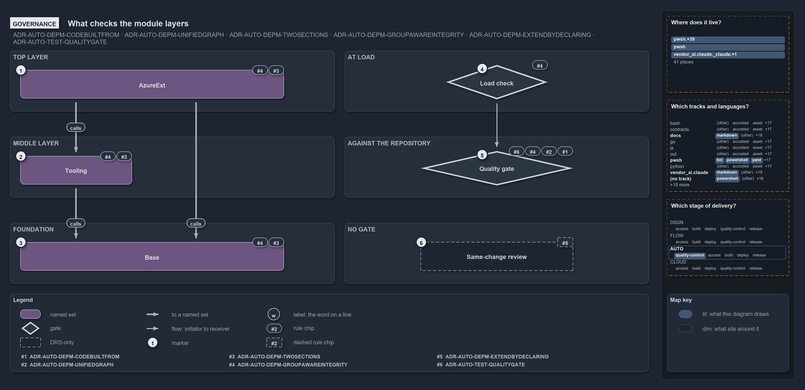

# What checks the module layers

```text
What checks the module layers.

1  AzureExt            top layer: every member pins groups or single modules, never its own group
2  Tooling             middle layer: four members also pin their own group
3  Base                foundation: no member has its own pin list
4  Load check          the declaration's shape, checked when it loads
5  Quality gate        the real code and the on-disk modules, checked against the declaration
6  Same-change review  a new edge lands with its code; no gate checks it

Supports ADR-AUTO-DEPM-CODEBUILTFROM, ADR-AUTO-DEPM-UNIFIEDGRAPH, ADR-AUTO-DEPM-TWOSECTIONS, ADR-AUTO-DEPM-GROUPAWAREINTEGRITY
and ADR-AUTO-DEPM-EXTENDBYDECLARING, and ADR-AUTO-TEST-QUALITYGATE (governance lens).
```

The layer pins of cats' module graph, the groups and modules each consumer may use, are held by the same DRS rules on every layer, and they
are checked twice. The load check validates the declaration itself, and the `Test-ModuleDependency` quality gate checks the real code
against it. One rule, declaring a new edge in the same change as the code, has no gate at all.

```yml drawio
description:
  Two gates check the layer pins, one against the declaration's own shape at load and one against the real code and the on-disk modules; a
  new edge landing with its code is left to review, because no gate checks it.
about:
  rules:
    - ADR-AUTO-DEPM-CODEBUILTFROM
    - ADR-AUTO-DEPM-UNIFIEDGRAPH
    - ADR-AUTO-DEPM-TWOSECTIONS
    - ADR-AUTO-DEPM-GROUPAWAREINTEGRITY
    - ADR-AUTO-DEPM-EXTENDBYDECLARING
    - ADR-AUTO-TEST-QUALITYGATE
  lens: governance
content:
  title: What checks the module layers
  kind: explanation
  flow: left-to-right
  theme: dark
  bands:
    - { id: band-top, label: TOP LAYER }
    - { id: band-middle, label: MIDDLE LAYER }
    - { id: band-foundation, label: FOUNDATION }
    - { id: band-load, label: AT LOAD }
    - { id: band-repository, label: AGAINST THE REPOSITORY }
    - { id: band-no-gate, label: NO GATE }
  glyphs:
    - { id: s-azure-ext, kind: set, label: AzureExt, in: band-top }
    - { id: s-tooling, kind: set, label: Tooling, in: band-middle }
    - { id: s-base, kind: set, label: Base, in: band-foundation }
    - { id: g-load, kind: gate, label: Load check, in: band-load }
    - { id: g-quality, kind: gate, label: Quality gate, in: band-repository }
    - { id: a-review, kind: drsonly, label: Same-change review, in: band-no-gate }
  edges:
    - { from: s-azure-ext, to: s-tooling, kind: thick, label: calls }
    - { from: s-azure-ext, to: s-base, kind: thick, label: calls }
    - { from: s-tooling, to: s-base, kind: thick, label: calls }
    - { from: g-load, to: g-quality, kind: flow, label: "" }
  markers:
    - { at: s-azure-ext, number: 1 }
    - { at: s-tooling, number: 2 }
    - { at: s-base, number: 3 }
    - { at: g-load, number: 4 }
    - { at: g-quality, number: 5 }
    - { at: a-review, number: 6 }
  chips:
    - { at: s-azure-ext, kind: rule, rule: ADR-AUTO-DEPM-TWOSECTIONS }
    - { at: s-azure-ext, kind: rule, rule: ADR-AUTO-DEPM-GROUPAWAREINTEGRITY }
    - { at: s-tooling, kind: rule, rule: ADR-AUTO-DEPM-TWOSECTIONS }
    - { at: s-tooling, kind: rule, rule: ADR-AUTO-DEPM-GROUPAWAREINTEGRITY }
    - { at: s-base, kind: rule, rule: ADR-AUTO-DEPM-TWOSECTIONS }
    - { at: s-base, kind: rule, rule: ADR-AUTO-DEPM-GROUPAWAREINTEGRITY }
    - { at: g-load, kind: rule, rule: ADR-AUTO-DEPM-GROUPAWAREINTEGRITY }
    - { at: g-quality, kind: rule, rule: ADR-AUTO-DEPM-CODEBUILTFROM }
    - { at: g-quality, kind: rule, rule: ADR-AUTO-DEPM-UNIFIEDGRAPH }
    - { at: g-quality, kind: rule, rule: ADR-AUTO-DEPM-GROUPAWAREINTEGRITY }
    - { at: g-quality, kind: rule, rule: ADR-AUTO-TEST-QUALITYGATE }
    - { at: a-review, kind: rule, rule: ADR-AUTO-DEPM-EXTENDBYDECLARING, gated: false }
  legend: auto
  minimaps: [code-locations, grid, axis]
layout:
  band-top: { x: 20, y: 84, w: 640, h: 120 }
  band-middle: { x: 20, y: 254, w: 640, h: 120 }
  band-foundation: { x: 20, y: 424, w: 640, h: 120 }
  band-load: { x: 680, y: 84, w: 600, h: 120 }
  band-repository: { x: 680, y: 254, w: 600, h: 120 }
  band-no-gate: { x: 680, y: 424, w: 600, h: 120 }
  s-azure-ext: { x: 40, y: 122, w: 520, h: 56 }
  s-tooling: { x: 40, y: 292, w: 220, h: 56 }
  s-base: { x: 40, y: 462, w: 520, h: 56 }
  g-load: { x: 880, y: 112, w: 200, h: 68 }
  g-quality: { x: 830, y: 282, w: 300, h: 68 }
  a-review: { x: 830, y: 462, w: 300, h: 56 }
```



## Walkthrough

1. **AzureExt.** Each member of the top group pins a group (Tooling, Base) or a single module (`Catzc.Azure`, `Catzc.Tooling.Core`). Its
   internal map is acyclic, and no member pins its own group, so every in-group edge stays within the internal map.
2. **Tooling.** Four members, Python, Node, Toolchain and Provisioning, also pin their own group. The code unions that pin with their
   in-group list, so they may reach any Tooling member, and the in-group rule holds for only two of the six members, Core and Environment.
   The internal map is still acyclic.
3. **Base.** No Base member has its own pin list, so each library's in-group list is its whole allow-set. The in-group rule holds, and the
   map is acyclic. `Catzc.Azure`, Github and KeyHandler, the single modules in the middle of the graph, pin Base alone.
4. **Load check.** The `DependenciesConfig` type checks the declaration when it loads, without reading the disk: every target resolves,
   every group is closed over its members, and the module graph and each group's map are acyclic. One throw lists every problem, and it runs
   before the quality gate checks anything.
5. **Quality gate.** `Test-ModuleDependency` checks that every function call and C# type reference stays within the allow-set, and that
   every declared module and group member exists on disk. It collects every issue, reports through `Write-QualityGateReport` and throws
   once. Its L1 integrity test, tagged `source-only`, runs it, so every default test run includes it; no gate runs at import.
6. **Same-change review.** Landing a new edge in the same change as the code is left to code review, because the integrity test sees only
   the end state. It stands alone: no code runs or checks it.

## Why it holds

- The declaration is the allow-list, and an undeclared edge fails the build (ADR-AUTO-DEPM-CODEBUILTFROM).
- Function calls and C# type references are one graph, checked by one gate (ADR-AUTO-DEPM-UNIFIEDGRAPH).
- Each consumer pins a group (loose) or a module (tight) (ADR-AUTO-DEPM-TWOSECTIONS).
- The declaration's shape is checked at load, and the real edges, on-disk modules and in-group edges by the gate
  (ADR-AUTO-DEPM-GROUPAWAREINTEGRITY).
- A new edge is declared in the same change as the code that introduces it (ADR-AUTO-DEPM-EXTENDBYDECLARING).
- A quality gate is one `Test-<subject>` that collects every issue, writes its report and throws once, run by an integrity test at its tier
  (ADR-AUTO-TEST-QUALITYGATE).

The remaining rules, which keep module and system dependencies apart and pin, vendor and stitch external code
(ADR-AUTO-DEPS-TWODEPENDENCYKINDS, ADR-AUTO-DEPM-EXACTVERSIONPINS, ADR-AUTO-DEPM-INTERNALVENDORED, ADR-AUTO-DEPM-EXTERNALSTITCHEDATBUILD and
ADR-AUTO-DEPM-STITCHISCONFIG), lie outside these two gates.

## Where the code and the decision record differ

- The record says actual in-group edges must stay within the group's declared internal map. The code unions a member's pins with its
  in-group list, so the four Tooling members that pin `Tooling` may reach any Tooling member.
- The record says a module absent from the pin lists is unconstrained. The code also constrains every group member.

## See also

- [Controlling module dependencies](../../drs/automation/controlling-module-dependencies.md) — the decision this article explains.
- [Test automation](../../drs/automation/test-automation.md) — the quality-gate rule, ADR-AUTO-TEST-QUALITYGATE.
- The other lenses on the same graph: [meta](which-layers-may-depend-on-which.md), [architecture](how-modules-are-layered.md),
  [implementation](which-modules-a-module-may-depend-on.md) and [operations](what-an-undeclared-module-dependency-reports.md).
- [The automation explanations](index.md) · [How to read the diagrams](../index.md#how-to-read-the-diagrams)
