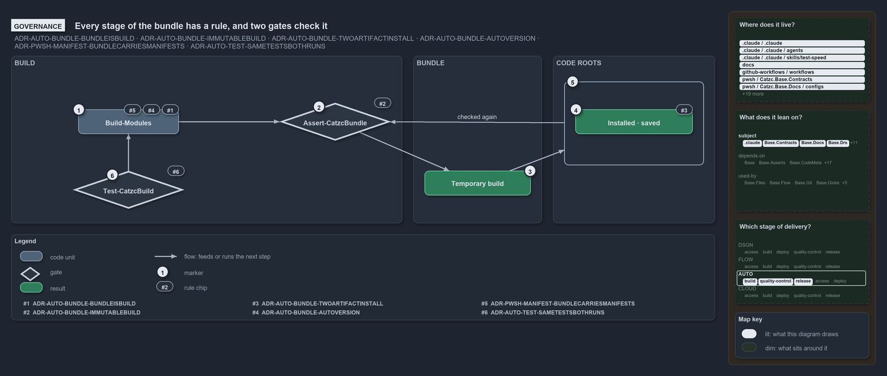

---
catzc:
  edges:
    cites:
      - ADR-AUTO-ASSETDEP-ENFORCEDMECHANICALLY
      - ADR-AUTO-BUNDLE-BUNDLEISBUILD
      - ADR-AUTO-BUNDLE-IMMUTABLEBUILD
      - ADR-AUTO-BUNDLE-TWOARTIFACTINSTALL
      - ADR-AUTO-BUNDLE-AUTOVERSION
      - ADR-AUTO-TEST-SAMETESTSBOTHRUNS
      - ADR-AUTO-TEST-SOURCEONLYTAG
      - ADR-PWSH-MANIFEST-BUNDLECARRIESMANIFESTS
      - DDR-RUNMODE-THREEBUILDKINDS
---

# Every stage of the bundle has a rule, and two gates check it

```text
Every stage of the bundle has a rule, and two gates check it.

1  Build-Modules            selection, merged payload and version (#1, #4, #7)
2  Assert-CatzcBundle       the integrity gate on every build (#5)
3  Temporary build          immutable and content-addressed (#5)
4  Installed, saved         idempotent placements of the verified build (#6)
5  Checked again            the install verifies its source with the same gate (#6)
6  Test-CatzcBuild          the build run: the same tests, against a fresh build (TEST#30)

Supports ADR-AUTO-BUNDLE-BUNDLEISBUILD, ADR-AUTO-BUNDLE-IMMUTABLEBUILD, ADR-AUTO-BUNDLE-TWOARTIFACTINSTALL, ADR-AUTO-BUNDLE-AUTOVERSION, ADR-PWSH-MANIFEST-BUNDLECARRIESMANIFESTS and ADR-AUTO-TEST-SAMETESTSBOTHRUNS (governance lens).
```

ADR-AUTO-BUNDLE fixes every stage of a bundle, from the module selection to the place the build is copied to. Rules only hold when something
checks them, and two gates do the checking. `Assert-CatzcBundle` verifies every build and verifies it again before every placement, and the
build run `Test-CatzcBuild` runs the same tests against a fresh build that the source run runs against the source tree.

```yml drawio
description:
  "Every stage of the bundle follows a rule and two gates check it: the integrity gate on every build and again before every install, and
  the build run that repeats the same tests against a fresh build."
about:
  adrs:
    - ADR-AUTO-BUNDLE-BUNDLEISBUILD
    - ADR-AUTO-BUNDLE-IMMUTABLEBUILD
    - ADR-AUTO-BUNDLE-TWOARTIFACTINSTALL
    - ADR-AUTO-BUNDLE-AUTOVERSION
    - ADR-PWSH-MANIFEST-BUNDLECARRIESMANIFESTS
    - ADR-AUTO-TEST-SAMETESTSBOTHRUNS
  lens: governance
content:
  title: Every stage of the bundle has a rule, and two gates check it
  kind: explanation
  flow: left-to-right
  relation: feeds or runs the next step
  theme: dark
  bands:
    - { id: band-build, label: BUILD }
    - { id: band-bundle, label: BUNDLE }
    - { id: band-roots, label: CODE ROOTS }
  groups:
    - { id: grp-copies, label: " ", in: band-roots }
  glyphs:
    - { id: g-build, kind: code, label: Build-Modules, in: band-build }
    - { id: g-assert, kind: gate, label: Assert-CatzcBundle, in: band-build }
    - { id: g-test-build, kind: gate, label: Test-CatzcBuild, in: band-build }
    - { id: r-temporary, kind: result, label: Temporary build, in: band-bundle }
    - { id: r-installed, kind: result, label: Installed · saved, in: grp-copies }
  edges:
    - { from: g-build, to: g-assert, kind: flow, label: "" }
    - { from: g-assert, to: r-temporary, kind: flow, label: "" }
    - { from: r-temporary, to: grp-copies, kind: flow, label: "" }
    - { from: g-test-build, to: g-build, kind: flow, label: "" }
    - { from: grp-copies, to: g-assert, kind: flow, label: checked again }
  markers:
    - { at: g-build, number: 1 }
    - { at: g-assert, number: 2 }
    - { at: r-temporary, number: 3 }
    - { at: r-installed, number: 4 }
    - { at: grp-copies, number: 5 }
    - { at: g-test-build, number: 6 }
  chips:
    - { at: g-build, kind: rule, rule: ADR-AUTO-BUNDLE-BUNDLEISBUILD }
    - { at: g-build, kind: rule, rule: ADR-AUTO-BUNDLE-AUTOVERSION }
    - { at: g-build, kind: rule, rule: ADR-PWSH-MANIFEST-BUNDLECARRIESMANIFESTS }
    - { at: g-assert, kind: rule, rule: ADR-AUTO-BUNDLE-IMMUTABLEBUILD }
    - { at: r-installed, kind: rule, rule: ADR-AUTO-BUNDLE-TWOARTIFACTINSTALL }
    - { at: g-test-build, kind: rule, rule: ADR-AUTO-TEST-SAMETESTSBOTHRUNS }
  legend: auto
  minimaps:
    code-locations:
      - cell: .claude/.claude/.
        by: [.claude/CLAUDE.md, ADR-AUTO-TEST-SAMETESTSBOTHRUNS]
      - cell: .claude/.claude/agents
        by: [.claude/agents/test-optimization.md, ADR-AUTO-TEST-SAMETESTSBOTHRUNS]
      - cell: .claude/.claude/skills/test-speed
        by: [.claude/skills/test-speed/SKILL.md, ADR-AUTO-TEST-SAMETESTSBOTHRUNS]
      - cell: docs/-/.
        by:
          - docs/drs/automation/dora-explains.md
          - docs/drs/automation/platform-bundle.md
          - docs/drs/automation/pwsh/dora-explains.md
          - docs/drs/automation/pwsh/dynamic-module-manifests.md
          - docs/drs/automation/test-automation.md
          - docs/drs/glossary.md
          - docs/drs/index.md
          - docs/references/github/workflows/ci-pwsh.yml.md
          - docs/references/pwsh/catzc-base-contracts/Publish-ContractRelease.ps1.md
          - docs/references/pwsh/catzc-base-docs/types/GlossaryConcept.cs.md
          - docs/references/pwsh/catzc-base-execution/Invoke-Executable.ps1.md
          - docs/references/pwsh/catzc-base-exporter/Assert-CatzcBundle.ps1.md
          - docs/references/pwsh/catzc-base-exporter/Build-Modules.ps1.md
          - docs/references/pwsh/catzc-base-exporter/Export-Catzc.ps1.md
          - docs/references/pwsh/catzc-base-exporter/Install-Catzc.ps1.md
          - docs/references/pwsh/catzc-base-exporter/Resolve-CatzcBuildVersion.ps1.md
          - docs/references/pwsh/catzc-base-exporter/configs/exporter.yml.md
          - docs/references/pwsh/catzc-base-exporter/private/Assert-BundleFootprint.ps1.md
          - docs/references/pwsh/catzc-base-exporter/private/New-CatzcNuGetPackage.ps1.md
          - docs/references/pwsh/catzc-base-exporter/types/ExporterBundle.cs.md
          - docs/references/pwsh/catzc-base-exporter/types/ExporterConfig.cs.md
          - docs/references/pwsh/catzc-base-maps/Get-ValueChainHighlight.ps1.md
          - docs/references/pwsh/catzc-base-module-system/configs/artifacts.yml.md
          - docs/references/pwsh/catzc-base-overlay/Get-FunctionFileViolation.ps1.md
          - docs/references/pwsh/catzc-base-quality-gates/Test-Automation.ps1.md
          - docs/references/pwsh/catzc-base-quality-gates/Test-CatzcBuild.ps1.md
          - docs/references/pwsh/catzc-base-quality-gates/configs/terminology.yml.md
          - docs/references/pwsh/catzc-base-quality-gates/private/Get-TestRunLocationEntry.ps1.md
          - docs/references/pwsh/catzc-base-quality-gates/private/Invoke-BuildArtifactProbe.ps1.md
          - docs/references/pwsh/catzc-base-quality-gates/private/Invoke-TestRun.ps1.md
          - docs/references/pwsh/catzc-base-quality-gates/private/New-TestAutomationShardScript.ps1.md
          - docs/references/pwsh/catzc-base-quality-gates/private/Write-TestAutomationHeader.ps1.md
          - docs/references/pwsh/catzc-base-quality-gates/tests/Get-TestTagViolations.Tests.ps1.md
          - docs/references/pwsh/catzc-tooling-key-handler/private/Select-SupportedKeyHandler.ps1.md
          - docs/references/pwsh/internal/Catzc.Internal.Builder.psm1.md
          - docs/references/pwsh/internal/assets/Import-Catzc.ps1.md
          - ADR-AUTO-BUNDLE-AUTOVERSION
          - ADR-AUTO-BUNDLE-BUNDLEISBUILD
          - ADR-AUTO-BUNDLE-IMMUTABLEBUILD
          - ADR-AUTO-BUNDLE-TWOARTIFACTINSTALL
          - ADR-AUTO-TEST-SAMETESTSBOTHRUNS
          - ADR-PWSH-MANIFEST-BUNDLECARRIESMANIFESTS
      - cell: github-workflows/workflows/.
        by: [.github/workflows/ci-pwsh.yml, ADR-AUTO-BUNDLE-IMMUTABLEBUILD]
      - cell: pwsh/Catzc.Base.Contracts/.
        by: [pwsh/Catzc.Base.Contracts/Publish-ContractRelease.ps1, ADR-AUTO-BUNDLE-AUTOVERSION]
      - cell: pwsh/Catzc.Base.Docs/configs
        by: [pwsh/Catzc.Base.Docs/configs/glossary.yml, ADR-AUTO-BUNDLE-BUNDLEISBUILD]
      - cell: pwsh/Catzc.Base.Docs/tests/assets/glossary/widget
        by: [pwsh/Catzc.Base.Docs/tests/assets/glossary/widget/glossary.yml, ADR-AUTO-TEST-SAMETESTSBOTHRUNS]
      - cell: pwsh/Catzc.Base.Docs/types
        by: [pwsh/Catzc.Base.Docs/types/GlossaryConcept.cs, ADR-AUTO-TEST-SAMETESTSBOTHRUNS]
      - cell: pwsh/Catzc.Base.Drs/configs
        by:
          - pwsh/Catzc.Base.Drs/configs/drs.yml
          - ADR-AUTO-BUNDLE-AUTOVERSION
          - ADR-AUTO-BUNDLE-BUNDLEISBUILD
          - ADR-AUTO-BUNDLE-IMMUTABLEBUILD
          - ADR-AUTO-BUNDLE-TWOARTIFACTINSTALL
          - ADR-AUTO-TEST-SAMETESTSBOTHRUNS
          - ADR-PWSH-MANIFEST-BUNDLECARRIESMANIFESTS
      - cell: pwsh/Catzc.Base.Execution/.
        by: [pwsh/Catzc.Base.Execution/Invoke-Executable.ps1, ADR-AUTO-TEST-SAMETESTSBOTHRUNS]
      - cell: pwsh/Catzc.Base.Exporter/.
        by:
          - pwsh/Catzc.Base.Exporter/Assert-CatzcBundle.ps1
          - pwsh/Catzc.Base.Exporter/Build-Modules.ps1
          - pwsh/Catzc.Base.Exporter/Export-Catzc.ps1
          - pwsh/Catzc.Base.Exporter/Install-Catzc.ps1
          - pwsh/Catzc.Base.Exporter/Resolve-CatzcBuildVersion.ps1
          - ADR-AUTO-BUNDLE-AUTOVERSION
          - ADR-AUTO-BUNDLE-BUNDLEISBUILD
          - ADR-AUTO-BUNDLE-IMMUTABLEBUILD
          - ADR-AUTO-BUNDLE-TWOARTIFACTINSTALL
      - cell: pwsh/Catzc.Base.Exporter/configs
        by:
          - pwsh/Catzc.Base.Exporter/configs/exporter.yml
          - ADR-AUTO-BUNDLE-AUTOVERSION
          - ADR-AUTO-BUNDLE-BUNDLEISBUILD
          - ADR-AUTO-BUNDLE-IMMUTABLEBUILD
          - ADR-AUTO-BUNDLE-TWOARTIFACTINSTALL
      - cell: pwsh/Catzc.Base.Exporter/private
        by:
          - pwsh/Catzc.Base.Exporter/private/Assert-BundleFootprint.ps1
          - pwsh/Catzc.Base.Exporter/private/New-CatzcNuGetPackage.ps1
          - ADR-AUTO-BUNDLE-AUTOVERSION
          - ADR-AUTO-BUNDLE-BUNDLEISBUILD
          - ADR-AUTO-BUNDLE-IMMUTABLEBUILD
          - ADR-AUTO-BUNDLE-TWOARTIFACTINSTALL
      - cell: pwsh/Catzc.Base.Exporter/types
        by:
          - pwsh/Catzc.Base.Exporter/types/ExporterBundle.cs
          - pwsh/Catzc.Base.Exporter/types/ExporterConfig.cs
          - ADR-AUTO-BUNDLE-AUTOVERSION
          - ADR-AUTO-BUNDLE-BUNDLEISBUILD
          - ADR-AUTO-BUNDLE-IMMUTABLEBUILD
          - ADR-AUTO-BUNDLE-TWOARTIFACTINSTALL
      - cell: pwsh/Catzc.Base.Maps/.
        by: [pwsh/Catzc.Base.Maps/Get-ValueChainHighlight.ps1, ADR-AUTO-TEST-SAMETESTSBOTHRUNS]
      - cell: pwsh/Catzc.Base.Modules/tests
        by: [pwsh/Catzc.Base.Modules/tests/Get-CatzcModule.Tests.ps1, ADR-AUTO-TEST-SAMETESTSBOTHRUNS]
      - cell: pwsh/Catzc.Base.ModuleSystem/configs
        by: [pwsh/Catzc.Base.ModuleSystem/configs/artifacts.yml, ADR-AUTO-TEST-SAMETESTSBOTHRUNS]
      - cell: pwsh/Catzc.Base.Overlay/.
        by: [pwsh/Catzc.Base.Overlay/Get-FunctionFileViolation.ps1, ADR-PWSH-MANIFEST-BUNDLECARRIESMANIFESTS]
      - cell: pwsh/Catzc.Base.QualityGates/.
        by:
          - pwsh/Catzc.Base.QualityGates/Test-Automation.ps1
          - pwsh/Catzc.Base.QualityGates/Test-CatzcBuild.ps1
          - ADR-AUTO-TEST-SAMETESTSBOTHRUNS
      - cell: pwsh/Catzc.Base.QualityGates/configs
        by: [pwsh/Catzc.Base.QualityGates/configs/terminology.yml, ADR-AUTO-TEST-SAMETESTSBOTHRUNS]
      - cell: pwsh/Catzc.Base.QualityGates/private
        by:
          - pwsh/Catzc.Base.QualityGates/private/Get-TestRunLocationEntry.ps1
          - pwsh/Catzc.Base.QualityGates/private/Invoke-BuildArtifactProbe.ps1
          - pwsh/Catzc.Base.QualityGates/private/Invoke-TestRun.ps1
          - pwsh/Catzc.Base.QualityGates/private/New-TestAutomationShardScript.ps1
          - pwsh/Catzc.Base.QualityGates/private/Write-TestAutomationHeader.ps1
          - ADR-AUTO-TEST-SAMETESTSBOTHRUNS
      - cell: pwsh/Catzc.Base.QualityGates/tests
        by:
          - pwsh/Catzc.Base.QualityGates/tests/Get-TestTagViolations.Tests.ps1
          - pwsh/Catzc.Base.QualityGates/tests/Invoke-TestRun.Tests.ps1
          - pwsh/Catzc.Base.QualityGates/tests/Test-CatzcBuild.Tests.ps1
          - ADR-AUTO-TEST-SAMETESTSBOTHRUNS
      - cell: pwsh/Catzc.Internal.Assets/.
        by:
          - pwsh/.internal/assets/Import-Catzc.ps1
          - pwsh/.internal/assets/Import-ModuleFiles.ps1
          - ADR-AUTO-BUNDLE-AUTOVERSION
          - ADR-AUTO-BUNDLE-BUNDLEISBUILD
          - ADR-AUTO-BUNDLE-IMMUTABLEBUILD
          - ADR-AUTO-BUNDLE-TWOARTIFACTINSTALL
          - ADR-PWSH-MANIFEST-BUNDLECARRIESMANIFESTS
      - cell: pwsh/Catzc.Internal.Tests/.
        by: [pwsh/.internal/tests/New-BuiltCatzcRoot.Tests.ps1, ADR-AUTO-TEST-SAMETESTSBOTHRUNS]
      - cell: pwsh/Catzc.Tooling.KeyHandler/private
        by: [pwsh/Catzc.Tooling.KeyHandler/private/Select-SupportedKeyHandler.ps1, ADR-AUTO-TEST-SAMETESTSBOTHRUNS]
    module-neighbourhood:
      - cell: subject/.claude
        by: [.claude/CLAUDE.md, .claude/agents/test-optimization.md, .claude/skills/test-speed/SKILL.md, ADR-AUTO-TEST-SAMETESTSBOTHRUNS]
      - cell: subject/Catzc.Base.Contracts
        by: [pwsh/Catzc.Base.Contracts/Publish-ContractRelease.ps1, ADR-AUTO-BUNDLE-AUTOVERSION]
      - cell: subject/Catzc.Base.Docs
        by:
          - pwsh/Catzc.Base.Docs/configs/glossary.yml
          - pwsh/Catzc.Base.Docs/tests/assets/glossary/widget/glossary.yml
          - pwsh/Catzc.Base.Docs/types/GlossaryConcept.cs
          - ADR-AUTO-BUNDLE-BUNDLEISBUILD
          - ADR-AUTO-TEST-SAMETESTSBOTHRUNS
      - cell: subject/Catzc.Base.Drs
        by:
          - pwsh/Catzc.Base.Drs/configs/drs.yml
          - ADR-AUTO-BUNDLE-AUTOVERSION
          - ADR-AUTO-BUNDLE-BUNDLEISBUILD
          - ADR-AUTO-BUNDLE-IMMUTABLEBUILD
          - ADR-AUTO-BUNDLE-TWOARTIFACTINSTALL
          - ADR-AUTO-TEST-SAMETESTSBOTHRUNS
          - ADR-PWSH-MANIFEST-BUNDLECARRIESMANIFESTS
      - cell: subject/Catzc.Base.Execution
        by: [pwsh/Catzc.Base.Execution/Invoke-Executable.ps1, ADR-AUTO-TEST-SAMETESTSBOTHRUNS]
      - cell: subject/Catzc.Base.Exporter
        by:
          - pwsh/Catzc.Base.Exporter/Assert-CatzcBundle.ps1
          - pwsh/Catzc.Base.Exporter/Build-Modules.ps1
          - pwsh/Catzc.Base.Exporter/Export-Catzc.ps1
          - pwsh/Catzc.Base.Exporter/Install-Catzc.ps1
          - pwsh/Catzc.Base.Exporter/Resolve-CatzcBuildVersion.ps1
          - pwsh/Catzc.Base.Exporter/configs/exporter.yml
          - pwsh/Catzc.Base.Exporter/private/Assert-BundleFootprint.ps1
          - pwsh/Catzc.Base.Exporter/private/New-CatzcNuGetPackage.ps1
          - pwsh/Catzc.Base.Exporter/types/ExporterBundle.cs
          - pwsh/Catzc.Base.Exporter/types/ExporterConfig.cs
          - ADR-AUTO-BUNDLE-AUTOVERSION
          - ADR-AUTO-BUNDLE-BUNDLEISBUILD
          - ADR-AUTO-BUNDLE-IMMUTABLEBUILD
          - ADR-AUTO-BUNDLE-TWOARTIFACTINSTALL
      - cell: subject/Catzc.Base.Maps
        by: [pwsh/Catzc.Base.Maps/Get-ValueChainHighlight.ps1, ADR-AUTO-TEST-SAMETESTSBOTHRUNS]
      - cell: subject/Catzc.Base.ModuleSystem
        by: [pwsh/Catzc.Base.ModuleSystem/configs/artifacts.yml, ADR-AUTO-TEST-SAMETESTSBOTHRUNS]
      - cell: subject/Catzc.Base.Modules
        by: [pwsh/Catzc.Base.Modules/tests/Get-CatzcModule.Tests.ps1, ADR-AUTO-TEST-SAMETESTSBOTHRUNS]
      - cell: subject/Catzc.Base.Overlay
        by: [pwsh/Catzc.Base.Overlay/Get-FunctionFileViolation.ps1, ADR-PWSH-MANIFEST-BUNDLECARRIESMANIFESTS]
      - cell: subject/Catzc.Base.QualityGates
        by:
          - pwsh/Catzc.Base.QualityGates/Test-Automation.ps1
          - pwsh/Catzc.Base.QualityGates/Test-CatzcBuild.ps1
          - pwsh/Catzc.Base.QualityGates/configs/terminology.yml
          - pwsh/Catzc.Base.QualityGates/private/Get-TestRunLocationEntry.ps1
          - pwsh/Catzc.Base.QualityGates/private/Invoke-BuildArtifactProbe.ps1
          - pwsh/Catzc.Base.QualityGates/private/Invoke-TestRun.ps1
          - pwsh/Catzc.Base.QualityGates/private/New-TestAutomationShardScript.ps1
          - pwsh/Catzc.Base.QualityGates/private/Write-TestAutomationHeader.ps1
          - pwsh/Catzc.Base.QualityGates/tests/Get-TestTagViolations.Tests.ps1
          - pwsh/Catzc.Base.QualityGates/tests/Invoke-TestRun.Tests.ps1
          - pwsh/Catzc.Base.QualityGates/tests/Test-CatzcBuild.Tests.ps1
          - ADR-AUTO-TEST-SAMETESTSBOTHRUNS
      - cell: subject/Catzc.Internal.Assets
        by:
          - pwsh/.internal/assets/Import-Catzc.ps1
          - pwsh/.internal/assets/Import-ModuleFiles.ps1
          - ADR-AUTO-BUNDLE-AUTOVERSION
          - ADR-AUTO-BUNDLE-BUNDLEISBUILD
          - ADR-AUTO-BUNDLE-IMMUTABLEBUILD
          - ADR-AUTO-BUNDLE-TWOARTIFACTINSTALL
          - ADR-PWSH-MANIFEST-BUNDLECARRIESMANIFESTS
      - cell: subject/Catzc.Internal.Tests
        by: [pwsh/.internal/tests/New-BuiltCatzcRoot.Tests.ps1, ADR-AUTO-TEST-SAMETESTSBOTHRUNS]
      - cell: subject/Catzc.Tooling.KeyHandler
        by: [pwsh/Catzc.Tooling.KeyHandler/private/Select-SupportedKeyHandler.ps1, ADR-AUTO-TEST-SAMETESTSBOTHRUNS]
      - cell: subject/workflows
        by: [.github/workflows/ci-pwsh.yml, ADR-AUTO-BUNDLE-IMMUTABLEBUILD]
    axis:
      - cell: AUTO/build
        by: [ADR-AUTO-BUNDLE-AUTOVERSION, ADR-AUTO-BUNDLE-BUNDLEISBUILD, ADR-AUTO-BUNDLE-IMMUTABLEBUILD, ADR-AUTO-BUNDLE-TWOARTIFACTINSTALL]
      - cell: AUTO/quality-control
        by: [ADR-AUTO-TEST-SAMETESTSBOTHRUNS]
      - cell: AUTO/release
        by: [ADR-AUTO-BUNDLE-AUTOVERSION, ADR-AUTO-BUNDLE-BUNDLEISBUILD, ADR-AUTO-BUNDLE-IMMUTABLEBUILD, ADR-AUTO-BUNDLE-TWOARTIFACTINSTALL]
      - cell: AUTO/*
        by: [ADR-PWSH-MANIFEST-BUNDLECARRIESMANIFESTS]
layout:
  band-build: { x: 20, y: 84, w: 700, h: 300 }
  band-bundle: { x: 740, y: 84, w: 230, h: 300 }
  band-roots: { x: 990, y: 84, w: 290, h: 300 }
  g-build: { x: 140, y: 180, w: 180, h: 44 }
  g-assert: { x: 500, y: 168, w: 200, h: 68 }
  g-test-build: { x: 130, y: 290, w: 200, h: 68 }
  r-temporary: { x: 760, y: 290, w: 190, h: 44 }
  grp-copies: { x: 1010, y: 130, w: 250, h: 150 }
  r-installed: { x: 1030, y: 180, w: 210, h: 44 }
```



## Walkthrough

1. **Build-Modules.** Three rules shape the build. The selection is closure-expanded over the declared dependencies
   (ADR-AUTO-BUNDLE-BUNDLEISBUILD), the payload ships in merged form and never carries `tests/` (ADR-PWSH-MANIFEST-BUNDLECARRIESMANIFESTS),
   and the version is the devbox placeholder or a version calculated in the pipeline (ADR-AUTO-BUNDLE-AUTOVERSION).
2. **Assert-CatzcBundle.** The gate on integrity checks the layout, that no test file leaked in, that exactly one types DLL is named for the
   recorded types hash, every module's manifest, merged file and exports, and the recorded content hash. It collects every violation and
   throws once.
3. **Temporary build.** The build is immutable and content-addressed: `build.json` records its content hash, which the gate re-verifies.
   That a second build of the same commit is byte-identical is the ADR's word alone; no test builds one commit twice and compares.
4. **Installed, saved.** A placement copies the verified build into a module path or into another root's `.vendor/`. It is idempotent: a
   destination that already holds the same content hash is not copied again.
5. **Checked again before placement.** The install verifies its source build with the same gate before it touches the destination.
6. **Test-CatzcBuild.** The build run builds the selected modules with `Build-Modules` and runs the same tests as `Test-Automation` against
   the build. A test opts out only with the `source-only` tag, and the run lists every test it excludes.

## Why it holds

- A bundle is built from a selected set of modules, closure-expanded over the declared dependencies (ADR-AUTO-BUNDLE-BUNDLEISBUILD).
- The payload is merged and default-deny: the `tests/` surface never travels (ADR-PWSH-MANIFEST-BUNDLECARRIESMANIFESTS).
- A build is immutable and content-addressed, and `Assert-CatzcBundle` is its integrity guard, run by the build on its own output
  (ADR-AUTO-BUNDLE-IMMUTABLEBUILD).
- An install verifies its source before it changes the destination, and a re-install with a matching hash does not copy
  (ADR-AUTO-BUNDLE-TWOARTIFACTINSTALL).
- A devbox build carries the placeholder version, and a pipeline build gets a calculated, reproducible one (ADR-AUTO-BUNDLE-AUTOVERSION).
- The same tests run in the source run and the build run (ADR-AUTO-TEST-SAMETESTSBOTHRUNS), and `source-only` is the one way out of the
  build run (ADR-AUTO-TEST-SOURCEONLYTAG).
- Build mode has three kinds of code root, temporary, installed and saved (DDR-RUNMODE-THREEBUILDKINDS).

## Where the code and the decision record differ

- ADR-AUTO-BUNDLE-IMMUTABLEBUILD lists the internal-asset presence check among the checks of `Assert-CatzcBundle`. The code runs that check
  in the engine, before it writes anything, as ADR-AUTO-ASSETDEP-ENFORCEDMECHANICALLY says.

## See also

- [Platform bundle](../../drs/automation/platform-bundle.md) — the decision this article explains.
- [Dynamic module manifests](../../drs/automation/pwsh/dynamic-module-manifests.md) — the merged module form of the payload.
- [Test automation](../../drs/automation/test-automation.md) and [Run modes](../../drs/design/run-modes.md) — the build run and the build
  kinds.
- The other lenses on the same bundle: [meta](one-commit-one-immutable-package.md), [architecture](every-code-root-is-a-copy.md),
  [implementation](build-verify-then-copy-the-folder.md) and [operations](build-then-place-with-one-command.md).
- [The automation explanations](index.md) · [How to read the diagrams](../index.md#how-to-read-the-diagrams)
