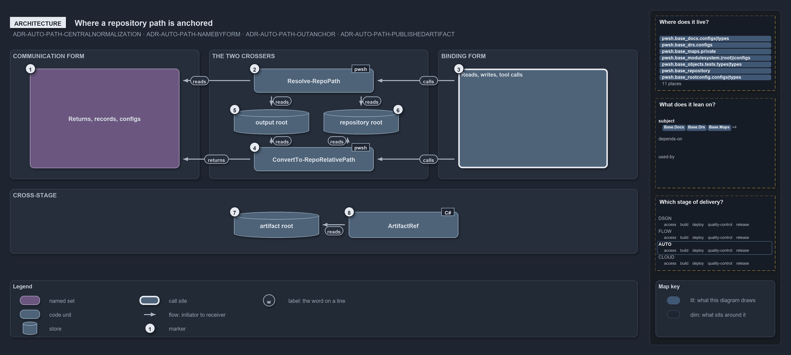

# Where a repository path is anchored

```text
Where a repository path is anchored.

1  Returns, records, configs   where a communication-form path lives: a return value, a record field, a checked-in config
2  Resolve-RepoPath            the crosser into binding form, anchored on one of the two roots
3  Reads, writes, tool calls   the side-effect lines that consume binding form
4  ConvertTo-RepoRelativePath  the crosser into communication form, relativized against one of the two roots
5  output root                 Get-OutputRoot: {root}/out on a devbox, the staging directory in a pipeline
6  repository root             Get-RepositoryRoot: the working root the importer sets, never $PWD
7  artifact root               the only anchor that survives a stage boundary
8  ArtifactRef                 the cross-stage type: both forms, anchored on the artifact root

Supports ADR-AUTO-PATH-CENTRALNORMALIZATION, ADR-AUTO-PATH-NAMEBYFORM, ADR-AUTO-PATH-OUTANCHOR
and ADR-AUTO-PATH-PUBLISHEDARTIFACT (architecture lens).
```

The path contract of cats is built from two functions in `Catzc.Base.Repository` and three anchors. `ConvertTo-RepoRelativePath` and
`Resolve-RepoPath` are the only boundary crossers, and each decides between the output root and the repository root. A published artifact
crosses a stage boundary, where neither root survives, so its type `ArtifactRef` in `Catzc.Base.Objects` anchors on the artifact root
instead.

```yml drawio
description:
  Two crossers anchor on the repository root and the output root, one into binding form and one into communication form; a published
  artifact anchors on its own artifact root, the only anchor that survives a stage boundary.
about:
  rules: [ADR-AUTO-PATH-CENTRALNORMALIZATION, ADR-AUTO-PATH-NAMEBYFORM, ADR-AUTO-PATH-OUTANCHOR, ADR-AUTO-PATH-PUBLISHEDARTIFACT]
  lens: architecture
content:
  title: Where a repository path is anchored
  kind: explanation
  flow: left-to-right
  theme: dark
  bands:
    - { id: band-communication, label: COMMUNICATION FORM }
    - { id: band-crossers, label: THE TWO CROSSERS }
    - { id: band-binding, label: BINDING FORM }
    - { id: band-stage, label: CROSS-STAGE }
  glyphs:
    - { id: s-records, kind: set, label: "Returns, records, configs", in: band-communication }
    - { id: g-resolve, kind: code, label: Resolve-RepoPath, in: band-crossers }
    - { id: t-output, kind: store, label: output root, in: band-crossers }
    - { id: t-repository, kind: store, label: repository root, in: band-crossers }
    - { id: g-convert, kind: code, label: ConvertTo-RepoRelativePath, in: band-crossers }
    - { id: s-effects, kind: callsite, label: "Reads, writes, tool calls", in: band-binding }
    - { id: t-artifact, kind: store, label: artifact root, in: band-stage }
    - { id: g-reference, kind: code, label: ArtifactRef, in: band-stage }
  edges:
    - { from: g-resolve, to: s-records, kind: flow, label: "" }
    - { from: s-effects, to: g-resolve, kind: flow, label: calls }
    - { from: s-effects, to: g-convert, kind: flow, label: calls }
    - { from: g-convert, to: s-records, kind: flow, label: returns }
    - { from: g-resolve, to: t-output, kind: flow, label: reads }
    - { from: g-convert, to: t-output, kind: flow, label: reads }
    - { from: g-resolve, to: t-repository, kind: flow, label: reads }
    - { from: g-convert, to: t-repository, kind: flow, label: reads }
    - { from: g-reference, to: t-artifact, kind: flow, label: reads }
  markers:
    - { at: s-records, number: 1 }
    - { at: g-resolve, number: 2 }
    - { at: s-effects, number: 3 }
    - { at: g-convert, number: 4 }
    - { at: t-output, number: 5 }
    - { at: t-repository, number: 6 }
    - { at: t-artifact, number: 7 }
    - { at: g-reference, number: 8 }
  legend: auto
  minimaps: [code-locations, module-neighbourhood, axis]
layout:
  band-communication: { x: 20, y: 84, w: 380, h: 260 }
  band-crossers: { x: 420, y: 84, w: 440, h: 260 }
  band-binding: { x: 880, y: 84, w: 400, h: 260 }
  band-stage: { x: 20, y: 364, w: 1260, h: 130 }
  s-records: { x: 60, y: 122, w: 300, h: 200 }
  g-resolve: { x: 510, y: 122, w: 240, h: 48 }
  t-output: { x: 470, y: 204, w: 150, h: 50 }
  t-repository: { x: 650, y: 204, w: 150, h: 50 }
  g-convert: { x: 510, y: 280, w: 240, h: 48 }
  s-effects: { x: 920, y: 122, w: 300, h: 200 }
  t-artifact: { x: 470, y: 410, w: 170, h: 52 }
  g-reference: { x: 700, y: 410, w: 220, h: 52 }
```



## Walkthrough

1. **Returns, records, configs.** A return value, a `DictionaryRecord` field, a deployment-context artifact or a source-controlled config
   holds a communication-form path: relative, slash-separated, normalized. `ContractAsset` and `rootconfig.yml` are two of the records that
   hold this form. A caller that needs to bind such a path hands it to `Resolve-RepoPath`.
2. **Resolve-RepoPath.** The crosser into binding form. An `out/` path is joined onto the output root, any other relative path onto the
   repository root, and a rooted path passes through. The absolute result goes to the line that uses it.
3. **Reads, writes, tool calls.** `Get-Content`, `Import-Module`, `Test-Path` and the external tools consume binding form, and only there is
   an absolute path correct. A tool run through `Invoke-Executable` starts in the repository root, so a repo-relative path binds there on
   its own; an `out/` path still needs the resolve. A path in hand on this side, absolute, `.\` or `..`, goes to
   `ConvertTo-RepoRelativePath` before it is stored.
4. **ConvertTo-RepoRelativePath.** The crosser into communication form. It relativizes against the output root first, then the repository
   root, and returns a normalized absolute path when the input lies under neither. The binding helpers `Get-RepositoryFile` and
   `Get-RepositoryFolder` are one call to `Resolve-RepoPath` each, so the normalization lives in one place.
5. **output root.** `Get-OutputRoot` is `{root}/out` on a devbox and `BUILD_ARTIFACTSTAGINGDIRECTORY` in a pipeline, which is why `out/` is
   a reserved anchor: both crossers treat it as the output root, never as a folder under the repository root.
6. **repository root.** `Get-RepositoryRoot` returns `$env:RepositoryRoot`, the working root the importer sets. Both crossers resolve
   against it, never against the current directory.
7. **artifact root.** When a build stage publishes a file and a deploy stage downloads it, the publish step strips the `out/template/`
   prefix, so the output root does not survive. The artifact root, the producer's `output_folder` or the consumer's downloaded folder, is
   the one anchor both sides share.
8. **ArtifactRef.** The cross-stage type holds an artifact-relative path and the producing context's absolute path. Its factory takes the
   raw path and the artifact root, and the consumer re-resolves against its own artifact root with `ResolveAt` and checks with `ExistsAt`.
   It uses neither crosser and never the `out/` anchor. A fourth anchor, `{workspace}` for a sibling checkout, is resolved by
   `InspirationRoot` in `Catzc.Tooling.Inspiration`.

## Why it holds

- Normalization is centralized: the two crossers are the only sanctioned way across the boundary (ADR-AUTO-PATH-CENTRALNORMALIZATION).
- A path is named by its form: the two crossers cross, and `Get-RepositoryFile` and `Get-RepositoryFolder` are binding helpers
  (ADR-AUTO-PATH-NAMEBYFORM).
- `out/` is a reserved anchor that `Resolve-RepoPath` re-anchors against `Get-OutputRoot`, not the repository root
  (ADR-AUTO-PATH-OUTANCHOR).
- A published artifact is created by `ArtifactRef`, holds both forms and anchors on the artifact root (ADR-AUTO-PATH-PUBLISHEDARTIFACT).

## Where the code and the decision record differ

The record keeps `RepoRelativePath` repo-root-pure, yet its `ToAbsolute` joins every relative value onto the repository root and knows no
`out/` anchor, a third resolver beside the two crossers.

## See also

- [Path representation](../../drs/automation/path-representation.md) — the decision this article explains.
- The other views of the same boundary: [meta](two-forms-never-a-third.md), [implementation](how-a-path-is-made-repo-relative.md),
  [operations](one-out-string-two-places.md) and [governance](types-check-forms-review-checks-crossers.md).
- [The automation explanations](index.md) · [How to read the diagrams](../index.md#how-to-read-the-diagrams)
