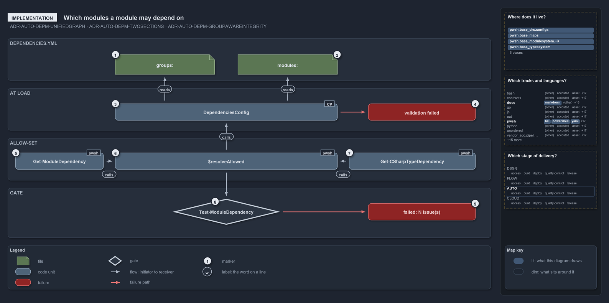

# Which modules a module may depend on

```text
Which modules a module may depend on.

1  groups:                   three groups, each with its own internal member-to-member map
2  modules:                  fourteen consumer entries, each listing the groups or modules it may use
3  DependenciesConfig        the typed config that validates both sections at load
4  validation failed         the one throw for a malformed declaration
5  Get-ModuleDependency      extracts the cross-module function-call edges
6  $resolveAllowed           builds each source module's allow-set and checks every edge against it
7  Get-CSharpTypeDependency  extracts the cross-module C# type references
8  Test-ModuleDependency     the quality gate that reports every issue
9  failed: N issue(s)        the gate's one throw, listing every issue

Supports ADR-AUTO-DEPM-UNIFIEDGRAPH, ADR-AUTO-DEPM-TWOSECTIONS and ADR-AUTO-DEPM-GROUPAWAREINTEGRITY (implementation lens).
```

`dependencies.yml` declares module dependencies in two sections, `groups:` and `modules:`. The `DependenciesConfig` type validates both when
the file loads, and `Get-ModuleDependencyViolations` merges them into one allow-set for each source module. Every function-call edge and
every C# type edge from that module is then checked against the set, and the `Test-ModuleDependency` quality gate fails on any miss. Reading
the code in this order shows exactly where an undeclared edge is caught.

```yml drawio
description:
  The two sections of dependencies.yml are validated at load and then unioned into one allow-set per source module, which the quality gate
  checks every function-call and type edge against, throwing one error that lists every issue.
about:
  rules: [ADR-AUTO-DEPM-UNIFIEDGRAPH, ADR-AUTO-DEPM-TWOSECTIONS, ADR-AUTO-DEPM-GROUPAWAREINTEGRITY]
  lens: implementation
content:
  title: Which modules a module may depend on
  kind: explanation
  flow: top-to-bottom
  theme: dark
  bands:
    - { id: band-file, label: DEPENDENCIES.YML }
    - { id: band-load, label: AT LOAD }
    - { id: band-allow, label: ALLOW-SET }
    - { id: band-gate, label: GATE }
  glyphs:
    - { id: g-groups, kind: file, label: "groups:", in: band-file }
    - { id: g-modules, kind: file, label: "modules:", in: band-file }
    - { id: g-config, kind: code, label: DependenciesConfig, in: band-load }
    - { id: f-validation, kind: failure, label: validation failed, in: band-load }
    - { id: g-function, kind: code, label: Get-ModuleDependency, in: band-allow }
    - { id: g-allowed, kind: code, label: $resolveAllowed, in: band-allow }
    - { id: g-type, kind: code, label: Get-CSharpTypeDependency, in: band-allow }
    - { id: g-test, kind: gate, label: Test-ModuleDependency, in: band-gate }
    - { id: f-issues, kind: failure, label: "failed: N issue(s)", in: band-gate }
  edges:
    - { from: g-config, to: g-groups, kind: flow, label: reads }
    - { from: g-config, to: g-modules, kind: flow, label: reads }
    - { from: g-allowed, to: g-config, kind: flow, label: calls }
    - { from: g-function, to: g-allowed, kind: flow, label: calls }
    - { from: g-type, to: g-allowed, kind: flow, label: calls }
    - { from: g-allowed, to: g-test, kind: flow, label: "" }
    - { from: g-config, to: f-validation, kind: fail, label: "" }
    - { from: g-test, to: f-issues, kind: fail, label: "" }
  markers:
    - { at: g-groups, number: 1 }
    - { at: g-modules, number: 2 }
    - { at: g-config, number: 3 }
    - { at: f-validation, number: 4 }
    - { at: g-function, number: 5 }
    - { at: g-allowed, number: 6 }
    - { at: g-type, number: 7 }
    - { at: g-test, number: 8 }
    - { at: f-issues, number: 9 }
  legend: auto
  minimaps: [code-locations, grid, axis]
layout:
  band-file: { x: 20, y: 84, w: 1260, h: 110 }
  band-load: { x: 20, y: 214, w: 1260, h: 110 }
  band-allow: { x: 20, y: 344, w: 1260, h: 110 }
  band-gate: { x: 20, y: 474, w: 1260, h: 130 }
  g-groups: { x: 300, y: 126, w: 260, h: 52 }
  g-modules: { x: 620, y: 126, w: 260, h: 52 }
  g-config: { x: 300, y: 254, w: 580, h: 44 }
  f-validation: { x: 960, y: 254, w: 280, h: 44 }
  g-function: { x: 40, y: 382, w: 230, h: 44 }
  g-allowed: { x: 300, y: 382, w: 580, h: 44 }
  g-type: { x: 910, y: 382, w: 330, h: 44 }
  g-test: { x: 450, y: 502, w: 280, h: 68 }
  f-issues: { x: 960, y: 514, w: 280, h: 44 }
```



## Walkthrough

1. **`groups:`.** Three groups, each with its own internal member-to-member map: `Base` with 26 members, `AzureExt` with 5 rooted at
   `Catzc.Azure.Cli`, and `Tooling` with 6, where Core and Environment depend on nothing in the group.
2. **`modules:`.** Fourteen consumer entries, each listing the groups or single modules that consumer may use. For example,
   `Catzc.Azure.Cli: [Base, Catzc.Azure, Catzc.Tooling.Core]`. No `Base` member has an entry, so a Base library's in-group list is its whole
   allow-set.
3. **`DependenciesConfig`.** The type that `Get-Config -Config dependencies` returns. The private accessors `Get-ModuleDependencyConfig` and
   `Get-ModuleGroupConfig` read its `modules` and `groups` sections, and each group is validated by `ModuleGroup`.
4. **validation failed.** Constructing the type collects every shape problem into one throw: a target that is neither a declared module nor
   a group, a group member that depends outside its own group, or a cycle. The throw starts with
   `module dependency configuration validation failed:`, before any edge is checked.
5. **`Get-ModuleDependency`.** It extracts the cross-module function-call edges, and it runs first.
6. **`$resolveAllowed`.** For each edge's source module it builds the allow-set: the module's `modules:` list with group names expanded to
   their members, unioned with the module's in-group list. A module in neither section is skipped. A declared module or group member missing
   on disk becomes an `[UnknownModule]` issue, and an edge outside the set becomes an `[UndeclaredDependency]` issue.
7. **`Get-CSharpTypeDependency`.** From `Catzc.Base.TypesSystem`, it extracts the cross-module C# type references. They are checked against
   the same allow-set and become `[UndeclaredTypeDependency]` issues, so one graph covers both kinds of edge.
8. **`Test-ModuleDependency`.** The quality gate passes every issue to `Write-QualityGateReport -Subject module-dependency`, which writes
   the report and either throws or, with `-PassThru`, returns the result. The L1 integrity test runs it and expects zero issues.
9. **failed: N issue(s).** With any issue, the gate throws once: `Test-ModuleDependency failed: N issue(s)`, followed by every issue line.

## Why it holds

- A cross-module function call and a cross-module C# type reference are one relationship, extracted by two functions and checked against one
  file (ADR-AUTO-DEPM-UNIFIEDGRAPH).
- The file has two sections. Naming a group allows an edge to any member, while naming a module allows exactly that edge
  (ADR-AUTO-DEPM-TWOSECTIONS).
- The declaration's shape is checked when it loads, and the gate checks the real edges and the on-disk modules against it
  (ADR-AUTO-DEPM-GROUPAWAREINTEGRITY).

## Where the code and the decision record differ

- The record says actual in-group edges must stay within the group's declared internal map. The allow-set is a union, so the four Tooling
  members that also pin `Tooling` in `modules:` (Python, Node, Toolchain and Provisioning) may reach any Tooling member.
- The record says a module absent from `modules:` is unconstrained. The code also constrains every group member, which is what keeps Base
  libraries inside their internal map.

## See also

- [Controlling module dependencies](../../drs/automation/controlling-module-dependencies.md) — the decision this article explains.
- The other lenses on the same graph: [meta](a-declared-allow-list-of-layers.md), [architecture](how-modules-are-layered.md),
  [operations](undeclared-edge-fails-with-one-line.md) and [governance](what-checks-the-module-layers.md).
- [The automation explanations](index.md) · [How to read the diagrams](../index.md#how-to-read-the-diagrams)
