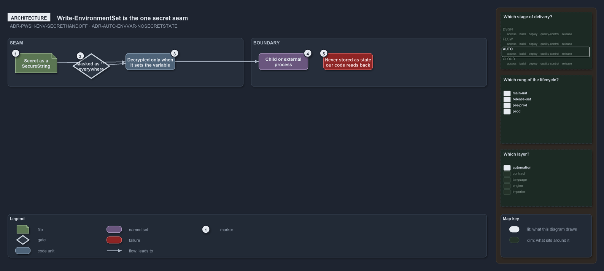

---
catzc:
  warning: "Experimental: this article merges two rules into one and holds nothing beyond what they say"
  edges:
    cites:
      - ADR-PWSH-ENV-SECRETHANDOFF
      - ADR-AUTO-ENVVAR-NOSECRETSTATE
---

# Write environmentset is the one secret seam and no secret is kept as state

This article is one rule:
[ADR-PWSH-ENV-SECRETHANDOFF](../../drs/automation/pwsh/environment-variable-mechanics.md#rule-adr-pwsh-env-secrethandoff) and
[ADR-AUTO-ENVVAR-NOSECRETSTATE](../../drs/automation/environment-variables.md#rule-adr-auto-envvar-nosecretstate) merged into one. It holds
nothing beyond what those two rules say.

`Write-EnvironmentSet` realises the one secret hand-off: it takes the secret as `[SecureString]`, masks it as `***` in everything it writes
or returns, and decrypts it only at the moment it sets the variable. Never store a secret in an environment variable as internal state our
own code reads back; a secret may cross to a child or external process through the environment only via that single disciplined seam.

