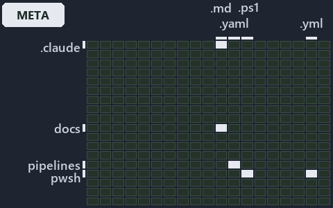

---
catzc:
  immutable:
    with_body_sha: "2fc218528f5a"
    repo_status: locked
    path: docs/explanation/azure/.assets/config-path-is-a-coordinate/grid.md
    source: docs/explanation/azure/.assets/config-path-is-a-coordinate/diagram.drawio.png
    role: asset-description
    language: markdown
    filetype: md
    track: docs
    tracktype: documentation
---

# A config file's path is a coordinate that resolves to one subscription and one resource group: the world-map minimap

```text
Where the files that cite ADR-AZ-CUSTOMER and ADR-AZ-DATAMOD sit in the repository: tracks down, file languages across.
5 of 342 cells lit, holding 75 files.
```



This is the world-map minimap in the sidebar of the meta diagram of [A config file's path is a coordinate that resolves to one subscription
and one resource group][77], which explains [ADR-AZ-CUSTOMER][1] and [ADR-AZ-DATAMOD][2]. It lights every cell of the world map that holds a
file citing those codes, so it shows where the decision lives in the repository. Each lit cell has its reason below, naming the code that
selects it.

## What the minimap shows

The grid crosses the 18 tracks (rows) with the 19 file languages (columns) of the world map and lights 5 cells, filled in ink. A cell lit
only by passing mentions (citations in body comments, not in a file's header or text) is touched: a lighter ink. Every other cell is idle, a
grey box: it holds files the slide's ADR codes do not select, or no file at all (288 of the 342 cells hold none). The minimap shows where
the slide sits, not how many files a cell holds; the world-map PDFs show the counts.

- .claude × markdown: 1 lit of 89 files
- docs × markdown: 65 lit of 2766 files
- pipelines × pipeline-yaml: 1 lit of 14 files
- pwsh × powershell: 4 lit of 1651 files
- pwsh × yaml: 4 lit of 115 files

## Key

A lit row prints its track's name; a lit column prints a short code, the first extension of its file language:

- `.md`: markdown
- `.yaml`: pipeline-yaml
- `.ps1`: powershell
- `.yml`: yaml

## Why each cell is lit

### .claude × markdown (1 lit file)

Placed: the root folder `.claude/` names the track .claude ([ADR-DSGN-TRACK-TRACKISPLACEDCLUSTER][3]); the extension `.md` names the file
language markdown ([ADR-DSGN-TRACK-FILELANGUAGE][3]). Lit ([ADR-DSGN-TRACK-LITCELL][3]) by:

- [.claude/plans/plan-promotion-ladder.md][4]: selected by [ADR-AZ-DATAMOD][2]: the file cites it at line 56 (text).

### docs × markdown (65 lit files)

Placed: the root folder `docs/` names the track docs ([ADR-DSGN-TRACK-TRACKISPLACEDCLUSTER][3]); the extension `.md` names the file language
markdown ([ADR-DSGN-TRACK-FILELANGUAGE][3]). Lit ([ADR-DSGN-TRACK-LITCELL][3]) by:

- [docs/adr/azure/azure-customer-model.md][1]: selected by [ADR-AZ-CUSTOMER][1]: the ADR's own file.
- [docs/adr/azure/azure-data-model.md][2]: selected by [ADR-AZ-DATAMOD][2]: the ADR's own file.
- [docs/adr/azure/dora-explains.md][5]: selected by [ADR-AZ-CUSTOMER][1]: the file cites it at line 60 (text); selected by
  [ADR-AZ-DATAMOD][2]: the file cites it at line 9 (text).
- [docs/adr/glossary.md][6]: selected by [ADR-AZ-DATAMOD][2]: the file cites it at line 1006 (text) and line 1054 (text).
- [docs/adr/index.md][7]: selected by [ADR-AZ-CUSTOMER][1]: the file cites it at line 285 (text); selected by [ADR-AZ-DATAMOD][2]: the file
  cites it at line 280 (text) and line 406 (text).
- [docs/how-to/pwsh/manual-test-plan/azure.md][8]: selected by [ADR-AZ-DATAMOD][2]: the file cites it at line 15 (text) and line 58 (text).
- [docs/references/.assets/automation/catzc-azure-cli/az-cli-test-assert-share-one-state.drawio.verify.md][9]: selected by
  [ADR-AZ-CUSTOMER][1]: the file cites it at line 62 (text); selected by [ADR-AZ-DATAMOD][2]: the file cites it at line 61 (text) and line
  61 (text).
- [docs/references/.assets/automation/catzc-azure-templates/bicep-deploy-one-immutable-context.drawio.verify.md][10]: selected by
  [ADR-AZ-DATAMOD][2]: the file cites it at line 58 (text) and line 73 (text).
- [docs/references/.assets/automation/catzc-azure-templates/bicep-template-is-a-folder.drawio.verify.md][11]: selected by
  [ADR-AZ-CUSTOMER][1]: the file cites it at line 44 (text); selected by [ADR-AZ-DATAMOD][2]: the file cites it at line 42 (text) and line
  48 (text).
- [docs/references/.assets/automation/catzc-azure/azure-identity-resolves-from-config.drawio.verify.md][12]: selected by
  [ADR-AZ-CUSTOMER][1]: the file cites it at line 50 (text) and line 50 (text); selected by [ADR-AZ-DATAMOD][2]: the file cites it at line
  50 (text), line 50 (text), line 50 (text), line 50 (text) and line 72 (text).
- [docs/references/infrastructure/templates/discovery/options.yml.md][13]: selected by [ADR-AZ-DATAMOD][2]: the file cites it at line 14
  (text).
- [docs/references/infrastructure/templates/expedition/options.yml.md][14]: selected by [ADR-AZ-DATAMOD][2]: the file cites it at line 15
  (text).
- [docs/references/infrastructure/templates/foundation/options.yml.md][15]: selected by [ADR-AZ-DATAMOD][2]: the file cites it at line 14
  (text).
- [docs/references/pipelines/cd-shared.yaml.md][16]: selected by [ADR-AZ-DATAMOD][2]: the file cites it at line 13 (text).
- [docs/references/pipelines/ci-infrastructure.yaml.md][17]: selected by [ADR-AZ-DATAMOD][2]: the file cites it at line 24 (text).
- [docs/references/pipelines/extends/cd-customer.yaml.md][18]: selected by [ADR-AZ-DATAMOD][2]: the file cites it at line 20 (text).
- [docs/references/pwsh/catzc-azure-cli/Assert-AzCliCanAccess.ps1.md][19]: selected by [ADR-AZ-DATAMOD][2]: the file cites it at line 21
  (text).
- [docs/references/pwsh/catzc-azure-cli/Assert-AzCliIsConnected.ps1.md][20]: selected by [ADR-AZ-DATAMOD][2]: the file cites it at line 17
  (text).
- [docs/references/pwsh/catzc-azure-cli/Test-AzCliCanAccess.ps1.md][21]: selected by [ADR-AZ-DATAMOD][2]: the file cites it at line 21
  (text).
- [docs/references/pwsh/catzc-azure-cli/az-cli-test-assert-share-one-state.drawio.md][22]: selected by [ADR-AZ-CUSTOMER][1]: the file cites
  it at line 101 (text); selected by [ADR-AZ-DATAMOD][2]: the file cites it at line 101 (text).
- [docs/references/pwsh/catzc-azure-devops-buildvalidation/configs/build-validation.yml.md][23]: selected by [ADR-AZ-CUSTOMER][1]: the file
  cites it at line 24 (text).
- [docs/references/pwsh/catzc-azure-devops-buildvalidation/tests/types/BuildValidationConfig.Tests.ps1.md][24]: selected by
  [ADR-AZ-CUSTOMER][1]: the file cites it at line 13 (text).
- [docs/references/pwsh/catzc-azure-devops-buildvalidation/types/BuildValidationEntry.cs.md][25]: selected by [ADR-AZ-CUSTOMER][1]: the file
  cites it at line 20 (text).
- [docs/references/pwsh/catzc-azure-templates/Assert-BicepTemplate.ps1.md][26]: selected by [ADR-AZ-DATAMOD][2]: the file cites it at line
  94 (text).
- [docs/references/pwsh/catzc-azure-templates/Build-Bicep.ps1.md][27]: selected by [ADR-AZ-DATAMOD][2]: the file cites it at line 129
  (text).
- [docs/references/pwsh/catzc-azure-templates/Deploy-Bicep.ps1.md][28]: selected by [ADR-AZ-DATAMOD][2]: the file cites it at line 17 (text)
  and line 105 (text).
- [docs/references/pwsh/catzc-azure-templates/Get-AzureBicepEnvironmentKinds.ps1.md][29]: selected by [ADR-AZ-DATAMOD][2]: the file cites it
  at line 24 (text).
- [docs/references/pwsh/catzc-azure-templates/Get-BicepDeploymentContext.ps1.md][30]: selected by [ADR-AZ-DATAMOD][2]: the file cites it at
  line 36 (text).
- [docs/references/pwsh/catzc-azure-templates/Get-BicepTemplateConfiguration.ps1.md][31]: selected by [ADR-AZ-DATAMOD][2]: the file cites it
  at line 18 (text).
- [docs/references/pwsh/catzc-azure-templates/Get-BicepTemplates.ps1.md][32]: selected by [ADR-AZ-CUSTOMER][1]: the file cites it at line
  128 (text); selected by [ADR-AZ-DATAMOD][2]: the file cites it at line 20 (text), line 46 (text) and line 117 (text).
- [docs/references/pwsh/catzc-azure-templates/Set-BicepTemplateConfiguration.ps1.md][33]: selected by [ADR-AZ-DATAMOD][2]: the file cites it
  at line 26 (text).
- [docs/references/pwsh/catzc-azure-templates/bicep-deploy-one-immutable-context.drawio.md][34]: selected by [ADR-AZ-DATAMOD][2]: the file
  cites it at line 24 (text), line 30 (text), line 101 (text), line 101 (text) and line 108 (text).
- [docs/references/pwsh/catzc-azure-templates/bicep-template-is-a-folder.drawio.md][35]: selected by [ADR-AZ-CUSTOMER][1]: the file cites it
  at line 94 (text); selected by [ADR-AZ-DATAMOD][2]: the file cites it at line 32 (text), line 94 (text) and line 100 (text).
- [docs/references/pwsh/catzc-azure-templates/private/Get-BicepConfigClassViolations.ps1.md][36]: selected by [ADR-AZ-DATAMOD][2]: the file
  cites it at line 22 (text).
- [docs/references/pwsh/catzc-azure-templates/private/Get-BicepConfigName.ps1.md][37]: selected by [ADR-AZ-DATAMOD][2]: the file cites it at
  line 16 (text).
- [docs/references/pwsh/catzc-azure-templates/private/Get-BicepConfigSubscriptionCandidates.ps1.md][38]: selected by [ADR-AZ-DATAMOD][2]:
  the file cites it at line 14 (text).
- [docs/references/pwsh/catzc-azure-templates/private/Get-BicepCustomerClassViolations.ps1.md][39]: selected by [ADR-AZ-CUSTOMER][1]: the
  file cites it at line 24 (text).
- [docs/references/pwsh/catzc-azure-templates/private/Get-BicepParametersFileName.ps1.md][40]: selected by [ADR-AZ-DATAMOD][2]: the file
  cites it at line 20 (text).
- [docs/references/pwsh/catzc-azure-templates/private/Get-BicepSubscriptionConfigViolations.ps1.md][41]: selected by [ADR-AZ-DATAMOD][2]:
  the file cites it at line 25 (text).
- [docs/references/pwsh/catzc-azure-templates/private/Resolve-BicepConfigName.ps1.md][42]: selected by [ADR-AZ-DATAMOD][2]: the file cites
  it at line 17 (text).
- [docs/references/pwsh/catzc-azure-templates/private/Resolve-BicepParameterAddresses.ps1.md][43]: selected by [ADR-AZ-DATAMOD][2]: the file
  cites it at line 16 (text).
- [docs/references/pwsh/catzc-azure-templates/tests/Get-BicepParameterModel.Shipped.Tests.ps1.md][44]: selected by [ADR-AZ-DATAMOD][2]: the
  file cites it at line 12 (text).
- [docs/references/pwsh/catzc-azure-templates/types/BicepTemplate.cs.md][45]: selected by [ADR-AZ-CUSTOMER][1]: the file cites it at line 27
  (text).
- [docs/references/pwsh/catzc-azure/Get-AzureCustomers.ps1.md][46]: selected by [ADR-AZ-CUSTOMER][1]: the file cites it at line 16 (text).
- [docs/references/pwsh/catzc-azure/Get-AzureEnvironment.ps1.md][47]: selected by [ADR-AZ-DATAMOD][2]: the file cites it at line 18 (text).
- [docs/references/pwsh/catzc-azure/Get-AzureSubscription.ps1.md][48]: selected by [ADR-AZ-CUSTOMER][1]: the file cites it at line 19 (text)
  and line 46 (text); selected by [ADR-AZ-DATAMOD][2]: the file cites it at line 18 (text).
- [docs/references/pwsh/catzc-azure/Get-AzureSubscriptionEnvironment.ps1.md][49]: selected by [ADR-AZ-DATAMOD][2]: the file cites it at line
  14 (text).
- [docs/references/pwsh/catzc-azure/azure-identity-resolves-from-config.drawio.md][50]: selected by [ADR-AZ-CUSTOMER][1]: the file cites it
  at line 103 (text) and line 103 (text); selected by [ADR-AZ-DATAMOD][2]: the file cites it at line 102 (text), line 102 (text), line 102
  (text) and line 102 (text).
- [docs/references/pwsh/catzc-azure/configs/azure.yml.md][51]: selected by [ADR-AZ-CUSTOMER][1]: the file cites it at line 66 (text);
  selected by [ADR-AZ-DATAMOD][2]: the file cites it at line 56 (text), line 83 (text) and line 102 (text).
- [docs/references/pwsh/catzc-azure/configs/customer.yml.md][52]: selected by [ADR-AZ-CUSTOMER][1]: the file cites it at line 12 (text).
- [docs/references/pwsh/catzc-azure/tests/types/AzureConfig.Tests.ps1.md][53]: selected by [ADR-AZ-CUSTOMER][1]: the file cites it at line
  26 (text); selected by [ADR-AZ-DATAMOD][2]: the file cites it at line 30 (text).
- [docs/references/pwsh/catzc-azure/types/AzureConfig.cs.md][54]: selected by [ADR-AZ-CUSTOMER][1]: the file cites it at line 43 (text);
  selected by [ADR-AZ-DATAMOD][2]: the file cites it at line 11 (text), line 26 (text), line 37 (text), line 39 (text) and line 45 (text).
- [docs/references/pwsh/catzc-azure/types/AzureCustomer.cs.md][55]: selected by [ADR-AZ-CUSTOMER][1]: the file cites it at line 11 (text).
- [docs/references/pwsh/catzc-azure/types/AzureEnvironmentRecord.cs.md][56]: selected by [ADR-AZ-DATAMOD][2]: the file cites it at line 11
  (text) and line 20 (text).
- [docs/references/pwsh/catzc-azure/types/AzureSubscriptionRecord.cs.md][57]: selected by [ADR-AZ-CUSTOMER][1]: the file cites it at line 22
  (text); selected by [ADR-AZ-DATAMOD][2]: the file cites it at line 11 (text).
- [docs/references/pwsh/catzc-azure/types/AzureTenantRecord.cs.md][58]: selected by [ADR-AZ-DATAMOD][2]: the file cites it at line 11
  (text).
- [docs/references/pwsh/catzc-azure/types/CustomerConfig.cs.md][59]: selected by [ADR-AZ-CUSTOMER][1]: the file cites it at line 11 (text),
  line 23 (text) and line 25 (text).
- [docs/references/pwsh/catzc-base-docs/types/AdrsConfig.cs.md][60]: selected by [ADR-AZ-CUSTOMER][1]: the file cites it at line 20 (text).
- [docs/references/pwsh/catzc-base-docs/types/GlossaryConcept.cs.md][61]: selected by [ADR-AZ-CUSTOMER][1]: the file cites it at line 24
  (text).
- [docs/references/pwsh/catzc-base-docs/types/GlossaryConfig.cs.md][62]: selected by [ADR-AZ-CUSTOMER][1]: the file cites it at line 26
  (text).
- [docs/references/pwsh/catzc-base-qualitygates/configs/analyzer-adr-map.yml.md][63]: selected by [ADR-AZ-CUSTOMER][1]: the file cites it at
  line 21 (text).
- [docs/references/pwsh/catzc-base-qualitygates/private/Get-MarkdownHeadingFinding.ps1.md][64]: selected by [ADR-AZ-DATAMOD][2]: the file
  cites it at line 15 (text).
- [docs/references/pwsh/catzc-base-qualitygates/private/Get-TerminologyCorpus.ps1.md][65]: selected by [ADR-AZ-DATAMOD][2]: the file cites
  it at line 53 (text).
- [docs/references/pwsh/catzc-base-qualitygates/types/AnalyzerAdrMapConfig.cs.md][66]: selected by [ADR-AZ-CUSTOMER][1]: the file cites it
  at line 25 (text).
- [docs/references/pwsh/catzc-base-variants/configs/variants.yml.md][67]: selected by [ADR-AZ-CUSTOMER][1]: the file cites it at line 51
  (text).

### pipelines × pipeline-yaml (1 lit file)

Placed: the root folder `pipelines/` names the track pipelines ([ADR-DSGN-TRACK-TRACKISPLACEDCLUSTER][3]); the extension `.yaml` names the
file language pipeline-yaml ([ADR-DSGN-TRACK-FILELANGUAGE][3]). Lit ([ADR-DSGN-TRACK-LITCELL][3]) by:

- [pipelines/ci-automation.yaml][68]: selected by [ADR-AZ-CUSTOMER][1]: a pipeline that cites nothing itself carries its globset's
  citations, which cite it at `pwsh/Catzc.Azure/tests/types/CustomerConfig.Tests.ps1` line 57 (text) and
  `pwsh/Catzc.Base.Docs/configs/adrs.yml` line 260 (text); selected by [ADR-AZ-DATAMOD][2]: a pipeline that cites nothing itself carries its
  globset's citations, which cite it at `pwsh/Catzc.Azure.Templates/configs/glossary.yml` line 5 (text),
  `pwsh/Catzc.Azure.Templates/configs/glossary.yml` line 101 (text),
  `pwsh/Catzc.Azure.Templates/tests/Get-BicepParameterModel.Shipped.Tests.ps1` line 5 (text),
  `pwsh/Catzc.Azure.Templates/tests/Resolve-BicepParameterAddresses.Tests.ps1` line 25 (text),
  `pwsh/Catzc.Azure.Templates/tests/Resolve-BicepParameterAddresses.Tests.ps1` line 31 (text),
  `pwsh/Catzc.Azure.Templates/tests/Resolve-BicepParameterAddresses.Tests.ps1` line 48 (text),
  `pwsh/Catzc.Azure.Templates/tests/Resolve-BicepParameterAddresses.Tests.ps1` line 54 (text),
  `pwsh/Catzc.Azure.Templates/tests/Resolve-BicepParameterAddresses.Tests.ps1` line 59 (text),
  `pwsh/Catzc.Azure.Templates/tests/Resolve-BicepParameterAddresses.Tests.ps1` line 65 (text),
  `pwsh/Catzc.Azure.Templates/tests/Resolve-BicepParameterAddresses.Tests.ps1` line 102 (text),
  `pwsh/Catzc.Azure.Templates/tests/Resolve-BicepParameterAddresses.Tests.ps1` line 106 (text),
  `pwsh/Catzc.Azure.Templates/tests/Resolve-BicepParameterAddresses.Tests.ps1` line 106 (text),
  `pwsh/Catzc.Azure.Templates/tests/Resolve-BicepParameterAddresses.Tests.ps1` line 111 (text),
  `pwsh/Catzc.Azure.Templates/tests/Resolve-BicepParameterAddresses.Tests.ps1` line 115 (text),
  `pwsh/Catzc.Azure/tests/types/AzureConfig.Tests.ps1` line 255 (text), `pwsh/Catzc.Azure/tests/types/AzureConfig.Tests.ps1` line 290
  (text), `pwsh/Catzc.Azure/tests/types/AzureConfig.Tests.ps1` line 296 (text), `pwsh/Catzc.Azure/tests/types/AzureConfig.Tests.ps1` line
  304 (text), `pwsh/Catzc.Azure/tests/types/AzureConfig.Tests.ps1` line 312 (text), `pwsh/Catzc.Azure/tests/types/AzureConfig.Tests.ps1`
  line 318 (text), `pwsh/Catzc.Azure/tests/types/AzureConfig.Tests.ps1` line 326 (text), `pwsh/Catzc.Base.Docs/configs/adr-index.yml` line
  43 (text), `pwsh/Catzc.Base.Docs/configs/adrs.yml` line 255 (text) and `pwsh/Catzc.Base.RootConfig/assets/root/cspell.yml` line 21 (body
  comment).

### pwsh × powershell (4 lit files)

Placed: the root folder `pwsh/` names the track pwsh ([ADR-DSGN-TRACK-TRACKISPLACEDCLUSTER][3]); the extension `.ps1` names the file
language powershell ([ADR-DSGN-TRACK-FILELANGUAGE][3]). Lit ([ADR-DSGN-TRACK-LITCELL][3]) by:

- [pwsh/Catzc.Azure.Templates/tests/Get-BicepParameterModel.Shipped.Tests.ps1][69]: selected by [ADR-AZ-DATAMOD][2]: the file cites it at
  line 5 (text).
- [pwsh/Catzc.Azure.Templates/tests/Resolve-BicepParameterAddresses.Tests.ps1][70]: selected by [ADR-AZ-DATAMOD][2]: the file cites it at
  line 25 (text), line 31 (text), line 48 (text), line 54 (text), line 59 (text), line 65 (text), line 102 (text), line 106 (text), line 106
  (text), line 111 (text) and line 115 (text).
- [pwsh/Catzc.Azure/tests/types/AzureConfig.Tests.ps1][71]: selected by [ADR-AZ-DATAMOD][2]: the file cites it at line 255 (text), line 290
  (text), line 296 (text), line 304 (text), line 312 (text), line 318 (text) and line 326 (text).
- [pwsh/Catzc.Azure/tests/types/CustomerConfig.Tests.ps1][72]: selected by [ADR-AZ-CUSTOMER][1]: the file cites it at line 57 (text).

### pwsh × yaml (4 lit files)

Placed: the root folder `pwsh/` names the track pwsh ([ADR-DSGN-TRACK-TRACKISPLACEDCLUSTER][3]); the extension `.yml` names the file
language yaml ([ADR-DSGN-TRACK-FILELANGUAGE][3]). Lit ([ADR-DSGN-TRACK-LITCELL][3]) by:

- [pwsh/Catzc.Azure.Templates/configs/glossary.yml][73]: selected by [ADR-AZ-DATAMOD][2]: the file cites it at line 5 (text) and line 101
  (text).
- [pwsh/Catzc.Base.Docs/configs/adr-index.yml][74]: selected by [ADR-AZ-DATAMOD][2]: the file cites it at line 43 (text).
- [pwsh/Catzc.Base.Docs/configs/adrs.yml][75]: selected by [ADR-AZ-CUSTOMER][1]: the file cites it at line 260 (text); selected by
  [ADR-AZ-DATAMOD][2]: the file cites it at line 255 (text).
- [pwsh/Catzc.Base.RootConfig/assets/root/cspell.yml][76]: selected by [ADR-AZ-DATAMOD][2]: the file cites it at line 21 (body comment) (a
  passing mention only).

## Keywords

- [world map][78]
- [track][79]
- [file language][80]
- [cell][81]
- [lit cell][82]
- [.claude][83]: a track
- [docs][83]: a track
- [pipelines][83]: a track
- [pwsh][83]: a track
- [markdown][84]: a file language
- [pipeline-yaml][84]: a file language
- [powershell][84]: a file language
- [yaml][84]: a file language

[1]: ../../../../adr/azure/azure-customer-model.md
[2]: ../../../../adr/azure/azure-data-model.md
[3]: ../../../../adr/design/tracks.md
[4]: ../../../../../.claude/plans/plan-promotion-ladder.md
[5]: ../../../../adr/azure/dora-explains.md
[6]: ../../../../adr/glossary.md
[7]: ../../../../adr/index.md
[8]: ../../../../how-to/pwsh/manual-test-plan/azure.md
[9]: ../../../../references/.assets/automation/catzc-azure-cli/az-cli-test-assert-share-one-state.drawio.verify.md
[10]: ../../../../references/.assets/automation/catzc-azure-templates/bicep-deploy-one-immutable-context.drawio.verify.md
[11]: ../../../../references/.assets/automation/catzc-azure-templates/bicep-template-is-a-folder.drawio.verify.md
[12]: ../../../../references/.assets/automation/catzc-azure/azure-identity-resolves-from-config.drawio.verify.md
[13]: ../../../../references/infrastructure/templates/discovery/options.yml.md
[14]: ../../../../references/infrastructure/templates/expedition/options.yml.md
[15]: ../../../../references/infrastructure/templates/foundation/options.yml.md
[16]: ../../../../references/pipelines/cd-shared.yaml.md
[17]: ../../../../references/pipelines/ci-infrastructure.yaml.md
[18]: ../../../../references/pipelines/extends/cd-customer.yaml.md
[19]: ../../../../references/pwsh/catzc-azure-cli/Assert-AzCliCanAccess.ps1.md
[20]: ../../../../references/pwsh/catzc-azure-cli/Assert-AzCliIsConnected.ps1.md
[21]: ../../../../references/pwsh/catzc-azure-cli/Test-AzCliCanAccess.ps1.md
[22]: ../../../../references/pwsh/.assets/az-cli-test-assert-share-one-state/diagram.drawio.md
[23]: ../../../../references/pwsh/catzc-azure-devops-buildvalidation/configs/build-validation.yml.md
[24]: ../../../../references/pwsh/catzc-azure-devops-buildvalidation/tests/types/BuildValidationConfig.Tests.ps1.md
[25]: ../../../../references/pwsh/catzc-azure-devops-buildvalidation/types/BuildValidationEntry.cs.md
[26]: ../../../../references/pwsh/catzc-azure-templates/Assert-BicepTemplate.ps1.md
[27]: ../../../../references/pwsh/catzc-azure-templates/Build-Bicep.ps1.md
[28]: ../../../../references/pwsh/catzc-azure-templates/Deploy-Bicep.ps1.md
[29]: ../../../../references/pwsh/catzc-azure-templates/Get-AzureBicepEnvironmentKinds.ps1.md
[30]: ../../../../references/pwsh/catzc-azure-templates/Get-BicepDeploymentContext.ps1.md
[31]: ../../../../references/pwsh/catzc-azure-templates/Get-BicepTemplateConfiguration.ps1.md
[32]: ../../../../references/pwsh/catzc-azure-templates/Get-BicepTemplates.ps1.md
[33]: ../../../../references/pwsh/catzc-azure-templates/Set-BicepTemplateConfiguration.ps1.md
[34]: ../../../../references/pwsh/.assets/bicep-deploy-one-immutable-context/diagram.drawio.md
[35]: ../../../../references/pwsh/.assets/bicep-template-is-a-folder/diagram.drawio.md
[36]: ../../../../references/pwsh/catzc-azure-templates/private/Get-BicepConfigClassViolations.ps1.md
[37]: ../../../../references/pwsh/catzc-azure-templates/private/Get-BicepConfigName.ps1.md
[38]: ../../../../references/pwsh/catzc-azure-templates/private/Get-BicepConfigSubscriptionCandidates.ps1.md
[39]: ../../../../references/pwsh/catzc-azure-templates/private/Get-BicepCustomerClassViolations.ps1.md
[40]: ../../../../references/pwsh/catzc-azure-templates/private/Get-BicepParametersFileName.ps1.md
[41]: ../../../../references/pwsh/catzc-azure-templates/private/Get-BicepSubscriptionConfigViolations.ps1.md
[42]: ../../../../references/pwsh/catzc-azure-templates/private/Resolve-BicepConfigName.ps1.md
[43]: ../../../../references/pwsh/catzc-azure-templates/private/Resolve-BicepParameterAddresses.ps1.md
[44]: ../../../../references/pwsh/catzc-azure-templates/tests/Get-BicepParameterModel.Shipped.Tests.ps1.md
[45]: ../../../../references/pwsh/catzc-azure-templates/types/BicepTemplate.cs.md
[46]: ../../../../references/pwsh/catzc-azure/Get-AzureCustomers.ps1.md
[47]: ../../../../references/pwsh/catzc-azure/Get-AzureEnvironment.ps1.md
[48]: ../../../../references/pwsh/catzc-azure/Get-AzureSubscription.ps1.md
[49]: ../../../../references/pwsh/catzc-azure/Get-AzureSubscriptionEnvironment.ps1.md
[50]: ../../../../references/pwsh/.assets/azure-identity-resolves-from-config/diagram.drawio.md
[51]: ../../../../references/pwsh/catzc-azure/configs/azure.yml.md
[52]: ../../../../references/pwsh/catzc-azure/configs/customer.yml.md
[53]: ../../../../references/pwsh/catzc-azure/tests/types/AzureConfig.Tests.ps1.md
[54]: ../../../../references/pwsh/catzc-azure/types/AzureConfig.cs.md
[55]: ../../../../references/pwsh/catzc-azure/types/AzureCustomer.cs.md
[56]: ../../../../references/pwsh/catzc-azure/types/AzureEnvironmentRecord.cs.md
[57]: ../../../../references/pwsh/catzc-azure/types/AzureSubscriptionRecord.cs.md
[58]: ../../../../references/pwsh/catzc-azure/types/AzureTenantRecord.cs.md
[59]: ../../../../references/pwsh/catzc-azure/types/CustomerConfig.cs.md
[60]: ../../../../references/pwsh/catzc-base-docs/types/AdrsConfig.cs.md
[61]: ../../../../references/pwsh/catzc-base-docs/types/GlossaryConcept.cs.md
[62]: ../../../../references/pwsh/catzc-base-docs/types/GlossaryConfig.cs.md
[63]: ../../../../references/pwsh/catzc-base-qualitygates/configs/analyzer-adr-map.yml.md
[64]: ../../../../references/pwsh/catzc-base-qualitygates/private/Get-MarkdownHeadingFinding.ps1.md
[65]: ../../../../references/pwsh/catzc-base-qualitygates/private/Get-TerminologyCorpus.ps1.md
[66]: ../../../../references/pwsh/catzc-base-qualitygates/types/AnalyzerAdrMapConfig.cs.md
[67]: ../../../../references/pwsh/catzc-base-variants/configs/variants.yml.md
[68]: ../../../../../pipelines/ci-automation.yaml
[69]: ../../../../../pwsh/Catzc.Azure.Templates/tests/Get-BicepParameterModel.Shipped.Tests.ps1
[70]: ../../../../../pwsh/Catzc.Azure.Templates/tests/Resolve-BicepParameterAddresses.Tests.ps1
[71]: ../../../../../pwsh/Catzc.Azure/tests/types/AzureConfig.Tests.ps1
[72]: ../../../../../pwsh/Catzc.Azure/tests/types/CustomerConfig.Tests.ps1
[73]: ../../../../../pwsh/Catzc.Azure.Templates/configs/glossary.yml
[74]: ../../../../../pwsh/Catzc.Base.Docs/configs/adr-index.yml
[75]: ../../../../../pwsh/Catzc.Base.Docs/configs/adrs.yml
[76]: ../../../../../pwsh/Catzc.Base.RootConfig/assets/root/cspell.yml
[77]: ../../config-path-is-a-coordinate.md
[78]: ../../../../adr/glossary.md#world-map
[79]: ../../../../adr/glossary.md#track
[80]: ../../../../adr/glossary.md#file-language
[81]: ../../../../adr/glossary.md#cell
[82]: ../../../../adr/glossary.md#lit-cell
[83]: ../../../../../pwsh/Catzc.Base.Variants/configs/variants.yml
[84]: ../../../../../pwsh/Catzc.Base.Languages/configs/languages.yml
