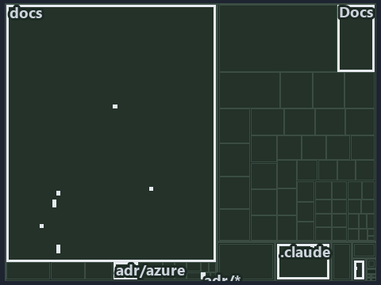

---
catzc:
  immutable:
    with_body_sha: b65ce1bccafc
    repo_status: locked
    path: docs/explanation/azure/.assets/lookup-form-check-render-in-order/tree.md
    source: docs/explanation/azure/.assets/lookup-form-check-render-in-order/diagram.drawio.png
    role: asset-description
    language: markdown
    filetype: md
    track: docs
    tracktype: documentation
---

# The namer looks up, forms, checks and renders a name in that order: the tree minimap

```text
Which files cite ADR-AZ-NAMING: every file of the world map is a tile, grouped by top-level folder.
14 files lit in 6 groups.
```



This is the tree minimap in the sidebar of the implementation diagram of [The namer looks up, forms, checks and renders a name in that
order][15], which explains [ADR-AZ-NAMING][1]. It lights every file that cites those codes, grouped by folder, so it shows which files carry
the decision. Each lit group has its reason below, naming the code that selects it.

## What the minimap shows

The tree draws every file of the world map as a tile, grouped by top-level folder (under `pwsh/` by module, under `docs/adr/` by ADR
domain), and lights 14 files in 6 groups, filled in ink. A lit ADR file has a white rim; a file lit only by passing mentions is a lighter
ink. Every other tile is idle, a grey box: a file the slide's ADR codes do not select.

- docs (docs/ outside docs/adr/): 8 lit files
- adr/azure (docs/adr/azure): 2 lit files
- .claude: 1 lit file
- adr/* (the files directly in docs/adr/): 1 lit file
- pipelines: 1 lit file
- Docs (pwsh/Catzc.Base.Docs): 1 lit file

## Why each group is lit

### docs (docs/ outside docs/adr/, 8 lit files)

The group holds the files of docs/ outside docs/adr/; each sits in its world-map cell and is lit by:

- [docs/how-to/getting-started/automation/add-a-doc-chapter.md][2], in the cell docs × markdown: selected by [ADR-AZ-NAMING][1]: the file
  cites it at line 67 (text).
- [docs/references/pwsh/catzc-azure-templates/Get-AzureResourceName.ps1.md][3], in the cell docs × markdown: selected by [ADR-AZ-NAMING][1]:
  the file cites it at line 97 (text).
- [docs/references/pwsh/catzc-azure-templates/Get-AzureResourceTypeSet.ps1.md][4], in the cell docs × markdown: selected by
  [ADR-AZ-NAMING][1]: the file cites it at line 29 (text).
- [docs/references/pwsh/catzc-azure-templates/types/BicepShortName.cs.md][5], in the cell docs × markdown: selected by [ADR-AZ-NAMING][1]:
  the file cites it at line 32 (text).
- [docs/references/pwsh/catzc-azure/configs/azure.yml.md][6], in the cell docs × markdown: selected by [ADR-AZ-NAMING][1]: the file cites it
  at line 32 (text), line 77 (text) and line 111 (text).
- [docs/references/pwsh/catzc-azure/configs/customer.yml.md][7], in the cell docs × markdown: selected by [ADR-AZ-NAMING][1]: the file cites
  it at line 19 (text).
- [docs/references/pwsh/catzc-azure/types/AzureEnvironmentRecord.cs.md][8], in the cell docs × markdown: selected by [ADR-AZ-NAMING][1]: the
  file cites it at line 12 (text).
- [docs/references/pwsh/catzc-base-variants/configs/variants.yml.md][9], in the cell docs × markdown: selected by [ADR-AZ-NAMING][1]: the
  file cites it at line 23 (text).

### adr/azure (docs/adr/azure, 2 lit files)

The group holds the files of docs/adr/azure; each sits in its world-map cell and is lit by:

- [docs/adr/azure/azure-naming-standard.md][1], in the cell docs × markdown: selected by [ADR-AZ-NAMING][1]: the ADR's own file.
- [docs/adr/azure/dora-explains.md][10], in the cell docs × markdown: selected by [ADR-AZ-NAMING][1]: the file cites it at line 43 (text).

### .claude (1 lit file)

The group holds the files of .claude; each sits in its world-map cell and is lit by:

- [.claude/plans/plan-explanation-drift-gaps.md][11], in the cell .claude × markdown: selected by [ADR-AZ-NAMING][1]: the file cites it at
  line 113 (text).

### adr/* (the files directly in docs/adr/, 1 lit file)

The group holds the files of the files directly in docs/adr/; each sits in its world-map cell and is lit by:

- [docs/adr/index.md][12], in the cell docs × markdown: selected by [ADR-AZ-NAMING][1]: the file cites it at line 284 (text).

### pipelines (1 lit file)

The group holds the files of pipelines; each sits in its world-map cell and is lit by:

- [pipelines/ci-automation.yaml][13], in the cell pipelines × pipeline-yaml: selected by [ADR-AZ-NAMING][1]: a pipeline that cites nothing
  itself carries its globset's citations, which cite it at `pwsh/Catzc.Base.Docs/configs/adrs.yml` line 257 (text).

### Docs (pwsh/Catzc.Base.Docs, 1 lit file)

The group holds the files of pwsh/Catzc.Base.Docs; each sits in its world-map cell and is lit by:

- [pwsh/Catzc.Base.Docs/configs/adrs.yml][14], in the cell pwsh × yaml: selected by [ADR-AZ-NAMING][1]: the file cites it at line 257
  (text).

## Keywords

- [world map][16]
- [track][17]
- [file language][18]
- [cell][19]
- [lit cell][20]
- [.claude][21]: a track
- [docs][21]: a track
- [pipelines][21]: a track
- [pwsh][21]: a track
- [markdown][22]: a file language
- [pipeline-yaml][22]: a file language
- [yaml][22]: a file language

[1]: ../../../../adr/azure/azure-naming-standard.md
[2]: ../../../../how-to/getting-started/automation/add-a-doc-chapter.md
[3]: ../../../../references/pwsh/catzc-azure-templates/Get-AzureResourceName.ps1.md
[4]: ../../../../references/pwsh/catzc-azure-templates/Get-AzureResourceTypeSet.ps1.md
[5]: ../../../../references/pwsh/catzc-azure-templates/types/BicepShortName.cs.md
[6]: ../../../../references/pwsh/catzc-azure/configs/azure.yml.md
[7]: ../../../../references/pwsh/catzc-azure/configs/customer.yml.md
[8]: ../../../../references/pwsh/catzc-azure/types/AzureEnvironmentRecord.cs.md
[9]: ../../../../references/pwsh/catzc-base-variants/configs/variants.yml.md
[10]: ../../../../adr/azure/dora-explains.md
[11]: ../../../../../.claude/plans/plan-explanation-drift-gaps.md
[12]: ../../../../adr/index.md
[13]: ../../../../../pipelines/ci-automation.yaml
[14]: ../../../../../pwsh/Catzc.Base.Docs/configs/adrs.yml
[15]: ../../lookup-form-check-render-in-order.md
[16]: ../../../../adr/glossary.md#world-map
[17]: ../../../../adr/glossary.md#track
[18]: ../../../../adr/glossary.md#file-language
[19]: ../../../../adr/glossary.md#cell
[20]: ../../../../adr/glossary.md#lit-cell
[21]: ../../../../../pwsh/Catzc.Base.Variants/configs/variants.yml
[22]: ../../../../../pwsh/Catzc.Base.Languages/configs/languages.yml
