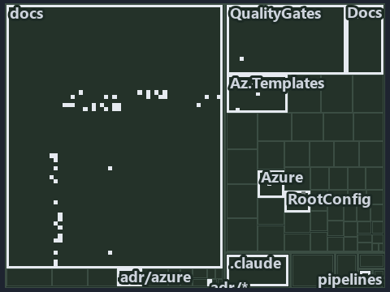

---
catzc:
  immutable:
    with_body_sha: "793b60e00c74"
    repo_status: locked
    path: docs/explanation/azure/.assets/pipeline-pins-devbox-picks-the-target/tree.md
    source: docs/explanation/azure/.assets/pipeline-pins-devbox-picks-the-target/diagram.drawio.png
    role: asset-description
    language: markdown
    filetype: md
    track: docs
    tracktype: documentation
---

# A pipeline pins the subscription it expects; a devbox picks the target with az account set: the tree minimap

```text
Which files cite ADR-AZ-DATAMOD: every file of the world map is a tile, grouped by top-level folder.
59 files lit in 10 groups.
```



This is the tree minimap in the sidebar of the operations diagram of [A pipeline pins the subscription it expects; a devbox picks the target
with az account set][60], which explains [ADR-AZ-DATAMOD][1]. It lights every file that cites those codes, grouped by folder, so it shows
which files carry the decision. Each lit group has its reason below, naming the code that selects it.

## What the minimap shows

The tree draws every file of the world map as a tile, grouped by top-level folder (under `pwsh/` by module, under `docs/adr/` by ADR
domain), and lights 59 files in 10 groups, filled in ink. A lit ADR file has a white rim; a file lit only by passing mentions is a lighter
ink. Every other tile is idle, a grey box: a file the slide's ADR codes do not select.

- docs (docs/ outside docs/adr/): 45 lit files
- Az.Templates (pwsh/Catzc.Azure.Templates): 3 lit files
- adr/* (the files directly in docs/adr/): 2 lit files
- adr/azure (docs/adr/azure): 2 lit files
- Docs (pwsh/Catzc.Base.Docs): 2 lit files
- .claude: 1 lit file
- pipelines: 1 lit file
- Azure (pwsh/Catzc.Azure): 1 lit file
- QualityGates (pwsh/Catzc.Base.QualityGates): 1 lit file
- RootConfig (pwsh/Catzc.Base.RootConfig): 1 lit file

## Why each group is lit

### docs (docs/ outside docs/adr/, 45 lit files)

The group holds the files of docs/ outside docs/adr/; each sits in its world-map cell and is lit by:

- [docs/how-to/pwsh/manual-test-plan/azure.md][2], in the cell docs × markdown: selected by [ADR-AZ-DATAMOD][1]: the file cites it at line
  15 (text) and line 58 (text).
- [docs/references/.assets/automation/catzc-azure-cli/az-cli-test-assert-share-one-state.drawio.verify.md][3], in the cell docs × markdown:
  selected by [ADR-AZ-DATAMOD][1]: the file cites it at line 61 (text) and line 61 (text).
- [docs/references/.assets/automation/catzc-azure-templates/bicep-deploy-one-immutable-context.drawio.verify.md][4], in the cell docs ×
  markdown: selected by [ADR-AZ-DATAMOD][1]: the file cites it at line 58 (text) and line 73 (text).
- [docs/references/.assets/automation/catzc-azure-templates/bicep-template-is-a-folder.drawio.verify.md][5], in the cell docs × markdown:
  selected by [ADR-AZ-DATAMOD][1]: the file cites it at line 42 (text) and line 48 (text).
- [docs/references/.assets/automation/catzc-azure/azure-identity-resolves-from-config.drawio.verify.md][6], in the cell docs × markdown:
  selected by [ADR-AZ-DATAMOD][1]: the file cites it at line 50 (text) and line 72 (text).
- [docs/references/infrastructure/templates/discovery/options.yml.md][7], in the cell docs × markdown: selected by [ADR-AZ-DATAMOD][1]: the
  file cites it at line 14 (text).
- [docs/references/infrastructure/templates/expedition/options.yml.md][8], in the cell docs × markdown: selected by [ADR-AZ-DATAMOD][1]: the
  file cites it at line 15 (text).
- [docs/references/infrastructure/templates/foundation/options.yml.md][9], in the cell docs × markdown: selected by [ADR-AZ-DATAMOD][1]: the
  file cites it at line 14 (text).
- [docs/references/pipelines/cd-shared.yaml.md][10], in the cell docs × markdown: selected by [ADR-AZ-DATAMOD][1]: the file cites it at line
  13 (text).
- [docs/references/pipelines/ci-infrastructure.yaml.md][11], in the cell docs × markdown: selected by [ADR-AZ-DATAMOD][1]: the file cites it
  at line 24 (text).
- [docs/references/pipelines/extends/cd-customer.yaml.md][12], in the cell docs × markdown: selected by [ADR-AZ-DATAMOD][1]: the file cites
  it at line 20 (text).
- [docs/references/pwsh/catzc-azure-cli/Assert-AzCliCanAccess.ps1.md][13], in the cell docs × markdown: selected by [ADR-AZ-DATAMOD][1]: the
  file cites it at line 21 (text).
- [docs/references/pwsh/catzc-azure-cli/Assert-AzCliIsConnected.ps1.md][14], in the cell docs × markdown: selected by [ADR-AZ-DATAMOD][1]:
  the file cites it at line 17 (text).
- [docs/references/pwsh/catzc-azure-cli/Test-AzCliCanAccess.ps1.md][15], in the cell docs × markdown: selected by [ADR-AZ-DATAMOD][1]: the
  file cites it at line 21 (text).
- [docs/references/pwsh/catzc-azure-cli/az-cli-test-assert-share-one-state.drawio.md][16], in the cell docs × markdown: selected by
  [ADR-AZ-DATAMOD][1]: the file cites it at line 101 (text).
- [docs/references/pwsh/catzc-azure-templates/Assert-BicepTemplate.ps1.md][17], in the cell docs × markdown: selected by
  [ADR-AZ-DATAMOD][1]: the file cites it at line 94 (text).
- [docs/references/pwsh/catzc-azure-templates/Build-Bicep.ps1.md][18], in the cell docs × markdown: selected by [ADR-AZ-DATAMOD][1]: the
  file cites it at line 129 (text).
- [docs/references/pwsh/catzc-azure-templates/Deploy-Bicep.ps1.md][19], in the cell docs × markdown: selected by [ADR-AZ-DATAMOD][1]: the
  file cites it at line 17 (text) and line 105 (text).
- [docs/references/pwsh/catzc-azure-templates/Get-AzureBicepEnvironmentKinds.ps1.md][20], in the cell docs × markdown: selected by
  [ADR-AZ-DATAMOD][1]: the file cites it at line 24 (text).
- [docs/references/pwsh/catzc-azure-templates/Get-BicepDeploymentContext.ps1.md][21], in the cell docs × markdown: selected by
  [ADR-AZ-DATAMOD][1]: the file cites it at line 36 (text).
- [docs/references/pwsh/catzc-azure-templates/Get-BicepTemplateConfiguration.ps1.md][22], in the cell docs × markdown: selected by
  [ADR-AZ-DATAMOD][1]: the file cites it at line 18 (text).
- [docs/references/pwsh/catzc-azure-templates/Get-BicepTemplates.ps1.md][23], in the cell docs × markdown: selected by [ADR-AZ-DATAMOD][1]:
  the file cites it at line 20 (text), line 46 (text) and line 117 (text).
- [docs/references/pwsh/catzc-azure-templates/Set-BicepTemplateConfiguration.ps1.md][24], in the cell docs × markdown: selected by
  [ADR-AZ-DATAMOD][1]: the file cites it at line 26 (text).
- [docs/references/pwsh/catzc-azure-templates/bicep-deploy-one-immutable-context.drawio.md][25], in the cell docs × markdown: selected by
  [ADR-AZ-DATAMOD][1]: the file cites it at line 24 (text), line 30 (text), line 101 (text) and line 108 (text).
- [docs/references/pwsh/catzc-azure-templates/bicep-template-is-a-folder.drawio.md][26], in the cell docs × markdown: selected by
  [ADR-AZ-DATAMOD][1]: the file cites it at line 32 (text), line 94 (text) and line 100 (text).
- [docs/references/pwsh/catzc-azure-templates/private/Get-BicepConfigClassViolations.ps1.md][27], in the cell docs × markdown: selected by
  [ADR-AZ-DATAMOD][1]: the file cites it at line 22 (text).
- [docs/references/pwsh/catzc-azure-templates/private/Get-BicepConfigName.ps1.md][28], in the cell docs × markdown: selected by
  [ADR-AZ-DATAMOD][1]: the file cites it at line 16 (text).
- [docs/references/pwsh/catzc-azure-templates/private/Get-BicepConfigSubscriptionCandidates.ps1.md][29], in the cell docs × markdown:
  selected by [ADR-AZ-DATAMOD][1]: the file cites it at line 14 (text).
- [docs/references/pwsh/catzc-azure-templates/private/Get-BicepParametersFileName.ps1.md][30], in the cell docs × markdown: selected by
  [ADR-AZ-DATAMOD][1]: the file cites it at line 20 (text).
- [docs/references/pwsh/catzc-azure-templates/private/Get-BicepSubscriptionConfigViolations.ps1.md][31], in the cell docs × markdown:
  selected by [ADR-AZ-DATAMOD][1]: the file cites it at line 25 (text).
- [docs/references/pwsh/catzc-azure-templates/private/Resolve-BicepConfigName.ps1.md][32], in the cell docs × markdown: selected by
  [ADR-AZ-DATAMOD][1]: the file cites it at line 17 (text).
- [docs/references/pwsh/catzc-azure-templates/private/Resolve-BicepParameterAddresses.ps1.md][33], in the cell docs × markdown: selected by
  [ADR-AZ-DATAMOD][1]: the file cites it at line 16 (text).
- [docs/references/pwsh/catzc-azure-templates/tests/Get-BicepParameterModel.Shipped.Tests.ps1.md][34], in the cell docs × markdown: selected
  by [ADR-AZ-DATAMOD][1]: the file cites it at line 12 (text).
- [docs/references/pwsh/catzc-azure/Get-AzureEnvironment.ps1.md][35], in the cell docs × markdown: selected by [ADR-AZ-DATAMOD][1]: the file
  cites it at line 18 (text).
- [docs/references/pwsh/catzc-azure/Get-AzureSubscription.ps1.md][36], in the cell docs × markdown: selected by [ADR-AZ-DATAMOD][1]: the
  file cites it at line 18 (text).
- [docs/references/pwsh/catzc-azure/Get-AzureSubscriptionEnvironment.ps1.md][37], in the cell docs × markdown: selected by
  [ADR-AZ-DATAMOD][1]: the file cites it at line 14 (text).
- [docs/references/pwsh/catzc-azure/azure-identity-resolves-from-config.drawio.md][38], in the cell docs × markdown: selected by
  [ADR-AZ-DATAMOD][1]: the file cites it at line 102 (text).
- [docs/references/pwsh/catzc-azure/configs/azure.yml.md][39], in the cell docs × markdown: selected by [ADR-AZ-DATAMOD][1]: the file cites
  it at line 56 (text), line 83 (text) and line 102 (text).
- [docs/references/pwsh/catzc-azure/tests/types/AzureConfig.Tests.ps1.md][40], in the cell docs × markdown: selected by [ADR-AZ-DATAMOD][1]:
  the file cites it at line 30 (text).
- [docs/references/pwsh/catzc-azure/types/AzureConfig.cs.md][41], in the cell docs × markdown: selected by [ADR-AZ-DATAMOD][1]: the file
  cites it at line 11 (text), line 26 (text), line 37 (text), line 39 (text) and line 45 (text).
- [docs/references/pwsh/catzc-azure/types/AzureEnvironmentRecord.cs.md][42], in the cell docs × markdown: selected by [ADR-AZ-DATAMOD][1]:
  the file cites it at line 11 (text) and line 20 (text).
- [docs/references/pwsh/catzc-azure/types/AzureSubscriptionRecord.cs.md][43], in the cell docs × markdown: selected by [ADR-AZ-DATAMOD][1]:
  the file cites it at line 11 (text).
- [docs/references/pwsh/catzc-azure/types/AzureTenantRecord.cs.md][44], in the cell docs × markdown: selected by [ADR-AZ-DATAMOD][1]: the
  file cites it at line 11 (text).
- [docs/references/pwsh/catzc-base-qualitygates/private/Get-MarkdownHeadingFinding.ps1.md][45], in the cell docs × markdown: selected by
  [ADR-AZ-DATAMOD][1]: the file cites it at line 15 (text).
- [docs/references/pwsh/catzc-base-qualitygates/private/Get-TerminologyCorpus.ps1.md][46], in the cell docs × markdown: selected by
  [ADR-AZ-DATAMOD][1]: the file cites it at line 53 (text).

### Az.Templates (pwsh/Catzc.Azure.Templates, 3 lit files)

The group holds the files of pwsh/Catzc.Azure.Templates; each sits in its world-map cell and is lit by:

- [pwsh/Catzc.Azure.Templates/configs/glossary.yml][47], in the cell pwsh × yaml: selected by [ADR-AZ-DATAMOD][1]: the file cites it at line
  5 (text) and line 101 (text).
- [pwsh/Catzc.Azure.Templates/tests/Get-BicepParameterModel.Shipped.Tests.ps1][48], in the cell pwsh × powershell: selected by
  [ADR-AZ-DATAMOD][1]: the file cites it at line 5 (text).
- [pwsh/Catzc.Azure.Templates/tests/Resolve-BicepParameterAddresses.Tests.ps1][49], in the cell pwsh × powershell: selected by
  [ADR-AZ-DATAMOD][1]: the file cites it at line 25 (text), line 31 (text), line 48 (text), line 54 (text), line 59 (text), line 65 (text),
  line 102 (text), line 106 (text), line 106 (body comment), line 111 (text) and line 115 (text).

### adr/* (the files directly in docs/adr/, 2 lit files)

The group holds the files of the files directly in docs/adr/; each sits in its world-map cell and is lit by:

- [docs/adr/glossary.md][50], in the cell docs × markdown: selected by [ADR-AZ-DATAMOD][1]: the file cites it at line 1005 (text) and line
  1053 (text).
- [docs/adr/index.md][51], in the cell docs × markdown: selected by [ADR-AZ-DATAMOD][1]: the file cites it at line 280 (text) and line 405
  (text).

### adr/azure (docs/adr/azure, 2 lit files)

The group holds the files of docs/adr/azure; each sits in its world-map cell and is lit by:

- [docs/adr/azure/azure-data-model.md][1], in the cell docs × markdown: selected by [ADR-AZ-DATAMOD][1]: the ADR's own file.
- [docs/adr/azure/dora-explains.md][52], in the cell docs × markdown: selected by [ADR-AZ-DATAMOD][1]: the file cites it at line 9 (text).

### Docs (pwsh/Catzc.Base.Docs, 2 lit files)

The group holds the files of pwsh/Catzc.Base.Docs; each sits in its world-map cell and is lit by:

- [pwsh/Catzc.Base.Docs/configs/adr-index.yml][53], in the cell pwsh × yaml: selected by [ADR-AZ-DATAMOD][1]: the file cites it at line 44
  (text).
- [pwsh/Catzc.Base.Docs/configs/adrs.yml][54], in the cell pwsh × yaml: selected by [ADR-AZ-DATAMOD][1]: the file cites it at line 255
  (text).

### .claude (1 lit file)

The group holds the files of .claude; each sits in its world-map cell and is lit by:

- [.claude/plans/plan-promotion-ladder.md][55], in the cell .claude × markdown: selected by [ADR-AZ-DATAMOD][1]: the file cites it at line
  56 (text).

### pipelines (1 lit file)

The group holds the files of pipelines; each sits in its world-map cell and is lit by:

- [pipelines/ci-automation.yaml][56], in the cell pipelines × pipeline-yaml: selected by [ADR-AZ-DATAMOD][1]: a pipeline that cites nothing
  itself carries its globset's citations, which cite it at `pwsh/Catzc.Azure.Templates/configs/glossary.yml` line 5 (text),
  `pwsh/Catzc.Azure.Templates/configs/glossary.yml` line 101 (text),
  `pwsh/Catzc.Azure.Templates/tests/Get-BicepParameterModel.Shipped.Tests.ps1` line 5 (text),
  `pwsh/Catzc.Azure.Templates/tests/Resolve-BicepParameterAddresses.Tests.ps1` line 25 (text),
  `pwsh/Catzc.Azure.Templates/tests/Resolve-BicepParameterAddresses.Tests.ps1` line 31 (text),
  `pwsh/Catzc.Azure.Templates/tests/Resolve-BicepParameterAddresses.Tests.ps1` line 48 (text),
  `pwsh/Catzc.Azure.Templates/tests/Resolve-BicepParameterAddresses.Tests.ps1` line 54 (text),
  `pwsh/Catzc.Azure.Templates/tests/Resolve-BicepParameterAddresses.Tests.ps1` line 59 (text),
  `pwsh/Catzc.Azure.Templates/tests/Resolve-BicepParameterAddresses.Tests.ps1` line 65 (text),
  `pwsh/Catzc.Azure.Templates/tests/Resolve-BicepParameterAddresses.Tests.ps1` line 102 (text),
  `pwsh/Catzc.Azure.Templates/tests/Resolve-BicepParameterAddresses.Tests.ps1` line 106 (text),
  `pwsh/Catzc.Azure.Templates/tests/Resolve-BicepParameterAddresses.Tests.ps1` line 106 (body comment),
  `pwsh/Catzc.Azure.Templates/tests/Resolve-BicepParameterAddresses.Tests.ps1` line 111 (text),
  `pwsh/Catzc.Azure.Templates/tests/Resolve-BicepParameterAddresses.Tests.ps1` line 115 (text),
  `pwsh/Catzc.Azure/tests/types/AzureConfig.Tests.ps1` line 255 (text), `pwsh/Catzc.Azure/tests/types/AzureConfig.Tests.ps1` line 290
  (text), `pwsh/Catzc.Azure/tests/types/AzureConfig.Tests.ps1` line 296 (text), `pwsh/Catzc.Azure/tests/types/AzureConfig.Tests.ps1` line
  304 (text), `pwsh/Catzc.Azure/tests/types/AzureConfig.Tests.ps1` line 312 (text), `pwsh/Catzc.Azure/tests/types/AzureConfig.Tests.ps1`
  line 318 (text), `pwsh/Catzc.Azure/tests/types/AzureConfig.Tests.ps1` line 326 (text), `pwsh/Catzc.Base.Docs/configs/adr-index.yml` line
  44 (text), `pwsh/Catzc.Base.Docs/configs/adrs.yml` line 255 (text), `pwsh/Catzc.Base.QualityGates/configs/terminology.yml` line 617 (text)
  and `pwsh/Catzc.Base.RootConfig/assets/root/cspell.yml` line 21 (body comment).

### Azure (pwsh/Catzc.Azure, 1 lit file)

The group holds the files of pwsh/Catzc.Azure; each sits in its world-map cell and is lit by:

- [pwsh/Catzc.Azure/tests/types/AzureConfig.Tests.ps1][57], in the cell pwsh × powershell: selected by [ADR-AZ-DATAMOD][1]: the file cites
  it at line 255 (text), line 290 (text), line 296 (text), line 304 (text), line 312 (text), line 318 (text) and line 326 (text).

### QualityGates (pwsh/Catzc.Base.QualityGates, 1 lit file)

The group holds the files of pwsh/Catzc.Base.QualityGates; each sits in its world-map cell and is lit by:

- [pwsh/Catzc.Base.QualityGates/configs/terminology.yml][58], in the cell pwsh × yaml: selected by [ADR-AZ-DATAMOD][1]: the file cites it at
  line 617 (text).

### RootConfig (pwsh/Catzc.Base.RootConfig, 1 lit file)

The group holds the files of pwsh/Catzc.Base.RootConfig; each sits in its world-map cell and is lit by:

- [pwsh/Catzc.Base.RootConfig/assets/root/cspell.yml][59], in the cell pwsh × yaml: selected by [ADR-AZ-DATAMOD][1]: the file cites it at
  line 21 (body comment) (a passing mention only).

## Keywords

- [world map][61]
- [track][62]
- [file language][63]
- [cell][64]
- [lit cell][65]
- [.claude][66]: a track
- [docs][66]: a track
- [pipelines][66]: a track
- [pwsh][66]: a track
- [markdown][67]: a file language
- [pipeline-yaml][67]: a file language
- [powershell][67]: a file language
- [yaml][67]: a file language

Terms the cited ADRs define:

- [environment class][68], defined by [ADR-AZ-DATAMOD#11][69]
- [slot][70], defined by [ADR-AZ-DATAMOD#2][71]

[1]: ../../../../adr/azure/azure-data-model.md
[2]: ../../../../how-to/pwsh/manual-test-plan/azure.md
[3]: ../../../../references/.assets/automation/catzc-azure-cli/az-cli-test-assert-share-one-state.drawio.verify.md
[4]: ../../../../references/.assets/automation/catzc-azure-templates/bicep-deploy-one-immutable-context.drawio.verify.md
[5]: ../../../../references/.assets/automation/catzc-azure-templates/bicep-template-is-a-folder.drawio.verify.md
[6]: ../../../../references/.assets/automation/catzc-azure/azure-identity-resolves-from-config.drawio.verify.md
[7]: ../../../../references/infrastructure/templates/discovery/options.yml.md
[8]: ../../../../references/infrastructure/templates/expedition/options.yml.md
[9]: ../../../../references/infrastructure/templates/foundation/options.yml.md
[10]: ../../../../references/pipelines/cd-shared.yaml.md
[11]: ../../../../references/pipelines/ci-infrastructure.yaml.md
[12]: ../../../../references/pipelines/extends/cd-customer.yaml.md
[13]: ../../../../references/pwsh/catzc-azure-cli/Assert-AzCliCanAccess.ps1.md
[14]: ../../../../references/pwsh/catzc-azure-cli/Assert-AzCliIsConnected.ps1.md
[15]: ../../../../references/pwsh/catzc-azure-cli/Test-AzCliCanAccess.ps1.md
[16]: ../../../../references/pwsh/catzc-azure-cli/az-cli-test-assert-share-one-state.drawio.md
[17]: ../../../../references/pwsh/catzc-azure-templates/Assert-BicepTemplate.ps1.md
[18]: ../../../../references/pwsh/catzc-azure-templates/Build-Bicep.ps1.md
[19]: ../../../../references/pwsh/catzc-azure-templates/Deploy-Bicep.ps1.md
[20]: ../../../../references/pwsh/catzc-azure-templates/Get-AzureBicepEnvironmentKinds.ps1.md
[21]: ../../../../references/pwsh/catzc-azure-templates/Get-BicepDeploymentContext.ps1.md
[22]: ../../../../references/pwsh/catzc-azure-templates/Get-BicepTemplateConfiguration.ps1.md
[23]: ../../../../references/pwsh/catzc-azure-templates/Get-BicepTemplates.ps1.md
[24]: ../../../../references/pwsh/catzc-azure-templates/Set-BicepTemplateConfiguration.ps1.md
[25]: ../../../../references/pwsh/catzc-azure-templates/bicep-deploy-one-immutable-context.drawio.md
[26]: ../../../../references/pwsh/catzc-azure-templates/bicep-template-is-a-folder.drawio.md
[27]: ../../../../references/pwsh/catzc-azure-templates/private/Get-BicepConfigClassViolations.ps1.md
[28]: ../../../../references/pwsh/catzc-azure-templates/private/Get-BicepConfigName.ps1.md
[29]: ../../../../references/pwsh/catzc-azure-templates/private/Get-BicepConfigSubscriptionCandidates.ps1.md
[30]: ../../../../references/pwsh/catzc-azure-templates/private/Get-BicepParametersFileName.ps1.md
[31]: ../../../../references/pwsh/catzc-azure-templates/private/Get-BicepSubscriptionConfigViolations.ps1.md
[32]: ../../../../references/pwsh/catzc-azure-templates/private/Resolve-BicepConfigName.ps1.md
[33]: ../../../../references/pwsh/catzc-azure-templates/private/Resolve-BicepParameterAddresses.ps1.md
[34]: ../../../../references/pwsh/catzc-azure-templates/tests/Get-BicepParameterModel.Shipped.Tests.ps1.md
[35]: ../../../../references/pwsh/catzc-azure/Get-AzureEnvironment.ps1.md
[36]: ../../../../references/pwsh/catzc-azure/Get-AzureSubscription.ps1.md
[37]: ../../../../references/pwsh/catzc-azure/Get-AzureSubscriptionEnvironment.ps1.md
[38]: ../../../../references/pwsh/catzc-azure/azure-identity-resolves-from-config.drawio.md
[39]: ../../../../references/pwsh/catzc-azure/configs/azure.yml.md
[40]: ../../../../references/pwsh/catzc-azure/tests/types/AzureConfig.Tests.ps1.md
[41]: ../../../../references/pwsh/catzc-azure/types/AzureConfig.cs.md
[42]: ../../../../references/pwsh/catzc-azure/types/AzureEnvironmentRecord.cs.md
[43]: ../../../../references/pwsh/catzc-azure/types/AzureSubscriptionRecord.cs.md
[44]: ../../../../references/pwsh/catzc-azure/types/AzureTenantRecord.cs.md
[45]: ../../../../references/pwsh/catzc-base-qualitygates/private/Get-MarkdownHeadingFinding.ps1.md
[46]: ../../../../references/pwsh/catzc-base-qualitygates/private/Get-TerminologyCorpus.ps1.md
[47]: ../../../../../pwsh/Catzc.Azure.Templates/configs/glossary.yml
[48]: ../../../../../pwsh/Catzc.Azure.Templates/tests/Get-BicepParameterModel.Shipped.Tests.ps1
[49]: ../../../../../pwsh/Catzc.Azure.Templates/tests/Resolve-BicepParameterAddresses.Tests.ps1
[50]: ../../../../adr/glossary.md
[51]: ../../../../adr/index.md
[52]: ../../../../adr/azure/dora-explains.md
[53]: ../../../../../pwsh/Catzc.Base.Docs/configs/adr-index.yml
[54]: ../../../../../pwsh/Catzc.Base.Docs/configs/adrs.yml
[55]: ../../../../../.claude/plans/plan-promotion-ladder.md
[56]: ../../../../../pipelines/ci-automation.yaml
[57]: ../../../../../pwsh/Catzc.Azure/tests/types/AzureConfig.Tests.ps1
[58]: ../../../../../pwsh/Catzc.Base.QualityGates/configs/terminology.yml
[59]: ../../../../../pwsh/Catzc.Base.RootConfig/assets/root/cspell.yml
[60]: ../../pipeline-pins-devbox-picks-the-target.md
[61]: ../../../../adr/glossary.md#world-map
[62]: ../../../../adr/glossary.md#track
[63]: ../../../../adr/glossary.md#file-language
[64]: ../../../../adr/glossary.md#cell
[65]: ../../../../adr/glossary.md#lit-cell
[66]: ../../../../../pwsh/Catzc.Base.Variants/configs/variants.yml
[67]: ../../../../../pwsh/Catzc.Base.Languages/configs/languages.yml
[68]: ../../../../adr/glossary.md#environment-class
[69]: ../../../../adr/azure/azure-data-model.md#rule-adr-az-datamod11
[70]: ../../../../adr/glossary.md#slot
[71]: ../../../../adr/azure/azure-data-model.md#rule-adr-az-datamod2
