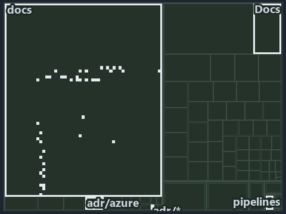

---
catzc:
  immutable:
    with_body_sha: "047854faddf0"
    repo_status: locked
    path: docs/explanation/azure/.assets/two-layers-join-through-one-resolver/tree.md
    source: docs/explanation/azure/.assets/two-layers-join-through-one-resolver/diagram.drawio.png
    role: asset-description
    language: markdown
    filetype: md
    track: docs
    tracktype: documentation
---

# Templating and identity join through one shared check and one resolver: the tree minimap

```text
Which files cite ADR-AZ-CUSTOMER and ADR-AZ-DATAMOD: every file of the world map is a tile, grouped by top-level folder.
46 files lit in 5 groups.
```



This is the tree minimap in the sidebar of the architecture diagram of [Templating and identity join through one shared check and one
resolver][47], which explains [ADR-AZ-CUSTOMER][1] and [ADR-AZ-DATAMOD][2]. It lights every file that cites those codes, grouped by folder,
so it shows which files carry the decision. Each lit group has its reason below, naming the code that selects it.

## What the minimap shows

The tree draws every file of the world map as a tile, grouped by top-level folder (under `pwsh/` by module, under `docs/adr/` by ADR
domain), and lights 46 files in 5 groups, filled in ink. A lit ADR file has a white rim; a file lit only by passing mentions is a lighter
ink. Every other tile is idle, a grey box: a file the slide's ADR codes do not select.

- docs (docs/ outside docs/adr/): 40 lit files
- adr/azure (docs/adr/azure): 3 lit files
- adr/* (the files directly in docs/adr/): 1 lit file
- pipelines: 1 lit file
- Docs (pwsh/Catzc.Base.Docs): 1 lit file

## Why each group is lit

### docs (docs/ outside docs/adr/, 40 lit files)

The group holds the files of docs/ outside docs/adr/; each sits in its world-map cell and is lit by:

- [docs/references/.assets/automation/catzc-azure-cli/az-cli-test-assert-share-one-state.drawio.verify.md][3], in the cell docs × markdown:
  selected by [ADR-AZ-CUSTOMER][1]: the file cites it at line 62 (text); selected by [ADR-AZ-DATAMOD][2]: the file cites it at line 61
  (text).
- [docs/references/.assets/automation/catzc-azure-templates/bicep-deploy-one-immutable-context.drawio.verify.md][4], in the cell docs ×
  markdown: selected by [ADR-AZ-DATAMOD][2]: the file cites it at line 58 (text) and line 73 (text).
- [docs/references/.assets/automation/catzc-azure-templates/bicep-template-is-a-folder.drawio.verify.md][5], in the cell docs × markdown:
  selected by [ADR-AZ-CUSTOMER][1]: the file cites it at line 44 (text); selected by [ADR-AZ-DATAMOD][2]: the file cites it at line 48
  (text).
- [docs/references/.assets/automation/catzc-azure/azure-identity-resolves-from-config.drawio.verify.md][6], in the cell docs × markdown:
  selected by [ADR-AZ-DATAMOD][2]: the file cites it at line 72 (text).
- [docs/references/infrastructure/templates/discovery/options.yml.md][7], in the cell docs × markdown: selected by [ADR-AZ-DATAMOD][2]: the
  file cites it at line 14 (text).
- [docs/references/infrastructure/templates/expedition/options.yml.md][8], in the cell docs × markdown: selected by [ADR-AZ-DATAMOD][2]: the
  file cites it at line 15 (text).
- [docs/references/infrastructure/templates/foundation/options.yml.md][9], in the cell docs × markdown: selected by [ADR-AZ-DATAMOD][2]: the
  file cites it at line 14 (text).
- [docs/references/pipelines/cd-shared.yaml.md][10], in the cell docs × markdown: selected by [ADR-AZ-DATAMOD][2]: the file cites it at line
  13 (text).
- [docs/references/pipelines/extends/cd-customer.yaml.md][11], in the cell docs × markdown: selected by [ADR-AZ-DATAMOD][2]: the file cites
  it at line 20 (text).
- [docs/references/pwsh/catzc-azure-cli/Assert-AzCliCanAccess.ps1.md][12], in the cell docs × markdown: selected by [ADR-AZ-DATAMOD][2]: the
  file cites it at line 21 (text).
- [docs/references/pwsh/catzc-azure-cli/Assert-AzCliIsConnected.ps1.md][13], in the cell docs × markdown: selected by [ADR-AZ-DATAMOD][2]:
  the file cites it at line 17 (text).
- [docs/references/pwsh/catzc-azure-cli/Test-AzCliCanAccess.ps1.md][14], in the cell docs × markdown: selected by [ADR-AZ-DATAMOD][2]: the
  file cites it at line 21 (text).
- [docs/references/pwsh/catzc-azure-cli/az-cli-test-assert-share-one-state.drawio.md][15], in the cell docs × markdown: selected by
  [ADR-AZ-CUSTOMER][1]: the file cites it at line 101 (text).
- [docs/references/pwsh/catzc-azure-templates/Deploy-Bicep.ps1.md][16], in the cell docs × markdown: selected by [ADR-AZ-DATAMOD][2]: the
  file cites it at line 17 (text) and line 105 (text).
- [docs/references/pwsh/catzc-azure-templates/Get-AzureBicepEnvironmentKinds.ps1.md][17], in the cell docs × markdown: selected by
  [ADR-AZ-DATAMOD][2]: the file cites it at line 24 (text).
- [docs/references/pwsh/catzc-azure-templates/Get-BicepDeploymentContext.ps1.md][18], in the cell docs × markdown: selected by
  [ADR-AZ-DATAMOD][2]: the file cites it at line 36 (text).
- [docs/references/pwsh/catzc-azure-templates/Get-BicepTemplateConfiguration.ps1.md][19], in the cell docs × markdown: selected by
  [ADR-AZ-DATAMOD][2]: the file cites it at line 18 (text).
- [docs/references/pwsh/catzc-azure-templates/Get-BicepTemplates.ps1.md][20], in the cell docs × markdown: selected by [ADR-AZ-CUSTOMER][1]:
  the file cites it at line 128 (text); selected by [ADR-AZ-DATAMOD][2]: the file cites it at line 20 (text), line 46 (text) and line 117
  (text).
- [docs/references/pwsh/catzc-azure-templates/Set-BicepTemplateConfiguration.ps1.md][21], in the cell docs × markdown: selected by
  [ADR-AZ-DATAMOD][2]: the file cites it at line 26 (text).
- [docs/references/pwsh/catzc-azure-templates/bicep-deploy-one-immutable-context.drawio.md][22], in the cell docs × markdown: selected by
  [ADR-AZ-DATAMOD][2]: the file cites it at line 24 (text) and line 108 (text).
- [docs/references/pwsh/catzc-azure-templates/bicep-template-is-a-folder.drawio.md][23], in the cell docs × markdown: selected by
  [ADR-AZ-CUSTOMER][1]: the file cites it at line 94 (text); selected by [ADR-AZ-DATAMOD][2]: the file cites it at line 100 (text).
- [docs/references/pwsh/catzc-azure-templates/private/Get-BicepConfigSubscriptionCandidates.ps1.md][24], in the cell docs × markdown:
  selected by [ADR-AZ-DATAMOD][2]: the file cites it at line 14 (text).
- [docs/references/pwsh/catzc-azure-templates/private/Get-BicepCustomerClassViolations.ps1.md][25], in the cell docs × markdown: selected by
  [ADR-AZ-CUSTOMER][1]: the file cites it at line 24 (text).
- [docs/references/pwsh/catzc-azure-templates/private/Get-BicepParametersFileName.ps1.md][26], in the cell docs × markdown: selected by
  [ADR-AZ-DATAMOD][2]: the file cites it at line 20 (text).
- [docs/references/pwsh/catzc-azure-templates/types/BicepTemplate.cs.md][27], in the cell docs × markdown: selected by [ADR-AZ-CUSTOMER][1]:
  the file cites it at line 27 (text).
- [docs/references/pwsh/catzc-azure/Get-AzureCustomers.ps1.md][28], in the cell docs × markdown: selected by [ADR-AZ-CUSTOMER][1]: the file
  cites it at line 16 (text).
- [docs/references/pwsh/catzc-azure/Get-AzureSubscription.ps1.md][29], in the cell docs × markdown: selected by [ADR-AZ-CUSTOMER][1]: the
  file cites it at line 19 (text) and line 46 (text).
- [docs/references/pwsh/catzc-azure/Get-AzureSubscriptionEnvironment.ps1.md][30], in the cell docs × markdown: selected by
  [ADR-AZ-DATAMOD][2]: the file cites it at line 14 (text).
- [docs/references/pwsh/catzc-azure/configs/azure.yml.md][31], in the cell docs × markdown: selected by [ADR-AZ-CUSTOMER][1]: the file cites
  it at line 66 (text); selected by [ADR-AZ-DATAMOD][2]: the file cites it at line 102 (text).
- [docs/references/pwsh/catzc-azure/configs/customer.yml.md][32], in the cell docs × markdown: selected by [ADR-AZ-CUSTOMER][1]: the file
  cites it at line 12 (text).
- [docs/references/pwsh/catzc-azure/tests/types/AzureConfig.Tests.ps1.md][33], in the cell docs × markdown: selected by
  [ADR-AZ-CUSTOMER][1]: the file cites it at line 26 (text); selected by [ADR-AZ-DATAMOD][2]: the file cites it at line 30 (text).
- [docs/references/pwsh/catzc-azure/types/AzureConfig.cs.md][34], in the cell docs × markdown: selected by [ADR-AZ-DATAMOD][2]: the file
  cites it at line 11 (text).
- [docs/references/pwsh/catzc-azure/types/AzureCustomer.cs.md][35], in the cell docs × markdown: selected by [ADR-AZ-CUSTOMER][1]: the file
  cites it at line 11 (text).
- [docs/references/pwsh/catzc-azure/types/AzureEnvironmentRecord.cs.md][36], in the cell docs × markdown: selected by [ADR-AZ-DATAMOD][2]:
  the file cites it at line 11 (text).
- [docs/references/pwsh/catzc-azure/types/AzureSubscriptionRecord.cs.md][37], in the cell docs × markdown: selected by [ADR-AZ-DATAMOD][2]:
  the file cites it at line 11 (text).
- [docs/references/pwsh/catzc-azure/types/AzureTenantRecord.cs.md][38], in the cell docs × markdown: selected by [ADR-AZ-DATAMOD][2]: the
  file cites it at line 11 (text).
- [docs/references/pwsh/catzc-azure/types/CustomerConfig.cs.md][39], in the cell docs × markdown: selected by [ADR-AZ-CUSTOMER][1]: the file
  cites it at line 11 (text).
- [docs/references/pwsh/catzc-base-qualitygates/private/Get-MarkdownHeadingFinding.ps1.md][40], in the cell docs × markdown: selected by
  [ADR-AZ-DATAMOD][2]: the file cites it at line 15 (text).
- [docs/references/pwsh/catzc-base-qualitygates/private/Get-TerminologyCorpus.ps1.md][41], in the cell docs × markdown: selected by
  [ADR-AZ-DATAMOD][2]: the file cites it at line 53 (text).
- [docs/references/pwsh/catzc-base-variants/configs/variants.yml.md][42], in the cell docs × markdown: selected by [ADR-AZ-CUSTOMER][1]: the
  file cites it at line 51 (text).

### adr/azure (docs/adr/azure, 3 lit files)

The group holds the files of docs/adr/azure; each sits in its world-map cell and is lit by:

- [docs/adr/azure/azure-customer-model.md][1], in the cell docs × markdown: selected by [ADR-AZ-CUSTOMER][1]: the ADR's own file.
- [docs/adr/azure/azure-data-model.md][2], in the cell docs × markdown: selected by [ADR-AZ-DATAMOD][2]: the ADR's own file.
- [docs/adr/azure/dora-explains.md][43], in the cell docs × markdown: selected by [ADR-AZ-CUSTOMER][1]: the file cites it at line 60 (text);
  selected by [ADR-AZ-DATAMOD][2]: the file cites it at line 9 (text).

### adr/* (the files directly in docs/adr/, 1 lit file)

The group holds the files of the files directly in docs/adr/; each sits in its world-map cell and is lit by:

- [docs/adr/index.md][44], in the cell docs × markdown: selected by [ADR-AZ-CUSTOMER][1]: the file cites it at line 287 (text); selected by
  [ADR-AZ-DATAMOD][2]: the file cites it at line 282 (text).

### pipelines (1 lit file)

The group holds the files of pipelines; each sits in its world-map cell and is lit by:

- [pipelines/ci-automation.yaml][45], in the cell pipelines × pipeline-yaml: selected by [ADR-AZ-CUSTOMER][1]: a pipeline that cites nothing
  itself carries its globset's citations, which cite it at `pwsh/Catzc.Base.Docs/configs/adrs.yml` line 260 (text); selected by
  [ADR-AZ-DATAMOD][2]: a pipeline that cites nothing itself carries its globset's citations, which cite it at
  `pwsh/Catzc.Base.Docs/configs/adrs.yml` line 255 (text).

### Docs (pwsh/Catzc.Base.Docs, 1 lit file)

The group holds the files of pwsh/Catzc.Base.Docs; each sits in its world-map cell and is lit by:

- [pwsh/Catzc.Base.Docs/configs/adrs.yml][46], in the cell pwsh × yaml: selected by [ADR-AZ-CUSTOMER][1]: the file cites it at line 260
  (text); selected by [ADR-AZ-DATAMOD][2]: the file cites it at line 255 (text).

## Keywords

- [world map][48]
- [track][49]
- [file language][50]
- [cell][51]
- [lit cell][52]
- [docs][53]: a track
- [pipelines][53]: a track
- [pwsh][53]: a track
- [markdown][54]: a file language
- [pipeline-yaml][54]: a file language
- [yaml][54]: a file language

[1]: ../../../../adr/azure/azure-customer-model.md
[2]: ../../../../adr/azure/azure-data-model.md
[3]: ../../../../references/.assets/automation/catzc-azure-cli/az-cli-test-assert-share-one-state.drawio.verify.md
[4]: ../../../../references/.assets/automation/catzc-azure-templates/bicep-deploy-one-immutable-context.drawio.verify.md
[5]: ../../../../references/.assets/automation/catzc-azure-templates/bicep-template-is-a-folder.drawio.verify.md
[6]: ../../../../references/.assets/automation/catzc-azure/azure-identity-resolves-from-config.drawio.verify.md
[7]: ../../../../references/infrastructure/templates/discovery/options.yml.md
[8]: ../../../../references/infrastructure/templates/expedition/options.yml.md
[9]: ../../../../references/infrastructure/templates/foundation/options.yml.md
[10]: ../../../../references/pipelines/cd-shared.yaml.md
[11]: ../../../../references/pipelines/extends/cd-customer.yaml.md
[12]: ../../../../references/pwsh/catzc-azure-cli/Assert-AzCliCanAccess.ps1.md
[13]: ../../../../references/pwsh/catzc-azure-cli/Assert-AzCliIsConnected.ps1.md
[14]: ../../../../references/pwsh/catzc-azure-cli/Test-AzCliCanAccess.ps1.md
[15]: ../../../../references/pwsh/catzc-azure-cli/az-cli-test-assert-share-one-state.drawio.md
[16]: ../../../../references/pwsh/catzc-azure-templates/Deploy-Bicep.ps1.md
[17]: ../../../../references/pwsh/catzc-azure-templates/Get-AzureBicepEnvironmentKinds.ps1.md
[18]: ../../../../references/pwsh/catzc-azure-templates/Get-BicepDeploymentContext.ps1.md
[19]: ../../../../references/pwsh/catzc-azure-templates/Get-BicepTemplateConfiguration.ps1.md
[20]: ../../../../references/pwsh/catzc-azure-templates/Get-BicepTemplates.ps1.md
[21]: ../../../../references/pwsh/catzc-azure-templates/Set-BicepTemplateConfiguration.ps1.md
[22]: ../../../../references/pwsh/catzc-azure-templates/bicep-deploy-one-immutable-context.drawio.md
[23]: ../../../../references/pwsh/catzc-azure-templates/bicep-template-is-a-folder.drawio.md
[24]: ../../../../references/pwsh/catzc-azure-templates/private/Get-BicepConfigSubscriptionCandidates.ps1.md
[25]: ../../../../references/pwsh/catzc-azure-templates/private/Get-BicepCustomerClassViolations.ps1.md
[26]: ../../../../references/pwsh/catzc-azure-templates/private/Get-BicepParametersFileName.ps1.md
[27]: ../../../../references/pwsh/catzc-azure-templates/types/BicepTemplate.cs.md
[28]: ../../../../references/pwsh/catzc-azure/Get-AzureCustomers.ps1.md
[29]: ../../../../references/pwsh/catzc-azure/Get-AzureSubscription.ps1.md
[30]: ../../../../references/pwsh/catzc-azure/Get-AzureSubscriptionEnvironment.ps1.md
[31]: ../../../../references/pwsh/catzc-azure/configs/azure.yml.md
[32]: ../../../../references/pwsh/catzc-azure/configs/customer.yml.md
[33]: ../../../../references/pwsh/catzc-azure/tests/types/AzureConfig.Tests.ps1.md
[34]: ../../../../references/pwsh/catzc-azure/types/AzureConfig.cs.md
[35]: ../../../../references/pwsh/catzc-azure/types/AzureCustomer.cs.md
[36]: ../../../../references/pwsh/catzc-azure/types/AzureEnvironmentRecord.cs.md
[37]: ../../../../references/pwsh/catzc-azure/types/AzureSubscriptionRecord.cs.md
[38]: ../../../../references/pwsh/catzc-azure/types/AzureTenantRecord.cs.md
[39]: ../../../../references/pwsh/catzc-azure/types/CustomerConfig.cs.md
[40]: ../../../../references/pwsh/catzc-base-qualitygates/private/Get-MarkdownHeadingFinding.ps1.md
[41]: ../../../../references/pwsh/catzc-base-qualitygates/private/Get-TerminologyCorpus.ps1.md
[42]: ../../../../references/pwsh/catzc-base-variants/configs/variants.yml.md
[43]: ../../../../adr/azure/dora-explains.md
[44]: ../../../../adr/index.md
[45]: ../../../../../pipelines/ci-automation.yaml
[46]: ../../../../../pwsh/Catzc.Base.Docs/configs/adrs.yml
[47]: ../../two-layers-join-through-one-resolver.md
[48]: ../../../../adr/glossary.md#world-map
[49]: ../../../../adr/glossary.md#track
[50]: ../../../../adr/glossary.md#file-language
[51]: ../../../../adr/glossary.md#cell
[52]: ../../../../adr/glossary.md#lit-cell
[53]: ../../../../../pwsh/Catzc.Base.Variants/configs/variants.yml
[54]: ../../../../../pwsh/Catzc.Base.Languages/configs/languages.yml
