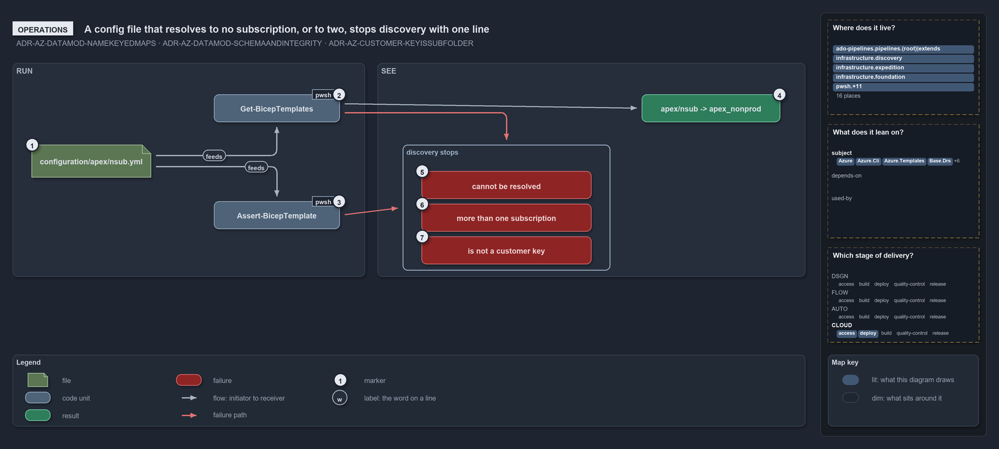

---
catzc:
  edges:
    cites:
      - ADR-AZ-CUSTOMER-KEYISSUBFOLDER
      - ADR-AZ-DATAMOD-NAMEKEYEDMAPS
      - ADR-AZ-DATAMOD-SCHEMAANDINTEGRITY
---

# A config file that resolves to no subscription, or to two, stops discovery with one line

<!-- cspell:ignore exped fnd weu zct -->

```text
A config file that resolves to no subscription, or to two, stops discovery with one line.

1  configuration/apex/nsub.yml  a config a person adds by placing a file in the template's configuration/ tree
2  Get-BicepTemplates           discovery, run on a devbox or in a pipeline; throws on the first bad config
3  Assert-BicepTemplate         the validator a person runs on one template, or all; reports every problem at once
4  apex/nsub -> apex_nonprod    what a good config becomes: a slot with its resolved subscription
5  cannot be resolved           no subscription serves the coordinate's environment
6  more than one subscription   several subscriptions serve it; every config must resolve to exactly one id
7  is not a customer key        the subfolder names no customer of customer.yml

Supports ADR-AZ-DATAMOD-NAMEKEYEDMAPS and ADR-AZ-DATAMOD-SCHEMAANDINTEGRITY, and ADR-AZ-CUSTOMER-KEYISSUBFOLDER (operations lens).
```

Adding a deployment to cats is adding a file: a person places `configuration/apex/nsub.yml` under a template, and nothing else declares it.
What they run next is discovery, directly or through anything that lists templates, or the validator `Assert-BicepTemplate` when they want
every problem at once. A config whose coordinate fits exactly one subscription becomes a slot; one that fits none, or more than one, or sits
in a subfolder that names no customer, stops discovery with a single line that names the file and the reason.

```yml drawio
description:
  "A config file placed under a template is discovered as a slot, or stops discovery with one line naming the file and why: no subscription,
  more than one, or a subfolder that is not a customer key."
about:
  adrs: [ADR-AZ-DATAMOD-NAMEKEYEDMAPS, ADR-AZ-DATAMOD-SCHEMAANDINTEGRITY, ADR-AZ-CUSTOMER-KEYISSUBFOLDER]
  lens: operations
content:
  title: A config file that resolves to no subscription, or to two, stops discovery with one line
  kind: explanation
  flow: left-to-right
  relation: feeds the next step
  theme: dark
  bands:
    - { id: band-run, label: RUN }
    - { id: band-see, label: SEE }
  groups:
    - { id: grp-failures, label: discovery stops, in: band-see }
  glyphs:
    - { id: g-config, kind: file, label: configuration/apex/nsub.yml, in: band-run }
    - { id: g-discovery, kind: code, label: Get-BicepTemplates, in: band-run }
    - { id: g-validator, kind: code, label: Assert-BicepTemplate, in: band-run }
    - { id: r-slot, kind: result, label: apex/nsub -> apex_nonprod, in: band-see }
    - { id: f-unresolved, kind: failure, label: cannot be resolved, in: grp-failures }
    - { id: f-several, kind: failure, label: more than one subscription, in: grp-failures }
    - { id: f-not-customer, kind: failure, label: is not a customer key, in: grp-failures }
  edges:
    - { from: g-config, to: g-discovery, kind: flow, label: "" }
    - { from: g-config, to: g-validator, kind: flow, label: "" }
    - { from: g-discovery, to: r-slot, kind: flow, label: "" }
    - { from: g-discovery, to: grp-failures, kind: fail, label: "" }
    - { from: g-validator, to: grp-failures, kind: fail, label: "" }
  markers:
    - { at: g-config, number: 1 }
    - { at: g-discovery, number: 2 }
    - { at: g-validator, number: 3 }
    - { at: r-slot, number: 4 }
    - { at: f-unresolved, number: 5 }
    - { at: f-several, number: 6 }
    - { at: f-not-customer, number: 7 }
  legend: auto
  minimaps:
    code-locations:
      - cell: ado-pipelines/pipelines/.
        by: [.ado/pipelines/cd-shared.yaml, ADR-AZ-DATAMOD-NAMEKEYEDMAPS, ADR-AZ-DATAMOD-SCHEMAANDINTEGRITY]
      - cell: ado-pipelines/pipelines/extends
        by: [.ado/pipelines/extends/cd-customer.yaml, ADR-AZ-DATAMOD-NAMEKEYEDMAPS, ADR-AZ-DATAMOD-SCHEMAANDINTEGRITY]
      - cell: docs/-/.
        by:
          - docs/drs/azure/azure-customer-model.md
          - docs/drs/azure/azure-data-model.md
          - docs/drs/azure/dora-explains.md
          - docs/drs/index.md
          - docs/references/ado/pipelines/cd-shared.yaml.md
          - docs/references/ado/pipelines/extends/cd-customer.yaml.md
          - docs/references/infrastructure/templates/discovery/options.yml.md
          - docs/references/infrastructure/templates/expedition/options.yml.md
          - docs/references/infrastructure/templates/foundation/options.yml.md
          - docs/references/pwsh/catzc-azure-cli/Assert-AzCliCanAccess.ps1.md
          - docs/references/pwsh/catzc-azure-cli/Assert-AzCliIsConnected.ps1.md
          - docs/references/pwsh/catzc-azure-cli/Test-AzCliCanAccess.ps1.md
          - docs/references/pwsh/catzc-azure-templates/Deploy-Bicep.ps1.md
          - docs/references/pwsh/catzc-azure-templates/Get-AzureBicepEnvironmentKinds.ps1.md
          - docs/references/pwsh/catzc-azure-templates/Get-BicepDeploymentContext.ps1.md
          - docs/references/pwsh/catzc-azure-templates/Get-BicepTemplateConfiguration.ps1.md
          - docs/references/pwsh/catzc-azure-templates/Get-BicepTemplates.ps1.md
          - docs/references/pwsh/catzc-azure-templates/Set-BicepTemplateConfiguration.ps1.md
          - docs/references/pwsh/catzc-azure-templates/private/Get-BicepConfigClassViolations.ps1.md
          - docs/references/pwsh/catzc-azure-templates/private/Get-BicepConfigSubscriptionCandidates.ps1.md
          - docs/references/pwsh/catzc-azure-templates/private/Get-BicepCustomerClassViolations.ps1.md
          - docs/references/pwsh/catzc-azure-templates/private/Get-BicepParametersFileName.ps1.md
          - docs/references/pwsh/catzc-azure-templates/private/Get-BicepSubscriptionConfigViolations.ps1.md
          - docs/references/pwsh/catzc-azure-templates/types/BicepTemplate.cs.md
          - docs/references/pwsh/catzc-azure/Get-AzureCustomers.ps1.md
          - docs/references/pwsh/catzc-azure/Get-AzureSubscription.ps1.md
          - docs/references/pwsh/catzc-azure/Get-AzureSubscriptionEnvironment.ps1.md
          - docs/references/pwsh/catzc-azure/configs/azure.yml.md
          - docs/references/pwsh/catzc-azure/configs/customer.yml.md
          - docs/references/pwsh/catzc-azure/tests/types/AzureConfig.Tests.ps1.md
          - docs/references/pwsh/catzc-azure/types/AzureConfig.cs.md
          - docs/references/pwsh/catzc-azure/types/AzureCustomer.cs.md
          - docs/references/pwsh/catzc-azure/types/AzureEnvironmentRecord.cs.md
          - docs/references/pwsh/catzc-azure/types/AzureSubscriptionRecord.cs.md
          - docs/references/pwsh/catzc-azure/types/AzureTenantRecord.cs.md
          - docs/references/pwsh/catzc-azure/types/CustomerConfig.cs.md
          - docs/references/pwsh/catzc-base-quality-gates/private/Get-MarkdownHeadingFinding.ps1.md
          - docs/references/pwsh/catzc-base-variants/configs/variants.yml.md
          - ADR-AZ-CUSTOMER-KEYISSUBFOLDER
          - ADR-AZ-DATAMOD-NAMEKEYEDMAPS
          - ADR-AZ-DATAMOD-SCHEMAANDINTEGRITY
      - cell: infrastructure/discovery/.
        by: [infrastructure/templates/discovery/options.yml, ADR-AZ-DATAMOD-NAMEKEYEDMAPS, ADR-AZ-DATAMOD-SCHEMAANDINTEGRITY]
      - cell: infrastructure/expedition/.
        by: [infrastructure/templates/expedition/options.yml, ADR-AZ-DATAMOD-NAMEKEYEDMAPS, ADR-AZ-DATAMOD-SCHEMAANDINTEGRITY]
      - cell: infrastructure/foundation/.
        by: [infrastructure/templates/foundation/options.yml, ADR-AZ-DATAMOD-NAMEKEYEDMAPS, ADR-AZ-DATAMOD-SCHEMAANDINTEGRITY]
      - cell: pwsh/Catzc.Azure/.
        by:
          - pwsh/Catzc.Azure/Get-AzureCustomers.ps1
          - pwsh/Catzc.Azure/Get-AzureSubscription.ps1
          - pwsh/Catzc.Azure/Get-AzureSubscriptionEnvironment.ps1
          - ADR-AZ-CUSTOMER-KEYISSUBFOLDER
          - ADR-AZ-DATAMOD-NAMEKEYEDMAPS
          - ADR-AZ-DATAMOD-SCHEMAANDINTEGRITY
      - cell: pwsh/Catzc.Azure/configs
        by:
          - pwsh/Catzc.Azure/configs/azure.yml
          - pwsh/Catzc.Azure/configs/customer.yml
          - ADR-AZ-CUSTOMER-KEYISSUBFOLDER
          - ADR-AZ-DATAMOD-NAMEKEYEDMAPS
          - ADR-AZ-DATAMOD-SCHEMAANDINTEGRITY
      - cell: pwsh/Catzc.Azure/tests/types
        by:
          - pwsh/Catzc.Azure/tests/types/AzureConfig.Tests.ps1
          - ADR-AZ-CUSTOMER-KEYISSUBFOLDER
          - ADR-AZ-DATAMOD-NAMEKEYEDMAPS
          - ADR-AZ-DATAMOD-SCHEMAANDINTEGRITY
      - cell: pwsh/Catzc.Azure/types
        by:
          - pwsh/Catzc.Azure/types/AzureConfig.cs
          - pwsh/Catzc.Azure/types/AzureCustomer.cs
          - pwsh/Catzc.Azure/types/AzureEnvironmentRecord.cs
          - pwsh/Catzc.Azure/types/AzureSubscriptionRecord.cs
          - pwsh/Catzc.Azure/types/AzureTenantRecord.cs
          - pwsh/Catzc.Azure/types/CustomerConfig.cs
          - ADR-AZ-CUSTOMER-KEYISSUBFOLDER
          - ADR-AZ-DATAMOD-NAMEKEYEDMAPS
          - ADR-AZ-DATAMOD-SCHEMAANDINTEGRITY
      - cell: pwsh/Catzc.Azure.Cli/.
        by:
          - pwsh/Catzc.Azure.Cli/Assert-AzCliCanAccess.ps1
          - pwsh/Catzc.Azure.Cli/Assert-AzCliIsConnected.ps1
          - pwsh/Catzc.Azure.Cli/Test-AzCliCanAccess.ps1
          - ADR-AZ-DATAMOD-NAMEKEYEDMAPS
          - ADR-AZ-DATAMOD-SCHEMAANDINTEGRITY
      - cell: pwsh/Catzc.Azure.Templates/.
        by:
          - pwsh/Catzc.Azure.Templates/Deploy-Bicep.ps1
          - pwsh/Catzc.Azure.Templates/Get-AzureBicepEnvironmentKinds.ps1
          - pwsh/Catzc.Azure.Templates/Get-BicepDeploymentContext.ps1
          - pwsh/Catzc.Azure.Templates/Get-BicepTemplateConfiguration.ps1
          - pwsh/Catzc.Azure.Templates/Get-BicepTemplates.ps1
          - pwsh/Catzc.Azure.Templates/Set-BicepTemplateConfiguration.ps1
          - ADR-AZ-CUSTOMER-KEYISSUBFOLDER
          - ADR-AZ-DATAMOD-NAMEKEYEDMAPS
          - ADR-AZ-DATAMOD-SCHEMAANDINTEGRITY
      - cell: pwsh/Catzc.Azure.Templates/private
        by:
          - pwsh/Catzc.Azure.Templates/private/Get-BicepConfigClassViolations.ps1
          - pwsh/Catzc.Azure.Templates/private/Get-BicepConfigSubscriptionCandidates.ps1
          - pwsh/Catzc.Azure.Templates/private/Get-BicepCustomerClassViolations.ps1
          - pwsh/Catzc.Azure.Templates/private/Get-BicepParametersFileName.ps1
          - pwsh/Catzc.Azure.Templates/private/Get-BicepSubscriptionConfigViolations.ps1
          - ADR-AZ-CUSTOMER-KEYISSUBFOLDER
          - ADR-AZ-DATAMOD-NAMEKEYEDMAPS
          - ADR-AZ-DATAMOD-SCHEMAANDINTEGRITY
      - cell: pwsh/Catzc.Azure.Templates/types
        by: [pwsh/Catzc.Azure.Templates/types/BicepTemplate.cs, ADR-AZ-CUSTOMER-KEYISSUBFOLDER]
      - cell: pwsh/Catzc.Base.Drs/configs
        by:
          - pwsh/Catzc.Base.Drs/configs/drs.yml
          - ADR-AZ-CUSTOMER-KEYISSUBFOLDER
          - ADR-AZ-DATAMOD-NAMEKEYEDMAPS
          - ADR-AZ-DATAMOD-SCHEMAANDINTEGRITY
      - cell: pwsh/Catzc.Base.QualityGates/private
        by:
          - pwsh/Catzc.Base.QualityGates/private/Get-MarkdownHeadingFinding.ps1
          - ADR-AZ-DATAMOD-NAMEKEYEDMAPS
          - ADR-AZ-DATAMOD-SCHEMAANDINTEGRITY
      - cell: pwsh/Catzc.Base.Variants/configs
        by: [pwsh/Catzc.Base.Variants/configs/variants.yml, ADR-AZ-CUSTOMER-KEYISSUBFOLDER]
    module-neighbourhood:
      - cell: subject/Catzc.Azure
        by:
          - pwsh/Catzc.Azure/Get-AzureCustomers.ps1
          - pwsh/Catzc.Azure/Get-AzureSubscription.ps1
          - pwsh/Catzc.Azure/Get-AzureSubscriptionEnvironment.ps1
          - pwsh/Catzc.Azure/configs/azure.yml
          - pwsh/Catzc.Azure/configs/customer.yml
          - pwsh/Catzc.Azure/tests/types/AzureConfig.Tests.ps1
          - pwsh/Catzc.Azure/types/AzureConfig.cs
          - pwsh/Catzc.Azure/types/AzureCustomer.cs
          - pwsh/Catzc.Azure/types/AzureEnvironmentRecord.cs
          - pwsh/Catzc.Azure/types/AzureSubscriptionRecord.cs
          - pwsh/Catzc.Azure/types/AzureTenantRecord.cs
          - pwsh/Catzc.Azure/types/CustomerConfig.cs
          - ADR-AZ-CUSTOMER-KEYISSUBFOLDER
          - ADR-AZ-DATAMOD-NAMEKEYEDMAPS
          - ADR-AZ-DATAMOD-SCHEMAANDINTEGRITY
      - cell: subject/Catzc.Azure.Cli
        by:
          - pwsh/Catzc.Azure.Cli/Assert-AzCliCanAccess.ps1
          - pwsh/Catzc.Azure.Cli/Assert-AzCliIsConnected.ps1
          - pwsh/Catzc.Azure.Cli/Test-AzCliCanAccess.ps1
          - ADR-AZ-DATAMOD-NAMEKEYEDMAPS
          - ADR-AZ-DATAMOD-SCHEMAANDINTEGRITY
      - cell: subject/Catzc.Azure.Templates
        by:
          - pwsh/Catzc.Azure.Templates/Deploy-Bicep.ps1
          - pwsh/Catzc.Azure.Templates/Get-AzureBicepEnvironmentKinds.ps1
          - pwsh/Catzc.Azure.Templates/Get-BicepDeploymentContext.ps1
          - pwsh/Catzc.Azure.Templates/Get-BicepTemplateConfiguration.ps1
          - pwsh/Catzc.Azure.Templates/Get-BicepTemplates.ps1
          - pwsh/Catzc.Azure.Templates/Set-BicepTemplateConfiguration.ps1
          - pwsh/Catzc.Azure.Templates/private/Get-BicepConfigClassViolations.ps1
          - pwsh/Catzc.Azure.Templates/private/Get-BicepConfigSubscriptionCandidates.ps1
          - pwsh/Catzc.Azure.Templates/private/Get-BicepCustomerClassViolations.ps1
          - pwsh/Catzc.Azure.Templates/private/Get-BicepParametersFileName.ps1
          - pwsh/Catzc.Azure.Templates/private/Get-BicepSubscriptionConfigViolations.ps1
          - pwsh/Catzc.Azure.Templates/types/BicepTemplate.cs
          - ADR-AZ-CUSTOMER-KEYISSUBFOLDER
          - ADR-AZ-DATAMOD-NAMEKEYEDMAPS
          - ADR-AZ-DATAMOD-SCHEMAANDINTEGRITY
      - cell: subject/Catzc.Base.Drs
        by:
          - pwsh/Catzc.Base.Drs/configs/drs.yml
          - ADR-AZ-CUSTOMER-KEYISSUBFOLDER
          - ADR-AZ-DATAMOD-NAMEKEYEDMAPS
          - ADR-AZ-DATAMOD-SCHEMAANDINTEGRITY
      - cell: subject/Catzc.Base.QualityGates
        by:
          - pwsh/Catzc.Base.QualityGates/private/Get-MarkdownHeadingFinding.ps1
          - ADR-AZ-DATAMOD-NAMEKEYEDMAPS
          - ADR-AZ-DATAMOD-SCHEMAANDINTEGRITY
      - cell: subject/Catzc.Base.Variants
        by: [pwsh/Catzc.Base.Variants/configs/variants.yml, ADR-AZ-CUSTOMER-KEYISSUBFOLDER]
      - cell: subject/discovery
        by: [infrastructure/templates/discovery/options.yml, ADR-AZ-DATAMOD-NAMEKEYEDMAPS, ADR-AZ-DATAMOD-SCHEMAANDINTEGRITY]
      - cell: subject/expedition
        by: [infrastructure/templates/expedition/options.yml, ADR-AZ-DATAMOD-NAMEKEYEDMAPS, ADR-AZ-DATAMOD-SCHEMAANDINTEGRITY]
      - cell: subject/foundation
        by: [infrastructure/templates/foundation/options.yml, ADR-AZ-DATAMOD-NAMEKEYEDMAPS, ADR-AZ-DATAMOD-SCHEMAANDINTEGRITY]
      - cell: subject/pipelines
        by:
          - .ado/pipelines/cd-shared.yaml
          - .ado/pipelines/extends/cd-customer.yaml
          - ADR-AZ-DATAMOD-NAMEKEYEDMAPS
          - ADR-AZ-DATAMOD-SCHEMAANDINTEGRITY
    axis:
      - cell: CLOUD/deploy
        by: [ADR-AZ-CUSTOMER-KEYISSUBFOLDER, ADR-AZ-DATAMOD-NAMEKEYEDMAPS, ADR-AZ-DATAMOD-SCHEMAANDINTEGRITY]
      - cell: CLOUD/access
        by: [ADR-AZ-DATAMOD-NAMEKEYEDMAPS, ADR-AZ-DATAMOD-SCHEMAANDINTEGRITY]
layout:
  band-run: { x: 20, y: 84, w: 560, h: 340 }
  band-see: { x: 600, y: 84, w: 680, h: 340 }
  g-config: { x: 50, y: 214, w: 190, h: 52 }
  g-discovery: { x: 340, y: 134, w: 200, h: 44 }
  g-validator: { x: 340, y: 304, w: 200, h: 44 }
  r-slot: { x: 650, y: 134, w: 220, h: 44 }
  grp-failures: { x: 640, y: 214, w: 330, h: 200 }
  f-unresolved: { x: 670, y: 256, w: 270, h: 44 }
  f-several: { x: 670, y: 308, w: 270, h: 44 }
  f-not-customer: { x: 670, y: 360, w: 270, h: 44 }
```



## Walkthrough

1. **`configuration/apex/nsub.yml`.** The person creates the file under `infrastructure/templates/foundation/configuration/apex/`. The
   subfolder `apex` is the customer and the name `nsub` the environment; there is no slot and no subscription to write anywhere.
2. **`Get-BicepTemplates`.** Discovery runs on the first use of any template command, on a devbox or in a pipeline. It checks every config
   in turn and throws on the first violation, so a bad file makes the whole discovery fail rather than one slot go missing.
3. **`Assert-BicepTemplate`.** The person who wants the full picture runs `Assert-BicepTemplate foundation`, or `Assert-BicepTemplate` for
   every template. It collects each problem as `[<name>] <violation>` and throws them together. The shipped tree is held the same way: an
   integrity test runs `Assert-BicepTemplate` over every shipped template without building it.
4. **`apex/nsub -> apex_nonprod`.** A good config is discovered as the slot `nsub` of `foundation` for customer `apex`, with the resolved
   subscription `apex_nonprod`. At deploy time its resource group is derived from the coordinate: `nsub-weu-zct-fnd-apex-rg`, beside the
   shared platform's `psub-weu-zct-fnd-rg` and the slotted `dev-blu-weu-zct-exped-apex-rg` of the `expedition` template.
5. **Cannot be resolved.**
   `configuration/nova/prod.yml cannot be resolved: customer 'nova' has no subscription serving environment 'prod' (azure.yml)`, and for a
   root file `no non-customer subscription serves environment '<env>'`. Discovery prefixes it with
   `Template 'foundation' has an invalid config:`.
6. **More than one subscription.**
   `<location> resolves to more than one subscription (<a>, <b>) — every config must resolve to exactly one subscription id (azure.yml)`.
   The fix is in `azure.yml`, not in the config: two subscriptions of one coordinate serve the same environment.
7. **Is not a customer key.** `configuration/acme/dev.yml is under configuration/acme/ but 'acme' is not a customer key in customer.yml`,
   continuing `— a configuration subfolder is always a customer key (valid: apex, dusk, flux, nova, volt, warp)`. A filename that is no
   coordinate stops discovery earlier, with
   `Config 'stage-001' has an unknown environment 'stage' (valid: dev, nsub, preprod, prod, psub, test)` or
   `Config 'dev-blue' has a slot 'blue' that is not valid (must be 1-3 lowercase alphanumeric chars)`.

## Why it holds

- Every config's coordinate must resolve to exactly one subscription id, and a configuration subfolder is always a customer key, asserted
  per file at discovery and by integrity tests (ADR-AZ-DATAMOD-NAMEKEYEDMAPS).
- The cross-layer link is enforced at discovery by `Get-BicepTemplates` through the shared `Get-BicepSubscriptionConfigViolations`, which
  `Assert-BicepTemplate` runs too, so the two report the same violations (ADR-AZ-DATAMOD-SCHEMAANDINTEGRITY).
- A subfolder that is not a defined customer key is a discovery error, and the shortcode never names a folder
  (ADR-AZ-CUSTOMER-KEYISSUBFOLDER).

## See also

- [Templating data model](../../drs/azure/azure-data-model.md) — the decision this article explains, with the
  [customer model](../../drs/azure/azure-customer-model.md) it pairs with.
- The other lenses on the same coordinate: [meta](config-path-is-a-coordinate.md), [architecture](two-layers-join-through-one-resolver.md),
  [implementation](coordinate-resolved-file-by-file-at-discovery.md) and [governance](coordinate-rules-and-their-gates.md).
- [The Azure explanations](index.md) · [How to read the diagrams](../index.md#how-to-read-the-diagrams)
