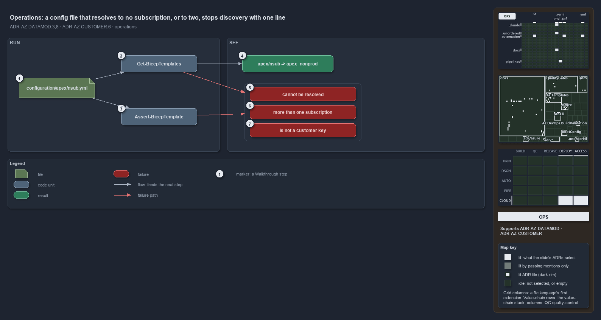

---
catzc:
  immutable:
    repo_status: clean
    path: docs/explanation/azure/a-bad-coordinate-stops-discovery.md
    folder: docs/explanation/azure
    name: a-bad-coordinate-stops-discovery
    filetype: md
    kind: explanation
    language: markdown
    track: docs
    tracktype: documentation
  edges:
    cites:
      - ADR-AZ-CUSTOMER#6
      - ADR-AZ-DATAMOD#{3,8}
    links:
      - docs/adr/azure/azure-customer-model.md
      - docs/adr/azure/azure-data-model.md
      - docs/explanation/.assets/adr-az-datamod--a-bad-coordinate-stops-discovery--operations.drawio.png
      - docs/explanation/azure/a-bad-coordinate-stops-discovery.drawio.md
      - docs/explanation/azure/config-path-is-a-coordinate.md
      - docs/explanation/azure/coordinate-resolved-file-by-file-at-discovery.md
      - docs/explanation/azure/coordinate-rules-and-their-gates.md
      - docs/explanation/azure/index.md
      - docs/explanation/azure/two-layers-join-through-one-resolver.md
      - docs/explanation/index.md#how-to-read-the-diagrams
---

# A config file that resolves to no subscription, or to two, stops discovery with one line

<!-- cspell:ignore exped fnd weu zct -->

```text
A config file that resolves to no subscription, or to two, stops discovery with one line.

1  configuration/apex/nsub.yml  a config a person adds by placing a file in the template's configuration/ tree
2  Get-BicepTemplates           discovery, run on a devbox or in a pipeline; throws on the first bad config
3  Assert-BicepTemplate         the validator a person runs on one template, or all; reports every problem at once
4  apex/nsub -> apex_nonprod    what a good config becomes: a slot with its resolved subscription
5  cannot be resolved           no subscription serves the coordinate's environment
6  more than one subscription   several subscriptions serve it; every config must resolve to exactly one id
7  is not a customer key        the subfolder names no customer of customer.yml

Supports ADR-AZ-DATAMOD#3 and #8, and ADR-AZ-CUSTOMER#6 (operations lens).
```

Adding a deployment to cats is adding a file: a person places `configuration/apex/nsub.yml` under a template, and nothing else declares it.
What they run next is discovery, directly or through anything that lists templates, or the validator `Assert-BicepTemplate` when they want
every problem at once. A config whose coordinate fits exactly one subscription becomes a slot; one that fits none, or more than one, or sits
in a subfolder that names no customer, stops discovery with a single line that names the file and the reason.



The diagram is described element by element in [its asset description](a-bad-coordinate-stops-discovery.drawio.md).

## Walkthrough

1. **`configuration/apex/nsub.yml`.** The person creates the file under `infrastructure/templates/foundation/configuration/apex/`. The
   subfolder `apex` is the customer and the name `nsub` the environment; there is no slot and no subscription to write anywhere.
2. **`Get-BicepTemplates`.** Discovery runs on the first use of any template command, on a devbox or in a pipeline. It checks every config
   in turn and throws on the first violation, so a bad file makes the whole discovery fail rather than one slot go missing.
3. **`Assert-BicepTemplate`.** The person who wants the full picture runs `Assert-BicepTemplate foundation`, or `Assert-BicepTemplate` for
   every template. It collects each problem as `[<name>] <violation>` and throws them together. The shipped tree is held the same way: an
   integrity test runs `Assert-BicepTemplate` over every shipped template without building it.
4. **`apex/nsub -> apex_nonprod`.** A good config is discovered as the slot `nsub` of `foundation` for customer `apex`, with the resolved
   subscription `apex_nonprod`. At deploy time its resource group is derived from the coordinate: `nsub-weu-zct-fnd-apex-rg`, beside the
   shared platform's `psub-weu-zct-fnd-rg` and the slotted `dev-blu-weu-zct-exped-apex-rg` of the `expedition` template.
5. **Cannot be resolved.**
   `configuration/nova/prod.yml cannot be resolved: customer 'nova' has no subscription serving environment 'prod' (azure.yml)`, and for a
   root file `no non-customer subscription serves environment '<env>'`. Discovery prefixes it with
   `Template 'foundation' has an invalid config:`.
6. **More than one subscription.**
   `<location> resolves to more than one subscription (<a>, <b>) — every config must resolve to exactly one subscription id (azure.yml)`.
   The fix is in `azure.yml`, not in the config: two subscriptions of one coordinate serve the same environment.
7. **Is not a customer key.** `configuration/acme/dev.yml is under configuration/acme/ but 'acme' is not a customer key in customer.yml`,
   continuing `— a configuration subfolder is always a customer key (valid: apex, dusk, flux, nova, volt, warp)`. A filename that is no
   coordinate stops discovery earlier, with
   `Config 'stage-001' has an unknown environment 'stage' (valid: dev, nsub, preprod, prod, psub, test)` or
   `Config 'dev-blue' has a slot 'blue' that is not valid (must be 1-3 lowercase alphanumeric chars)`.

## Why it holds

- Every config's coordinate must resolve to exactly one subscription id, and a configuration subfolder is always a customer key, asserted
  per file at discovery and by integrity tests (ADR-AZ-DATAMOD#3).
- The cross-layer link is enforced at discovery by `Get-BicepTemplates` through the shared `Get-BicepSubscriptionConfigViolations`, which
  `Assert-BicepTemplate` runs too, so the two report the same violations (ADR-AZ-DATAMOD#8).
- A subfolder that is not a defined customer key is a discovery error, and the shortcode never names a folder (ADR-AZ-CUSTOMER#6).

## See also

- [Templating data model](../../adr/azure/azure-data-model.md) — the decision this article explains, with the
  [customer model](../../adr/azure/azure-customer-model.md) it pairs with.
- The other lenses on the same coordinate: [meta](config-path-is-a-coordinate.md), [architecture](two-layers-join-through-one-resolver.md),
  [implementation](coordinate-resolved-file-by-file-at-discovery.md) and [governance](coordinate-rules-and-their-gates.md).
- [The Azure explanations](index.md) · [How to read the diagrams](../index.md#how-to-read-the-diagrams)
