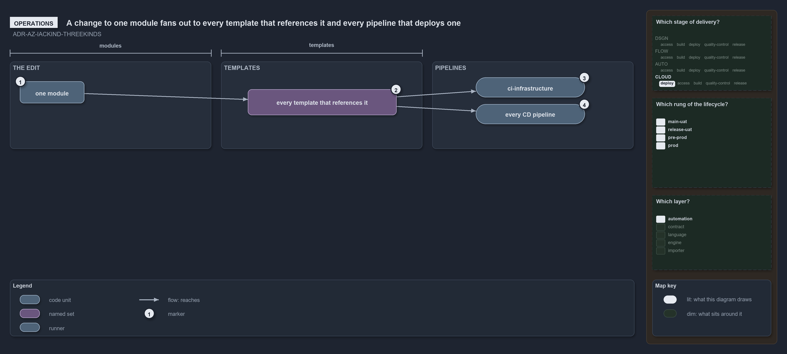

---
catzc:
  edges:
    cites:
      - ADR-AZ-IACKIND-THREEKINDS
---

# A change to one module fans out to every template that references it and every pipeline that deploys one

```text
A change to one module fans out to every template that references it and every pipeline that deploys one.

1  one module                          the edit: one .bicep file in the modules place of the infrastructure track
2  every template that references it   each main.bicep with a module declaration of it, which the build inlines
3  ci-infrastructure                   validates and builds every template on any change under infrastructure/
4  every CD pipeline                   each path filter includes the modules place, so every owner's pipeline runs

Supports ADR-AZ-IACKIND-THREEKINDS (operations lens).
```

A reusable module is the one kind of infrastructure code that never deploys on its own, and that is exactly why a change to it is the widest
change there is. Every template that references the module builds it in, so one edited file reaches every deployment of every one of those
templates, for the shared platform and for every customer. An operator changing a module should expect every pipeline to run.

```yml drawio
description:
  "A change to one reusable module edits one file in the modules place of the infrastructure track and fans out: every template that
  references the module builds it in, the infrastructure CI validates every template, and every CD pipeline runs."
about:
  adrs: [ADR-AZ-IACKIND-THREEKINDS]
  lens: operations
content:
  title: A change to one module fans out to every template that references it and every pipeline that deploys one
  kind: explanation
  flow: left-to-right
  relation: reaches
  theme: dark
  bands:
    - { id: band-modules, label: THE EDIT }
    - { id: band-templates, label: TEMPLATES }
    - { id: band-pipelines, label: PIPELINES }
  spans:
    - id: span-modules
      label: modules
      over: [band-modules]
    - id: span-templates
      label: templates
      over: [band-templates]
  glyphs:
    - { id: g-module, kind: code, label: one module, in: band-modules }
    - { id: s-templates, kind: set, label: every template that references it, in: band-templates }
    - { id: r-ci, kind: runner, label: ci-infrastructure, in: band-pipelines }
    - { id: r-cd, kind: runner, label: every CD pipeline, in: band-pipelines }
  edges:
    - { from: g-module, to: s-templates, kind: flow, label: "" }
    - { from: s-templates, to: r-ci, kind: flow, label: "" }
    - { from: s-templates, to: r-cd, kind: flow, label: "" }
  markers:
    - { at: g-module, number: 1 }
    - { at: s-templates, number: 2 }
    - { at: r-ci, number: 3 }
    - { at: r-cd, number: 4 }
  legend: auto
  minimaps:
    axis:
      - cell: CLOUD/deploy
        by: [ADR-AZ-IACKIND-THREEKINDS]
    lifecycle-position:
      - cell: main-uat
        by: [docs/drs/index.md, pwsh/Catzc.Base.Drs/configs/drs.yml, ADR-AZ-IACKIND-THREEKINDS]
      - cell: release-uat
        by: [docs/drs/index.md, pwsh/Catzc.Base.Drs/configs/drs.yml, ADR-AZ-IACKIND-THREEKINDS]
      - cell: pre-prod
        by: [docs/drs/index.md, pwsh/Catzc.Base.Drs/configs/drs.yml, ADR-AZ-IACKIND-THREEKINDS]
      - cell: prod
        by: [docs/drs/index.md, pwsh/Catzc.Base.Drs/configs/drs.yml, ADR-AZ-IACKIND-THREEKINDS]
    layer-stack:
      - cell: automation
        by:
          - docs/drs/azure/dora-explains.md
          - docs/drs/azure/infrastructure-kinds.md
          - docs/drs/index.md
          - pwsh/Catzc.Base.Drs/configs/drs.yml
          - ADR-AZ-IACKIND-THREEKINDS
layout:
  s-templates: { x: 500, y: 164, w: 300, h: 52 }
  r-ci: { x: 960, y: 140, w: 220, h: 40 }
  r-cd: { x: 960, y: 194, w: 220, h: 40 }
```



## Walkthrough

1. **One module.** The operator edits one `.bicep` file in the track's `modules` place, such as the Log Analytics workspace.
2. **Every template that references it.** A template references a module from its `main.bicep` with a `module` declaration, and the build
   inlines it, so the next build of each referencing template carries the change.
3. **ci-infrastructure.** The infrastructure CI runs on any change under `infrastructure/`, and validates and builds every template, so a
   module that breaks one template fails before the merge.
4. **Every CD pipeline.** Each CD pipeline's path filter includes the modules place, so after the merge the shared pipeline and every
   customer's pipeline run and redeploy their templates.

## Why it holds

- A reusable module is one `.bicep` file used by templates and never deployed alone, and a change to it reaches every template that uses it
  (ADR-AZ-IACKIND-THREEKINDS).

## See also

- [Infrastructure code is of three kinds](three-kinds-of-infrastructure-code.md) — the three kinds and their places.
- [Changing one configuration slot](change-one-configuration-slot.md) — the narrowest change, for contrast.
- [The Azure explanations](index.md) · [How to read the diagrams](../index.md#how-to-read-the-diagrams)
