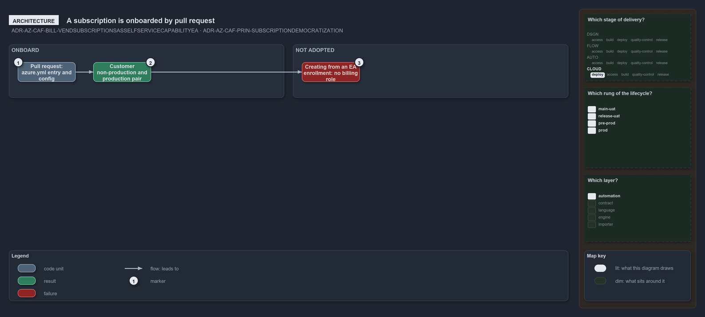

---
catzc:
  warning: "Experimental: this article merges two rules into one and holds nothing beyond what they say"
  edges:
    cites:
      - ADR-AZ-CAF-BILL-VENDSUBSCRIPTIONSASSELFSERVICECAPABILITYEA
      - ADR-AZ-CAF-PRIN-SUBSCRIPTIONDEMOCRATIZATION
---

# A subscription is onboarded by pull request and creating it from ea is not adopted

This article is one rule:
[ADR-AZ-CAF-BILL-VENDSUBSCRIPTIONSASSELFSERVICECAPABILITYEA](../../drs/azure/caf/billing-and-tenant.md#rule-adr-az-caf-bill-vendsubscriptionsasselfservicecapabilityea)
and [ADR-AZ-CAF-PRIN-SUBSCRIPTIONDEMOCRATIZATION](../../drs/azure/caf/design-principles.md#rule-adr-az-caf-prin-subscriptiondemocratization)
merged into one. It holds nothing beyond what those two rules say.

A subscription is onboarded by pull request, partly realising vending as self-service: each customer holds its own non-production and
production subscription pair declared in `azure.yml`, and a new subscription's landing zone is a config file reviewed as a pull request.
Creating a subscription from an Enterprise Agreement enrollment is not adopted, because the repository holds no billing role.

