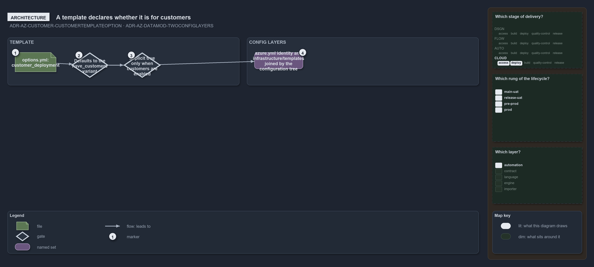

---
catzc:
  warning: "Experimental: this article merges two rules into one and holds nothing beyond what they say"
  edges:
    cites:
      - ADR-AZ-CUSTOMER-CUSTOMERTEMPLATEOPTION
      - ADR-AZ-DATAMOD-TWOCONFIGLAYERS
---

# A template declares whether it is customer template and two config layers join at tree

This article is one rule:
[ADR-AZ-CUSTOMER-CUSTOMERTEMPLATEOPTION](../../drs/azure/azure-customer-model.md#rule-adr-az-customer-customertemplateoption) and
[ADR-AZ-DATAMOD-TWOCONFIGLAYERS](../../drs/azure/azure-data-model.md#rule-adr-az-datamod-twoconfiglayers) merged into one. It holds nothing
beyond what those two rules say.

A template declares whether it is a customer template with an `options.yml` `customer_deployment` bit, which defaults to the
`have_customers` variant, and an explicit `true` is only permitted when customers are enabled. This meets the two config layers, identity in
`azure.yml` and templating in `infrastructure/templates/`, which join through the conventional configuration tree: a config at the root is a
shared-platform deployment and one under `configuration/<customer>/` is that customer's.

