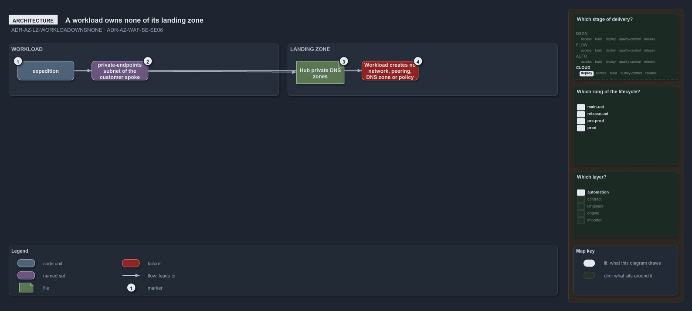

---
catzc:
  warning: "Experimental: this article merges two rules into one and holds nothing beyond what they say"
  edges:
    cites:
      - ADR-AZ-LZ-WORKLOADOWNSNONE
      - ADR-AZ-WAF-SE-SE06
---

# A workload lands in its landing zone and owns none of it

This article is one rule: [ADR-AZ-LZ-WORKLOADOWNSNONE](../../drs/azure/landing-zones.md#rule-adr-az-lz-workloadownsnone) and
[ADR-AZ-WAF-SE-SE06](../../drs/azure/waf/security.md#rule-adr-az-waf-se-se06) merged into one. It holds nothing beyond what those two rules
say.

A workload lands in its landing zone and owns none of it: `expedition` places its private endpoints in the `private-endpoints` subnet of its
customer's spoke, the shared platform's in the hub's `shared-services` subnet, and registers them in the hub's private DNS zones, creating
no network, peering, DNS zone or policy. Data services have public network access off and are reached only through those private endpoints.

