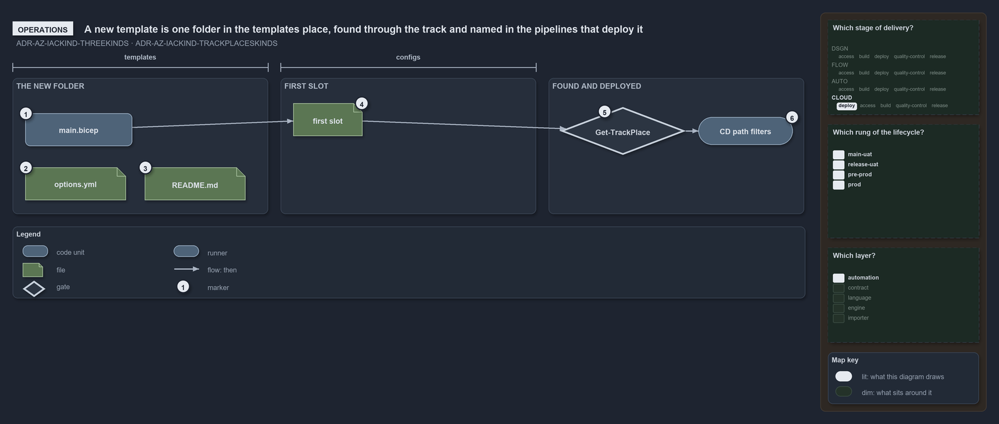

# A new template is one folder in the templates place, found through the track and named in the pipelines that deploy it

```text
A new template is one folder in the templates place, found through the track and named in the pipelines that deploy it.

1  main.bicep        the new template's deployable entry, referencing the modules it needs
2  options.yml       the template's own settings
3  README.md         what the template deploys
4  first slot        one <env>[-<slot>].yml in the template's configuration folder: its first deployment
5  Get-TrackPlace    how the tooling finds the new folder: through the track's templates place, never a path in code
6  CD path filters   the pipelines name each template's folder, so the new one is added there before it deploys

Supports ADR-AZ-IACKIND-THREEKINDS and ADR-AZ-IACKIND-TRACKPLACESKINDS (operations lens).
```

A template is the unit that deploys, so adding one is adding a folder: the folder's name is the template's name, and its files are the same
for every template. Nothing in the tooling lists the templates; it finds the new folder through the infrastructure track. What does list
them is the pipelines' path filters, so the last step of adding a template is naming it there.



## Walkthrough

1. **main.bicep.** The new folder under the track's `templates` place holds the deployable `main.bicep`, which references the reusable
   modules it needs.
2. **options.yml.** The template's own settings sit beside it. The template's short name is derived from the folder name unless this file
   overrides it.
3. **README.md.** Every template folder carries a README that says what it deploys.
4. **First slot.** A template deploys nothing until its configuration folder holds a slot: one `<env>[-<slot>].yml` per resource group, at
   the root for the shared platform or under a customer subfolder.
5. **Get-TrackPlace.** The tooling finds templates through `Get-TrackPlace -Track infrastructure -TrackKind templates`, so the new folder is
   discovered without any code change.
6. **CD path filters.** Each CD pipeline's trigger names every template's folder and its configuration slots, so the new template is added
   to the filters of the pipelines that should deploy it.

## Why it holds

- An IaC template is a folder holding a deployable `main.bicep` and its `options.yml`, and every infrastructure file is of one kind
  (ADR-AZ-IACKIND-THREEKINDS).
- The tooling finds a kind only through `Get-TrackPlace`, never through a path written in code, so a new template needs no tooling change
  (ADR-AZ-IACKIND-TRACKPLACESKINDS).

## See also

- [Infrastructure code is of three kinds](three-kinds-of-infrastructure-code.md) — the three kinds and their places.
- [Add a configuration slot](add-an-environment-slot.md) — the next deployment of an existing template.
- [The Azure explanations](index.md) · [How to read the diagrams](../index.md#how-to-read-the-diagrams)
