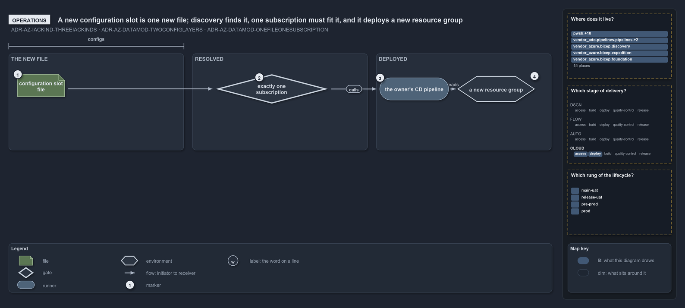

---
catzc:
  edges:
    cites:
      - ADR-AZ-DATAMOD-TWOCONFIGLAYERS
      - ADR-AZ-DATAMOD-ONEFILEONESUBSCRIPTION
      - ADR-AZ-IACKIND-THREEKINDS
---

# A new configuration slot is one new file; discovery finds it, one subscription must fit it, and it deploys a new resource group

```text
A new configuration slot is one new file; discovery finds it, one subscription must fit it, and it deploys a new resource group.

1  configuration slot file    one <env>[-<slot>].yml added to a template's configuration folder
2  exactly one subscription   the check at discovery that the file's coordinate resolves to one subscription
3  the owner's CD pipeline    the shared pipeline for a root slot, the customer's for a slot under its subfolder
4  a new resource group       the one group the new configuration slot deploys, its name derived from the coordinate

Supports ADR-AZ-IACKIND-THREEKINDS, ADR-AZ-DATAMOD-TWOCONFIGLAYERS and ADR-AZ-DATAMOD-ONEFILEONESUBSCRIPTION (operations lens).
```

A new deployment of an existing template is a new file and nothing more. Slots are discovered from disk, never listed, so no catalogue
changes and no pipeline is edited: the file's place says whose deployment it is and which environment, and cats checks before deploying that
exactly one subscription serves it.

```yml drawio
description:
  Adding a configuration slot adds one file to the configs place of the infrastructure track; discovery finds it on disk, checks that its
  coordinate resolves to exactly one subscription, and the owner's CD pipeline deploys it into a new resource group.
about:
  adrs: [ADR-AZ-IACKIND-THREEKINDS, ADR-AZ-DATAMOD-TWOCONFIGLAYERS, ADR-AZ-DATAMOD-ONEFILEONESUBSCRIPTION]
  lens: operations
content:
  title: A new configuration slot is one new file; discovery finds it, one subscription must fit it, and it deploys a new resource group
  kind: explanation
  flow: left-to-right
  relation: then
  theme: dark
  bands:
    - { id: band-edit, label: THE NEW FILE }
    - { id: band-resolved, label: RESOLVED }
    - { id: band-deployed, label: DEPLOYED }
  spans:
    - id: span-configs
      label: configs
      over: [band-edit]
  glyphs:
    - { id: g-slot, kind: file, label: configuration slot file, in: band-edit }
    - { id: g-one, kind: gate, label: exactly one subscription, in: band-resolved }
    - { id: r-owner, kind: runner, label: the owner's CD pipeline, in: band-deployed }
    - { id: e-group, kind: env, label: a new resource group, in: band-deployed }
  edges:
    - { from: g-slot, to: g-one, kind: flow, label: "" }
    - { from: g-one, to: r-owner, kind: flow, label: "" }
    - { from: r-owner, to: e-group, kind: flow, label: "" }
  markers:
    - { at: g-slot, number: 1 }
    - { at: g-one, number: 2 }
    - { at: r-owner, number: 3 }
    - { at: e-group, number: 4 }
  legend: auto
  minimaps:
    axis:
      - cell: CLOUD/deploy
        by: [ADR-AZ-DATAMOD-ONEFILEONESUBSCRIPTION, ADR-AZ-DATAMOD-TWOCONFIGLAYERS, ADR-AZ-IACKIND-THREEKINDS]
      - cell: CLOUD/access
        by: [ADR-AZ-DATAMOD-ONEFILEONESUBSCRIPTION, ADR-AZ-DATAMOD-TWOCONFIGLAYERS]
    lifecycle-position:
      - cell: main-uat
        by:
          - docs/drs/index.md
          - pwsh/Catzc.Base.Drs/configs/drs.yml
          - ADR-AZ-DATAMOD-ONEFILEONESUBSCRIPTION
          - ADR-AZ-DATAMOD-TWOCONFIGLAYERS
          - ADR-AZ-IACKIND-THREEKINDS
      - cell: release-uat
        by:
          - docs/drs/index.md
          - pwsh/Catzc.Base.Drs/configs/drs.yml
          - ADR-AZ-DATAMOD-ONEFILEONESUBSCRIPTION
          - ADR-AZ-DATAMOD-TWOCONFIGLAYERS
          - ADR-AZ-IACKIND-THREEKINDS
      - cell: pre-prod
        by:
          - docs/drs/index.md
          - pwsh/Catzc.Base.Drs/configs/drs.yml
          - ADR-AZ-DATAMOD-ONEFILEONESUBSCRIPTION
          - ADR-AZ-DATAMOD-TWOCONFIGLAYERS
          - ADR-AZ-IACKIND-THREEKINDS
      - cell: prod
        by:
          - docs/drs/index.md
          - pwsh/Catzc.Base.Drs/configs/drs.yml
          - ADR-AZ-DATAMOD-ONEFILEONESUBSCRIPTION
          - ADR-AZ-DATAMOD-TWOCONFIGLAYERS
          - ADR-AZ-IACKIND-THREEKINDS
    layer-stack:
      - cell: automation
        by:
          - .ado/pipelines/cd-shared.yaml
          - .ado/pipelines/extends/cd-customer.yaml
          - docs/drs/azure/azure-data-model.md
          - docs/drs/azure/dora-explains.md
          - docs/drs/azure/infrastructure-kinds.md
          - docs/drs/glossary.md
          - docs/drs/index.md
          - docs/references/ado/pipelines/cd-shared.yaml.md
          - docs/references/ado/pipelines/extends/cd-customer.yaml.md
          - docs/references/infrastructure/templates/discovery/options.yml.md
          - docs/references/infrastructure/templates/expedition/options.yml.md
          - docs/references/infrastructure/templates/foundation/options.yml.md
          - docs/references/pwsh/catzc-azure-cli/Assert-AzCliCanAccess.ps1.md
          - docs/references/pwsh/catzc-azure-cli/Assert-AzCliIsConnected.ps1.md
          - docs/references/pwsh/catzc-azure-cli/Test-AzCliCanAccess.ps1.md
          - docs/references/pwsh/catzc-azure-templates/Deploy-Bicep.ps1.md
          - docs/references/pwsh/catzc-azure-templates/Get-AzureBicepEnvironmentKinds.ps1.md
          - docs/references/pwsh/catzc-azure-templates/Get-BicepDeploymentContext.ps1.md
          - docs/references/pwsh/catzc-azure-templates/Get-BicepTemplateConfiguration.ps1.md
          - docs/references/pwsh/catzc-azure-templates/Get-BicepTemplates.ps1.md
          - docs/references/pwsh/catzc-azure-templates/Set-BicepTemplateConfiguration.ps1.md
          - docs/references/pwsh/catzc-azure-templates/private/Get-BicepConfigName.ps1.md
          - docs/references/pwsh/catzc-azure-templates/private/Get-BicepConfigSubscriptionCandidates.ps1.md
          - docs/references/pwsh/catzc-azure-templates/private/Get-BicepParametersFileName.ps1.md
          - docs/references/pwsh/catzc-azure-templates/private/Resolve-BicepConfigName.ps1.md
          - docs/references/pwsh/catzc-azure/Get-AzureSubscriptionEnvironment.ps1.md
          - docs/references/pwsh/catzc-azure/configs/azure.yml.md
          - docs/references/pwsh/catzc-azure/tests/types/AzureConfig.Tests.ps1.md
          - docs/references/pwsh/catzc-azure/types/AzureConfig.cs.md
          - docs/references/pwsh/catzc-azure/types/AzureEnvironmentRecord.cs.md
          - docs/references/pwsh/catzc-azure/types/AzureSubscriptionRecord.cs.md
          - docs/references/pwsh/catzc-azure/types/AzureTenantRecord.cs.md
          - docs/references/pwsh/catzc-base-quality-gates/private/Get-MarkdownHeadingFinding.ps1.md
          - infrastructure/templates/discovery/options.yml
          - infrastructure/templates/expedition/options.yml
          - infrastructure/templates/foundation/options.yml
          - pwsh/Catzc.Azure.Cli/Assert-AzCliCanAccess.ps1
          - pwsh/Catzc.Azure.Cli/Assert-AzCliIsConnected.ps1
          - pwsh/Catzc.Azure.Cli/Test-AzCliCanAccess.ps1
          - pwsh/Catzc.Azure.Templates/Deploy-Bicep.ps1
          - pwsh/Catzc.Azure.Templates/Get-AzureBicepEnvironmentKinds.ps1
          - pwsh/Catzc.Azure.Templates/Get-BicepDeploymentContext.ps1
          - pwsh/Catzc.Azure.Templates/Get-BicepTemplateConfiguration.ps1
          - pwsh/Catzc.Azure.Templates/Get-BicepTemplates.ps1
          - pwsh/Catzc.Azure.Templates/Set-BicepTemplateConfiguration.ps1
          - pwsh/Catzc.Azure.Templates/configs/glossary.yml
          - pwsh/Catzc.Azure.Templates/private/Get-BicepConfigName.ps1
          - pwsh/Catzc.Azure.Templates/private/Get-BicepConfigSubscriptionCandidates.ps1
          - pwsh/Catzc.Azure.Templates/private/Get-BicepParametersFileName.ps1
          - pwsh/Catzc.Azure.Templates/private/Resolve-BicepConfigName.ps1
          - pwsh/Catzc.Azure/Get-AzureSubscriptionEnvironment.ps1
          - pwsh/Catzc.Azure/configs/azure.yml
          - pwsh/Catzc.Azure/tests/types/AzureConfig.Tests.ps1
          - pwsh/Catzc.Azure/types/AzureConfig.cs
          - pwsh/Catzc.Azure/types/AzureEnvironmentRecord.cs
          - pwsh/Catzc.Azure/types/AzureSubscriptionRecord.cs
          - pwsh/Catzc.Azure/types/AzureTenantRecord.cs
          - pwsh/Catzc.Base.Drs/configs/drs-index.yml
          - pwsh/Catzc.Base.Drs/configs/drs.yml
          - pwsh/Catzc.Base.QualityGates/private/Get-MarkdownHeadingFinding.ps1
          - ADR-AZ-DATAMOD-ONEFILEONESUBSCRIPTION
          - ADR-AZ-DATAMOD-TWOCONFIGLAYERS
          - ADR-AZ-IACKIND-THREEKINDS
layout:
  g-one: { x: 500, y: 156, w: 260, h: 68 }
  r-owner: { x: 880, y: 164, w: 160, h: 52 }
  e-group: { x: 1060, y: 160, w: 180, h: 60 }
```



## Walkthrough

1. **Configuration slot file.** The operator adds `configuration/[<customer>/]<env>[-<slot>].yml` under the template, in the track's
   `configs` place. A root file is a deployment of the shared platform; a file under a customer subfolder is that customer's.
2. **Exactly one subscription.** Discovery reads the new file and matches its coordinate against the subscriptions that serve the
   environment. Zero or several matches stop discovery, so a slot that fits no subscription never reaches a pipeline.
3. **The owner's CD pipeline.** The owner's pipeline already includes its slots in its path filter, so the merge that adds the file runs it.
4. **A new resource group.** The slot is one resource group, and the namer derives its name from the coordinate, so nobody types it.

## Why it holds

- A configuration slot is one of the three kinds of infrastructure code (ADR-AZ-IACKIND-THREEKINDS).
- A config at the configuration root is the shared platform's and one under a customer subfolder is that customer's, and the subscription is
  resolved from that coordinate (ADR-AZ-DATAMOD-TWOCONFIGLAYERS).
- One config file is one (customer?, env, slot), one subscription and one Azure resource group (ADR-AZ-DATAMOD-ONEFILEONESUBSCRIPTION).

## See also

- [Infrastructure code is of three kinds](three-kinds-of-infrastructure-code.md) — the three kinds and their places.
- [A config file's path is a coordinate](config-path-is-a-coordinate.md) — how the coordinate resolves to one subscription.
- [The Azure explanations](index.md) · [How to read the diagrams](../index.md#how-to-read-the-diagrams)
